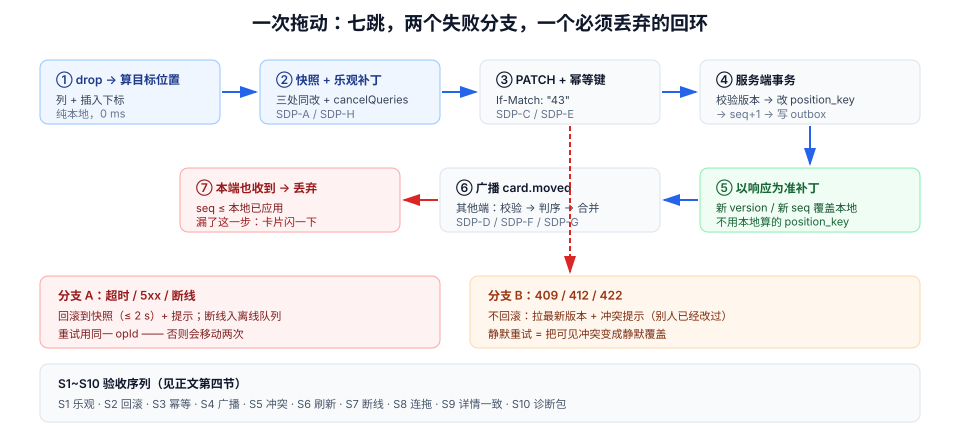

# 实战：看板一次拖动的完整状态流

这个实战只做一件事：把一张卡片从「待办」拖到「进行中」，并保证**四件事同时成立**——松手立刻生效、失败能弹回、别人也在看时两端收敛、刷新后状态还在。它覆盖了本专题前七页的全部判据，也是 [在线协作任务看板](/project/Complete/TeamBoard/index.md) 第 3 周联调的真实场景。

场景取自多租户协作看板：5 列、每列 12 张卡、两台设备同时打开、服务端用 WebSocket 广播事件。

## 判据族声明

本页判据族 `SDP-A` ~ `SDP-H`，共 8 条。定义表在第八节。

## 本页不讲什么

- 不讲租户隔离与权限矩阵的施工，归 [TeamBoard · 多租户](/project/Complete/TeamBoard/MultiTenancy/index.md)。
- 不讲 `position_key` 可比较字符串的实现细节，归 [TeamBoard · 卡片拖动](/project/Complete/TeamBoard/CardMove/index.md)。
- 不讲拖拽手势与动画，归 [微交互与动效工程](/docs/Frontend/Motion/index.md)。



## 一、范围与数据契约

### 接口

```http
GET  /api/boards/{boardId}/cards
→ 200 { "cards": [...], "seq": 118, "serverTime": "2026-10-19T05:12:31Z" }

PATCH /api/cards/{cardId}/move
If-Match: "43"
Idempotency-Key: 1f0c...（每次用户操作一个，重试复用）
→ 200 { "card": {...}, "seq": 119 }
→ 409 版本冲突（body 带 current 实体）
→ 412 前置条件失败（同上）
→ 422 目标列不可用（如已归档）
```

三个字段决定了整个链路：

| 字段 | 作用 | 少了会怎样 |
| --- | --- | --- |
| `seq` | 服务端事件的单调序号，用于判序与断线补拉 | 乱序时状态倒退，重连后不知道从哪补 |
| 实体 `version`（`ETag`） | 并发写控制 | 两人同时改，后者静默覆盖 |
| `Idempotency-Key` | 重试去重 | 超时重试产生两次移动（审计日志两条） |

### 本地状态分层

| 层 | 内容 | 存哪 | 生命周期 |
| --- | --- | --- | --- |
| 远端态 | `cards`（归一化实体表 + 每列 id 数组）、`seq` | 查询缓存 `["board", id, "cards"]` | 页面级，`gcTime` 5 分钟 |
| 客户端态 | `draggingId`、`hoverColumnId`、`selectedId` | 轻量 store | 组件/会话级 |
| URL 态 | `?tab=active&q=设计` | 路由 query | 可分享 |
| 表单态 | 卡片标题编辑中的草稿 | 组件本地 | 提交即弃 |

`draggingId` **不放进查询缓存**：它是纯 UI 状态，进缓存会导致「刷新后仍然显示正在拖动」。

## 二、七跳链路

```text
① drop 事件 → 计算目标位置（本地）
② 快照 + 应用乐观补丁（缓存）
③ 发 PATCH（带 version 与幂等键）
④ 服务端事务：校验 version → 改 position_key → seq+1 → 写 outbox
⑤ 响应回来：以响应为准补丁（含新 version 与新 seq）
⑥ 广播 card.moved(seq) → 其他端落地
⑦ 本端也收到广播 → 判序后丢弃（因为 seq 已应用）
```

第 ⑦ 跳是最容易被漏掉的一环：**本端也会收到自己触发的广播**。如果没有判序，就会出现「卡片闪一下」——补丁应用两次，中间还可能插进一次重渲染。

### ② 应用补丁

```ts
// 归一化结构下的移动：三处必须同时改
function applyMove(state: BoardState, move: { cardId: string; toColumn: string; toIndex: number }) {
  const card = state.cards[move.cardId];
  if (!card) return state;
  const from = state.columns[card.columnId];
  const to = state.columns[move.toColumn];
  return {
    ...state,
    cards: { ...state.cards, [move.cardId]: { ...card, columnId: move.toColumn } },
    columns: {
      ...state.columns,
      [card.columnId]: { ...from, cardIds: from.cardIds.filter((id) => id !== move.cardId) },
      [move.toColumn]: {
        ...to,
        cardIds: [...to.cardIds.slice(0, move.toIndex), move.cardId, ...to.cardIds.slice(move.toIndex)],
      },
    },
  };
}
```

三处（`cards[id].columnId`、源列 `cardIds`、目标列 `cardIds`）如果只改两处，就会出现「卡片在目标列显示，但详情页仍显示旧列」——因为详情页读的是 `cards[id].columnId`。

### ③ 请求与 ④ 服务端

```ts
async function moveCard(input: MoveInput) {
  const res = await fetch(`/api/cards/${input.cardId}/move`, {
    method: "PATCH",
    headers: {
      "Content-Type": "application/json",
      "If-Match": `"${input.version}"`,
      "Idempotency-Key": input.opId,
    },
    body: JSON.stringify({ toColumn: input.toColumn, toIndex: input.toIndex }),
  });
  if (res.status === 409 || res.status === 412) {
    throw new ConflictError(await res.json()); // 交给上层展示冲突
  }
  if (!res.ok) throw new Error(`move failed: ${res.status}`);
  return res.json();
}
```

服务端事务里的四步（`SELECT ... FOR UPDATE` 校验版本 → 更新 `position_key` → `seq = seq + 1` → 写 outbox）保证了「一格事件对应一次真实变更」。

### ⑤ 以响应为准

```ts
onSuccess: (data) => {
  queryClient.setQueryData(keys.cards(boardId), (prev) => ({
    ...prev,
    seq: data.seq,
    cards: { ...prev.cards, [data.card.id]: data.card },  // 服务端才是真相
  }));
}
```

乐观补丁里本地算的 `position_key` 通常与服务端不同（服务端会在相邻两条之间取中值并可能重排）。**必须以响应覆盖**，否则下一次拖动会基于错误的 `position_key` 计算，导致顺序错乱。

### ⑥⑦ 广播落地

```ts
socket.on("card.moved", (evt: { seq: number; cardId: string; toColumn: string; toIndex: number }) => {
  const state = queryClient.getQueryData(keys.cards(boardId));
  if (!state) return;
  if (evt.seq <= state.seq) return;   // ⑦ 判序：自己触发的、重复的，一律丢
  queryClient.setQueryData(keys.cards(boardId), applyMove({ ...state, seq: evt.seq }, evt));
});
```

## 三、失败分支与用户可见行为

| 失败 | 前端动作 | 用户看到 | 不该做 |
| --- | --- | --- | --- |
| 网络超时 | 重试 1 次（同 `opId`），仍失败则回滚 | 卡片弹回 + 「保存失败，点此重试」 | 自动重试 3 次（错误窗口 8 秒） |
| `409` / `412` | 不回滚，拉最新版本，弹冲突提示 | 卡片停在原位 + 「该卡片已被他人移动」+「查看最新」 | 用本地值强行覆盖 |
| `422`（目标列归档） | 回滚 + 刷新列元数据 | 卡片弹回 + 「目标列已归档」 | 静默回滚不提示 |
| 断线 | 乐观应用 + 入离线队列 | 卡片停在新位置 + 顶部「离线，恢复后自动同步」 | 直接回滚（用户会以为操作丢了） |
| 服务端 5xx | 回滚 + 提示重试 | 同超时 | 重试到底（会把故障放大） |

::: danger 这一层最容易写错的两处
1. **`409` 也走回滚**：冲突不是「你的操作失败」，而是「你基于的数据旧了」。直接回滚会让用户以为自己的拖动无效，而实际上目标位置是合法的——正确做法是提示后让用户决定是否重试。
2. **离线时不入队**：断网时直接回滚，用户看到卡片弹回，会再拖一次；恢复网络后两次都成功，出现重复移动。
:::

## 四、S1~S10 验收序列

十步全部可在本地跑（浏览器 + 一台第二设备/第二个浏览器窗口）。每步给出**操作、期望、判读**。

| 序号 | 操作 | 期望 | 判读（不通过说明什么） |
| --- | --- | --- | --- |
| **S1** | 打开看板，Network 限速 Fast 3G，拖动一张卡片 | ≤ 100 ms 内停在新位置（不等网络） | 卡顿/等请求返回 = 不是乐观更新 |
| **S2** | 切 Offline，拖同一张卡片 | ≤ 2 s 内弹回 + 失败提示（`role="alert"`） | 停在原位 = 缺回滚；> 8 s = 沿用默认重试 |
| **S3** | 恢复网络，重做 S2 的操作 | 成功，且**只有一次**移动（服务端审计一条） | 两条 = 缺幂等键或键每次重生成 |
| **S4** | 双窗口打开同一看板，在 A 拖动 | B ≤ 1 s 内同步；A 不闪 | B 不动 = 没订阅；A 闪 = 自己触发的广播没判序 |
| **S5** | 双窗口同时拖**同一张**卡片到不同列 | 后提交者看到「已被他人移动」，不静默覆盖 | 都成功 = 缺版本校验 |
| **S6** | 在 A 拖动后立刻刷新 B | B 刷新后位置正确，且无重复条目 | 错乱 = `seq` 未持久化/判序用了 `>=` |
| **S7** | A 断网 30 s，期间在 B 移动 3 张卡，A 恢复 | A 补齐 3 处变化，顺序正确 | 少数据 = 无补拉；顺序错 = 补拉没走落地四步 |
| **S8** | 连续快速拖动同一张卡 3 次 | 最终位置 = 第 3 次目标；无回跳 | 回跳 = 没 `cancelQueries`；位置错 = 用本地 `position_key` 未以响应为准 |
| **S9** | 拖动后立刻点进卡片详情 | 详情显示新列，不是旧列 | 旧列 = `cards[id].columnId` 没一起更新 |
| **S10** | 连拖 10 次后看诊断包体积 | ≤ 2 MB，且日志可排出完整因果链 | 超限 = 每步存了全量快照 |

::: tip S1 与 S8 的区别
S1 验证「乐观」，S8 验证「并发下的乐观」。前者关掉网络也能过，后者必须快速连点——因为它的失效条件是「两个补丁基于同一个快照」。这正是 `cancelQueries` 存在的理由。
:::

## 五、性能与体积预算

| 指标 | 预算 | 实测/推算 | 备注 |
| --- | --- | --- | --- |
| 拖动响应（本地补丁应用） | ≤ 16 ms（一帧） | 60 张卡的归一化移动为 O(1) 查表 + 两次数组复制 | 若做整树 `map`，5 列 × 12 卡约 0.3 ms，仍在预算内；上万卡才会超 |
| 广播下行体积 | ≤ 500 B | 事件体约 120~180 B | 不要广播整张卡片（13 KiB 级） |
| 单次拖动请求数 | 1 | PATCH 1 次 | 若还有一次列表重取，说明失效范围过大 |
| 诊断包体积 | ≤ 2 MB | 10 分钟会话约 80 KiB | 见 [状态可观测](../Observability/index.md) |

## 六、与其他专题的对齐

| 主题 | 本页落点 | 那边讲什么 |
| --- | --- | --- |
| 幂等键 | 每次拖动生成 `opId`，重试复用 | 服务端的键表、TTL、去重窗口：[幂等键](/docs/Backend/IdempotencyStateMachine/IdempotencyKey/index.md) |
| 版本冲突 | `If-Match` + `409` 提示 | 服务端事务与版本列：[TeamBoard · 领域核心](/project/Complete/TeamBoard/DomainCore/index.md) |
| 事件序号 | 判序、补拉、`truncated` | 服务端 `seq` 分配与 outbox：[同步协议](/docs/Backend/RealtimeCollaboration/SyncProtocol/index.md) |
| 归一化 | `cards` 实体表 + `cardIds` 顺序 | 通用取舍：[派生状态与归一化](../DerivedState/index.md) |

## 七、判据表

| 编号 | 规则 | 违反时的样子 | 怎么验证 |
| --- | --- | --- | --- |
| `SDP-A` | 拖动本地生效不等网络 | 松手后卡片悬停等请求 | S1 |
| `SDP-B` | 乐观写入有快照，失败 ≤ 2 s 回滚 | 失败后停在假位置 | S2 |
| `SDP-C` | 幂等键按「用户操作」生成，重试复用 | 重试后出现两次移动 | S3 |
| `SDP-D` | 广播落地前判序，自己触发的事件丢弃 | 卡片闪一下、位置抖动 | S4 |
| `SDP-E` | 写请求带版本，冲突可见不静默 | 双端同时拖，后者覆盖前者 | S5 |
| `SDP-F` | `seq` 持久化，刷新不重复应用 | 刷新后顺序错乱 | S6 |
| `SDP-G` | 断线补拉处理 `truncated`，顺序正确 | 断网后少数据或顺序错 | S7 |
| `SDP-H` | 归一化三处同改，且以响应为准 | 详情页显示旧列 / 位置漂移 | S8、S9 |

## 八、验证命令

```shell
# SDP-C：审计日志里同一 opId 只能有一条成功记录
grep "card.move" app.log | jq -r 'select(.op_id!=null) | .op_id' | sort | uniq -c | sort -rn | head
# 期望：每行计数为 1；出现 2 说明幂等没生效

# SDP-D：同一 seq 的广播事件在本端应被丢弃（前端日志）
# 控制台导出状态日志后统计 drop 原因
grep '"op":"drop"' state-log.json | jq -r '.reason' | sort | uniq -c
# 期望：出现 "seq<=local" 若干条（自己触发的回环），且没有 "seq<=local" 之外的重复应用

# SDP-H：卡片在详情页的列与列表中一致（接口层比对）
curl -s localhost:8080/api/cards/card_7 | jq '.card.columnId, .card.version'
curl -s "localhost:8080/api/boards/1/cards" | jq '.cards[] | select(.id=="card_7") | .columnId'
# 期望：两处 columnId 相同
```

::: warning 本页没有「本机实测」的端到端读数
S1~S10 需要可运行的前后端工程，本仓库只沉淀文档、不提交工程代码。因此本页的**验收序列是读者可执行的步骤**，不是本机跑出的结果；表里的「预算」列是设计目标，不是实测值。已在其他页面标为实测的数字（请求数、深比较耗时、快照体积、冲突率）来自 Node 22.22.2 的独立模拟，不依赖本项目的服务端。
:::

## 参考资料

- [TanStack Query v5 · Optimistic Updates](https://tanstack.com/query/v5/docs/react/guides/optimistic-updates)——`onMutate` 与回滚
- [RFC 9110 · If-Match](https://www.rfc-editor.org/rfc/rfc9110.html#name-if-match)——`409` 与 `412` 的分工
- [RFC 6902 · JSON Patch](https://www.rfc-editor.org/rfc/rfc6902.html)——差量事件的标准表达
- [MDN · BroadcastChannel](https://developer.mozilla.org/docs/Web/API/BroadcastChannel)——多标签页同步
- 相邻：[乐观更新](../OptimisticUpdate/index.md) · [多端同步与收敛](../RealtimeSync/index.md) · [TeamBoard · 卡片拖动](/project/Complete/TeamBoard/CardMove/index.md)
