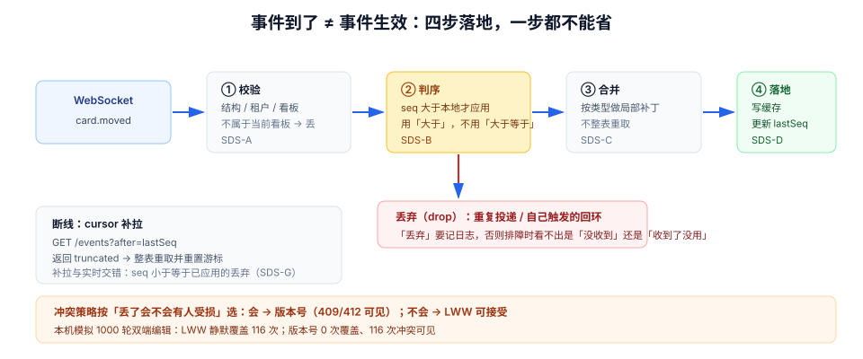

# 多端同步与收敛：推送到了之后

服务端把事件推到了浏览器，剩下的活才刚开始。一条 `card.moved` 事件要经过**校验、判序、合并、落地**四步才算真正生效；跳过任何一步，都会出现「明明推了但界面不对」或者「推了两次卡片闪两下」。

本页只讲**客户端落地这一侧**：收到事件之后怎么把它安全地写进本地状态，以及两台设备、两个标签页之间怎么收敛到同一个结果。

## 判据族声明

本页判据族 `SDS-A` ~ `SDS-H`，共 8 条。定义表在第六节。

## 本页不讲什么

- 不讲 WebSocket 握手、心跳、`seq` 在服务端怎么分配，归 [实时协作 · 同步协议](/docs/Backend/RealtimeCollaboration/SyncProtocol/index.md)。
- 不讲在线状态（presence）的设计，归 [实时协作 · 在线状态](/docs/Backend/RealtimeCollaboration/Presence/index.md)。
- 不讲离线队列的发送顺序，归 [乐观更新](../OptimisticUpdate/index.md)。
- 不讲 CRDT 的数学性质，本页只给「什么时候值得上」的判断。



## 一、落地四步

| 步骤 | 做什么 | 漏掉的后果 |
| --- | --- | --- |
| **① 校验** | 事件结构、租户/看板归属、权限范围 | 别的事件写进当前看板；越权数据泄漏到界面 |
| **② 判序** | 与本地版本比较，旧事件丢弃 | 乱序到达时状态倒退，卡片位置抖动 |
| **③ 合并** | 按事件类型做局部更新（不改整棵树） | 整表替换导致滚动位置丢失、选中态丢失 |
| **④ 落地** | 写缓存 + 记录最新版本 + 必要时持久化 | 下次重连时不知道自己已经到哪，重复应用 |

### ① 校验：为什么必须做租户归属判断

推送通道常常是「按用户」或「按连接」订阅的，而**一个用户可能同时属于多个租户/工作区**。服务端如果按用户推，客户端就会收到不属于当前看板的事件。

```ts
function accept(evt: BoardEvent, ctx: { boardId: string; tenantId: string }) {
  if (evt.tenantId !== ctx.tenantId) return false;   // 租户不符
  if (evt.boardId !== ctx.boardId) return false;     // 不是当前看板
  if (evt.seq <= getLastSeq(ctx.boardId)) return false; // ② 判序
  return true;
}
```

这三行看起来是「防御性代码」，实际是**功能代码**：没有它，打开两个看板就会互相串事件。而这在单人测试时几乎不会暴露。

### ② 判序：`seq` 只在「同一聚合」内可比

`seq` 的语义必须是**同一看板内单调递增**。跨看板比较没有意义（两个看板的 `seq` 各自从 1 开始）。所以本地要按聚合维度记版本：

```ts
const lastSeq = new Map<string, number>(); // boardId → 已应用的最大 seq
```

::: danger 判序的三个常见错法
1. **用时间戳判序**：客户端时钟不可信，两台设备差 30 秒就会互相覆盖。时间戳只能做「展示」，不能做「判序」。
2. **用 `>=` 而不是 `>`**：重复投递（至少一次语义）会带着同一个 `seq` 再来一次，`>=` 会把它当新事件重复应用——表现为「卡片闪一下」或「计数加两次」。
3. **把 `seq` 记在组件里**：组件卸载就丢了，重连后从 0 开始，历史事件会被重新应用一遍。
:::

### ③ 合并：局部更新，不要整表替换

```ts
// 反例：收到事件就整表重取
socket.on("card.moved", () => queryClient.invalidateQueries({ queryKey: keys.list(boardId) }));

// 正例：按事件类型做最小补丁，必要时才失效聚合
socket.on("card.moved", (evt) => {
  queryClient.setQueryData(keys.list(evt.boardId), (prev) => applyMove(prev, evt));
});
```

整表重取有四个代价：一次往返、列表闪动、滚动位置重置（如果 key 变化）、以及**在重取完成前收到的后续事件会基于旧数据计算**。

### ④ 落地：把「已到哪」也存下来

`lastSeq` 要么进内存 + `sessionStorage`（刷新不丢，换标签页不共享），要么进 `localStorage`（跨标签页共享，但要处理并发写）。判据很简单：**刷新页面后不应该重新应用已经应用过的事件**。

## 二、冲突：四种策略与它们的代价

两端同时改同一条数据，必须有明确的裁决规则。四种常见策略：

| 策略 | 规则 | 优点 | 代价 | 适用 |
| --- | --- | --- | --- | --- |
| **LWW**（最后写入者赢） | 比较时间戳/到达顺序，后者覆盖 | 实现最简单 | **静默丢数据**，且丢得无声无息 | 低价值字段（最后浏览时间、草稿位置） |
| **版本号 / `If-Match`** | 版本不符则拒绝（409/412） | 不丢数据，冲突可见 | 需要用户重试或手工合并 | 结构化字段（标题、状态、负责人） |
| **字段级合并** | 不同字段各自比较版本 | 减少无谓冲突 | 实现复杂，需要字段级版本 | 大表单（两个人分别改描述和标签） |
| **CRDT / OT** | 数据结构本身可交换合并 | 无需裁决，天然收敛 | 复杂度高，存储膨胀，调试困难 | 富文本协同、白板、光标 |

本机模拟（Node 22.22.2，固定种子，1000 轮，两个客户端读时刻在 0~400 ms 内均匀分布）：

| 策略 | 静默覆盖 | 冲突被感知 | 无冲突 |
| --- | --- | --- | --- |
| LWW | **116 次** | 0 次 | 884 次 |
| 版本号 | 0 次 | 116 次 | 884 次 |

11.6% 的写会撞车。这个数字说明：**「冲突是罕见情况」这个假设在协作产品里是错的**——每十次编辑就有一次以上发生在别人的旧版本上。

::: tip 怎么选
先问「丢了会不会有人受损」：会 → 版本号；不会 → LWW 也可以。再问「冲突频率」：高 → 字段级合并或 CRDT；低 → 版本号足够。**不要因为「CRDT 很先进」就上 CRDT**——它的调试成本通常高于它省下的冲突处理代码。
:::

### 版本号冲突的前端处理

```ts
// 409/412：不要静默重试，要让用户决定
onError: (err, vars) => {
  if (isConflict(err)) {
    // 1) 拉取最新版本，展示差异
    // 2) 提供「用我的覆盖」/「放弃我的修改」两个动作
    openConflictDialog({ mine: vars, latest: err.body.current });
  }
}
```

「自动重试」在冲突场景是**有害**的：它会把用户的修改强行盖到别人的修改上，等于把「可见冲突」变成「静默覆盖」。

## 三、断线追平：cursor 与补拉

推送必然断（切网、休眠、服务端重启）。重连后要做三件事：

1. **带 cursor 补拉**：`GET /events?after=<lastSeq>`，把断线期间的事件按序取回，逐条走「落地四步」。
2. **判断「补拉是否够用」**：服务端通常只保留有限窗口（如最近 7 天 / 最近 10 万个事件）。超出窗口时不能补拉，必须**整表重取**。
3. **重置本地版本**：整表重取后用响应里的 `seq` 覆盖 `lastSeq`，否则之后的事件会被误判为「旧的」而丢弃。

```ts
async function resync(boardId: string, lastSeq: number) {
  const res = await api.events(boardId, { after: lastSeq, limit: 500 });
  if (res.truncated) {
    // 超出保留窗口：整表重取，并用返回的 seq 重置游标
    const snapshot = await api.board(boardId);
    queryClient.setQueryData(keys.list(boardId), snapshot.cards);
    setLastSeq(boardId, snapshot.seq);
    return;
  }
  for (const evt of res.events) applyEvent(evt);
  setLastSeq(boardId, res.events.at(-1)?.seq ?? lastSeq);
}
```

::: danger 追平里最容易错的两处
1. **补拉与实时推送的交错**：补拉请求在途时，新事件可能已经到了。若新事件的 `seq` 大于补拉结果的最后一条，直接应用；若小于等于，说明补拉已经包含了它，必须丢弃。没有这条规则就会出现「同一条事件应用两次」。
2. **`truncated` 被忽略**：服务端返回「只给了一部分」时，若按普通补拉处理，客户端会永远缺一段历史，而界面上看不出任何异常——直到用户发现某张卡片「不见了」。
:::

## 四、多标签页：一条连接比 N 条好

用户开了 5 个标签页，每个都连 WebSocket，就是 5 条连接、5 份状态、5 次重连。更好的做法是**选一个 leader 保持连接**，其余标签页通过 `BroadcastChannel` 收事件。

| 方案 | 连接数 | 复杂度 | 风险 |
| --- | --- | --- | --- |
| 每个标签页各连 | N | 低 | 服务端连接数放大；同一事件被处理 N 次（各自更新各自的缓存，其实没问题） |
| leader 连接 + 广播 | 1 | 中 | leader 关闭时要重新选举；消息格式要版本化 |
| 共享 Worker | 1 | 高 | 需要 Worker 环境；调试不便 |

对中小型应用，「每个标签页各连」是可接受的——真正的成本在服务端连接数上限，而不是前端。**但如果服务端按连接数计费或限流，就必须做 leader 选举**。

leader 选举的简易做法：用 `navigator.locks.request('ws-leader', ...)` 抢一把锁，抢到的标签页负责连接，锁释放时自动重新选举。这比手写心跳 + 时间戳要可靠得多。

## 五、重连风暴：退避与抖动

服务端重启时，所有客户端同时断开、同时重连。没有抖动（jitter）的指数退避，会让重连请求在同一毫秒到达，把刚起来的服务再打垮一次。

```ts
function backoff(attempt: number) {
  const base = Math.min(1000 * 2 ** attempt, 30_000); // 1s, 2s, 4s ... 上限 30s
  return base * (0.5 + Math.random() * 0.5);          // 抖动：50%~100%
}
```

三条纪律：① **上限必须存在**（否则第 10 次是 1024 秒）；② **抖动比例不低于 30%**；③ **重连成功要重置计数器**，否则一次抖动之后每次重连都要等 30 秒。

## 六、判据表

| 编号 | 规则 | 违反时的样子 | 怎么验证 |
| --- | --- | --- | --- |
| `SDS-A` | 事件落地前校验租户与聚合归属 | 开两个看板互相串事件 | 同时打开两个看板，改 A 的数据，B 的界面不得变化 |
| `SDS-B` | 用聚合内单调 `seq` 判序，且用 `>` 而非 `>=` | 重复投递导致卡片闪动/计数翻倍 | 手动重放同一事件，界面状态不变 |
| `SDS-C` | 落地用局部补丁，不整表重取 | 每次事件列表都闪、滚动位置丢失 | 收到事件时 Network 无新请求，滚动位置不变 |
| `SDS-D` | `lastSeq` 持久化，刷新不重复应用 | 刷新后状态错乱（事件被应用两次） | 记录 seq → 刷新 → 检查无重复应用 |
| `SDS-E` | 冲突策略与数据价值匹配，且冲突可见 | 两人同时改，后者无声覆盖前者 | 双端同时编辑，后者必须看到冲突提示 |
| `SDS-F` | 断线后用 cursor 补拉，处理 `truncated` | 断网一段时间后少了几条数据 | 断网 30 s 再恢复，界面与服务端一致 |
| `SDS-G` | 补拉与实时事件交错有去重规则 | 同一条事件应用两次 | 慢速网络下断线重连，审计日志无重复条目 |
| `SDS-H` | 重连有指数退避 + 抖动 + 上限 | 服务端重启后被重连风暴打垮 | 服务端日志中重连请求不集中在同一毫秒 |

## 验证方式

`SDS-A` / `SDS-B` / `SDS-F` 的验证不依赖特殊工具，用两个浏览器窗口即可：

```text
SDS-A：窗口 1 打开看板 A，窗口 2 打开同一租户的看板 B
  在 A 里拖动卡片
  期望：B 的界面完全不变（B 只应收到属于自己看板的事件）
  判读：B 出现变化 = 落地前没校验 boardId / tenantId

SDS-B：在控制台手动触发同一事件两次
  socket.dispatchEvent(new MessageEvent('message', { data: JSON.stringify(lastEvent) }))
  期望：界面状态不变、计数不翻倍
  判读：卡片闪动或计数 +2 = 判序用了 >= 或没判序

SDS-F：DevTools → Network → Offline 30 秒 → 恢复
  期望：期间服务端的改动全部出现，且没有重复
  判读：少数据 = 没补拉；顺序错乱 = 补拉没走「落地四步」
```

服务端侧的可观测判据（配合后端日志）：

```shell
# SDS-H：统计重连时间分布，看是否集中在同一秒
# 服务端日志中提取 reconnect 时间戳，按秒聚合计数
grep "reconnect" app.log | awk '{print $1" "$2}' | cut -c1-19 | sort | uniq -c | sort -rn | head -3
# 期望：单秒内重连数远小于总连接数；若某秒集中了几百条，说明缺抖动
```

## 参考资料

- [MDN · WebSocket](https://developer.mozilla.org/docs/Web/API/WebSocket)——重连需要自己实现
- [MDN · BroadcastChannel](https://developer.mozilla.org/docs/Web/API/BroadcastChannel)——多标签页广播
- [MDN · Web Locks API](https://developer.mozilla.org/docs/Web/API/Web_Locks_API)——leader 选举
- [RFC 6455 · The WebSocket Protocol](https://www.rfc-editor.org/rfc/rfc6455.html)——帧与关闭码
- 相邻：[实时协作 · 同步协议](/docs/Backend/RealtimeCollaboration/SyncProtocol/index.md) · [缓存失效](../CacheInvalidation/index.md) · [状态可观测](../Observability/index.md)
