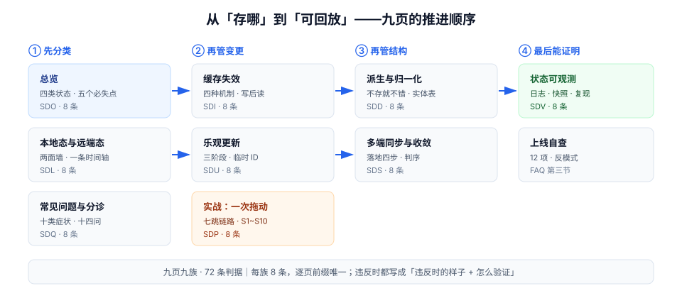

# 状态管理与数据流

前端最难的三件事不是「怎么把数据放进 store」，而是**这份数据该放在哪、什么时候作废、改坏了怎么退回去**。前者是选型（Pinia、Zustand、Redux、Context），后两者是工程：几乎每一次「页面显示的是旧数据」「两个人同时改冲突了」「刷新一下就好了」的线上问题，都能落在这两条上。

本专题讲的是**状态与数据流的工程层**：状态怎么分类、边界画在哪、缓存怎么失效、乐观更新怎么回滚、多端怎么收敛、出了问题怎么观测。具体某个库的 API 用法不在这里——它们在框架专题的 [React 状态管理](/docs/Frontend/Frame/React/StateManagement/index.md)、[Pinia 进阶](/docs/Frontend/Frame/Vue/Vue3/PiniaAdvanced/index.md) 与 [Next 状态管理](/docs/Frontend/Frame/Next/StateManagement/index.md)。

::: tip 一句话理解
状态管理的本质不是「存」，而是**给每一份数据指定一个唯一的所有者和一个明确的作废条件**；没有所有者的数据，一定会有两份；没有作废条件的数据，一定会显示旧的。
:::

## 与相邻专题的分工

「状态管理」这四个字在库里被至少十个专题从不同角度讲过，边界必须先写死，否则读者会以为本专题在重复造轮子。

| 专题 | 讲什么 | 与本专题的关系 |
| --- | --- | --- |
| 本专题 | **状态分类与归属、远端态缓存与失效、乐观更新与回滚、派生与归一化、多端收敛、状态可观测** | —— |
| [React 状态管理](/docs/Frontend/Frame/React/StateManagement/index.md) | Context、Zustand、Redux Toolkit、TanStack Query 的**用法与选型** | 那边回答「这个库怎么用」，本专题回答「**为什么这份数据不该进 store、进了以后谁会看到旧值**」 |
| [Pinia 进阶](/docs/Frontend/Frame/Vue/Vue3/PiniaAdvanced/index.md) | Setup Store、插件、持久化、跨 Store 协作 | 那边的 `storeToRefs` 与订阅是**实现手段**；本专题的 [派生状态](./DerivedState/index.md) 讲的是「哪些值根本不该被存」 |
| [Next 状态管理](/docs/Frontend/Frame/Next/StateManagement/index.md) | RSC 边界下的 Context / Zustand / Jotai 组合 | 那边解决「服务端组件拿不到 Context」；本专题的 [本地态与远端态](./LocalRemote/index.md) 给出**同一份数据跨越 RSC 边界时的归属判据** |
| [Angular 状态管理](/docs/Frontend/Frame/Angular/StateManagement/index.md) | RxJS、Signal、NgRx | 那边是可观察流的具体写法；本专题的「数据流」讲**方向与依赖**，与框架无关 |
| [浏览器原理 · 存储与事件循环](/docs/Frontend/Basic/Browser/index.md) | localStorage、IndexedDB、事件循环、`storage` 事件 | 那边是**平台能力**；本专题的 [多端同步](./RealtimeSync/index.md) 只讲怎么用这些能力把两台设备收敛到同一个状态 |
| [实时协作 · 同步协议](/docs/Backend/RealtimeCollaboration/SyncProtocol/index.md) | WebSocket 协议、`seq`、断线追平、背压 | 那边是**服务端协议**；本专题讲**客户端收到推送之后怎么落到本地状态**（合并、去重、乱序、回滚） |
| [分布式缓存](/docs/Backend/DistributedCache/index.md) | 缓存穿透/击穿/雪崩、Redis 一致性 | 那边是服务端缓存；本专题的 [缓存失效](./CacheInvalidation/index.md) 是**浏览器内的同一类问题**，很多判据可以直接搬 |
| [幂等与状态机](/docs/Backend/IdempotencyStateMachine/IdempotencyKey/index.md) | 幂等键、状态机、重复提交 | 乐观更新必然产生重试，**没有幂等键的乐观更新是不可回滚的**，本专题引用那边的判据而不重复推导 |
| [前端性能优化](/docs/Frontend/Others/PerformanceOptimization/index.md) | 首屏、打包体积、运行时开销 | 那边看**毫秒**；本专题看**请求数与一致性**，两者的指标会打架（例如「多取一次换正确」） |
| [在线协作任务看板](/project/Complete/TeamBoard/index.md) | 真实项目里的多租户看板：实时网关、乐观拖动、跨端一致性 | 那边是**施工记录**，本专题是**判据**；[实战](./Practice/index.md) 与该项目逐条对齐，不重复讲鉴权与租户隔离 |

## 专题地图

| 页面 | 内容 | 适合谁读 |
| --- | --- | --- |
| [总览：四类状态与五个必失点](./Overview/index.md) | 远端态 / 客户端态 / URL 态 / 表单态的划分；单向数据流真正约束的是什么；五个「不报错但显示错」的失效 | 所有人，先读 |
| [本地态与远端态](./LocalRemote/index.md) | 归属判据、两面墙（重复与失联）、`staleTime` / `gcTime` 的真实语义、分页与详情页的共享 | 天天写列表页的人，**重点读** |
| [缓存失效](./CacheInvalidation/index.md) | 四种失效方式、失效风暴、写后读、跨页面与跨标签页广播、`ETag` 与版本号 | 做写操作的人，**必读** |
| [乐观更新](./OptimisticUpdate/index.md) | 三阶段与回滚快照、临时 ID 的映射、重试与错误窗口、离线队列、什么场景不该乐观 | 做交互密集页面的人，**必读** |
| [派生状态与归一化](./DerivedState/index.md) | 派生 vs 存储、选择器与记忆化、归一化实体表、状态机替代布尔组合 | 维护大 store 的人，**重点读** |
| [多端同步与收敛](./RealtimeSync/index.md) | 推送落地四步、乱序与去重、LWW 与版本号、CRDT 的适用边界、断线追平 | 做实时协作的人 |
| [状态可观测](./Observability/index.md) | 变更日志、状态快照、埋点口径、复现三件套、回归断言 | 要排「偶现」问题的人，**重点读** |
| [实战：看板拖动的状态流](./Practice/index.md) | 从一次拖动到两台设备收敛的完整链路：契约、实现、S1~S10 验收 | 要照着做的人 |
| [常见问题与分诊](./FAQ/index.md) | 十类症状分诊表、十四问、上线自查、术语表 | 所有人 |

## 四条底层判断（先记住这四句）

| 判断 | 含义 | 违反它的典型后果 |
| --- | --- | --- |
| **一份数据只有一个所有者** | 远端数据的所有者是服务端，本地只持有**副本 + 时间戳**；本地数据的所有者是当前会话 | 同一份列表既进 store 又进查询缓存，两边各自刷新，页面在两者之间闪烁 |
| **失效是写操作的一部分** | 写成功只完成一半，另一半是「让所有读到过旧值的地方知道它旧了」 | 保存成功、提示成功、列表还是旧值，用户再点一次保存 |
| **乐观不是「先改 UI」** | 乐观 = 本地先应用 + 保存可回滚的快照 + 明确回滚条件 | 失败后 UI 停在乐观值，刷新才恢复，用户以为改成功了 |
| **不可观测的状态等于不存在** | 没有变更日志与快照，就只能靠「再点一次试试」排障 | 偶现问题无法复现，最后归因为「网络问题」 |

## 成熟度五档

状态管理最容易停在「能跑」：数据能显示、能提交，就再没人动过。按下面五档对照，只补当前档位的下一件事：

| 档位 | 特征 | 下一件事 |
| --- | --- | --- |
| **L0 各自为政** | 每个组件自己 `fetch` + `useState`，没有缓存 | 先把远端态收进一个查询层（TanStack Query / SWR / Pinia Colada 任一） |
| **L1 有缓存** | 有统一查询层，但 `staleTime` 全默认 0，切页面就打请求 | 按数据变化频率给 `staleTime` 分档（见 [本地态与远端态](./LocalRemote/index.md)） |
| **L2 有失效** | 写操作后会失效相关 key，跨页面能看到新值 | 补跨标签页广播与写后读判据（见 [缓存失效](./CacheInvalidation/index.md)） |
| **L3 有回滚** | 乐观更新有快照与回滚，失败会提示并复原 | 补临时 ID 映射与重试幂等，避免重复创建（见 [乐观更新](./OptimisticUpdate/index.md)） |
| **L4 可观测** | 有变更日志、快照导出、可复现步骤，回归有断言 | 把「偶现问题」变成可回放的用例（见 [状态可观测](./Observability/index.md)） |

::: warning 不要跳档
直接从 L1 跳到 L4 的团队，通常会先写一套「状态埋点」，但因为 `staleTime` 仍是 0，日志里全是无意义的重复请求；反过来，L2 都没做好就上乐观更新，等于把「显示旧值」升级成「显示错的且用户以为是新的」。
:::

## 判据族总览

九页各一族，共 72 条。每条都写成「违反时的样子 + 怎么验证」，可以直接抄进 PR 检查清单。

| 页面 | 判据族 | 覆盖的约定 | 条数 |
| --- | --- | --- | --- |
| [总览](./Overview/index.md) | `SDO-A` ~ `SDO-H` | 状态四分类、单向流、五个必失点 | 8 |
| [本地态与远端态](./LocalRemote/index.md) | `SDL-A` ~ `SDL-H` | 归属判据、两面墙、时间戳语义 | 8 |
| [缓存失效](./CacheInvalidation/index.md) | `SDI-A` ~ `SDI-H` | 四种失效、风暴、写后读、跨标签页 | 8 |
| [乐观更新](./OptimisticUpdate/index.md) | `SDU-A` ~ `SDU-H` | 快照、临时 ID、错误窗口、离线队列 | 8 |
| [派生状态与归一化](./DerivedState/index.md) | `SDD-A` ~ `SDD-H` | 派生边界、记忆化、实体表、状态机 | 8 |
| [多端同步与收敛](./RealtimeSync/index.md) | `SDS-A` ~ `SDS-H` | 落地四步、乱序、冲突策略、追平 | 8 |
| [状态可观测](./Observability/index.md) | `SDV-A` ~ `SDV-H` | 变更日志、快照、口径、复现 | 8 |
| [实战](./Practice/index.md) | `SDP-A` ~ `SDP-H` | 端到端链路与验收 | 8 |
| [常见问题](./FAQ/index.md) | `SDQ-A` ~ `SDQ-H` | 分诊、自查、反模式 | 8 |

## 版本速览（2026-10 联网核对）

| 工具 | 当前稳定版 | 与本专题相关的关键事实 |
| --- | --- | --- |
| React | 19.2.8 | `useOptimistic` / `useActionState` 内置在 `react` 包；`useSyncExternalStore` 是第三方 store 的接入点 |
| TanStack Query | 5.101.4 | `staleTime` 默认 **0**、`gcTime` 默认 **5 min**、`retry` 默认 **3**（退避 1s/2s/4s，上限 30s）；v5 起 `cacheTime` 更名 `gcTime`，新增 `staleTime: 'static'`（连 `invalidateQueries` 都不触发） |
| SWR | 2.5.1 | `dedupingInterval` 默认 **2000 ms**（按时间窗去重，不是按在途请求）、`focusThrottleInterval` 5000 ms |
| Zustand | 5.0.15 | v5 起 peer 要求 React ≥ 18，改用原生 `useSyncExternalStore`；`useShallow` 走 `zustand/react/shallow` |
| Pinia | 4.0.3 | 4.0 起 **仅 ESM**，`@vue/devtools-api` 成为**必装 peer**；peer 要求 `vue ^3.5.11` |
| Vue | 3.5.41（3.6 仍在 RC） | `shallowRef` / `markRaw` 是避免大对象被深度代理的主要手段 |

::: info 为什么给版本号
本专题的判据几乎都与**默认值**有关：`staleTime: 0` 是「切页面就打请求」的根因，`dedupingInterval: 2000` 是「两个库请求数差一倍」的根因。默认值随版本变，抄结论前先回来看这张表。
:::

## 为什么不建版本目录

`Spring5/Spring6` 那种按大版本分目录的做法，前提是「旧版本的写法在新版本里跑不起来」。状态管理不是这样：

1. **判据与库版本无关**：「一份数据只有一个所有者」「失效是写操作的一部分」在 React 18 与 19、Pinia 3 与 4 上都成立。
2. **API 更名不影响工程结论**：`cacheTime` → `gcTime`、`keepPreviousData` → `placeholderData` 是写法差异，语义没变，用一节迁移提示就够。
3. **建两套目录会让判据族重复**，而判据族是全局唯一的，重复就意味着撞号。

所以本专题**单目录 + 页内版本说明**，与 [全文检索与搜索工程](/docs/DB/FullTextSearch/index.md) 的处理一致。

## 三条一开始就会踩的坑

::: danger 这三条几乎每个项目都踩过
1. **把远端数据复制进本地 store**：`useEffect` 里 `fetch` 完写进 Zustand，于是「刷新」有两套逻辑（store 的和查询层的），必然有一天两边不一致。正确做法是**远端态只存在查询层**，本地 store 只放 UI 偏好。
2. **用 `useEffect` 同步两个状态**：`useEffect(() => setB(a), [a])` 会多渲染一轮，并且在 React 18 并发特性下可能出现撕裂。正确做法是**能派生就不存**（见 [派生状态](./DerivedState/index.md)）。
3. **乐观更新只改 UI 不改快照**：失败时不知道「改回什么」，只能重新拉一次列表，用户在原地看到内容闪一下。正确做法是**先存快照再改**，回滚就是把快照写回去。
:::

## 学习路径

1. 先读 [总览](./Overview/index.md)，把「四类状态」和「五个必失点」对上自己项目的症状。
2. 有列表页/详情页的人读 [本地态与远端态](./LocalRemote/index.md)，把 `staleTime` 从默认 0 按频率分档。
3. 有写操作的人读 [缓存失效](./CacheInvalidation/index.md)，给每个写接口配一条失效断言。
4. 交互密集的项目读 [乐观更新](./OptimisticUpdate/index.md)，先补快照与临时 ID，再谈动画。
5. 要排偶现问题的人直接读 [状态可观测](./Observability/index.md) 的「复现三件套」。

## 参考资料

- [TanStack Query v5 · Important Defaults](https://tanstack.com/query/v5/docs/react/guides/important-defaults)——`staleTime` / `gcTime` / `retry` / `structuralSharing` 的默认值
- [TanStack Query v5 · Optimistic Updates](https://tanstack.com/query/v5/docs/react/guides/optimistic-updates)——两种乐观更新写法与回滚
- [SWR · 配置项](https://swr.vercel.app/docs/api)——`dedupingInterval`、`focusThrottleInterval`
- [React · useOptimistic](https://react.dev/reference/react/useOptimistic)——并发渲染下的乐观状态
- [Pinia 官方文档](https://pinia.vuejs.org/)——4.x 的 ESM 与 peer 变化
- [RFC 9111 · HTTP Caching](https://www.rfc-editor.org/rfc/rfc9111.html)——`no-cache` / `must-revalidate` / `stale-while-revalidate` 的准确含义
- [RFC 9110 · Conditional Requests](https://www.rfc-editor.org/rfc/rfc9110.html#name-conditional-requests)——`ETag` / `If-Match` / 412
- 相邻：[React 状态管理](/docs/Frontend/Frame/React/StateManagement/index.md) · [Pinia 进阶](/docs/Frontend/Frame/Vue/Vue3/PiniaAdvanced/index.md) · [实时协作 · 同步协议](/docs/Backend/RealtimeCollaboration/SyncProtocol/index.md)
