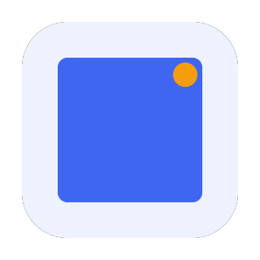

# 前端测试

「前端测试」专题系统讲解 Web 前端项目的自动化测试体系：从单元测试（Jest / Vitest）、组件测试（Testing Library / Vue Test Utils）、端到端测试（Playwright / Cypress）到覆盖率统计与测试策略，帮助你把「测试」从口号变成 CI 里可执行的门禁。

## 目录

- [测试体系概述与选型](Overview/index.md)
- [Jest 单元测试](Jest/index.md)
- [Vitest 单元测试](Vitest/index.md)
- [组件测试：Testing Library 与 Vue Test Utils](ComponentTesting/index.md)
- [E2E 测试：Playwright 与 Cypress](E2E/index.md)
- [覆盖率统计与门禁](Coverage/index.md)
- [测试策略与 CI 集成](Strategy/index.md)
- [常见问题与最佳实践](FAQ/index.md)

## 相关专题

- [前端工程化](../Others/FrontendEngineering/index.md)：测试是工程化的一环，配合代码规范与 CI 使用
- [JavaScript 测试](../Basic/JavaScript/Testing/index.md)：语言层面的测试基础概念
- [React 测试](../Frame/React/Testing/index.md)、[Vue3](../Frame/Vue/Vue3/index.md)：框架专属测试实践

## 相关专题与分工

- [Selenium 端到端测试](../../Tools/TestingTools/Selenium/index.md)：本专题讲**前端的单元/组件测试与 Playwright E2E**，加上前端侧的覆盖率门禁与 CI 接法；该页讲 **Selenium + WebDriver BiDi 的跨浏览器端到端**——多浏览器矩阵怎么跑、显式等待与隐式等待的等待策略、POM（Page Object Model）分层怎么写。两者按技术栈分工：前端组件行为与单页应用主链路用本专题的 Playwright，需要覆盖多浏览器 / 多版本的端到端回归走该页，**同一批用例不重复造两遍**。
- [AI 编程助手](../../AI/AICodingAssistant/index.md)：AI 参与生成测试后，本专题的口径更要用起来——**契约由人定、用例由 AI 补**，警惕断言被改弱来迁就实现；评审清单里的「测试被改弱」一查见 [团队规范](../../AI/AICodingAssistant/TeamStandard/index.md)。
- [国际化与无障碍 · 无障碍测试与门禁](../IntlA11y/A11yTesting/index.md)：**分工是**——本专题讲用户行为的测试与覆盖率门禁（单测 / 组件测试 / Playwright E2E），该页讲**无障碍这一条专门的门禁线**：axe-core 的规则分级（只把 `serious` / `critical` 设为阻断）、自动化只能覆盖三到四成的现实、**防退化基线**（对比增量而非总量）怎么设计。两者共用同一套 Playwright 基础设施，但断言对象完全不同。
- [PWA 与离线应用](../PWA/index.md)：**分工是**——本专题讲「怎么测一个页面」；PWA 新增的是**两种不在页面内的被测对象**：Service Worker 的注册与激活（有没有、scope 对不对）、以及离线状态下的行为（断网后是兜底页还是白屏）。Playwright 侧的最小手段是 `context.setOffline(true)` + 断言「页面出现离线文案」，但**测不到**的东西也要写清楚：SW 的 `waiting` 与更新流程、`beforeinstallprompt`（`userChoice` 无法在自动化里点）、以及真实设备上的安装与推送。完整的判据与自动化边界见[实战](../PWA/Practice/index.md)的 P1~P10 与[常见问题](../PWA/FAQ/index.md)的上线自查清单。
- [低代码平台](../LowCode/index.md)：**分工是**——本专题讲常规前端的三层测试（单测 / 组件测试 / E2E 与覆盖率门禁）；低代码页面的**被测对象换了**，测试策略要跟着换三层：① **契约测试**——同一份 Schema 在不同渲染器版本下产物一致（升级渲染器后必须跑），这一类取代了「逐行覆盖源码」；② **协议校验测试**——元 Schema 校验、id 唯一、组件名已知，三件进 CI（这在低代码里的地位相当于普通项目的 lint）；③ **关键路径 E2E**——只覆盖「能提交、能校验、能提示」这类主链路。反过来，**不要给「拖拽过程」写单测**，UI 自动化维护成本远大于收益。完整清单见低代码专题的[实战](../LowCode/Practice/index.md) P1~P9 与[常见问题](../LowCode/FAQ/index.md)的上线自查十二条。
- [桌面应用深入](../DesktopApp/index.md)：**分工是**——本专题讲「怎么测一个页面」（单测 / 组件测试 / Playwright E2E 与覆盖率门禁）；桌面应用**换了被测对象**，多出三层：① **命令契约测试**——IPC 命令的入参校验与错误分支（越界的路径、超范围的目录必须被拒）用核心侧单测覆盖，前端只测「拿到错误之后怎么提示」，这一层在桌面应用里的地位相当于普通项目的接口测试；② **打包产物冒烟**——开发态正常不代表打包后正常（资源路径、CSP、sidecar 是否随包、WebView 版本差异），必须对**安装包**跑一遍主链路；③ **更新链路验收**——「能不能装上新版本、装失败能不能留在旧版本」属于产品级验收项，不是测试的补充项。完整判据见该专题[实战](../DesktopApp/Practice/index.md)的 V1~V15 与[常见问题](../DesktopApp/FAQ/index.md)的上线自查清单。
- [浏览器扩展工程](../../Tools/BrowserExtension/index.md)：**分工是**——本专题讲「怎么测一个页面」；扩展**多出三个不在页面里的被测对象**：① **service worker 的生命周期**——sw 被终止后重跑，状态能否从存储里正确恢复（Playwright 的 `context.serviceWorkers()` 能拿到句柄，但**拿不到「被回收」这个事件**，只能靠「在 `chrome://extensions` 里点 Stop 再触发一次」来近似）；② **权限被拒的分支**——`activeTab` 失效、可选权限未授予时的降级路径，这类分支**在自动化里几乎造不出来**，只能靠单元测试打桩 `chrome.*`；③ **打包产物的冒烟**——「加载已解压」正常不代表打包后的 CRX 正常（`web_accessible_resources` 路径、图标尺寸、`minimum_chrome_version`）。完整性见该专题[实战](../../Tools/BrowserExtension/Practice/index.md)的 S1~S10，另外**别给「点工具栏图标」写 E2E**——`chrome.action` 不在页面里，点击事件拿不到。
