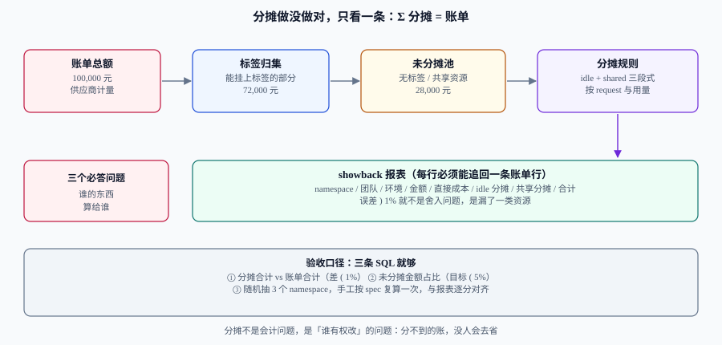

# 归集与分摊

「账分不到人，就没人会去省」——这句话在成本治理里几乎是公理。但落地时它会被两件事卡住：**标签不全**（分不下去）和**共享资源没有天然归属**（分出去也不服）。

这一页给出一套能对得上账单的分摊方法：三级归集（账户 → 标签 → 命名）、未分摊池的三种去向、Kubernetes 集群的分摊公式，以及**只用三条 SQL 就能验收**的口径。它是「加容量」「回收浪费」「买承诺」三个决策的前置条件。

## 判据族声明

本页判据族 `CCA-A` ~ `CCA-H`，共 8 条。定义表在第八节。

## 一、分摊不是会计洁癖，是执行力的来源

| 不分摊的组织 | 分摊的组织 |
| --- | --- |
| 总账单只有平台团队看 | 每个团队每月收到自己那一行 |
| 降本由平台单方面降配 | 降本由「花钱的人」决定要不要 |
| 争论靠音量（「我们用量很小」） | 争论靠数字（「你上个月 18% 是 idle」） |
| 新服务默认申请大规格 | 申请大规格要先解释为什么 |

::: tip 分摊的第一价值不是「省钱」，是「让申请资源变成一个需要理由的动作」
一旦资源有价钱、有钱的归属，`requests` 填 2 核的人会自己改成 500m。这比任何一次专项清理都有效。
:::

## 二、三级归集：先分层，再分摊



| 层级 | 归集依据 | 覆盖度（经验值） | 优点 | 缺点 |
| --- | --- | --- | --- | --- |
| **L1 账户** | 云账号 / 订阅 / 项目 | 高（几乎 100%） | 天然隔离、无需治理 | 粒度粗，一个账号常常混多个团队 |
| **L2 标签** | 资源标签（`owner` / `service` / `env` / `cost-center`） | 中（60%~90%，取决于治理力度） | 粒度细、可交叉分析 | 靠人填，必然有漏 |
| **L3 命名** | 资源命名规范 / 命名空间 / 前缀 | 中高 | 不依赖标签系统 | 改名即失效，脆弱 |

实践口径：**L1 定边界，L2 做分摊，L3 做兜底**。只做 L1 的组织永远分不到团队；只做 L3 的组织会在一次改名后失去全部历史可比性。

## 三、四个必备标签键

标签不要多，要**每个都能被强制**。四个键足够覆盖 95% 的分摊需求：

| 键 | 取值示例 | 用途 | 谁维护 |
| --- | --- | --- | --- |
| `owner` | `team-payments` | 分摊主体、责任人 | 服务 owner |
| `service` | `order-api` | 服务级成本、单位成本的分母对齐 | 服务 owner |
| `env` | `prod` / `staging` / `dev` | 非生产占比、作息停机的依据 | 平台 |
| `cost-center` | `CC-1042` | 与财务科目对齐 | 财务 + 团队负责人 |

强制手段有三个，缺一不可：

1. **默认注入**：IaC 模块与 Helm chart 在创建资源时自动带上四个键，不给「忘记填」的机会。
2. **CI 门禁**：`terraform plan` / `helm template` 的输出里检查四个键，缺失即失败。
3. **定期扫描**：每天扫一次未打标签的资源，输出「资源 ID + 创建人 + 金额」清单，按金额排序发给对应团队。

```shell
# 门禁示例：检查 Helm 渲染结果里是否每个 workload 都带了四个标签（用 yq 提取）
helm template order-api ./charts/order-api \
  | yq 'select(.kind == "Deployment") | .metadata.labels | [.owner, .service, .env, .cost-center]'
```

**预期输出**：每个 Deployment 一行，形如 `["team-payments", "order-api", "prod", "CC-1042"]`。出现 `null` 即为门禁失败。

## 四、未分摊池：三类来源，三种去向

未分摊（untagged / unallocated）不是错误，**它是一个必须被命名、被计量、被决定的池子**。装作它不存在，报表就会永远差 15%。

| 来源 | 典型占比 | 推荐去向 | 理由 |
| --- | --- | --- | --- |
| **无标签资源** | 5%~15% | **挂账到平台团队**，并按周发出「认领清单」 | 摊给业务等于惩罚守规矩的人；挂平台才会有人去追 |
| **共享资源**（集群控制面、网关、日志、监控、镜像仓库） | 10%~25% | **按用量比例分摊**（CPU/内存请求、日志量、请求数） | 共享成本随用量增长，按用量摊才公平 |
| **平台固定成本**（安全扫描、CI runner、堡垒机） | 3%~8% | **按人头或按团队均摊** | 与用量无关，按用量摊会产生荒谬结果 |

三条纪律：

1. **未分摊金额必须进报表**，单独一行，不许摊进「其他」。
2. **未分摊占比有上限**（建议 5%），超过就冻结新资源创建，直到补齐标签。
3. **分摊规则写进配置**（一份 YAML），改动走 PR 评审；规则不写在代码里，三个月后就没人能复算。

## 五、Kubernetes 集群怎么摊

K8s 是最容易「看起来分了、其实没分」的场景：账单按节点收费，而节点被所有命名空间共享。OpenCost 的口径可以直接借用，它把三件事分开算：

```text
① 工作负载成本 = max(request, usage) × 单价        # 按「占用的调度能力」算，不是按「实际烧掉的」
② 集群空闲成本 = 集群资产成本 − Σ 工作负载成本      # 没人认领的那部分
③ 共享成本     = 控制面 + 网络 + 存储 + 平台组件     # 三种分法：均摊 / 按用量 / 自定义指标
```

为什么要用 `max(request, usage)` 而不是 `usage`：**一个申请 2 核只用 200m 的 Pod，仍然占着 2 核的调度能力**，别人用不了。按 `usage` 算会让「虚报 `requests`」变成一种合法的省钱手段，而这恰恰是最常见的浪费来源（见 [闲置与浪费治理](../Waste/index.md)）。

```sql
-- 一张能对账的分摊表：直接成本 + idle 分摊 + 共享分摊
with workload as (
  select namespace,
         sum(greatest(cpu_request, cpu_usage)) as cpu_core_hours,
         sum(greatest(mem_request, mem_usage)) as mem_gib_hours
  from k8s_hourly_usage
  where ts >= date '2026-09-01' and ts < date '2026-10-01'
  group by namespace
),
price as (select 0.28 as cpu_price, 0.0035 as mem_price),   -- 元 / 核时、元 / GiB时
direct as (
  select w.namespace,
         round(w.cpu_core_hours * p.cpu_price + w.mem_gib_hours * p.mem_price, 2) as direct_cost
  from workload w cross join price p
),
total as (select sum(direct_cost) as s from direct),
idle as (select 12000.00 - (select s from total) as amount)  -- 集群月度资产成本 12000
select d.namespace,
       d.direct_cost,
       round(d.direct_cost / (select s from total) * (select amount from idle), 2) as idle_share,
       round(d.direct_cost + d.direct_cost / (select s from total) * (select amount from idle), 2) as total_cost
from direct d
order by total_cost desc;
```

**判读**：`sum(total_cost)` 与集群月度资产成本（示例 12,000 元）的差异应当只有舍入误差；若差得多，说明有节点成本没进集群资产（例如负载均衡、EBS、跨区流量），它们属于「共享成本」，要另立一行。

## 六、showback 与 chargeback：先告知，再扣钱

| 模式 | 做法 | 适用阶段 | 风险 |
| --- | --- | --- | --- |
| **showback（告知）** | 每月发报表，不进财务账 | 起步期（前 3~6 个月） | 没人真的在意，容易退化成「每月一份没人读的邮件」 |
| **soft chargeback（软扣）** | 进部门虚拟预算，超支要说明 | 成熟期 | 需要财务配合定义虚拟预算 |
| **hard chargeback（硬扣）** | 真实扣减部门预算 | 组织成熟、口径稳定 | 口径一变就会引发争议，必须有变更流程 |

::: danger 不要一上来就硬扣
分摊规则在前三个月一定会被改（标签补全、共享成本口径、分母选择）。**在规则还在变的时候硬扣钱，等于用还没校准的秤收费**——第一次争议就会让整个治理失去信任。正确顺序是：showback 三个月 → 规则冻结 → soft chargeback → 再谈 hard。
:::

## 七、验收：三条 SQL，一条抽检

| 验收项 | 判据 | 阈值 |
| --- | --- | --- |
| 总额守恒 | `Σ 分摊合计 / 账单合计` | 0.99 ~ 1.01 |
| 未分摊可控 | `未分摊金额 / 账单合计` | < 5% |
| 规则可复算 | 随机抽 3 个命名空间，按配置手工复算 | 逐分对齐（误差 ≤ 0.01 元） |
| 责任人可查 | 每行都有 `owner` 且是人名/团队名 | 100% |

抽检这一步不能省。它是唯一能发现「规则写错但总额恰好对上」的手段——例如把 `idle` 按 CPU 占比分摊，而 CPU 与内存的单价差了 80 倍，总额照样守恒，但每个团队的数字都是错的。

## 八、判据定义表

| 判据 | 约定 | 定错了会怎样 | 怎么验证 |
| --- | --- | --- | --- |
| `CCA-A` | 分摊合计与账单合计误差 ≤ 1% | 报表与账单长期不一致，无人信任 | 每月跑一次守恒 SQL |
| `CCA-B` | 未分摊金额单独成行，不并入「其他」 | 差异被藏起来，永远查不清 | 报表里存在独立的「未分摊」行 |
| `CCA-C` | 未分摊占比 < 5%，超限冻结新资源 | 标签治理永远补不完 | 月度读数 + 冻结动作留痕 |
| `CCA-D` | 四个必备标签键在 CI 门禁中被强制 | 靠人填 → 覆盖率长期停在 70% | 门禁脚本对 `null` 退出码非 0 |
| `CCA-E` | K8s 工作负载成本按 `max(request, usage)` 计 | 虚报 `requests` 变成合法省钱手段 | 分摊 SQL 里出现 `greatest(...)` |
| `CCA-F` | 共享成本按用量摊、平台固定成本按人均摊 | 摊法错配，团队间争议不断 | 规则配置里两类成本各有独立条目 |
| `CCA-G` | 分摊规则写进版本库并走 PR 评审 | 规则只存在于某人脑子里，无法复算 | 配置文件有提交历史，最近一次改动有评审记录 |
| `CCA-H` | 每月抽 3 个命名空间手工复算 | 总额守恒但单行全错，无法发现 | 抽检记录（对象、金额、复算人）可查 |

## 如何验证

用可执行的三步验证「这套分摊能不能自证」：

```shell
# ① 守恒：分摊合计 99,750，账单 100,000
/Users/cuifendemac/.workbuddy/binaries/python/versions/3.13.12/bin/python3 - <<'PY'
alloc, bill = 99750, 100000
print(f"守恒比 {alloc/bill:.4f}，未分摊 {bill-alloc} 元（{(bill-alloc)/bill:.2%}）")
print("判定:", "通过" if 0.99 <= alloc/bill <= 1.01 else "不通过")
PY
```

**预期输出**：`守恒比 0.9975，未分摊 250 元（0.25%）` 与 `判定: 通过`。

```shell
# ② max(request, usage) 的效果：虚报 requests 会被算成真实成本
/Users/cuifendemac/.workbuddy/binaries/python/versions/3.13.12/bin/python3 - <<'PY'
req, use, price = 2.0, 0.2, 0.28
print(f"按 usage 计 {use*price:.2f} 元/时，按 max 计 {max(req,use)*price:.2f} 元/时")
print(f"虚报放大倍数 {max(req,use)/use:.0f} 倍")
PY
```

**预期输出**：`按 usage 计 0.06 元/时，按 max 计 0.56 元/时` 与 `虚报放大倍数 10 倍`。这 10 倍就是「按 `usage` 分摊」时被隐藏掉的成本。

```shell
# ③ 标签门禁：模拟渲染结果里有一个 Deployment 缺 owner
printf 'owner: team-payments\nservice: order-api\nenv: prod\ncost-center: null\n' | yq '. | to_entries | map(select(.value == null)) | length'
```

**预期输出**：`1`。大于 0 即门禁应当失败——**注意 `null` 与空字符串都要算缺失**，只判 `null` 会放过 `owner: ""`。

## 参考资料

- [FOCUS 1.3 · Split Cost Allocation](https://www.finops.org/insights/introducing-focus-1-3/)——分摊方法成为账单字段的规范依据
- [OpenCost · Cost Allocation 规范](https://opencost.io/docs/specification)——`max(request, usage)`、idle 与 shared 的官方口径
- [Kubernetes · 资源请求与限制](../../Kubernetes/index.md)——`requests` 与调度承诺的关系
- 上一站：[容量台账与预测](../CapacityPlan/index.md) · 下一站：[单位成本](../UnitEconomics/index.md)
