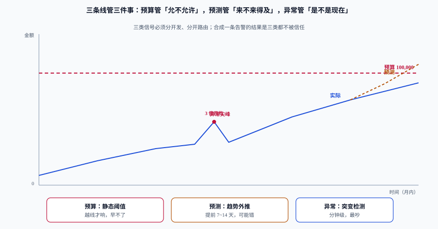

# 预算与告警

预算告警最常见的失败不是「没设」，而是**设了 80% 和 100% 两条，然后在月末收到一条已经来不及做任何事的通知**。100% 是结果，不是信号：它到达时，钱已经花完了。

这一页把「成本类的告警」拆成三类互不替代的信号，并给出各自该在什么时候响、响给谁、响完之后必须能做什么。

## 判据族声明

本页判据族 `CCB-A` ~ `CCB-H`，共 8 条。定义表在第九节。

## 一、三类信号，三种时间尺度



| 信号 | 回答的问题 | 时间尺度 | 提前量 | 误报特性 |
| --- | --- | --- | --- | --- |
| **预算（budget）** | 到月底会不会超？ | 月度 | 取决于阈值，通常「事后」 | 几乎不误报，但太晚 |
| **预测（forecast）** | 按当前速率，月底落在哪？ | 小时~天 | 7~14 天 | 会因一次性大额支出误报 |
| **异常（anomaly）** | 现在这小时是不是不正常？ | 分钟~小时 | 分钟级 | 最吵，需要基线 |

三类必须**分开发、分开路由**。合成一条「成本告警」的结果是三件事都做不好：太晚的规则掩盖了太吵的规则，最后整条渠道被静音。

## 二、预算：额度怎么定，粒度怎么切

### 1. 额度不是「上个月的数 × 1.1」

一个能用的额度公式：

```text
预算额度 = 近 3 个月实际成本的 P50 × (1 + 业务增长假设) + 已排期的增量 + 缓冲
```

| 项 | 取值方法 | 常见错法 |
| --- | --- | --- |
| P50 基线 | 近 3 个月去极值后的中位数 | 用上月单月（会被一次大促带偏） |
| 业务增长假设 | 与容量台账同一份输入 | 各写各的，预算与容量脱钩 |
| 已排期增量 | 活动日历、新服务上线清单 | 漏掉「新服务」，导致一上线就超 |
| 缓冲 | 基线的 5%~10% | 留 30%，额度失去约束力 |

### 2. 粒度：按「能负责的最小单位」切

| 粒度 | 适合 | 优点 | 缺点 |
| --- | --- | --- | --- |
| 账户 | 强隔离的多账号组织 | 天然可算、不易作弊 | 粒度粗，一个账号常有多团队 |
| 团队 / 成本中心 | 大多数组织 | 与责任人一致 | 依赖标签覆盖率 |
| 服务 | 平台型团队 | 能定位到具体服务 | 服务数多，维护成本高 |
| 标签组合（团队 × 环境） | 需要区分生产/非生产 | 支持「非生产砍半」这类政策 | 标签必须强制 |

推荐做法：**两层预算**——团队层做「总量控制」，标签组合（`env=dev|staging`）做「政策控制」。只有团队层时，「非生产砍一半」这种决定没有抓手。

## 三、阈值：用「消耗速率」而不是「余额百分比」

80% / 100% 这种阈值的问题是**与时间无关**：月初花到 80% 和月末花到 80% 是完全不同的两件事。

更好的口径是**进度比**（burn ratio）：

```text
时间进度 = 已过天数 / 本月天数
消耗进度 = 已花金额 / 月度预算
告警条件 = 消耗进度 / 时间进度 > 1.2      # 消耗比时间快 20%
```

判读示例（本月 30 天，今天 10 号）：

| 已花 | 预算 | 消耗进度 | 时间进度 | 比值 | 判读 |
| --- | --- | --- | --- | --- | --- |
| 28,000 | 100,000 | 28% | 33% | 0.84 | 正常 |
| 40,000 | 100,000 | 40% | 33% | 1.20 | 临界，看一眼 |
| 52,000 | 100,000 | 52% | 33% | 1.56 | **告警**：按此速率月底约 156,000 |

这个口径的好处是**自适应**：月初的正常波动不会触发，月末的轻微超速会立刻被看到。坏处是**月初分母小、比值跳动大**，所以前 3 天加一个「最小金额门槛」（例如已花 < 5,000 元不告警），避免噪音。

## 四、异常检测：三种基线，按成本结构选

| 方法 | 公式 | 适合 | 误报来源 |
| --- | --- | --- | --- |
| 静态阈值 | `当前小时成本 > X 元` | 成本结构极稳定的系统 | 业务增长后阈值失效 |
| 环比 | `当前小时 / 上一小时 > k` | 突发型异常（批处理、爬虫） | 定时任务整点启动 |
| **季节基线**（推荐） | `当前值 / 同星期同时刻的 P50 > k` | 有周内周期的绝大多数业务 | 节假日、活动日 |

季节基线是成本异常检测的默认选择：它自动吸收了「工作日高、周末低」「每天 10 点高峰」这些结构，剩下的是真正的异常。

降噪三件套（缺一不可）：

1. **最小金额门槛**：异常金额 < 500 元不告警（噪音成本高于收益）。
2. **连续 N 点确认**：连续 3 个数据点都超阈值才告警（避免单点毛刺）。
3. **变更窗口静默**：发版、扩缩容、迁移期间按标签静默，静默必须带到期时间。

## 五、分级与路由

| 级别 | 触发 | 通知对象 | 响应时限 | 必须能做的事 |
| --- | --- | --- | --- | --- |
| **P1** | 预测月底超支 > 30%，或单日异常 > 月预算 10% | 团队负责人 + 财务对接人 | 24 小时 | 冻结非必要变更 / 关闭非生产环境 / 调整预算 |
| **P2** | 预测超支 10%~30%，或异常连续 3 点 | 服务 owner | 3 个工作日 | 定位资源 / 提交回收或右调 |
| **P3** | 预算进度正常但单位成本环比上升 > 15% | 平台团队（进月报） | 下个月度会 | 纳入月度分析 |

分级的意义在于**每级都有一个「不做也行的成本」**：P1 必须当天动，P3 允许下个月再看。所有级别都用同一个渠道，等于所有级别都是 P3。

## 六、可执行性：每条告警必须回答三个问题

```text
① 收到后做什么？（动作，不是「关注一下」）
② 多久内做？（时限）
③ 做不了找谁？（升级路径）
```

不合格的写法：「成本异常，请关注」。
合格的写法：「`team-payments` 的 `order-api` 在 14:00 起成本为基线 3.2 倍，疑似批量任务重跑。动作：确认是否在跑对账，若否则暂停 Deployment `order-api-worker`；30 分钟内未恢复，升级至值班主管。」

::: danger 只报数不报动作的告警，一定会被静音
告警渠道的信噪比是被**不可执行的告警**一点点消耗掉的。一条「本月已用 80%」的通知，收到的人唯一能做的动作是「知道了」——它训练出来的行为是忽略通知。
:::

## 七、抑制与依赖

| 场景 | 做法 | 理由 |
| --- | --- | --- |
| 同一团队多个服务同时异常 | 按 `owner` 聚合，一条通知列出前 5 个服务 | 10 条同类通知 = 0 条有效通知 |
| 预算告警与异常告警同时触发 | **都发**，但在异常告警里附「已超预算 X%」 | 两者动作不同：一个要止损，一个要解释 |
| 变更窗口 | 静默 `env=staging`，带到期时间 | 变更期间的成本波动是预期的 |
| 月末最后一天 | 抑制 P2/P3，只保留 P1 | 月末总结期，噪音只会干扰对账 |

## 八、三家云厂商的实现口径差异

不同厂商的预算产品能力接近，但**语义差异会直接影响规则写法**：

| 维度 | 关注点 | 落地时的坑 |
| --- | --- | --- |
| 触发类型 | 实际值 vs 预测值（forecasted） | 只有「实际值」时，规则天然滞后；优先选支持预测触发的产品 |
| 通知目标 | 邮件 / webhook / 消息队列 / 工单 | 只支持邮件的产品无法接入值班系统，等于 P3 |
| 作用域 | 账户 / 订阅 / 项目 / 标签 / 成本类别 | 标签作用域依赖标签覆盖率，未打标签的部分会漏出预算之外 |
| 数据延迟 | 账单数据通常有数小时到一天延迟 | 用账单数据做「小时级异常」是错配，异常检测必须用**自有采集**的成本估算 |

::: warning 一个常见错配
拿「日更的账单」做「小时级异常告警」，结果只能是延迟一天的通知。**异常检测要用你自己采集的资源用量 × 单价估算**（准实时），账单只用于月末对账与预算。
:::

## 九、判据定义表

| 判据 | 约定 | 定错了会怎样 | 怎么验证 |
| --- | --- | --- | --- |
| `CCB-A` | 预算、预测、异常三类规则分开配置、分开路由 | 合成一条后全部被静音 | 告警配置文件里存在三个独立规则组 |
| `CCB-B` | 预算阈值用进度比（消耗进度 / 时间进度） | 月初/月末用同一阈值，误报与漏报并存 | 规则表达式含「已过天数 / 总天数」 |
| `CCB-C` | 前 3 天设最小金额门槛 | 月初噪音淹没真实告警 | 规则里有金额下限条件 |
| `CCB-D` | 异常检测用季节基线（同星期同时刻） | 定时任务整点误报 | 基线查询含星期与小时分组 |
| `CCB-E` | 每条告警写明动作、时限、升级路径 | 收到等于没收到 | 抽 3 条规则，三项均可读 |
| `CCB-F` | P1 通知到人（负责人 + 财务），不只发群 | 群里没人认领 | 路由配置里有具体接收人 |
| `CCB-G` | 静默必须带到期时间 | 静默永久化，问题再也报不出来 | 静默记录里 `expires_at` 非空 |
| `CCB-H` | 异常数据源是准实时估算，不是日更账单 | 告警延迟一天，失去意义 | 数据源与采集间隔可查 |

## 如何验证

```shell
# ① 进度比：本月 30 天，今天 10 号，已花 52,000，预算 100,000
/Users/cuifendemac/.workbuddy/binaries/python/versions/3.13.12/bin/python3 - <<'PY'
spent, budget, day, days = 52_000, 100_000, 10, 30
burn, elapsed = spent/budget, day/days
print(f"消耗进度 {burn:.0%} 时间进度 {elapsed:.0%} 比值 {burn/elapsed:.2f}")
print(f"按此速率月底约 {spent/day*days:,.0f} 元")
PY
```

**预期输出**：`消耗进度 52% 时间进度 33% 比值 1.56`、`按此速率月底约 156,000 元`。比值 > 1.2 即应触发 `CCB-B` 类告警。

```shell
# ② 告警规则自检：规则能否被 Prometheus 正确加载
cat > /tmp/cost-rules.yaml <<'YAML'
groups:
  - name: cost-budget
    rules:
      - alert: CostBudgetBurnFast
        expr: (cost_mtd / budget_month) / (day_of_month / days_in_month) > 1.2
        for: 1h
        labels:
          severity: ticket
        annotations:
          summary: "团队预算消耗速率超时间进度 20%"
          action: "查看归属服务，确认是否为一次性任务；否则提交回收或右调"
YAML
promtool check rules /tmp/cost-rules.yaml
```

**预期输出**：`SUCCESS: 1 rules found`（`promtool` 随 Prometheus 发行包提供，未安装时先解压一份到本地）。若提示 `unknown metric` 之类的错误，检查指标名与采集侧是否一致——**规则能加载不等于指标存在**，上线前要在 Prometheus 的 `/graph` 里查一次真实数据。

## 参考资料

- [FinOps Foundation · Budgeting](https://www.finops.org/framework/capabilities/budgeting/)——预算能力的目标与常见做法
- [FinOps Foundation · Anomaly Management](https://www.finops.org/framework/capabilities/anomaly-management/)——异常检测的能力定义与降噪要求
- [Prometheus · Alerting rules](https://prometheus.io/docs/prometheus/latest/configuration/alerting_rules/)——规则语法与 `for` 的语义
- 上一站：[单位成本](../UnitEconomics/index.md) · 下一站：[闲置与浪费治理](../Waste/index.md)
