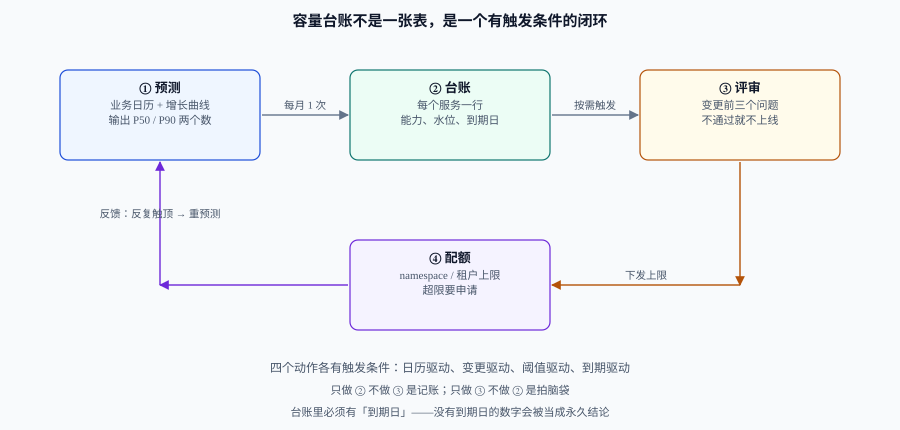

# 容量台账与预测

容量报告是**一次性的**：为某次大促、某次评审写一份，写完归档。容量台账是**常驻的**：每个服务一行，随时能回答「现在几个实例、还能扛多少、什么时候要动、谁签字」。前者解决一次问题，后者让问题不再重复发生。

这一页讲三件事：台账要有哪几列、预测怎么做才敢签字、以及**复核与评审的触发条件**。公式部分不重复造轮子——单实例能力、水位线、排队放大一律引用 [性能与容量工程 · 容量规划](../../PerformanceEngineering/Capacity/index.md)，这里只讲治理面。

## 判据族声明

本页判据族 `CCF-A` ~ `CCF-H`，共 8 条。定义表在第八节。

## 一、台账与容量报告的区别

| 维度 | 容量报告 | 容量台账 |
| --- | --- | --- |
| 生命周期 | 一次性，写完归档 | 常驻，每月更新 |
| 粒度 | 一个系统 / 一次活动 | 每个服务一行 |
| 回答 | 「这次大促够不够」 | 「现在够不够、什么时候不够、谁负责」 |
| 失效方式 | 过期后无人再读 | 字段缺失后变成摆设（最常见是**没有到期日**） |
| 谁来维护 | 写报告的人 | **服务 owner**（不是平台团队代填） |

::: warning 台账最常见的死法
不是没人填，而是**填了但没有「下次什么时候看」**。一张没有复核周期的表，三个月后所有数字都变成了历史陈述，而读表的人不知道它是历史。
:::

## 二、台账必须有六列



| 列 | 内容 | 为什么必须有 | 常见错法 |
| --- | --- | --- | --- |
| **服务** | 服务名 + 所属团队 | 归因的锚点 | 写成仓库名，半年后没人认得 |
| **单实例能力** | QPS 与对应延迟，**附压测报告链接** | 没有依据的能力值是猜的 | 抄厂商的「最大连接数」，与业务延迟无关 |
| **当前峰值** | 最近 30 天的 P95 峰值（写明时间窗） | 水位线的分母 | 用日均值，峰值被抹平 |
| **水位线** | 有效能力 / 单实例能力（本项目默认 50%） | 决定「还能加多少」 | 写 80% 却不解释为什么不是 50% |
| **到期日** | 这个数字什么时候必须重算 | 防止结论永久化 | 空着，或写「长期有效」 |
| **责任人** | 一个人名 + 一个备用联系人 | 出问题找谁 | 写团队名，等于没人 |

「到期日」这一列最容易被省略，但它决定了台账是**活的**还是**档案**。一个实用的约定：**到期日 = 下一次已知的业务变化点**（大促结束、版本切换、合同到期、增长假设失效）。没有已知变化点时，到期日 = 今天 + 90 天。

## 三、预测：三个输入，一个不对称

### 1. 三个输入

| 输入 | 从哪来 | 不可靠时怎么办 |
| --- | --- | --- |
| **历史用量** | 监控的请求量时间序列（至少 60 天，覆盖两个完整月度周期） | 少于 30 天就不要做趋势外推，只做「当前水位 + 余量」判断 |
| **业务日历** | 活动排期、发版计划、营销投放、节假日 | 日历缺失时按「无异常」预测，并在台账到期日上写「日历待补」 |
| **增长假设** | 业务方的目标（用户数、订单量）与历史转化率 | 假设必须有数字与来源，写「大概会涨」等于没有假设 |

### 2. 季节性：先剥掉周内波动，再谈趋势

绝大多数业务流量的第一主成分是**周内周期**（工作日高、周末低）。直接用 7 天移动平均会把周末的低谷抹进趋势里，导致预测偏低。做法是先算周系数：

```text
周系数(星期 d) = 该星期 d 的日均值 / 全周日均值
去季节化序列 = 原始序列 / 周系数(当天星期)
```

算例（order-api，单位 QPS）：

| 星期 | 日均 | 周系数 | 说明 |
| --- | --- | --- | --- |
| 周一 | 412 | 1.11 | 高于均值 |
| 周二~周四 | 445 | 1.20 | 一周高峰（三天同值，此处合并展示） |
| 周五 | 398 | 1.08 | 略降 |
| 周六 | 232 | 0.63 | 明显低谷 |
| 周日 | 214 | 0.58 | 最低 |
| **全周** | **370** | **1.00** | 分母（七天等权均值） |

去季节化之后再做趋势，噪音会小一个量级；预测出结果后**必须乘回周系数**，否则会得到一条「每天一样」的假曲线。

### 3. 三种增长假设，各自什么时候用

| 假设 | 公式 | 适用 | 危险 |
| --- | --- | --- | --- |
| **线性** | `未来 = 当前 + 斜率 × 天数` | 成熟业务、增长平稳 | 早期业务会严重低估 |
| **复合** | `未来 = 当前 × (1 + r)^月数` | 高增长、有明确目标 | r 取历史最高值 → 系统性高估 |
| **阶梯** | `未来 = 当前 + 已知活动增量` | 有明确排期（大促、投放） | 活动叠加时会漏算叠加效应 |

实践口径：**主假设用线性，活动用阶梯叠加，复合只作为敏感性分析的上界**。三条曲线都画出来，取「线性 + 阶梯」作为 P50，取「复合上界」作为 P90。

### 4. 误差不对称：容量按 P90 买，承诺按 P10 买

这是本页最重要的一条，也是最反直觉的一条：

| 决策 | 买多了的代价 | 买少了的代价 | 因此按哪个分位 |
| --- | --- | --- | --- |
| **加容量**（按小时/按月付费的弹性资源） | 多付「闲置的那部分」 | SLO 违约、降级、赔偿、口碑 | **P90**（宁可多买一点） |
| **买承诺**（1~3 年锁定） | 锁定 1~3 年的沉没成本 | 少省一点折扣，仍按需付费 | **P10**（宁可少买一点） |

一句话：**弹性的钱可以随时退，承诺的钱退不回来**。所以同一份预测，往上取分位用于「临时扩容」，往下取分位用于「长期承诺」。把两者搞反的团队，通常表现为「容量总是不够，而承诺总是闲置」。

## 四、复核：四个触发条件，缺一不可

| 触发 | 条件 | 谁发起 | 产出 |
| --- | --- | --- | --- |
| **日历驱动** | 每月 1 日、大促前 14 天 | 平台团队 | 台账更新 + 差异说明 |
| **变更驱动** | 架构变更、依赖替换、版本升级 | 变更发起人 | 受影响服务的重新评估 |
| **阈值驱动** | 水位线连续 7 天 > 70%，或连续 30 天 < 30% | 监控告警 | 扩容 / 缩容提案 |
| **到期驱动** | 台账「到期日」到达 | 服务 owner | 重算或续期（续期必须写理由） |

四个触发里，**阈值驱动的「低于 30%」最容易漏**：所有人都在盯「快满了」，没人盯「一直很空」。而后者恰恰是成本治理的主战场。

## 五、容量评审门禁：变更前的三个问题

容量评审不是审批流程，是**三个必须回答的问题**。任何一个答不上来，就不该上线：

1. **这次变更改变了传导链的哪一段？**（SLO / 业务量 / 容量 / 规格 / 单价）——说不清段，就无法评估代价。
2. **峰值预测是多少，依据是什么？**——必须给出数字、分位与来源（历史外推还是活动排期）。
3. **水位落在哪里，触顶后谁先知道？**——必须给出触顶后的动作（扩容脚本、限流开关、降级预案）。

三个问题对应的判据分别是 `CCF-A` / `CCF-D` / `CCF-E`。把它们写进 PR 模板，比开一次评审会有效得多。

## 六、配额：上限不是预算

配额（quota）与预算（budget）经常被当成一回事，其实管的是两件事：

| | 配额 | 预算 |
| --- | --- | --- |
| 单位 | 核、GiB、Pod 数 | 钱 |
| 生效方式 | **硬拦截**（提交即失败） | 软提醒（越线告警） |
| 主要目的 | 防止单点失控（一个命名空间吃满集群） | 控制总量与节奏 |
| 定错的后果 | 业务被卡住，转而申请更大配额 | 告警被忽略 |

配置口径建议：

- 配额按**命名空间 × 资源类型**设两级：`requests` 的硬上限（防止调度挤占）+ `limits` 的上限（防止单容器打爆节点）。
- 配额不得超过该团队容量台账的 1.2 倍——否则配额就成了一张空头支票。
- 配额申请必须带上「当前用量分位」与「到期日」，与台账同一套字段。

```yaml
# 一个命名空间的配额示例：requests 是调度承诺，limits 是运行时天花板
apiVersion: v1
kind: ResourceQuota
metadata:
  name: team-board-quota
  namespace: team-board
spec:
  hard:
    requests.cpu: "24"          # 不超过该团队台账容量的 1.2 倍
    requests.memory: 96Gi
    limits.cpu: "48"
    limits.memory: 192Gi
    count/pods: "120"
```

**验证方式**：`kubectl describe resourcequota team-board-quota -n team-board` 的 `Used` / `Hard` 两列应当同时存在；只有 `Hard` 而没有 `Used`，说明配额没有真正生效（常见于资源名写错，例如 `requests.cpu` 写成 `cpu`）。

## 七、与「容量规划」页的分工

| 内容 | 在哪一页 | 本页怎么处理 |
| --- | --- | --- |
| 三输入模型（业务量 → 峰值到达率 → 实例数）的推导 | [容量规划](../../PerformanceEngineering/Capacity/index.md) | **只引用，不重算** |
| 水位线为什么是 50%（排队放大与 USL） | 同上 | 引用结论，本页只负责「写进台账」 |
| HPA 的指标选择、冷却、缩容纪律 | [弹性伸缩](../../CloudArchitecture/AutoScaling/index.md) | 引用；本页只管「扩出来的钱记在谁头上」 |
| 台账字段、复核触发、评审门禁、配额 | **本页** | —— |

::: tip 本页不讲什么
本页不给「单实例能扛多少 QPS」的算法——那需要压测与排队模型，属于 [容量规划](../../PerformanceEngineering/Capacity/index.md)。本页假设你已经有一个**带依据**的单实例能力值，然后回答「怎么把它变成一张能被复核、能被追责的表」。
:::

## 八、判据定义表

| 判据 | 约定 | 定错了会怎样 | 怎么验证 |
| --- | --- | --- | --- |
| `CCF-A` | 台账每行必须能标出「本次变更动了传导链哪一段」 | 变更与容量脱钩，扩容永远滞后 | 台账「变更段」列非空率 100% |
| `CCF-B` | 单实例能力必须附压测报告链接 | 能力值是猜的，水位线全盘失真 | 抽查 5 行，链接均可打开且含 P99 口径 |
| `CCF-C` | 峰值一律用 P95，且写明时间窗 | 用日均值导致系统性低估 | 列名含「P95」，且时间窗字段非空 |
| `CCF-D` | 预测必须同时给出 P50 与 P90 | 只有一个数时无法判断风险偏好 | 台账/提案里两个分位都在 |
| `CCF-E` | 触顶动作必须写明「谁先知道、做什么」 | 触顶后无人响应，退化为事故 | 每行有告警规则名或预案链接 |
| `CCF-F` | 扩容按 P90，采购承诺按 P10 | 反向取分位 → 容量不足且承诺闲置 | 扩容提案用 P90、承诺提案用 P10，可对照 |
| `CCF-G` | 台账「到期日」不得为空，且不得写「长期有效」 | 结论永久化，一年后仍被引用 | `grep -c '长期有效'` 应为 0 |
| `CCF-H` | 配额不超过台账容量的 1.2 倍 | 配额成为空头支票 | `Used / Hard` 与台账容量比值 ≤ 1.2 |

## 如何验证

用一组具体数字把「台账 → 预测 → 实例数 → 成本」走一遍（数字为示例，请替换成你自己的）：

```shell
# 已知：单实例能力 180 QPS @ P99 300ms；水位线 50% → 每实例有效 90 QPS
# 当前峰值 620 QPS；大促预测 P90 = 1050 QPS；单实例月成本 1240 元
/Users/cuifendemac/.workbuddy/binaries/python/versions/3.13.12/bin/python3 - <<'PY'
cap, level, peak, p90, price = 180, 0.5, 620, 1050, 1240
eff = cap * level
import math
now, spike = math.ceil(peak / eff), math.ceil(p90 / eff)
print(f"当前实例数 {now}，大促实例数 {spike}")
print(f"当前月成本 {now*price} 元，大促期间月成本 {spike*price} 元")
print(f"增量 {spike-now} 个实例，按 5 天计增量成本 {round((spike-now)*price*5/30)} 元")
PY
```

**预期输出**：

```text
当前实例数 7，大促实例数 12
当前月成本 8680 元，大促期间月成本 14880 元
增量 5 个实例，按 5 天计增量成本 1033 元
```

第三行的意义：**扩 5 个实例只花 1,033 元，而少 1 个实例可能造成一次 SLO 违约**。这就是「扩容按 P90」的算术依据——它不是保守，是代价不对称。

```shell
# 周系数自检：七个系数（含三天高峰重复计入）之和必须等于 7，否则均值算错了
/Users/cuifendemac/.workbuddy/binaries/python/versions/3.13.12/bin/python3 - <<'PY'
days = [412, 445, 445, 445, 398, 232, 214]
mean = sum(days) / len(days)
coef = [round(d / mean, 2) for d in days]
print("日均", round(mean, 1), "系数", coef, "合计", round(sum(coef), 2))
PY
```

**预期输出**：`日均 370.1 系数 [1.11, 1.2, 1.2, 1.2, 1.08, 0.63, 0.58] 合计 7.0`。

合计不等于 7 说明「把合并展示的那一行当成一天」了——这是手算周系数最常见的错：**表格里为了可读性合并了三个同值日，计算时必须按三天展开**。
## 与「数据库参数与内核调优」专题的分工（第 199 天补充）

本页算**容量与成本**（CPU/内存/存储的规划、单位经济性），[数据库参数与内核调优](../../../DB/ParameterTuning/index.md) 提供其中两个输入：**WAL 生成速率**（决定复制带宽与归档存储）与**内存分配表**（决定单机能扛多少连接）。

| 输入 | 本页用法 | 参数专题出处 |
| --- | --- | --- |
| WAL 日生成量 | 算归档存储与跨区流量 | [写放大](../../../DB/ParameterTuning/WriteAmplification/index.md) |
| 单连接内存 | 算「一台机器能开多少连接」 | [并发参数](../../../DB/ParameterTuning/Concurrency/index.md) |
| 缓冲池占比 | 算内存规格选型 | [内存预算](../../../DB/ParameterTuning/MemoryBudget/index.md) |

**这一页特有的一个坑**：按「数据变化量」估 WAL 与带宽。本机实测（`pgbench -N -c 8`，15 秒，`full_page_writes=on`）WAL 174.3 MB ≈ **11.6 MB/s → 一天 1.0 TB**；开 `wal_compression=zstd` 后 32.5 MB ≈ **2.2 MB/s → 一天 187 GB**。同一份业务写入，账单差 **5.4 倍**——容量表里必须写清「按开压缩还是不开压缩估」。

## 与「数据库运维自动化」专题的分工（第 200 天补充）

| 那边讲什么 | 这边讲什么 | 交界处 |
| --- | --- | --- |
| 容量台账、P50/P90、复核触发、评审门禁 | 「到阈值天数」的**算式与误差**、采购前置期 | 台账是账本，天数是结论 |
| 配额与规格选型 | 把天数换算成「最晚下单日」 | 一个报数，一个报日期 |
| 成本分摊与预算 | 不涉及（只在需要时引用天数） | — |

**这一页特有的一个坑**：台账里常用「近 30 天平均日增」当作斜率，但平均会把周周期抹平、把阶跃摊薄。本专题的实测是：同一序列上线性拟合的 MAPE 只有 **2.03%**，而「还有几天到阈值」的误差是 **4.7%**；Holt 的 MAPE 2.86%（只差 1.4 倍），天数误差却是 **64.9%**（差 14 倍）。**报数用 MAPE 看不出问题，排期用天数才看得出。**

## 参考资料

- [性能与容量工程 · 容量规划](../../PerformanceEngineering/Capacity/index.md)——三输入模型、水位线与容量报告模板
- [Kubernetes · 资源请求与限制](../../Kubernetes/index.md)——`requests` / `limits` 与调度的关系
- [Kubernetes · Resource Quotas（官方文档）](https://kubernetes.io/docs/concepts/policy/resource-quotas/)——配额字段与生效条件
- 上一站：[总览：三本账与四个决策点](../Overview/index.md) · 下一站：[归集与分摊](../Allocation/index.md)
