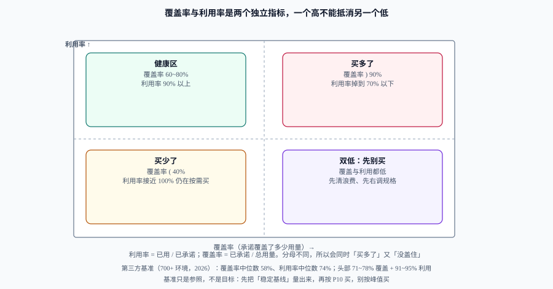

# 承诺折扣治理

承诺折扣（Reserved Instance / Savings Plan / Committed Use Discount）是云上**单位收益最大、也最容易买错**的动作：一次下单可能省下 30%~60%，也可能把未来 1~3 年的钱锁死在一个即将被淘汰的架构上。

这一页只回答治理问题：什么时候该买、按哪个分位买、买多少、怎么错峰到期、以及**买错之后账怎么记**。具体到某家厂商的下单页面怎么点，不在本页范围内。

## 判据族声明

本页判据族 `CCK-A` ~ `CCK-H`，共 8 条。定义表在第九节。

## 一、承诺的本质：用灵活度换单价

| 你付出的 | 你得到的 |
| --- | --- |
| 1~3 年的用量承诺（按金额或按资源） | 更低的单价（折扣 15%~60%，取决于工具与期限） |
| 架构变更的自由（越不灵活越深） | 可预测的基线成本 |
| 现金流（全预付时） | 财务报表上的确定性 |

**承诺不是省钱按钮**：它不降低用量，只降低单价。用量还在涨的时候买承诺，等于给增长打折；用量在跌的时候买承诺，等于给下跌加杠杆。

::: tip 一句话
**先清浪费、再右调、最后才买承诺。** 在一个还有 20% 虚高 `requests` 的集群上买承诺，是把浪费也一起锁了三年。
:::

## 二、两个指标：覆盖率与利用率



| 指标 | 公式 | 含义 | 低了会怎样 | 高了会怎样 |
| --- | --- | --- | --- | --- |
| **覆盖率**（coverage） | 已承诺用量 / 总用量 | 有多少用量享受了折扣 | 少省钱 | 可能买多（承诺闲置） |
| **利用率**（utilization） | 已用承诺 / 已承诺 | 买来的承诺有多少被用掉 | 白付钱 | 说明还该继续买 |

两个指标**分母不同**，所以可以同时「买多了」和「没盖住」：某团队买了 100 台数据库 RI（覆盖数据库的 90%），但计算资源全按需（覆盖率 0%），于是利用率 60%（数据库缩容了）、覆盖率 35%。这种情况的正确动作不是「再买计算承诺」，而是「先退/等到期数据库 RI」。

第三方统计（700+ 环境，2026，非官方基准）给出的参照：

| 分位 | 覆盖率 | 利用率 |
| --- | --- | --- |
| 中位数 | 58% | 74% |
| 头部 | 71%~78% | 91%~95% |

不同工具的典型折扣深度（公开口径，2026，实际以合同为准）：

| 工具 | 典型折扣 | 灵活度 |
| --- | --- | --- |
| AWS Compute Savings Plan | 17%~20%（1 年） | 最高（跨族/跨区/跨 OS，含 Fargate 与 Lambda） |
| AWS EC2 Instance Savings Plan | 更高（约 25%~30%） | 中（锁定族 + 区） |
| AWS Standard RI | 30%~40%（1 年）/ 50%~60%（3 年） | 最低（锁族、规格、区、OS） |
| Azure Reservations | 38%~45% | 低（锁 VM 族/区） |
| Azure Savings Plan for Compute | 15%~18% | 高（跨区跨规格） |
| GCP resource-based CUD | 28%~37%（1 年）/ 46%~57%（3 年） | 低（锁机型族 + 区） |
| GCP spend-based（Flex）CUD | 略低 | 高（按金额，覆盖 Cloud Run 与 GKE Autopilot） |

**读法**：折扣越深，越要求「这个资源形态在期限内不变」。选择工具的本质是回答一个问题——**你对「不变」有多确信**。

## 三、买错的三种典型

| 错法 | 当时的理由 | 后果 | 正确做法 |
| --- | --- | --- | --- |
| **按峰值买** | 「我们最高用到 60 台，买 60 台最省」 | 峰值一年出现 20 天，其余时间 40 台承诺闲置 | 按 **P10 基线**买（覆盖底座），峰值用按需/Spot |
| **按历史最高月买** | 「上个月是全年最高，按它买最安全」 | 增长停滞或业务调整后，利用率跌到 60% 以下 | 用近 6 个月的去极值 P50，且**分批买** |
| **锁 3 年押架构不变** | 「3 年折扣最深」 | 半年后换机型/换区/上托管服务，承诺还在扣钱 | 变动期只用 1 年；3 年只给「确定不会动的数据库底座」 |

还有一种更隐蔽的错法：**在错误的层级买**。在组织里没有用量的管理账号下买 Compute SP，共享开关没开，承诺只覆盖那个空账号，等于 0 利用率。买之前先确认**承诺共享（sharing）是开着的**，且购买账号本身有真实用量。

## 四、下单前必须回答的五个问题

1. **基线是多少？** 给出近 6 个月的 P10 用量（不是 P50，不是峰值），并写明数据来源。
2. **覆盖率会到多少？利用率下限是多少？** 两个数都要算，且都要写进提案。
3. **如果架构变了怎么办？** 说明「可退/可换/可转售」三条路径里有哪些（不同工具差异极大：Standard RI 可在市场上转售，Savings Plan 不可退）。
4. **到期分布长什么样？** 未来 12 个月每月到期的承诺金额，是否有某个月集中到期（会导致那个月成本跳变）。
5. **摊销口径是什么？** 报表用**实付**还是**摊销**？预付款怎么摊到月？（见第七节，口径不一致会让同一个团队看到两个数）

## 五、分批购买：阶梯与错峰

一次性买满是最常见的错误。分批买的两个理由：

1. **信息来源会变好**：三个月后的基线估计一定比今天准，把决策分散到多个时点，误差也被分散。
2. **到期错峰**：所有承诺同月到期，会导致当月成本突然跳升 30%+，并且在下一次续买时被迫接受当时的折扣条件。

```text
目标：12 个月后覆盖率达到 70%，且每月到期金额不超过总量的 12%
做法：每季度买一次，每次买「距离目标缺口」的 1/3
      期限上做 1 年 / 3 年混合：3 年只给数据库底座（约占总量 30%），其余 1 年滚动
```

一张到期台账（必须维护，与 [容量台账](../CapacityPlan/index.md) 同一个「到期日」纪律）：

| 月份 | 到期金额 | 占比 | 备注 |
| --- | --- | --- | --- |
| 2027-03 | 12,000 | 10% | 数据库 3 年期第一批 |
| 2027-06 | 9,000 | 7.5% | 计算 1 年期 |
| 2027-09 | 11,000 | 9.2% | 数据库 3 年期第二批 |
| 2027-12 | 8,000 | 6.7% | 计算 1 年期 |

::: danger 到期台账不是财务的事，是架构的事
承诺到期意味着**下个月起单价跳升**。如果到期时没人续买、也没人确认用量，成本会在没有任何业务变化的情况下上涨 20%~40%，然后被误判为「这个月怎么这么贵」。**正确写法**：到期前 60 天进月度会，与容量复核同一张表。
:::

## 六、承诺与弹性的冲突

承诺锁定与弹性缩容看起来矛盾，实际不矛盾——**只要承诺只覆盖底座**：

| 层 | 用量特征 | 用什么 | 说明 |
| --- | --- | --- | --- |
| **底座**（数据库、常驻服务、控制面） | 全年波动 < 20% | 3 年承诺 | 这层几乎不缩容 |
| **常规弹性层**（Web/API 副本） | 日间波动 2~3 倍 | 1 年 Compute SP 覆盖 P10 + 按需覆盖其余 | 缩容时承诺仍被用掉（因为基线在） |
| **峰值层**（活动、批处理） | 一年几十天 | 按需 / Spot | **绝不买承诺** |

判断一个用量属于哪一层的实用方法：**看它过去 90 天的最低日用量**。最低日用量就是「即使全公司放假也在跑」的部分，这层买承诺最安全。

## 七、核算口径：实付、摊销、与「未使用承诺去哪了」

同一笔承诺，三种记法会得到三个不同的月度数字：

| 口径 | 记法 | 适合 | 副作用 |
| --- | --- | --- | --- |
| **实付（billed）** | 预付款记在付款当月 | 现金流管理 | 单月账单出现巨大尖峰，团队报表失真 |
| **摊销（amortized）** | 预付款按期限平均摊到每月 | 团队分摊、单位成本 | 与发票金额不一致，财务对账要单独说明 |
| **有效成本（effective）** | 按实际用量重算「如果按需要花多少」 | 评估折扣收益 | 不是真实支出，不能用于预算 |

**未使用承诺的成本必须有归属**：它不该消失，也不该摊给业务团队（业务没用到那部分）。推荐做法是进**平台/共享成本池**，与 [归集与分摊](../Allocation/index.md) 的未分摊池同样处理，并在月报里单独一行「承诺闲置成本」。这一行是下一次购买的决策依据。

## 八、与其它页面的分工

| 问题 | 去哪一页 |
| --- | --- |
| 该不该扩容、扩几个 | [容量台账与预测](../CapacityPlan/index.md) |
| 规格选哪种、七个降本杠杆 | [云上架构 · 成本与规格选型](../../CloudArchitecture/Cost/index.md) |
| 单位成本怎么算、怎么比较 | [单位成本](../UnitEconomics/index.md) |
| 承诺买多少、买哪种、何时到期 | **本页** |

## 九、判据定义表

| 判据 | 约定 | 定错了会怎样 | 怎么验证 |
| --- | --- | --- | --- |
| `CCK-A` | 覆盖率与利用率分开计算、分开汇报 | 用一个数掩盖另一个数的问题 | 报表两列都在，且分母可查 |
| `CCK-B` | 承诺按 P10 基线买，不按峰值买 | 买完即闲置 | 提案里基线分位标注为 P10 |
| `CCK-C` | 购买前确认承诺共享已开启且购买账号有用量 | 承诺覆盖到空账号，利用率 0 | 组织级共享设置截图/配置留档 |
| `CCK-D` | 分批购买，单月到期金额 ≤ 总量 12% | 到期月成本跳变 | 到期台账每月占比列可算 |
| `CCK-E` | 到期前 60 天进月度会 | 到期无动作，单价跳升 | 会议记录与到期台账日期对齐 |
| `CCK-F` | 峰值层（活动/批处理）不买承诺 | 锁定短期用量 | 承诺覆盖的资源清单里无 Spot/批处理作业 |
| `CCK-G` | 未使用承诺成本单独成行，进平台池 | 闲置成本被摊给业务，引发争议 | 月报存在「承诺闲置成本」行 |
| `CCK-H` | 报表口径（实付/摊销/有效）必须写明 | 同一团队看到两个数 | 报表页脚有口径声明与版本 |

## 如何验证

```shell
# ① 盈亏平衡利用率：折扣 d 之下，利用率低于多少就不划算
/Users/cuifendemac/.workbuddy/binaries/python/versions/3.13.12/bin/python3 - <<'PY'
for d in (0.18, 0.30, 0.38, 0.55):
    print(f"折扣 {d:.0%} → 盈亏平衡利用率 {1-d:.1%}")
PY
```

**预期输出**：

```text
折扣 18% → 盈亏平衡利用率 82.0%
折扣 30% → 盈亏平衡利用率 70.0%
折扣 38% → 盈亏平衡利用率 62.0%
折扣 55% → 盈亏平衡利用率 45.0%
```

**判读**：折扣 38% 时，利用率必须高于 62% 才真的省钱。推导：设承诺量 X、利用率 u、折扣 d，承诺后支出为 `X·price·(1−d)`，不承诺时支出为 `u·X·price`，净收益 `X·price·(u + d − 1)`，令其为 0 得 `u = 1 − d`。

这条公式解释了为什么「按峰值买」几乎总是错的——按峰值承诺意味着平均利用率只有 30%~50%，在 38% 折扣下低于 62% 的平衡点，**买得越多亏得越多**。

```shell
# ② 一次购买的净收益（元/月）：X=10 台等价、u=0.75、d=0.38、单价 1240
/Users/cuifendemac/.workbuddy/binaries/python/versions/3.13.12/bin/python3 - <<'PY'
X, u, d, price = 10, 0.75, 0.38, 1240
gain = X*price*(u + d - 1)
low  = X*price*(0.60 + d - 1)
print(f"净收益 {gain:,.0f} 元/月；若利用率 0.60 则为 {low:,.0f} 元/月")
PY
```

**预期输出**：`净收益 1,612 元/月；若利用率 0.60 则为 -248 元/月`。**利用率从 0.75 掉到 0.60 就跨过了 62% 的平衡点，节省变成亏损**——这就是要按 P10 而非 P50 买的算术原因。

```shell
# ③ 覆盖率与利用率（用两个独立的分母，不要合成一个数）
/Users/cuifendemac/.workbuddy/binaries/python/versions/3.13.12/bin/python3 - <<'PY'
committed, used_commit, total_usage = 700, 520, 1000
print(f"覆盖率 {committed/total_usage:.0%}  利用率 {used_commit/committed:.0%}")
PY
```

**预期输出**：`覆盖率 70%  利用率 74%`。这两个数一个看「盖得够不够」，一个看「买得准不准」，必须同时看。

## 参考资料

- [FinOps Foundation · Rate Optimization](https://www.finops.org/framework/capabilities/rate-optimization/)——承诺与折扣的能力定义
- [FOCUS 1.3 · Contract Commitment 数据集](https://www.finops.org/insights/introducing-focus-1-3/)——承诺数据的标准化字段
- [AWS · Savings Plans 文档](https://docs.aws.amazon.com/savingsplans/latest/userguide/what-is-savings-plans.html)——覆盖率与利用率的口径
- [Google Cloud · Committed Use Discounts](https://cloud.google.com/docs/costs-usage/committed-use-discounts)——resource-based 与 spend-based 的区别
- 上一站：[闲置与浪费治理](../Waste/index.md) · 下一站：[实战：一个季度的治理循环](../Practice/index.md)
