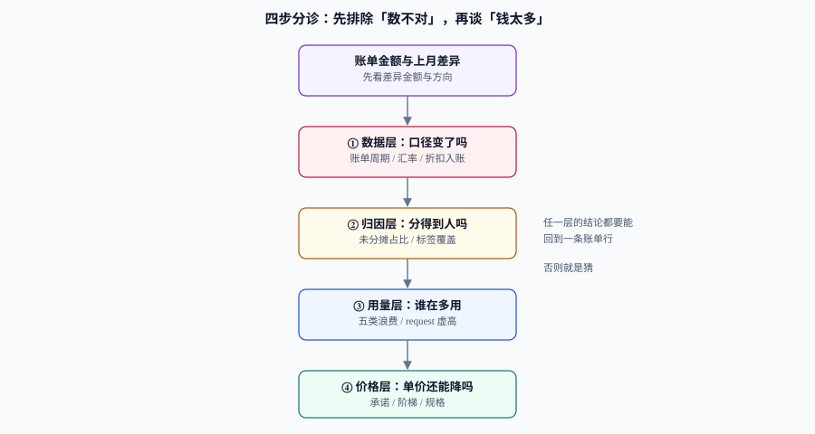

# 常见问题与最佳实践

成本问题有一个共同特征：**现象永远比原因显眼**。「这个月贵了 30%」是现象，原因可能在账单周期、可能在汇率、可能在标签丢失、可能在某个团队上了一个新服务、也可能只是核算口径改了。按顺序分诊，比凭经验猜快得多。

这一页给四样东西：四步分诊表、高频十二问、十二条最佳实践、以及一份上线前自查清单。

## 判据族声明

本页判据族 `CCQ-A` ~ `CCQ-H`，共 8 条。定义表在第六节。

## 一、四步分诊：先排除「数不对」



| 步 | 问题 | 先查什么 | 常见原因 | 深入 |
| --- | --- | --- | --- | --- |
| ① | **数据层**：是账变了吗，还是账记法变了？ | 账单周期、币种汇率、折扣入账、数据完整性标记 | 上月有一次性抵扣、汇率变动、FOCUS 数据「未最终」（recency/completeness 标记为否） | [总览](../Overview/index.md) |
| ② | **归因层**：分得到人吗？ | 未分摊占比、标签覆盖、新增资源标签 | 新服务没打标签、共享成本口径改了 | [归集与分摊](../Allocation/index.md) |
| ③ | **用量层**：谁在多用？ | 单位成本、`requests/usage`、P95 利用率、限流次数 | 新服务上线、压测没关、`requests` 虚高、非生产环境常开 | [闲置与浪费治理](../Waste/index.md) |
| ④ | **价格层**：单价还能降吗？ | 覆盖率、利用率、到期台账 | 承诺到期未续、规格换错、跨区流量 | [承诺折扣治理](../Commitment/index.md) |

**顺序纪律**：跳过 ① 直接做 ③，最常见的后果是把「核算口径变化」当成「用量暴涨」，然后去砍业务。**先证伪数据，再解释业务**。

## 二、高频十二问

**Q1：账单涨了 30%，但业务量只涨了 5%，剩下 25% 从哪来？**
做量价分解：量效应 = 5% 对应的金额，其余是价效应。价效应再拆三块——单价（合同/规格）、idle 占比（新集群水位低）、`requests` 虚高。三块各自找责任人。详见 [单位成本](../UnitEconomics/index.md) 第五节。

**Q2：分摊报表和账单总是差 5%~15%，怎么查？**
按这个顺序查：① 时间窗口（账单自然月 vs 指标 UTC 天）；② 未分摊池是否漏行；③ 账单里有但资源账没有的类别（快照、跨区流量、DNS、负载均衡）；④ 折扣入账方式（实付 vs 摊销）。四条都排完还差，就逐行抽 3 个资源对账。

**Q3：老板要求「下季度降 20%」，怎么拆才不是喊口号？**
拆成四块，每块给金额与责任人：浪费回收（通常可拿 3%~8%）、非生产作息（3%~10%）、`requests` 右调（2%~6%）、承诺折扣（5%~15%）。四块相加若不到 20%，就明确回复「需要改架构或降 SLO」，而不是承诺一个做不到的数。

**Q4：为什么优化后账单没降？**
三种常见原因：① 省下的资源没有真正缩容（只改了 `requests`，节点数没变，见 [实战](../Practice/index.md) 的右调说明）；② 省下的钱被同期增长吃掉；③ 承诺/包年资源是预付的，当月账单看不出变化。**判断优化是否有效，看单位成本与资源数，不看当月账单**。

**Q5：承诺折扣该按什么买？**
按 **P10 基线**（过去 90 天最低日用量）买，不按峰值、不按最高月。且必须先算盈亏平衡利用率 `1 − d`：折扣 30% 时利用率要高于 70%。见 [承诺折扣治理](../Commitment/index.md)。

**Q6：Kubernetes 集群的成本怎么摊到命名空间？**
三件事分开算：工作负载成本 = `max(requests, usage) × 单价`；集群 idle = 资产成本 − Σ 工作负载成本；共享成本（控制面、网络、存储）按用量比例摊。`sum` 必须等于集群资产成本。见 [归集与分摊](../Allocation/index.md) 第五节。

**Q7：`requests` 设多少才不算浪费？**
`P95 usage × 1.25`，`limits` 用 `P99 usage × 2`，并用限流次数校验。判断是否虚高看 `requests/usage` 比值，大于 3 进候选清单。见 [闲置与浪费治理](../Waste/index.md) 第三节。

**Q8：非生产环境能不能直接关？**
不能，但可以按作息停。三件安全阀：排除清单（监控/日志/ingress）、一条命令应急拉起、临时常开带到期时间。见 [闲置与浪费治理](../Waste/index.md) 第四节。

**Q9：预算告警设多少合适？**
不要用「余额百分比」，用进度比：`消耗进度 / 时间进度 > 1.2` 才告警，且前 3 天设最小金额门槛。见 [预算与告警](../BudgetAlert/index.md) 第三节。

**Q10：为什么成本告警总是没人理？**
因为大部分告警不包含「动作」。每条告警必须回答：做什么、多久内、做不了找谁。做不到这三点的告警应当被删除而不是被保留。见 [预算与告警](../BudgetAlert/index.md) 第六节。

**Q11：单位成本降了，是不是就说明做得好？**
不一定。要看错误预算是否同时上升——靠降 SLO、关重试、减副本换来的下降是借贷，不是优化。两个指标必须同页汇报。见 [单位成本](../UnitEconomics/index.md) 第六节。

**Q12：多云 / 混合云的账单怎么统一？**
用统一列名（FOCUS 1.3 的 77 列 14 类）先做归一，再谈分析。注意两点：`Provider` / `Publisher` 列在 1.3 已弃用、1.4 移除；「支持 FOCUS」不等于列都填了，要看 Conformance Gap Report。见 [index](../index.md) 的事实表。

## 三、十二条最佳实践

1. **先定口径，再谈数字**：一页纸写清周期、币种、税、折扣、共享成本。
2. **分摊是前置条件**：分不到人的账，没人会去省。
3. **分子分母都可复算**：给输入与公式，任何人能算出同一个数。
4. **判据用分位、趋势用均值**：判断浪费看 P95 与限流，判断走势才看均值。
5. **右调按节点口径算收益**：按配置差算，通常高估 2~3 倍。
6. **扩容按 P90、承诺按 P10**：弹性的钱能退，承诺的钱退不回来。
7. **承诺分批买、到期错峰**：单月到期不超过总量的 12%。
8. **回收五步齐全**：发现、标记、通知、宽限、回收，每步留痕。
9. **预算用进度比、异常用季节基线**：两类信号分开路由。
10. **每条告警带动作**：不写动作的告警等于噪音。
11. **门禁放在 CI 与 IaC**：文档里的规范不会拦住任何人。
12. **总量与单位成本一起报**：只报总量会把「业务萎缩」包装成「降本成功」。

## 四、术语表

| 术语 | 含义 | 易混点 |
| --- | --- | --- |
| **摊销成本**（amortized） | 预付款按期限摊到每月 | 与发票金额不一致，不是「算错了」 |
| **实付成本**（billed） | 当期实际支付的金额 | 预付款月会出现尖峰 |
| **有效成本**（effective） | 按实际用量重算的「本应花多少」 | 只用于评估折扣收益，不能做预算 |
| **idle cost** | 集群资产成本中未分摊到工作负载的部分 | 不等于「浪费」，一部分是必要的余量 |
| **coverage（覆盖率）** | 已承诺用量 / 总用量 | 与利用率分母不同 |
| **utilization（利用率）** | 已用承诺 / 已承诺 | 高利用率不代表该继续买 |
| **P10 / P90** | 分位数用量，分别代表「低谷基线」与「高峰上界」 | 承诺用 P10，扩容用 P90 |
| **showback / chargeback** | 告知成本 / 真实扣减预算 | 规则未稳定前不要硬扣 |
| **FOCUS** | 跨云账单的开放列规范（1.3 为 2025-12-05 批准版） | 「支持」不等于「列填满」 |

## 五、上线前自查清单

- [ ] 账单口径说明已落成文档，含与财务口径的差异项
- [ ] 四个必备标签在 CI 中被强制（缺标签即失败）
- [ ] 分摊报表合计与账单误差 < 1%，且留有复算 SQL
- [ ] 未分摊占比 < 10%，且有认领期限
- [ ] 单位成本指标已定义（分子三项 + 分母一项），连续观察 ≥ 4 周
- [ ] 单位成本与错误预算同页汇报
- [ ] 预算用进度比，异常用季节基线，两类规则分开路由
- [ ] 每条告警都有动作、时限、升级路径
- [ ] 浪费清单五类齐全，且有责任人
- [ ] 回收流程有宽限期与快照保留
- [ ] 承诺台账含到期分布，单月到期 ≤ 12%
- [ ] 季度评审有四个决定，每项带判据编号

## 六、判据定义表

| 判据 | 约定 | 定错了会怎样 | 怎么验证 |
| --- | --- | --- | --- |
| `CCQ-A` | 分诊必须先过数据层，再谈归因与用量 | 把口径变化当业务暴涨，砍错东西 | 分析记录里第一步有数据层结论 |
| `CCQ-B` | 每个结论必须附一条可复算的命令或 SQL | 结论不可复核，下次不再被信 | 结论旁有命令/链接 |
| `CCQ-C` | 「降本」必须同时给总量与单位成本 | 业务萎缩被包装成成功 | 汇报两栏并列 |
| `CCQ-D` | 优化效果看资源数与单位成本，不看当月账单 | 预付/承诺掩盖真实变化 | 有资源数变化读数 |
| `CCQ-E` | 承诺提案必须写盈亏平衡利用率 | 买完闲置 | 提案含 `1 − d` 的计算结果 |
| `CCQ-F` | 告警必须带动作，否则删除 | 渠道被噪音占满 | 抽查 3 条规则 |
| `CCQ-G` | 分摊口径变更必须留时间戳与原因 | 曲线断点被误读 | 序列断点有记录 |
| `CCQ-H` | 多云归一用 FOCUS 列，且核对列填充率 | 字段为空导致汇总偏小 | 抽查 3 列的填充率 |

## 如何验证

```shell
# ① 分诊第一步：先把「汇率/折扣」这类口径变化排除掉
/Users/cuifendemac/.workbuddy/binaries/python/versions/3.13.12/bin/python3 - <<'PY'
base, fx, discount = 120_000, 1.03, -8_000
print(f"口径影响 {base*fx - base - 8000:+,.0f} 元，占涨幅 {(base*fx-base-8000)/base:+.2%}")
print(f"剔除口径后 {base*fx-8000:,.0f} 元（若账单为 156,000，则剩余待解释 {156000-(base*fx-8000):,.0f}）")
PY
```

**预期输出**：`口径影响 -4,400 元，占涨幅 -3.67%` 与 `剔除口径后 115,600 元（若账单为 156,000，则剩余待解释 40,400）`。**先扣掉这 4,400，再去解释剩下的 40,400**，是最省时间的分诊顺序。

```shell
# ② 自查清单可机器判定的那几条：标签、分摊误差、告警动作
/Users/cuifendemac/.workbuddy/binaries/python/versions/3.13.12/bin/python3 - <<'PY'
bill, alloc = 120_000, 120_000
checks = {
    "分摊误差<1%": abs(alloc-bill)/bill < 0.01,
    "单位成本已定义": True,
    "告警含动作": True,
}
for k, v in checks.items():
    print(("PASS " if v else "FAIL ") + k)
PY
```

**预期输出**：三行 `PASS`。任何一行 `FAIL`，对应条目不允许在季度评审里报「已完成」。

## 参考资料

- [FinOps Foundation · Framework](https://www.finops.org/framework/)——能力域与术语的权威定义
- [FOCUS Specification](https://focus.finops.org/)——列名与数据集的规范
- [OpenCost 文档](https://opencost.io/docs/)——K8s 分摊的规范与 API
- 上一站：[实战：一个季度的治理循环](../Practice/index.md) · 回到：[容量与成本治理](../index.md)
