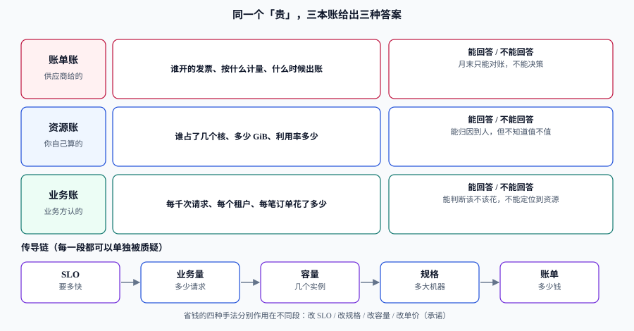

# 总览：三本账与四个决策点

「这个月成本有点高」不是一句可以被讨论的话。它至少有三种完全不同的意思：**你买贵了**（单价问题）、**你买多了**（容量问题）、**你买的东西没人用**（浪费问题）。三者的责任人、修法、验收标准都不同，而它们在一张账单上长得一模一样。

这一页做两件事：把「成本」拆成**三本账**，让每种「贵」都有归处；把治理拆成**四个决策点**，让每个决策都能说清「需要什么输入、谁签字、错了怎么发现」。

## 判据族声明

本页判据族 `CCO-A` ~ `CCO-H`，共 8 条。定义表在第七节。

## 一、先说清「贵」的三种来源

同一个 30% 的涨幅，三种来源的处理方式完全不同：

| 来源 | 典型信号 | 该谁处理 | 修法与代价 |
| --- | --- | --- | --- |
| **单价贵** | 用量没变、单价变了（换规格、丢掉折扣、跨区流量） | 采购 + 架构 | 改规格、买承诺、改链路；**代价是灵活度** |
| **容量多** | 单价没变、实例数涨了（水位低但仍在扩容） | 平台 + 业务负责人 | 右调规格、改扩缩容策略；**代价是变更风险** |
| **用不上** | 资源存在但没被使用（孤悬卷、闲置环境、虚高 `requests`） | 资源所有者 | 回收、按作息停机；**代价是沟通成本** |

::: tip 一句话判断顺序
先问「**用量变了吗**」，再问「**单价变了吗**」，最后问「**这些用量还在被用吗**」。顺序反了，就会把「业务增长」当成「浪费」去砍，也会把「没人用的资源」当成「业务需要」去优化。
:::

## 二、三本账：同一个「贵」，三种答案



三本账的区别不在精度，而在**回答的问题**：

| 账 | 数据来源 | 一句话 | 能回答 | 不能回答 |
| --- | --- | --- | --- | --- |
| **账单账** | 供应商（发票、用量明细、FOCUS 数据集） | 「供应商收了你多少钱」 | 总计、按服务、按账期、按合同折扣 | 谁用的、值不值 |
| **资源账** | 你自己的采集（K8s 指标、云监控、CMDB） | 「谁占了多少资源」 | 归因到团队/服务/命名空间、利用率 | 这笔占用该不该存在 |
| **业务账** | 业务系统（订单、请求、租户、活跃用户） | 「每单位业务量花了多少」 | 效率是否退化、增长是否健康 | 具体哪台机器要多买 |

三本账必须能**互相勾稽**：资源账的合计要能对上账单账的合计（误差只允许来自未分摊与舍入），业务账的分母要能在业务系统里被复算。勾稽不上时，不要急着解释差异，先检查**时间窗口是否一致**——账单按自然月、指标按 UTC 天、业务报表按北京时间，这是最常见的「对不上」。

## 三、传导链：五段，每一段都可以被单独质疑

```text
SLO（要多快） → 业务量（多少请求） → 容量（几个实例） → 规格（多大机器） → 账单（多少钱）
```

这条链的价值在于：**任何一次降本，都是在链上某一段动手**，而每一段的改动都有代价，且代价落在不同的人身上。

| 段 | 动手方式 | 代价 | 谁疼 |
| --- | --- | --- | --- |
| SLO | 把 99.9% 降到 99% | 错误预算从 43 分钟涨到 7.2 小时 | 用户 |
| 业务量 | 限流、去重、缓存、合并请求 | 功能受限或复杂度上升 | 产品 |
| 容量 | 降副本数、缩水位线 | 峰值余量变薄 | 值班 |
| 规格 | 换更小机型、混部 | 单机能力下降、可能触发重写 | 开发 |
| 单价 | 承诺折扣、阶梯、换供应商 | 锁定 1~3 年 | 采购与财务 |

**判据的含义**：如果一个降本方案说不清「动的是哪一段、代价由谁承担」，它就不是方案，是愿望。

## 四、四个决策点

治理之所以会退化成「每个月看一次账单然后叹气」，是因为没有人被告知「你在什么时刻必须做一个什么决定」。容量与成本治理只有四个真正的决策点：

| 决策点 | 什么时候做 | 必须的输入 | 输出 | 做错的典型后果 |
| --- | --- | --- | --- | --- |
| **① 要不要加容量** | 水位线触顶、活动日历临近、新功能上线前 | 单实例能力（来自压测）、峰值预测 P90、水位线 | 加几个、什么时候加、到期日 | 加了没用（预测错）或加晚了（事故） |
| **② 要不要买承诺** | 季度评审、大额新增长期负载 | 稳定基线（P10）、覆盖率与利用率、到期分布 | 买多少、买哪种、买几年 | 买多了闲置，买少了没省到 |
| **③ 钱记在谁头上** | 每月归集、新团队/新服务上线 | 标签覆盖、未分摊池、分摊规则 | 分摊报表、责任人清单 | 账分不下去，省钱的动力消失 |
| **④ 这个环境还要不要** | 每月浪费清单、项目结束 | 使用率分位、最后访问时间、责任人确认 | 保留 / 停机作息 / 回收 | 误删生产依赖，或长期养着僵尸环境 |

四个决策点里，**③ 是前置条件**：分不到人，①②④ 都没有责任人，也就没有执行者。

## 五、五种失败模式

这五种模式在真实团队里反复出现，且每一种都有「看起来在做治理」的外表：

1. **只优化不分摊**。所有人都知道总账单，没人知道自己那份。结果是平台团队单方面降配，业务侧无感，下季度反弹。
2. **只分摊不决策**。报表做得很漂亮，但没有任何一个会议用它做决定。三个月后报表停更，因为「没人看」。
3. **只降单价不看用量**。买了一年承诺，同时业务量涨了 50%，账单还是涨——但这次是**锁定的涨**。
4. **只买承诺不看变动**。为「稳定基线」买 3 年，结果半年后架构换掉，承诺还在扣钱。
5. **只看月度总量不看日粒度**。月末发现超支，归因窗口已过，只能写说明；而真正的异常发生在当月 8 号。

::: danger 一个反直觉的结论
**最贵的不是闲置资源，是「没有人负责的资源」。** 闲置资源只要有人负责，一次清理就结束；没人负责的资源会持续存在，并且在每次扩容时被当成「基线」一起放大。
:::

## 六、五步起步（30 天内能做完）

从零开始时不要先买工具，先做这五步，每一步都有可验收的产出：

1. **定一本账的口径**（第 1 周）：账单周期、币种、含税与否、折扣入账方式写成一页纸。产出：口径说明，含「与财务口径的三处差异」。
2. **把标签补到能归集**（第 1~2 周）：四个必备键（见 [归集与分摊](../Allocation/index.md)），覆盖率从 X% 提到 90% 以上。产出：未分摊金额占比读数。
3. **做一张能对上的分摊报表**（第 2~3 周）：合计与账单误差小于 1%。产出：报表 + 三条复算 SQL。
4. **立一个单位成本指标**（第 3 周）：选一个分母，锁定口径，连续观察 4 周。产出：一条时间序列，含两次口径变更记录。
5. **定一条预算与一条告警**（第 4 周）：预算按团队、告警按日环比，且每条告警都写清「收到后做什么」。产出：告警规则 + 处置手册链接。

## 七、判据定义表

| 判据 | 约定 | 定错了会怎样 | 怎么验证 |
| --- | --- | --- | --- |
| `CCO-A` | 每个成本结论必须指明属于哪一本账（账单 / 资源 / 业务） | 三种「贵」混为一谈，修法互相打架 | 抽查最近 5 条成本结论，每条都能标出账别 |
| `CCO-B` | 三本账的合计必须能勾稽，差异有名称 | 报表与账单长期差 15%，没人信 | `sum(分摊) / sum(账单)` 落在 0.99~1.01 |
| `CCO-C` | 每个降本方案必须写明动的是传导链哪一段 | 方案无法评估代价，落地即返工 | 方案模板里有「段」与「代价承担方」两栏且非空 |
| `CCO-D` | 四个决策点各有明确责任人 | 决策悬空，出事后互相指 | 责任人表里四行都有人名（不是团队名） |
| `CCO-E` | 分摊是加容量与回收的前置条件 | 没有责任人，清理清单执行率接近 0 | 最近一次回收清单里，责任人字段非空比例 100% |
| `CCO-F` | 承诺只在「稳定基线」上买，不按峰值买 | 买完即闲置，节省变成沉没成本 | 承诺覆盖率与 P10 基线的比值 ≤ 1.1 |
| `CCO-G` | 预算与异常必须分开发、分开路由 | 合成一条后三类都不被信任 | 告警配置里预算类与异常类是两个独立规则 |
| `CCO-H` | 所有口径变更必须留时间戳与原因 | 曲线断点被当成「效率突变」 | 单位成本序列上每个断点都有对应记录 |

## 如何验证

用三条命令验证「三本账能不能勾稽」这件事本身（不需要真实账单，用估值即可）：

```shell
# ① 分摊合计与账单合计的比值（示例数据：账单 100000，分摊 99750）
/Users/cuifendemac/.workbuddy/binaries/python/versions/3.13.12/bin/python3 -c "print(round(99750/100000, 4))"
```

**预期输出**：`0.9975`。落在 `0.99~1.01` 之外时，先查未分摊池是否被漏掉，再查时间窗口。

```shell
# ② 未分摊占比（目标 < 5%）
/Users/cuifendemac/.workbuddy/binaries/python/versions/3.13.12/bin/python3 -c "print(f'{2500/100000:.2%}')"
```

**预期输出**：`2.50%`。

```shell
# ③ 四个决策点的责任人是否都写了人名（应为 4；空值会少算）
printf '容量|张三\n承诺|李四\n分摊|王五\n回收|赵六\n' | awk -F'|' 'length($2)>0' | wc -l
```

**预期输出**：`4`。若小于 4，说明有决策点只写了团队名或留空。

## 与「分布式调度与任务编排」的分工（第 180 天补充）

| 问题 | 归哪一页 |
| --- | --- |
| 水位线、弹性策略、单位成本 | **本页** |
| 批处理任务把容量打满（补跑风暴） | [分布式调度与任务编排](../../../Backend/DistributedScheduling/index.md) 的「misfire 与补跑」 |
| 定时任务与在线流量抢资源 | 该页的「追赶降速」闸门；本页给出容量预算 |
| 任务密度与调度精度 | 该页的「轮询周期 vs 查询成本」读数 |

> 该页特有的一个坑：容量规划通常只算「稳态 + 峰值」，而补跑是**第三种形态**——它按「停机时长 / 周期」放大，且发生在你最不希望它发生的时刻（刚恢复、缓存全冷）。容量预算里必须留一档给补跑，或明确写出「补跑上限」。

## 参考资料

- [FinOps Foundation · FinOps Framework](https://www.finops.org/framework/)——「理解用量与成本 → 量化业务价值 → 优化 → 治理」的四域划分
- [FOCUS Specification](https://focus.finops.org/)——账单账的标准化列名，三本账勾稽的公共语言
- [OpenCost · Allocation API](https://opencost.io/docs/api/)——资源账的接口形态与分摊口径示例
- 上一站：[容量与成本治理](../index.md) · 下一站：[容量台账与预测](../CapacityPlan/index.md)
