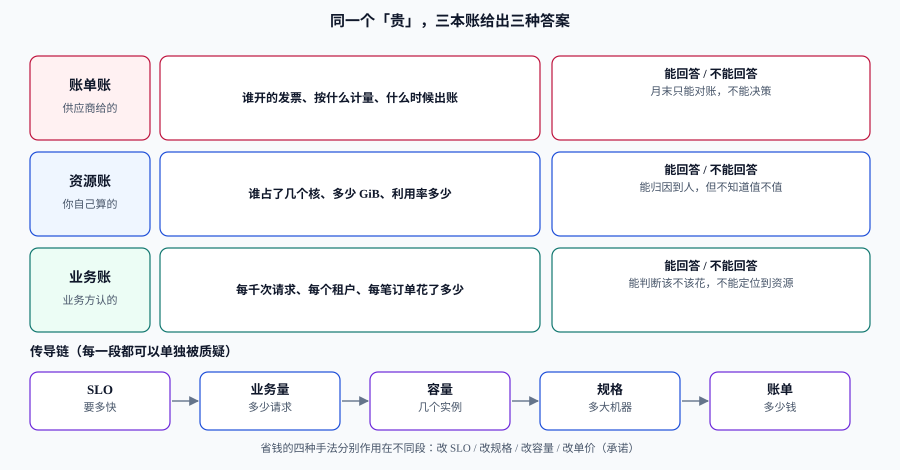

# 总览：三本账与四个决策点

「这个月成本有点高」不是一句可以被讨论的话。它至少有三种完全不同的意思：**你买贵了**（单价问题）、**你买多了**（容量问题）、**你买的东西没人用**（浪费问题）。三者的责任人、修法、验收标准都不同，而它们在一张账单上长得一模一样。

这一页做两件事：把「成本」拆成**三本账**，让每种「贵」都有归处；把治理拆成**四个决策点**，让每个决策都能说清「需要什么输入、谁签字、错了怎么发现」。

## 判据族声明

本页判据族 `CCO-A` ~ `CCO-H`，共 8 条。定义表在第七节。

## 一、先说清「贵」的三种来源

同一个 30% 的涨幅，三种来源的处理方式完全不同：

| 来源 | 典型信号 | 该谁处理 | 修法与代价 |
| --- | --- | --- | --- |
| **单价贵** | 用量没变、单价变了（换规格、丢掉折扣、跨区流量） | 采购 + 架构 | 改规格、买承诺、改链路；**代价是灵活度** |
| **容量多** | 单价没变、实例数涨了（水位低但仍在扩容） | 平台 + 业务负责人 | 右调规格、改扩缩容策略；**代价是变更风险** |
| **用不上** | 资源存在但没被使用（孤悬卷、闲置环境、虚高 `requests`） | 资源所有者 | 回收、按作息停机；**代价是沟通成本** |

::: tip 一句话判断顺序
先问「**用量变了吗**」，再问「**单价变了吗**」，最后问「**这些用量还在被用吗**」。顺序反了，就会把「业务增长」当成「浪费」去砍，也会把「没人用的资源」当成「业务需要」去优化。
:::

## 二、三本账：同一个「贵」，三种答案



三本账的区别不在精度，而在**回答的问题**：

| 账 | 数据来源 | 一句话 | 能回答 | 不能回答 |
| --- | --- | --- | --- | --- |
| **账单账** | 供应商（发票、用量明细、FOCUS 数据集） | 「供应商收了你多少钱」 | 总计、按服务、按账期、按合同折扣 | 谁用的、值不值 |
| **资源账** | 你自己的采集（K8s 指标、云监控、CMDB） | 「谁占了多少资源」 | 归因到团队/服务/命名空间、利用率 | 这笔占用该不该存在 |
| **业务账** | 业务系统（订单、请求、租户、活跃用户） | 「每单位业务量花了多少」 | 效率是否退化、增长是否健康 | 具体哪台机器要多买 |

三本账必须能**互相勾稽**：资源账的合计要能对上账单账的合计（误差只允许来自未分摊与舍入），业务账的分母要能在业务系统里被复算。勾稽不上时，不要急着解释差异，先检查**时间窗口是否一致**——账单按自然月、指标按 UTC 天、业务报表按北京时间，这是最常见的「对不上」。

## 三、传导链：五段，每一段都可以被单独质疑

```text
SLO（要多快） → 业务量（多少请求） → 容量（几个实例） → 规格（多大机器） → 账单（多少钱）
```

这条链的价值在于：**任何一次降本，都是在链上某一段动手**，而每一段的改动都有代价，且代价落在不同的人身上。

| 段 | 动手方式 | 代价 | 谁疼 |
| --- | --- | --- | --- |
| SLO | 把 99.9% 降到 99% | 错误预算从 43 分钟涨到 7.2 小时 | 用户 |
| 业务量 | 限流、去重、缓存、合并请求 | 功能受限或复杂度上升 | 产品 |
| 容量 | 降副本数、缩水位线 | 峰值余量变薄 | 值班 |
| 规格 | 换更小机型、混部 | 单机能力下降、可能触发重写 | 开发 |
| 单价 | 承诺折扣、阶梯、换供应商 | 锁定 1~3 年 | 采购与财务 |

**判据的含义**：如果一个降本方案说不清「动的是哪一段、代价由谁承担」，它就不是方案，是愿望。

## 四、四个决策点

治理之所以会退化成「每个月看一次账单然后叹气」，是因为没有人被告知「你在什么时刻必须做一个什么决定」。容量与成本治理只有四个真正的决策点：

| 决策点 | 什么时候做 | 必须的输入 | 输出 | 做错的典型后果 |
| --- | --- | --- | --- | --- |
| **① 要不要加容量** | 水位线触顶、活动日历临近、新功能上线前 | 单实例能力（来自压测）、峰值预测 P90、水位线 | 加几个、什么时候加、到期日 | 加了没用（预测错）或加晚了（事故） |
| **② 要不要买承诺** | 季度评审、大额新增长期负载 | 稳定基线（P10）、覆盖率与利用率、到期分布 | 买多少、买哪种、买几年 | 买多了闲置，买少了没省到 |
| **③ 钱记在谁头上** | 每月归集、新团队/新服务上线 | 标签覆盖、未分摊池、分摊规则 | 分摊报表、责任人清单 | 账分不下去，省钱的动力消失 |
| **④ 这个环境还要不要** | 每月浪费清单、项目结束 | 使用率分位、最后访问时间、责任人确认 | 保留 / 停机作息 / 回收 | 误删生产依赖，或长期养着僵尸环境 |

四个决策点里，**③ 是前置条件**：分不到人，①②④ 都没有责任人，也就没有执行者。

## 五、五种失败模式

这五种模式在真实团队里反复出现，且每一种都有「看起来在做治理」的外表：

1. **只优化不分摊**。所有人都知道总账单，没人知道自己那份。结果是平台团队单方面降配，业务侧无感，下季度反弹。
2. **只分摊不决策**。报表做得很漂亮，但没有任何一个会议用它做决定。三个月后报表停更，因为「没人看」。
3. **只降单价不看用量**。买了一年承诺，同时业务量涨了 50%，账单还是涨——但这次是**锁定的涨**。
4. **只买承诺不看变动**。为「稳定基线」买 3 年，结果半年后架构换掉，承诺还在扣钱。
5. **只看月度总量不看日粒度**。月末发现超支，归因窗口已过，只能写说明；而真正的异常发生在当月 8 号。

::: danger 一个反直觉的结论
**最贵的不是闲置资源，是「没有人负责的资源」。** 闲置资源只要有人负责，一次清理就结束；没人负责的资源会持续存在，并且在每次扩容时被当成「基线」一起放大。
:::

## 六、五步起步（30 天内能做完）

从零开始时不要先买工具，先做这五步，每一步都有可验收的产出：

1. **定一本账的口径**（第 1 周）：账单周期、币种、含税与否、折扣入账方式写成一页纸。产出：口径说明，含「与财务口径的三处差异」。
2. **把标签补到能归集**（第 1~2 周）：四个必备键（见 [归集与分摊](../Allocation/index.md)），覆盖率从 X% 提到 90% 以上。产出：未分摊金额占比读数。
3. **做一张能对上的分摊报表**（第 2~3 周）：合计与账单误差小于 1%。产出：报表 + 三条复算 SQL。
4. **立一个单位成本指标**（第 3 周）：选一个分母，锁定口径，连续观察 4 周。产出：一条时间序列，含两次口径变更记录。
5. **定一条预算与一条告警**（第 4 周）：预算按团队、告警按日环比，且每条告警都写清「收到后做什么」。产出：告警规则 + 处置手册链接。

## 七、判据定义表

| 判据 | 约定 | 定错了会怎样 | 怎么验证 |
| --- | --- | --- | --- |
| `CCO-A` | 每个成本结论必须指明属于哪一本账（账单 / 资源 / 业务） | 三种「贵」混为一谈，修法互相打架 | 抽查最近 5 条成本结论，每条都能标出账别 |
| `CCO-B` | 三本账的合计必须能勾稽，差异有名称 | 报表与账单长期差 15%，没人信 | `sum(分摊) / sum(账单)` 落在 0.99~1.01 |
| `CCO-C` | 每个降本方案必须写明动的是传导链哪一段 | 方案无法评估代价，落地即返工 | 方案模板里有「段」与「代价承担方」两栏且非空 |
| `CCO-D` | 四个决策点各有明确责任人 | 决策悬空，出事后互相指 | 责任人表里四行都有人名（不是团队名） |
| `CCO-E` | 分摊是加容量与回收的前置条件 | 没有责任人，清理清单执行率接近 0 | 最近一次回收清单里，责任人字段非空比例 100% |
| `CCO-F` | 承诺只在「稳定基线」上买，不按峰值买 | 买完即闲置，节省变成沉没成本 | 承诺覆盖率与 P10 基线的比值 ≤ 1.1 |
| `CCO-G` | 预算与异常必须分开发、分开路由 | 合成一条后三类都不被信任 | 告警配置里预算类与异常类是两个独立规则 |
| `CCO-H` | 所有口径变更必须留时间戳与原因 | 曲线断点被当成「效率突变」 | 单位成本序列上每个断点都有对应记录 |

## 如何验证

用三条命令验证「三本账能不能勾稽」这件事本身（不需要真实账单，用估值即可）：

```shell
# ① 分摊合计与账单合计的比值（示例数据：账单 100000，分摊 99750）
/Users/<用户名>/.workbuddy/binaries/python/versions/3.13.12/bin/python3 -c "print(round(99750/100000, 4))"
```

**预期输出**：`0.9975`。落在 `0.99~1.01` 之外时，先查未分摊池是否被漏掉，再查时间窗口。

```shell
# ② 未分摊占比（目标 < 5%）
/Users/<用户名>/.workbuddy/binaries/python/versions/3.13.12/bin/python3 -c "print(f'{2500/100000:.2%}')"
```

**预期输出**：`2.50%`。

```shell
# ③ 四个决策点的责任人是否都写了人名（应为 4；空值会少算）
printf '容量|张三\n承诺|李四\n分摊|王五\n回收|赵六\n' | awk -F'|' 'length($2)>0' | wc -l
```

**预期输出**：`4`。若小于 4，说明有决策点只写了团队名或留空。

## 与「分布式调度与任务编排」的分工（第 180 天补充）

| 问题 | 归哪一页 |
| --- | --- |
| 水位线、弹性策略、单位成本 | **本页** |
| 批处理任务把容量打满（补跑风暴） | [分布式调度与任务编排](../../../Backend/DistributedScheduling/index.md) 的「misfire 与补跑」 |
| 定时任务与在线流量抢资源 | 该页的「追赶降速」闸门；本页给出容量预算 |
| 任务密度与调度精度 | 该页的「轮询周期 vs 查询成本」读数 |

> 该页特有的一个坑：容量规划通常只算「稳态 + 峰值」，而补跑是**第三种形态**——它按「停机时长 / 周期」放大，且发生在你最不希望它发生的时刻（刚恢复、缓存全冷）。容量预算里必须留一档给补跑，或明确写出「补跑上限」。

## 与本专题的分工（订阅计费）

本页算的是**你付出去的钱**（云账单），[订阅计费](../../../Backend/SubscriptionBilling/index.md)算的是**你收回来的钱**（客户账单）。两者的周期、税率、对账对象完全不同。

| 维度 | 云账单（本页） | 客户账单 |
| --- | --- | --- |
| 周期由谁定 | 供应商（多为自然月，按供应商时区） | 你的合同（自然月或周年日） |
| 条目粒度 | SKU × 用量 × 单价 | 订阅 / 折算 / 用量 / 结转 / 调整 / 红冲 |
| 对账对象 | 供应商对账单 ⇄ 你的分摊表 | 账单 ⇄ 支付 ⇄ 账务 |
| 税额 | 供应商开票给你（进项） | 你开票给客户（销项） |

::: danger 别用云账单去核客户账单
两者周期不同源，硬核会得到「毛利逐月波动」的假象：某月云成本按自然月结算，而客户账单按周年日滚动，月中永远有一批「已发生成本、未出账收入」。正确做法是各算各的，再用**同一口径的服务期间**（`service_start` / `service_end`）对齐，见[三向对账 · 收入确认](../../../Backend/SubscriptionBilling/Reconciliation/index.md)。
:::

## 与「开放平台 · 配额」的分工（第 222 天补充）
| 这一页讲的 | 开放平台专题讲的 |
| --- | --- |
| 容量怎么估、单位成本怎么算、扩容阈值 | 单个客户的**配额**怎么定、超了怎么拒绝 |
| 面向**自己**：留多少余量 | 面向**客户**：承诺多少额度 |
| 结论是「加机器 / 加缓存」 | 结论是「429 还是超额计费」 |

**这一页特有的一个坑**：用「平均 QPS」做容量规划，同时用「峰值 QPS」做客户配额。本机算过一组数：100 万次/月 平均只有 **0.39 次/秒**，但客户完全可以在 60 秒内打完（**16,667 次/秒**）。按平均做容量，一次批量任务就把集群打穿；按峰值做容量，成本是需求的一百倍。两套数必须分开：容量按 p99 峰值 × 安全系数，配额按合同写「速率 + 突发」两个数。详见[配额、限流与用量](../../../Backend/OpenPlatform/QuotaUsage/index.md)。

## 与「收入确认与递延收入工程」的分工（第 226 天补充）

| 本页 | 那一册 |
| --- | --- |
| 云成本按自然月结算、按服务期间对齐 | 收入按履约进度确认、按期间归属 |
| 单位成本、毛利测算 | 交易价格、分摊与递延 |
| 容量与成本的量纲 | 收入的口径与披露的三张表 |
| 成本侧的「已发生未出账」 | 收入侧的「已履约未开票」（合同资产） |

::: warning 这一页特有的一个坑：用「自然月成本 ÷ 自然月收入」算毛利率
成本按自然月出账、收入按服务期确认，两者周期不同源。硬除会得到「毛利逐月波动」的假象：月中永远有一批「已发生成本、未出账收入」，季度末又反过来。

判据：毛利率的分母与分子必须**同期间、同口径**——要么都用服务期间（`service_start` / `service_end`），要么都用账期，并在看板上标注用的是哪一个。两个口径都算一遍、差额能解释，才算读懂了这张图。收入侧的期间归属见[收入确认 · 披露口径与月结](../../../Backend/RevenueRecognition/Disclosure/index.md)。
:::

## 与「仓储作业与波次拣选工程」的分工（第 228 天补充）

| 维度 | 本页（容量与成本） | [作业度量与产能](../../../Backend/WarehouseOps/Metrics/index.md) |
| --- | --- | --- |
| 回答的问题 | 这套系统一个月花多少钱、能扛多少量 | 现场一小时能干多少活、卡在哪 |
| 关键输入 | 实例数、存储、带宽 | UPH、行走占比、短拣率 |
| 换算关系 | 成本 ÷ 处理量 = 单均成本 | 处理量 = 人数 × UPH × 有效工时 |

::: danger 这一页特有的一个坑
把 UPH 的分母写成「出勤工时」：等待、开会、找货全算进去，算出来的 UPH 偏低，于是
「需要加人」的结论被反复得出，而真正的瓶颈是行走占比（本机读数 56.7%）。**成本模型
必须用纯作业工时**，否则容量规划会系统性高估人力需求。
:::


## 与「资产台账与折旧摊销工程」的分工（第 229 天补充）

| 你关心的问题 | 该读哪一册 | 分界 |
| --- | --- | --- |
| 「这台机器的月成本怎么算进单位成本」 | 本页 | 讲容量、单位经济性与预算归口 |
| 「折旧金额是怎么算出来的」 | [折旧方法与月度引擎](../../../Backend/FixedAsset/Depreciation/index.md) | 那册讲方法、寿命、尾差与重跑幂等 |
| 「自建 vs 租用，折旧该不该算进去」 | [资产卡片与组件拆分](../../../Backend/FixedAsset/AssetCard/index.md) | 那册讲组件折旧，决定「一台机器」其实是几张卡 |

::: danger 一页一坑：把折旧当变动成本摊进单位成本
折旧是**期间固定成本**：这个月开机 10 小时还是 700 小时，折旧额都是同一个数。把它按「每 CPU 小时」摊进单位成本，会在低负载时算出极高的单位成本，然后得出「不如关掉」的结论——而关掉之后折旧照提，成本一分没少。

正确做法是把折旧放在「固定成本」一行，用**产能利用率**去看它被摊薄了多少；只有「按用量计费的云资源」才是变动成本。这两类混在一张表里，任何单位成本结论都不可信。
:::

## 与「资金管理与现金流预测工程」的分工（第 231 天补充）

| 你关心的问题 | 该读哪一册 | 为什么不是本册 |
| --- | --- | --- |
| 「一台机器一小时多少钱」 | 本册 | 本册管**单位成本与容量预算** |
| 「这笔钱什么时候要付出去」 | [13 周滚动预测与现金缺口](../../../Backend/Treasury/Forecast/index.md) | 那册管**现金时点**，本册管**成本归集** |
| 「闲置资金的成本算不算」 | [短期融资、额度与计息基准](../../../Backend/Treasury/Funding/index.md) | 那册管**机会成本与计息基准** |
| 「透支利息该摊到哪个业务」 | 本册 | 本册管**分摊口径**，那册管**利息怎么算出来** |

**这一页特有的一个坑**：把「容量成本」和「资金成本」用同一把尺子摊。容量成本按月摊（一台机器开不开都要付），资金成本按天算（余额每天在变，透支按日计息）。本机读数：5 个账户净头寸 3,700,000，分散计息 30 天 **7,130.14**，名义归集 **10,643.84**——差的 **3,513.70** 不是「成本高低」，而是「有没有把钱放到同一个池子里」。把它摊进容量成本，会得出「扩容不划算」的错误结论。

## 与本专题的分工（生产执行）

| 你关心的问题 | 该读哪一册 | 为什么不是本册 |
| --- | --- | --- |
| 「设备到底有多少可用产能」 | [排产、有限产能与交期承诺](../../../Backend/Manufacturing/Planning/index.md) | 那册讲**负荷 ρ 与排队**，本册讲**单位成本曲线** |
| 「OEE 三个因子怎么算」 | [排产、有限产能与交期承诺](../../../Backend/Manufacturing/Planning/index.md) | 那册给的是制造侧口径，本册关心「成本怎么摊」 |
| 「工时怎么归到工作中心」 | [报工、在制品与工序交接](../../../Backend/Manufacturing/Reporting/index.md) | 那册讲**归集粒度**，本册讲**归完之后的分摊** |

::: warning 一页一坑：OEE 的分母换一个，数就换一个量级
本机实测同一台设备：日历 480 min − 计划停机 45 − 故障 28 = 运行 407 min（可用率 0.848），乘性能 0.89、良品率 0.965 得 **OEE 72.8%**。只算「运行/日历」是 **84.8%**（高 12 个百分点），算「运行/日历 × 良品率」是 81.8%（高 9 个百分点），把计划停机也算成损失则是 94.2%（高 21.3 个百分点）。**四个数都能叫「设备利用率」**，摊成本时用哪个必须写死。
:::


## 与「设备维护与可靠性」专题的分工（第 233 天补充）

本册算的是「**一个单位产出要花多少钱**」，其中的产能是**有效产能**——已经被可用率折损过的那个数。那一册算的正是这个折损：单台 99.7% 的设备串成 12 台的线，整线只剩 96.46%。两册的交点是一个乘数。

| 你关心的问题 | 该读哪一册 | 为什么不是另一册 |
| --- | --- | --- |
| 单位成本曲线怎么画、拐点在哪 | 本册（[单位成本](../UnitEconomics/index.md)） | 那一册不算钱，只算可用时间 |
| 这条线的有效产能是多少 | [设备维护与可靠性](../../../Backend/EquipmentMaintenance/Reliability/index.md) | 本册把有效产能当输入，不推导它 |
| 加一台设备能不能降本 | 本册（[容量台账](../CapacityPlan/index.md)） | 那一册会告诉你「多一台的边际可用度增益」 |
| 停机一小时损失多少钱 | 两册都要看 | 本册给单位成本口径，那一册给停机时长 |

::: danger 一个把成本算低 15% 的默认假设：用铭牌产能当分母
用铭牌产能算单位成本，等于假设设备 100% 可用。本机数据：单台负荷口径可用率 99.70%，12 台串联后 **96.46%**；若再算上性能 88% 与质量 96.5%，OEE 只有 **84.66%**。

也就是说，按铭牌产能算出来的单位成本，**系统性低估了约 15%**。这个偏差不会在任何一张报表上显形，只会在年底「实际成本高于标准成本」时被归因为「原料涨价」。
:::

## 与「碳排放核算与 ESG 披露」的分工（第 237 天补充）

| 你关心的问题 | 该读哪一册 | 为什么不是本页 |
| --- | --- | --- |
| 「单位成本怎么算、容量怎么摊」 | 本页 | 判**每单位算力/存储的成本** |
| 「碳价怎么进单位成本」 | [披露、重述与履约](../../../Backend/CarbonAccounting/Disclosure/index.md) | 那册判**配额缺口与碳关税**，本页只把它当一项外部成本 |
| 「这一年的碳清单怎么算」 | [碳排放核算总览](../../../Backend/CarbonAccounting/Overview/index.md) | 那册判**边界与范围** |
| 「电力因子用哪个」 | [范围二双报](../../../Backend/CarbonAccounting/Scope2Dual/index.md) | 那册判**位置法/市场法与残差**，本页只取一个数入成本 |

::: warning 一页一坑：碳成本不是「单价 × 用量」
本页的成本模型是线性的，碳成本不是：免费配额先把一部分排放「抹掉」，缺口部分才计价，而配额价格本身是波动的。

本机实测：排放 500,000 t、免费配额 480,000 t，缺口 4.0%（20,000 t）；按 75 元/t 是 150 万元，按 60 元是 120 万元，按 100 元是 200 万元。**同一份排放，成本区间跨度 67%**。把它按「度电碳成本」摊进单位成本时，摊的是这个区间里的某一个点，而合同报价往往要覆盖整个区间。
:::

## 与「指标平台与语义层」专题的分工（第 242 天补充）

本页算的是「跑一次要多少钱」，指标平台决定「跑几次、扫多少行」。**预聚合省的是扫描，花的是存储与刷新**——两笔账要合起来算，只看一边会得出相反的结论。

| 维度 | 本页（容量与成本） | 指标平台 |
| --- | --- | --- |
| 计量对象 | CPU、内存、IO、出口流量 | 查询次数、扫描行数、缓存命中率 |
| 优化手段 | 加副本、换规格、降冷热分层 | 加粒度组合、提命中率、参数化 |
| 成本形态 | 固定成本 + 变动成本 | 存储成本 + 刷新成本 vs 扫描成本 |
| 风险 | 扩容不降单位成本 | 命中率低时预聚合纯亏 |

**一页一坑**：命中率从 60% 提到 85%，通常要多付约 3 倍存储与 2 倍刷新时间，而回退查询的 P95 可能只降 12%。判断标准不是命中率，而是**回退查询的 P95 延迟**：低于 2 秒就别加，超过 10 秒才值得买。见[预聚合与物化](../../../Backend/MetricPlatform/Aggregate/index.md)。

## 与「车队运输与调度」专题的分工（第 254 天补充）

本库新增 [车队运输与调度工程](../../../Backend/FleetTransport/Cost/index.md)，讲的是「一辆车装了什么、跑了多少、该收多少钱」的七段链。与本页的分界如下：

| 关注点 | 本页 | 车队运输与调度 |
| --- | --- | --- |
| 容量含义 | 机房容量（CPU/内存/存储） | **车辆运力**（车厢容积与核定载重） |
| 成本单位 | 元/核·时、元/TB·月 | 元/吨公里、元/车公里 |
| 扩容方式 | 加机器、升配 | 加车、提装载率、压空驶 |

::: danger 本页读者最容易踩的一个坑
「容量成本」在两个领域是同名不同义：机房的容量是「能同时跑多少」，车队的容量是「一趟能装多少」。把车队成本套进「容量利用率」模型会得出「装载率越高越省钱」的结论——但本机实测装载率从 62.5% 提到 80% 会让 **12.6% 的车次超载**，罚单与转运成本并不在容量模型里。
:::

## 与「充电桩运营与计费工程」专题的分工（第 255 天补充）

本页只讲「容量与成本」本身。充电桩侧的「三个电量口径、分时拆分、分成比例」由[充电桩运营与计费工程](../../../Backend/ChargingNetwork/Overview/index.md)讲透，这里不重复：

| 边界 | 本页负责 | 该专题负责 |
| --- | --- | --- |
| 口径归属 | 容量与成本自身的度量与状态 | 一根枪的三个电量、三个价、三个率 |
| 失败形态 | 本领域的典型缺陷 | 充电链路上的安静失败（积分偏小、单笔偏 49%） |
| 验证方式 | 本页的命令与预期输出 | 十表四触发器十五条断言 |

一处只在本页成立的坑：容量利用率有两个分母，混用会得出相反的结论。按功率算，本机单枪日均 103.5 kWh、额定 120 kW，利用率只有 3.6%——看起来「容量严重过剩」；但按并发算，P99 是 4 辆车、需求超过站容量的时长占 0.89%——说明「高峰确实不够用」。**「过剩」与「不够」同时成立，因为它们算的不是同一个东西**：前者是能量利用率，后者是功率峰值。

## 与「二手回收与以旧换新工程」专题的分工（第 256 天补充）

| 本页讲什么 | 回收册讲什么 | 为什么不互相替代 |
| --- | --- | --- |
| 一次请求/一台实例的成本与容量 | 一台旧机的全成本：结算价 + 翻新 + 保修准备金 | 本页的成本对象是「服务」，回收册的成本对象是「单台实物」，计量单位不同 |
| 容量按 QPS/并发算 | 容量按**工位时**算：质检 33.3 + 翻新 40.9 = 74.2 工位时/天 | 服务扩容按分钟，工位扩容按招聘周期 |

::: danger 只在本页成立的一个坑
把回收的单台成本算成「结算价」，会漏掉翻新（占上架价 6.10%）与保修准备金（0.38%），毛利率虚高约 6.5 个百分点。而且这个错误不会报错——它只会让「毛利率 29.5%」和「现金流」对不上。见[回收的翻新](../../../Backend/Recommerce/Refurbishment/index.md)。
:::

## 与「游戏匹配与赛季竞技工程」专题的分工（第 259 天补充）

本页与[游戏匹配与赛季竞技工程](../../../Backend/GameMatchmaking/index.md)专题相邻，先画清边界：

匹配的容量账和常规 API 完全不同：它的成本大头不在请求，而在**扫描**与**空转**。

| 维度 | 本页讲什么 | 匹配侧讲什么 |
| --- | --- | --- |
| 成本驱动 | 请求量 × 单请求成本 + 常驻资源 | **每秒扫描次数 × 窗口内候选数**，与请求量几乎无关 |
| 空转 | 空闲实例要缩到零 | 队列里有 1 个人也得有 worker 在扫，**缩不到零** |
| 扩容信号 | QPS、CPU、队列深度 | 队列**等待时长分布**（P90 先动，QPS 不动） |
| 单位成本 | 每万请求成本 | 每千场对局的匹配成本（含未成局的空转） |

本页回答「**这个月为什么贵了**」；匹配专题回答「**贵在哪一段**」。本机实测：同一份硬件，窗口从 ±50 放宽到 ±400，成局率从 37.5% 升到 97.2%，而**扫描代价上升 8.3 倍**——「把匹配放宽一点」在容量表上是一次**乘法**，不是一次加法。

::: danger 一个只在本页成立的坑
**用 CPU 利用率做匹配 worker 的扩容信号**。匹配 worker 的 CPU 曲线是**阶梯**的：队列稀疏时几乎为 0（每次扫描都空手而归），队列密集时陡升。按 70% 阈值扩容，会在「已经排了 200 人但还没成局」的时段里**完全不动**——因为扫描很快、CPU 很低。正确的信号是**队列等待时长的 P90**（本机 P90 超过 90 秒时，CPU 仍只有 12%）。这条只在本页成立，因为常规服务里 P90 与 CPU 是同向的。
:::

## 参考资料

- [FinOps Foundation · FinOps Framework](https://www.finops.org/framework/)——「理解用量与成本 → 量化业务价值 → 优化 → 治理」的四域划分
- [FOCUS Specification](https://focus.finops.org/)——账单账的标准化列名，三本账勾稽的公共语言
- [OpenCost · Allocation API](https://opencost.io/docs/api/)——资源账的接口形态与分摊口径示例
- 上一站：[容量与成本治理](../index.md) · 下一站：[容量台账与预测](../CapacityPlan/index.md)
