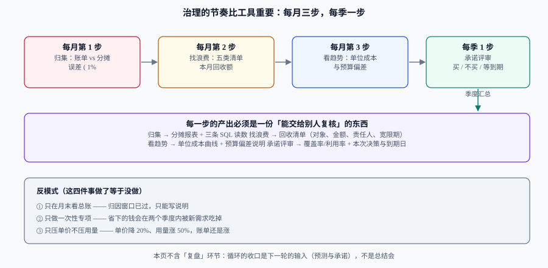

# 实战：一个季度的治理循环

前面八页各自解决一个问题，这一页把它们装进一个**能重复跑的循环**：每月三步、每季一步，每一步都有输入、产出与判据。所有数字来自一个虚构但完整的场景——月账单 120,000 元的中型 SaaS，两个集群、六个团队、一个没做完的标签治理。

照着做完一轮，你会得到七份交付物（第八节）；做完两轮，你会得到一条能对外解释的成本曲线。

## 判据族声明

本页判据族 `CCP-A` ~ `CCP-H`，共 8 条。定义表在第九节。

## 一、前置：四个数据源，缺一个就会退化成猜

| 数据源 | 最小要求 | 拿不到时的替代 |
| --- | --- | --- |
| **账单明细** | 按资源/服务/标签的日粒度成本，至少 3 个月历史 | 只有月度总账时，先做账户级归集，放弃服务级 |
| **资源用量** | 每 5 分钟~1 小时的 CPU/内存/存储/网络用量 | 用云监控的日粒度，但**异常检测要放弃小时级** |
| **业务量** | 请求数、订单数、活跃租户（与业务方同一口径） | 用网关日志自算，并在报表里注明「与业务口径差异」 |
| **责任人映射** | 服务 → 团队 → 人 | 从 CMDB 或代码仓库的 `CODEOWNERS` 提取 |

::: warning 顺序不能反
先有账单与用量，再谈分摊；先有分摊，再谈回收与承诺。**在没有分摊的情况下做回收，回收清单会被当成「平台在乱删东西」**；在没有基线的情况下买承诺，等于给未知用量上锁。
:::

## 二、循环的形状



| 频率 | 步骤 | 输入 | 产出 | 耗时（一个人） |
| --- | --- | --- | --- | --- |
| 每月 | ① 归集与对账 | 账单 + 用量 + 标签 | 分摊报表（误差 < 1%） | 0.5 天 |
| 每月 | ② 找浪费 | 分摊报表 + 分位指标 | 回收清单（对象、金额、责任人、宽限期） | 1 天 |
| 每月 | ③ 看趋势 | 单位成本序列 + 预算执行 | 一页偏差说明（量效应 / 价效应） | 0.5 天 |
| 每季 | ④ 承诺评审 + 门禁校准 | 覆盖率/利用率 + 到期台账 + 上月偏离 | 购买决定 + 门禁规则更新 | 0.5 天 |

合计约 2.5 人天/月。**超过 5 人天说明工具链有问题**（多半是手工对账），不是治理本身重。

## 三、第 1 个月：先把账分开

### 步骤 1：定口径（一页纸）

写清五件事：账单周期（自然月，UTC+8）、币种与汇率来源、含税与否、折扣入账方式（实付 / 摊销）、共享成本的分摊方法。这一页纸是后面所有争议的仲裁依据。

### 步骤 2：补标签，量化未分摊

现状读数：账单 120,000 元，其中能按 `owner` 归集的 84,000 元（70%），未分摊 36,000 元（30%）。

```sql
-- 未分摊金额与占比（按标签是否存在判定，注意空字符串也算缺失）
select
  round(sum(case when tags_owner is null or tags_owner = '' then cost else 0 end), 2) as unallocated,
  round(sum(cost), 2) as total,
  round(sum(case when tags_owner is null or tags_owner = '' then cost else 0 end) / sum(cost), 4) as ratio
from billing_daily
where usage_date >= date '2026-07-01' and usage_date < date '2026-08-01';
```

**预期读数**：`unallocated = 36000.00`、`total = 120000.00`、`ratio = 0.3000`。

动作：给三类大头补标签（集群节点池、对象存储桶、负载均衡），两周后复跑上面这条 SQL，目标是 `ratio < 0.10`。

### 步骤 3：出第一版分摊报表

| team | 直接成本 | idle 分摊 | 共享分摊 | 合计 | 占比 |
| --- | --- | --- | --- | --- | --- |
| payments | 28,400 | 4,100 | 2,600 | 35,100 | 29.3% |
| search | 22,600 | 3,300 | 2,100 | 28,000 | 23.3% |
| growth | 16,900 | 2,500 | 1,600 | 21,000 | 17.5% |
| platform | 12,300 | 1,800 | 8,900 | 23,000 | 19.2% |
| 未分摊 | 4,800 | 0 | 8,100 | 12,900 | 10.8% |
| **合计** | **85,000** | **11,700** | **23,300** | **120,000** | **100%** |

**这一步的验收只有一条**：合计 = 120,000.00，差额为 0。差额不为 0 时不要调「其他」行凑数，去找漏掉的成本类别（最常见：跨区流量、快照、负载均衡、DNS 查询）。

## 四、第 2 个月：回收与右调

### 步骤 1：生成浪费清单（按金额排序）

| 类型 | 对象 | 月度金额 | 判据读数 | 责任人 | 动作 |
| --- | --- | --- | --- | --- | --- |
| 孤悬资源 | 12 块未挂载云盘 | 3,200 | 挂载数 0，最后访问 90 天前 | 各 owner | 直接回收（留快照 7 天） |
| 非生产作息 | `staging` 集群 18 节点 | 22,000 | 夜间 P95 CPU 3% | platform | 按 10×5 停机，预计省 65% |
| `requests` 虚高 | `search-api`（40 副本） | 12,000 | `requests/usage` = 6.2 | search | 右调到 400m，预计省 40% |
| 保留期过长 | 日志 90 天 → 30 天 | 6,000 | 30 天以上访问占比 2% | platform | 改保留策略，预计省 30% |

### 步骤 2：执行与读数

| 动作 | 生效 | 首月实际节省 | 与预估的差异 | 原因 |
| --- | --- | --- | --- | --- |
| 回收孤悬盘 | 第 1 周 | 3,200 | 一致 | —— |
| staging 停机 | 第 2 周 | 9,500 | 低于预估 14,300 | 首月只覆盖半个月；且夜间批处理保留 3 节点 |
| `requests` 右调 | 第 3 周 | 4,800 | **远低于预估的 13,000** | 按配置差算高估了，见下方说明 |
| 日志保留期 | 第 4 周 | 1,800 | 一致 | —— |

::: danger 右调的账要按「实际被调度掉的量」算，不要按配置差算
`search-api` 从 2000m 降到 400m，配置差是 1.6 核/副本，40 副本看起来该省 13,000 元/月。**实际只省了 4,800**，原因有二：① 节点没有缩容（副本密度提高后节点仍未打满，节点数不变）；② 部分节点是包年包月，缩容只影响弹性节点。

**正确写法**：右调的成本收益必须用「节点数变化 × 节点单价」计算，而不是「requests 差 × 单价」。这也是为什么右调要和 [容量台账](../CapacityPlan/index.md) 一起做——台账里没有「节点池可缩容量」，右调就只是改了配置。
:::

### 步骤 3：更新台账与预算

右调后单实例可承载副本数上升，节点池的目标容量下降。台账里更新「单节点可承载副本数」与「到期日」，预算里把节省额从下月起从额度中扣除——**否则预算会一直显示「有富余」，掩盖新的增长**。

## 五、第 3 个月：预算、承诺与门禁

### 步骤 1：预算校准

用近 3 个月去极值 P50 重算额度：

```text
新额度 = P50(近 3 月) × (1 + 业务增长 8%) + 已排期增量 4,000 + 缓冲 6%
       = 96,500 × 1.08 + 4,000 + 5,800 ≈ 114,000
```

同时把「非生产砍半」落成标签级预算：`env=dev|staging` 独立额度 8,000 元/月，超限即 P2。

### 步骤 2：承诺评审

| 项 | 读数 | 判读 |
| --- | --- | --- |
| 计算类稳定基线（P10，近 6 月） | 折合 45,000 元/月 | 这是可承诺的上限 |
| 当前覆盖率 | 0% | 完全按需，全部付标价 |
| 拟购买 | 27,000 元/月等价的 1 年期 Compute SP（覆盖基线的 60%） | 留 40% 给增长与波动 |
| 预期折扣 | 30%（1 年期） | 见 [承诺折扣治理](../Commitment/index.md) 的折扣表 |
| 预期月省 | 27,000 × 30% = 8,100 | 需利用率 > 70%（`1 − 0.30`） |
| 盈亏平衡利用率 | 70% | 基线用量下实际利用率约 95%，安全 |
| 到期台账 | 2027-10，占比 100% | **首次购买必然集中到期**，下一轮起分批错峰 |

### 步骤 3：门禁校准

三条门禁，落在 IaC 与 CI 上（不是落在文档里）：

```shell
#!/usr/bin/env bash
# 成本门禁 1：新资源必须带四个标签，否则 plan 失败
set -euo pipefail
terraform plan -out=/tmp/tfplan >/dev/null
terraform show -json /tmp/tfplan \
  | jq -e '[.resource_changes[] | select(.mode == "managed" and .change.actions[0] == "create")
            | select((.change.after.tags.owner // "") == ""
                  or (.change.after.tags.env // "") == ""
                  or (.change.after.tags["cost-center"] // "") == "")]
           | length == 0' >/dev/null \
  && echo "OK: 所有新建资源标签齐全" \
  || { echo "FAIL: 存在缺标签的新建资源"; exit 1; }
```

**预期输出**：`OK: 所有新建资源标签齐全`。出现 `FAIL` 时，`jq` 的中间结果会指出具体是哪个资源——把这条命令放进 CI，比开十次会有效。

另外两条门禁：**单服务月度预估成本超 2,000 元必须在 PR 里附成本说明**（用 Infracost 之类的工具在 PR 里贴出 diff）；**非生产环境资源默认带作息注解**（见 [闲置与浪费治理](../Waste/index.md)）。

## 六、季度评审：一次会，四个决定

评审会只做四件事，每件都必须有结论与责任人：

| 决定 | 需要的输入 | 可能的结论 |
| --- | --- | --- |
| ① 下季度容量是否需要提前加 | 台账 + 活动日历 | 加 / 不加 / 到期再看 |
| ② 承诺是否加买 | 覆盖率、利用率、到期台账 | 买 X 元等价 / 等下一季度 / 不买 |
| ③ 哪些浪费必须清零 | 上月回收清单执行率 | 名单 + 期限 + 升级路径 |
| ④ 门禁是否要收紧 | 本月新增资源的标签缺失率 | 收紧 / 维持 / 放宽（要有理由） |

::: tip 会议产出物是一张表，不是一份纪要
四个决定各一行：`决定 / 依据读数 / 责任人 / 期限 / 判据编号`。没有判据编号的决议无法验证是否执行——这正是本专题九族判据存在的意义。
:::

## 七、完整算例：120,000 → 95,900

| 项 | 金额（元/月） | 生效月 | 复算方式 | 判据 |
| --- | --- | --- | --- | --- |
| 基线账单 | 120,000 | M0 | 账单合计 | —— |
| 回收孤悬资源 | −3,200 | M1 | 12 块盘 × 单价 | `CCW-E` |
| 非生产作息（首月半月） | −9,500 | M1 | 14,300 元 × 0.66（首月只覆盖约 2/3 时间） | `CCW-D` |
| `requests` 右调（节点口径） | −4,800 | M1 | 缩掉的弹性节点 × 单价 | `CCW-A` |
| 日志保留期 90→30 天 | −1,800 | M1 | 存储单价 × 减少的 GiB | `CCW-B` |
| **季度末账单** | **95,900** | M3 | 逐项累加 | `CCP-C` |
| 承诺折扣（下季度生效） | −8,100 | M4 | 27,000 × 30% | `CCK-B` |
| **承诺生效后** | **87,800** | M4 | —— | —— |

降幅：季度末 **−20.1%**（24,100/120,000），承诺生效后 **−26.8%**。单位成本同步从 `120,000/258M = 465 元/百万请求` 降到 `95,900/258M = 372 元/百万请求`（假设业务量不变）。

**注意最后一行的假设**：业务量不变。若业务同期增长 10%，账单可能只降到 101,000 而单位成本降得更多——**汇报时必须同时给出总量与单位成本**，否则「降本」会被误解为「业务萎缩」。

## 八、七份交付物

| # | 交付物 | 验收 |
| --- | --- | --- |
| 1 | 口径说明（一页纸） | 五要素齐全（周期/币种/税/折扣/共享） |
| 2 | 分摊报表 + 三条复算 SQL | 合计 = 账单，误差 < 1% |
| 3 | 未分摊清单（按金额排序） | 占比 < 10%，有认领期限 |
| 4 | 浪费清单（对象/金额/责任人/宽限期） | 每行有判据读数 |
| 5 | 单位成本序列（含口径变更记录） | 断点有说明 |
| 6 | 预算与告警配置（三类信号分开） | 每条有动作与时限 |
| 7 | 承诺台账（含到期分布） | 单月到期 ≤ 12% |

## 九、判据定义表

| 判据 | 约定 | 定错了会怎样 | 怎么验证 |
| --- | --- | --- | --- |
| `CCP-A` | 每轮循环从同一天开始、用同一口径 | 月度数字不可比，趋势失效 | 报表页脚有生成时间与口径版本 |
| `CCP-B` | 归集误差 < 1% 才允许进入下一步 | 在错账上做决策 | 守恒 SQL 每月留档 |
| `CCP-C` | 每项节省必须写复算方式 | 数字无法复核，下次不再被信 | 节省表有「复算方式」列 |
| `CCP-D` | 右调收益按节点口径算，不按配置差算 | 高估 2~3 倍 | 节省额与节点数变化对应 |
| `CCP-E` | 回收清单必须有责任人与宽限期 | 执行率接近 0 | 清单字段完整性 100% |
| `CCP-F` | 承诺按 P10 基线买，且写盈亏平衡利用率 | 买完闲置 | 提案含两个数 |
| `CCP-G` | 季度会有四个决定、每项带判据编号 | 会议变成汇报 | 决议表有判据列 |
| `CCP-H` | 汇报同时给总量与单位成本 | 降本被误读为业务萎缩 | 报表两栏并列 |

## 如何验证

```shell
# ① 季度降幅与单位成本（业务量不变假设下）
/Users/cuifendemac/.workbuddy/binaries/python/versions/3.13.12/bin/python3 - <<'PY'
base, saved = 120_000, 24_100
after, requests_m = base - saved, 258.0
print(f"季度末账单 {after:,} 元，降幅 {saved/base:.1%}")
print(f"单位成本 {base/requests_m:.0f} → {after/requests_m:.0f} 元/百万请求")
print(f"承诺生效后 {after-8100:,} 元，累计降幅 {(base-(after-8100))/base:.1%}")
PY
```

**预期输出**：`季度末账单 95,900 元，降幅 20.1%`、`单位成本 465 → 372 元/百万请求`、`承诺生效后 87,800 元，累计降幅 26.8%`。

```shell
# ② 分摊守恒：五个团队的合计必须等于账单
/Users/cuifendemac/.workbuddy/binaries/python/versions/3.13.12/bin/python3 - <<'PY'
rows = [35100, 28000, 21000, 23000, 12900]
print("合计", sum(rows), "与账单 120000 的差", sum(rows) - 120_000)
PY
```

**预期输出**：`合计 120000 与账单 120000 的差 0`。差额不为 0 时，先查「未分摊」行是否被写成 0。

```shell
# ③ 门禁自检：确认脚本在缺标签时确实会失败（负向测试）
printf '{"resource_changes":[{"mode":"managed","change":{"actions":["create"],"after":{"tags":{"owner":"","env":"prod"}}}}]}' \
  | jq -e '[.resource_changes[] | select(.change.actions[0] == "create")
            | select((.change.after.tags.owner // "") == "")] | length == 0'
echo "rc=$?"
```

**预期输出**：`false` 与 `rc=1`。**门禁必须做一次负向测试**——只验证「合规时通过」的门禁，有一半的概率是永远通过。

## 参考资料

- [FinOps Foundation · FinOps Framework](https://www.finops.org/framework/)——本页循环对应的四个能力域
- [FOCUS Specification](https://focus.finops.org/)——报表字段的标准化口径
- [OpenCost · Allocation API](https://opencost.io/docs/api/)——分摊报表的数据来源之一
- [Infracost](https://www.infracost.io/docs/)——PR 内成本 diff 的实现参考
- 上一站：[承诺折扣治理](../Commitment/index.md) · 下一站：[常见问题与最佳实践](../FAQ/index.md)
