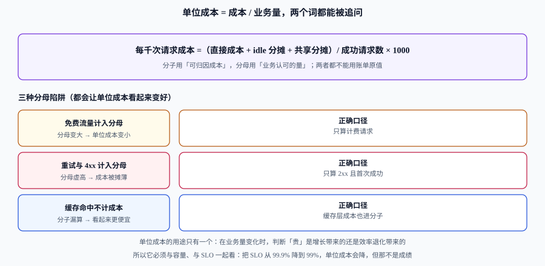

# 单位成本

总成本不能跨期比较：业务涨了 30%，账单涨 20% 其实说明**效率提高了**；业务跌了 10%，账单只跌 5% 说明**效率退化了**。唯一能跨期比较的量是**单位成本**——每千次请求、每个租户、每笔订单花了多少。

这一页讲四件事：分子分母各自的口径、分母的四种选法与三种陷阱、把「单位成本变化」分解成可归因的几块，以及**它必须和 SLO 一起看**的理由。

## 判据族声明

本页判据族 `CCU-A` ~ `CCU-H`，共 8 条。定义表在第八节。

## 一、单位成本回答的是「效率」，不是「金额」

| 问题 | 用总量回答 | 用单位成本回答 |
| --- | --- | --- |
| 这个月贵了吗 | 132,000 元，比上月多 32% | 每百万请求 511 元，比上月多 22.8% |
| 是增长还是浪费 | 分不清 | 增长只解释 7,500 元，其余 24,500 元要解释 |
| 优化有没有效 | 账单降了（可能只是业务跌了） | 单位成本降了才算数 |
| 能不能对外承诺 | 不能 | 可以（「每千单成本不超过 X 元」） |

::: tip 一句话
**总额是结果，单位成本是能力。** 汇报总额只能说明「花了多少」，汇报单位成本才能说明「花得值不值」。
:::

## 二、公式：分子分母都不能用账单原值



```text
每千次请求成本 = (直接成本 + idle 分摊 + 共享分摊) / 成功请求数 × 1000
```

| 部分 | 该用什么 | 不该用什么 | 为什么 |
| --- | --- | --- | --- |
| 分子·直接成本 | 该服务的账单行（含折扣后实付） | 标价（list price） | 标价会随合同变化，跨期不可比 |
| 分子·idle 分摊 | 按 `max(request, usage)` 占比摊 | 平均摊 | 平均摊会让「申请大、用得少」的服务占便宜 |
| 分子·共享分摊 | 按用量比例（请求/日志量/存储） | 按人头 | 共享成本随用量增长 |
| 分母 | **业务认可的量**（成功请求、订单、活跃租户） | 账单里的调用次数 | 账单计数包含重试、4xx、内部调用 |

分子分母都要能**被第三方复算**：给出输入与公式，任何人都能算出同一个数。做不到这一步的指标，一遇到争议就会失效。

## 三、分母的四种选法

| 分母 | 公式 | 适合 | 不适合 | 常见坑 |
| --- | --- | --- | --- | --- |
| **每千次请求** | 成本 / 2xx 请求数 × 1000 | API、网关、Serverless | 请求粒度差异极大的系统 | 把 4xx、重试算进去 |
| **每租户** | 成本 / 活跃租户数 | SaaS、多租户平台 | 租户规模差异 100 倍的场景 | 大客户被小客户平均掉 |
| **每笔订单** | 成本 / 已支付订单数 | 交易系统 | 浏览型业务 | 把取消单算进分母 |
| **每活跃用户** | 成本 / DAU 或 MAU | 内容、社交 | B 端 | DAU 口径每月被改一次 |

选择依据只有一条：**分母必须是「业务方也认的那个数」**。如果业务方的报表里没有这个数，你的单位成本就永远需要解释，而需要解释的指标不会被使用。

多租户系统建议**两级口径**：`每租户成本` 用于分摊，`每千请求成本` 用于效率比较。只用前者会被大客户拉偏，只用后者会掩盖「小客户不赚钱」。

## 四、三种分母陷阱

| 陷阱 | 表面上发生什么 | 真实发生什么 | 正确口径 |
| --- | --- | --- | --- |
| **免费流量计入分母** | 分母变大，单位成本变低 | 免费流量也消耗资源，但收入为 0 | 分开算：计费请求与免费请求各一条曲线 |
| **重试与 4xx 计入分母** | 分母虚高，成本被摊薄 | 重试是**成本的放大器**，不是业务量 | 只算 2xx 且首次成功；重试率单独成指标 |
| **缓存命中不计成本** | 分子漏算，看起来更便宜 | 缓存层自身有成本（内存、节点、回源） | 缓存层成本进分子，命中率进分母说明 |

第二个陷阱最阴险：**它会让「故障月」的单位成本看起来更漂亮**——因为故障期间重试暴涨，分母被撑大。用这张图汇报，会被误读成「这个月效率提升了」。

## 五、把变化拆开：量、价、结构、分母

单位成本涨了，先别急着下结论。用标准的差异分解，把总变化拆成可归因的几块：

```text
成本 = 请求量(Q) × 每百万请求成本(P)
总量变化 = (Q₁ − Q₀) × P₀          ← 量效应：业务增长「应该涨」的部分
         + Q₁ × (P₁ − P₀)          ← 价效应：效率变化「不该涨」的部分
```

算例（order-api，连续两个月）：

| 项 | 上月 | 本月 | 说明 |
| --- | --- | --- | --- |
| 请求量 Q | 240.0 M | 258.0 M | 增长 7.5% |
| 成本 | 100,000 元 | 132,000 元 | 增长 32% |
| 每百万请求成本 P | 416.67 元 | 511.63 元 | **增长 22.8%** |

```text
量效应 = (258 − 240) × 416.67 = 7,500 元     ← 业务增长带来的，合理
价效应 = 258 × (511.63 − 416.67) = 24,500 元 ← 效率退化带来的，必须解释
合计    = 32,000 元 ✓（与账单差额一致）
```

价效应的 24,500 元再往下拆，通常落在这三块：

| 子项 | 本月读数 | 贡献 | 归属 |
| --- | --- | --- | --- |
| 实例单价上涨（合同到期后按需） | 单价 +6% | 约 6,600 元 | 采购（见 [承诺折扣](../Commitment/index.md)） |
| idle 分摊占比从 8% 升到 15% | 集群利用率下降 | 约 9,200 元 | 平台（新集群水位过低） |
| `requests` 结构性虚高（新服务申请 2 核用 300m） | 虚高 1.6 倍 | 约 8,700 元 | 业务（见 [闲置治理](../Waste/index.md)） |

三块相加略大于 24,500（因交叉项），**这说明分解是近似的**——写结论时要把「交叉项」单列，不要硬凑到分。

## 六、单位成本必须和 SLO 一起看

单位成本可以靠**降 SLO** 变好：把重试关掉、把副本减半、把超时调短。这些动作都让数字更漂亮，但代价是可用性。所以两个指标必须画在同一张图上：

| 象限 | 单位成本 | 错误预算消耗 | 判读 |
| --- | --- | --- | --- |
| 左下 | 低 | 低 | 健康，保持 |
| 右下 | 低 | 高 | **危险**：靠砍可靠性换来的便宜 |
| 左上 | 高 | 低 | 有余量可优化（先查 idle 与 `requests`） |
| 右上 | 高 | 高 | 双重问题：先修可靠性，再谈成本 |

判据口径：**单位成本改善必须伴随错误预算消耗不上升**。若单位成本降了 10% 而错误预算消耗翻倍，这不是优化，是借贷。

## 七、AI 推理的单位成本：per-token

GPU 负载打破了「按核时摊」的模型：**成本随流量而非在线时长变化**，空闲的推理 Pod 几乎不花钱，打满时可能是空闲的几十倍。2026 年起这件事开始有标准做法：

| 事项 | 当前状态（2026-10） | 对口径的影响 |
| --- | --- | --- |
| OpenCost 计量能力 | 1.121.0（2026-07-20）起提供 **AI 推理按 token / 按请求**的成本归属；1.121.1（2026-08-05）修正了用量成本基准的缺陷 | **低于 1.121.1 不要用于对外报表**，否则数字系统性偏差 |
| 接入方式 | 推理服务（vLLM / TGI / Triton）上报 token 计数，与成本数据在数仓里按 SKU / 客户标签 join | 单位成本的分母第一次可以是真的「输出 token 数」 |
| 自建 vs 按量 API | 自建的成本随**利用率**变化一个数量级；按量 API 的单价固定 | 两者只在某个利用率之上才可比；**用「按量 API 单价 ÷ 自建单位成本」判断自建是否划算，必须先固定利用率假设** |

第三方测算（2026，单卡租赁与自建折旧口径，**非官方数据，仅作量级参考**）显示：同一张卡、同一模型，70% 利用率下每百万输出 token 的成本约为 **$0.21~0.56**，而 10% 利用率下升至 **$1.44~3.92**。这组数字的用途不是报价，而是说明一件事：**推理的单位成本首先由利用率决定，其次才是硬件价格**。

## 八、判据定义表

| 判据 | 约定 | 定错了会怎样 | 怎么验证 |
| --- | --- | --- | --- |
| `CCU-A` | 单位成本必须写明分子三项与分母一项 | 只写「每请求成本」，无法复算 | 指标定义文档里四项齐全 |
| `CCU-B` | 分母只计成功业务量（2xx 且首次成功） | 故障月数字变漂亮，误判为效率提升 | 分母 SQL 含状态码与重试过滤 |
| `CCU-C` | 免费流量与计费流量分开成两条曲线 | 免费流量掩盖付费侧的退化 | 报表里存在两条独立序列 |
| `CCU-D` | 缓存层成本进分子 | 分子漏算，单位成本系统性偏低 | 分子构成里有缓存/回源成本行 |
| `CCU-E` | 跨期比较必须同口径，口径变更留时间戳 | 曲线断点被当成效率突变 | 序列上每个断点有变更记录 |
| `CCU-F` | 单位成本改善必须附错误预算读数 | 用可靠性换便宜，无人察觉 | 汇报模板里两个指标同页 |
| `CCU-G` | 变化必须做量/价分解，交叉项单列 | 把所有涨幅都归给「业务增长」 | 差异分析表里有量效应与价效应两行 |
| `CCU-H` | AI 推理的单位成本必须绑定利用率假设 | 自建与 API 的比较结论随意翻转 | 结论旁注明利用率与成本口径版本 |

## 如何验证

```shell
# ① 量价分解：结果必须与账单差额相等
/Users/cuifendemac/.workbuddy/binaries/python/versions/3.13.12/bin/python3 - <<'PY'
q0, q1 = 240.0, 258.0          # 百万请求
c0, c1 = 100_000, 132_000      # 元
p0, p1 = c0/q0, c1/q1
vol = (q1-q0)*p0
pri = q1*(p1-p0)
print(f"P0={p0:.2f} P1={p1:.2f} 涨幅={p1/p0-1:.1%}")
print(f"量效应={vol:.0f} 价效应={pri:.0f} 合计={vol+pri:.0f} 实际差额={c1-c0}")
PY
```

**预期输出**：`P0=416.67 P1=511.63 涨幅=22.8%`、`量效应=7500 价效应=24500 合计=32000 实际差额=32000`。合计与实际差额不等，说明分子分母取数窗口不一致（最常见：请求量按 UTC 天、成本按自然月）。

```shell
# ② 分母污染的影响：把 6% 的重试剔除后，单位成本会变高还是变低
/Users/cuifendemac/.workbuddy/binaries/python/versions/3.13.12/bin/python3 - <<'PY'
cost, q_raw, retry_ratio = 132_000, 258.0, 0.06
q_clean = q_raw * (1 - retry_ratio)
print(f"含重试 {cost/q_raw:.2f} 元/百万，剔除后 {cost/q_clean:.2f} 元/百万")
print(f"差 {cost/q_clean - cost/q_raw:.2f} 元，虚低 {(1-q_clean/q_raw):.1%}")
PY
```

**预期输出**：`含重试 511.63 元/百万，剔除后 544.29 元/百万` 与 `差 32.66 元，虚低 6.0%`。

**判读**：重试占比越高，「含重试」的数字越好看。这就是为什么**故障月的单位成本不能直接与正常月比较**。

## 与「多活与单元化」的分工（第 163 天补充）

本页给出单位成本的分母四种选法与三种陷阱，适用于**单套系统**的成本归集。多活把系统变成 N 套后，单位成本会同时被两件事推动，方向相反：

| 方向 | 效应 | 结果 |
| --- | --- | --- |
| 分母变大（多单元承载更多租户） | 单位成本下降 | 看起来更划算 |
| 分子变大（N 份全栈同时在线） | 单位成本上升 | 通常净上升 |

净效果必须用**同一口径**算，否则会出现「上了多活，单位成本反而降了」的假结论——那通常是把「备用单元的闲置容量」从分子里漏掉了。

| 本页的方法 | 多活里的用法 | 去哪 |
| --- | --- | --- |
| 单位成本三种分母 | 用「每万次请求」横向比较四种形态 | [成本](../../MultiActive/Cost/index.md) 第 4 节 |
| 闲置与浪费的识别 | 冗余容量是「必要的闲置」，不能按浪费治理掉 | [成本](../../MultiActive/Cost/index.md) 第 3 节 |
| 承诺折扣与盈亏平衡 | 备用单元的承诺折扣要按「可降配」重新算 | [成本](../../MultiActive/Cost/index.md) 第 3.3 节 |

::: warning 一条口径纪律
**「备用容量」与「闲置资源」在成本表里必须分成两行。** 混在一起，FinOps 的「浪费治理」会理直气壮地建议你砍掉冗余——而砍掉的正是多活的价格。区分方法：能被容量规划证明「删了会破坏 N-1 可用」的那部分，就是备用容量。
:::

## 与「模型路由与降级」专题的分工（第 164 天补充）

本页给的是**成本治理的分母**：单位成本怎么定、水位线怎么划、预算与承诺怎么谈。AI 场景里那个分母有个特殊性——**「每答对一题的成本」取决于你把多少请求分给了哪个档位**，这一层的算法归 [模型路由与降级 · 成本与质量](../../../AI/ModelRouting/CostQuality/index.md)。

| 问题 | 归本页 | 归路由专题 |
| --- | --- | --- |
| 单位成本该用哪个分母 | 每请求 / 每用户 / 每万次 | 补「每答对一题」这个分母与它的质量口径（`MRC-A`） |
| 预算超了先砍什么 | 水位线与弹性策略 | 提高**降档比例**还是缩短上下文（两者的质量代价不同） |
| 容量报告怎么写 | 三输入模型与水位 | 路由策略变更后的容量重算（省下的预算要能对上） |

一句话边界：**本页算「一个单位要花多少钱」，路由算「同样的钱能买到多少正确率」**；两个分母不统一，成本报告和路由收益永远对不上账。

## 与「音视频交付工程」的分工（第 203 天补充）

本页讲单位经济性：怎么把基础设施成本摊到「每次请求 / 每个用户 / 每元收入」。音视频的成本几乎全部由一条算式决定——**播放次数 × 时长 × 平均码率**，在[体验与成本](../../../Backend/MediaDelivery/QoE/index.md)里给了完整推导。

| 口径 | 本页（通用） | 音视频侧 |
| --- | --- | --- |
| 成本驱动 | 请求数、存储、计算 | **出口流量**（码率 × 时长） |
| 单次成本 | 按请求摊 | 按「千次播放」摊：1.0 / 2.2 / 4.0 Mbps → **¥2.64 / ¥5.80 / ¥10.55** |
| 边际成本 | 视业务而定 | 平均码率每 **+0.1 Mbps** → 10 万次播放 **+109.9 GB ≈ +¥26.37** |

::: danger 缓存省的是回源费，不是出口费
命中率从 85% 提到 99%，回源流量从 362.5 GB 降到 24.2 GB，但 CDN 侧出口仍是 2417 GB（观众该拿多少字节还是多少）。把两者混在一张账单上，会得出「优化缓存省了 90% 成本」的错误结论。
:::

## 参考资料

- [FinOps Foundation · Unit Economics](https://www.finops.org/framework/capabilities/unit-economics/)——单位成本能力的官方定义与做法
- [OpenCost 1.121 发布说明](https://github.com/opencost/opencost/releases)——AI 推理按 token 计量的来源
- [云上架构 · 成本与规格选型](../../CloudArchitecture/Cost/index.md)——单位成本三问的单次决策版本
- 上一站：[归集与分摊](../Allocation/index.md) · 下一站：[预算与告警](../BudgetAlert/index.md)
