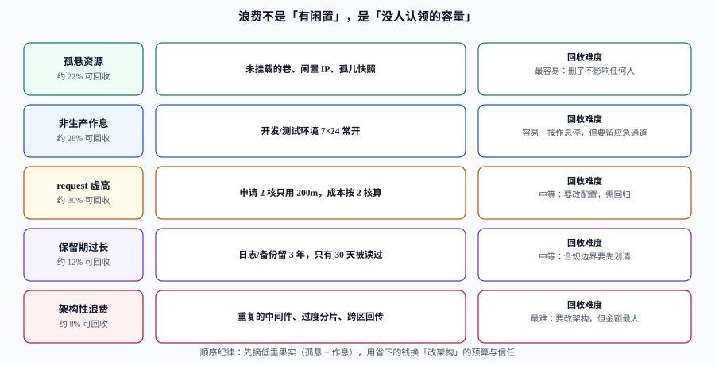

# 闲置与浪费治理

浪费的严格定义不是「利用率低」。一个 CPU 平均利用率 20% 的服务，如果它承担的是每天 10 点那波尖峰，那 20% 就是**必要的余量**，不是浪费。反过来，一个「平均利用率 60%」的集群，完全可能有一半的节点上跑着没人用的测试环境。

真正的定义只有一句：**没人认领的容量就是浪费**。判断标准因此不是「用了多少」，而是「谁需要它、为什么需要、什么时候不再需要」。

## 判据族声明

本页判据族 `CCW-A` ~ `CCW-H`，共 8 条。定义表在第八节。

## 一、五类浪费，按回收难度排序



| 类型 | 长什么样 | 为什么产生 | 回收难度 | 典型可回收比例 |
| --- | --- | --- | --- | --- |
| **孤悬资源** | 未挂载的云盘、未绑定的弹性 IP、孤儿快照、已删服务的负载均衡 | 删除流程只删了主资源 | 最低（删了不影响任何人） | 高（几乎 100%） |
| **非生产作息** | `dev` / `staging` 环境 7×24 常开 | 没人愿意每天手动起停 | 低（自动化即可） | 50%~70%（按 10×5 作息算） |
| **`requests` 虚高** | 申请 2 核、实际用 300m | 复制粘贴模板、怕 OOM 就往上加 | 中（要改配置 + 回归） | 与虚高倍数成正比 |
| **保留期过长** | 日志留 3 年、备份留 12 个月、指标留 24 个月 | 「留着总没错」+ 合规口径没划清 | 中（先划边界） | 视策略而定，常见 30%~60% |
| **架构性浪费** | 重复的中间件、过度分片、跨区同步回传、为峰值常备整套环境 | 历史决策 + 无成本评审 | 最高（要改架构） | 金额最大，周期最长 |

顺序纪律：**先做前两类**。它们不需要改架构、不需要说服业务，两周内就能把省下的钱变成「改架构」的预算与信任。

## 二、识别：三个指标，都不用平均值

| 指标 | 计算 | 用来判断 | 阈值建议 |
| --- | --- | --- | --- |
| **P95 利用率** | `sum(usage) / sum(capacity)` 的 95 分位（按小时桶） | 是否长期空闲 | CPU < 15% 且内存 < 25% 连续 14 天 |
| **限流/拒绝次数** | 单位时间的 429 / 5xx（资源类） | 是否被压到边界 | 与 P95 一起看：P95 高且限流 > 0 → 不能降 |
| **`requests` / `usage` 比** | `sum(requests) / sum(usage)` | 是否存在虚高申请 | > 3 即可疑，> 5 明确虚高 |

为什么不用均值：均值会把「每天 2 小时的尖峰」摊平成「看起来还行」。一个日均 20%、峰值 90% 的服务，用均值判断会被降配，然后在尖峰时段出事。

```text
# P95 CPU 利用率（按命名空间，14 天窗口）
quantile_over_time(0.95,
  sum by (namespace) (rate(container_cpu_usage_seconds_total{container!="POD"}[5m]))
  / sum by (namespace) (kube_pod_container_resource_requests{resource="cpu"})
  [14d:5m]
)
```

**判读**：结果持续 < 0.15 且该命名空间的 `kube_pod_container_status_restarts_total` 无异常增长，才进入「可疑清单」。只看利用率不看重启，会把「正在被 OOM 打死、所以用量很低」的服务当成浪费。

## 三、`requests` 右调：公式、工具、风险

### 1. 右调公式

```text
新 requests = P95 usage × (1 + headroom)      # headroom 取 0.2~0.3
新 limits   = max(P99 usage × 2, 新 requests × 2)
```

算例：某服务 `requests.cpu = 2000m`，P95 usage = 320m，headroom 25%。

```text
新 requests = 320 × 1.25 = 400m      （从 2000m 降到 400m，虚高 5 倍）
成本影响     = (2000 − 400) / 1000 核 × 0.28 元/核时 × 730 小时 ≈ 327 元/月/副本
```

看起来很香，但**右调有风险**，必须成套做：

| 风险 | 表现 | 缓解 |
| --- | --- | --- |
| 尖峰被抹平 | P95 之外的 5% 流量打爆 | 用 P99 校验 `limits`，并保留 HPA 上限 |
| 冷启动变慢 | CPU 不足导致启动超时 | 启动阶段给临时更高配额（initContainer 或 startup probe 配合） |
| 抖动 | 频繁被 CFS 限流 | 观察 `container_cpu_cfs_throttled_periods_total` 比例 |
| 回归困难 | 出问题不知是哪次调整 | 一次只改一个服务，改完观察 48 小时 |

### 2. 工具

| 工具 | 作用 | 用法要点 |
| --- | --- | --- |
| **VPA（Recommender 模式）** | 给出 `target` / `lowerBound` / `upperBound` 建议 | 只开 recommender，不要开自动更新（会重启 Pod） |
| **Goldilocks** | 把 VPA 建议做成看板，按命名空间汇总 | 适合作为「右调候选清单」的入口 |
| `kubectl top` | 即时用量 | 只适合排查，不适合决策（样本太短） |

## 四、非生产作息：停机不是关服务，是关「不必要的在线」

非生产环境的价值是「随时可用」，所以不能简单关掉。三种做法按侵入性排序：

| 做法 | 做法 | 节省 | 恢复时间 | 适合 |
| --- | --- | --- | --- | --- |
| **降规格** | 夜间把副本数降到 1、规格减半 | 30%~50% | 秒级 | 必须常驻的开发环境 |
| **按作息停机** | 工作时间外副本数置 0 | 60%~75% | 分钟级（拉镜像 + 启动） | 测试、预发 |
| **按需创建** | 不用时整套销毁，用时从 IaC 重建 | 85%~95% | 十分钟级 | 演示、培训环境 |

按作息停机的落地方式（Kubernetes 生态里最常用的是 `kube-downscaler` 的注解）：

```yaml
# 只在工作日 08:00-20:00（北京时间）保持运行，其余时间副本置 0
apiVersion: apps/v1
kind: Deployment
metadata:
  name: board-web
  annotations:
    downscaler/uptime: "Mon-Fri 08:00-20:00 Asia/Shanghai"
    downscaler/exclude: "false"
spec:
  replicas: 3
  # ... 其余字段省略
```

三个必须配的安全阀：

1. **排除清单**：监控、日志、 ingress、证书管理这类「停了会连锁」的组件必须显式排除。
2. **应急通道**：一条命令能临时拉起（例如给 Deployment 打 `downscaler/force-uptime: "true"`），且不需要走发布流程。
3. **到期自动恢复**：任何「临时常开」必须带到期时间，否则一周后全部恢复成 7×24。

## 五、回收流程：五步，每步都有留痕

| 步骤 | 动作 | 时长 | 留痕 |
| --- | --- | --- | --- |
| ① 发现 | 生成候选清单（资源 ID、金额、责任人、判据读数） | 每月 1 次 | 清单入库，带生成时间 |
| ② 标记 | 打 `pending-reclaim` 标签 + 记录标记时间 | 即时 | 标签即证据 |
| ③ 通知 | 按 `owner` 通知，附「不处理将在 N 天后回收」 | 即时 | 通知记录 |
| ④ 宽限 | 默认 7 天（生产 14 天），期间可申请豁免并写理由 | 7~14 天 | 豁免记录 + 到期日 |
| ⑤ 回收 | 先停（保留快照/镜像），观察 7 天后再删 | 7 天 | 停用与删除两次记录 |

::: danger 回收最容易出事的两个时刻
1. **跳过 ③ 直接删**。哪怕判据再确定（未挂载的盘），也可能有人在用「挂载失败后手工恢复」的临时方案。**正确写法**：通知 + 宽限是流程的一部分，不是形式；宽限期内的豁免必须能一键撤回回收。
2. **删了但没留快照**。孤儿快照本身是浪费，但**回收动作必须留一份可回滚的副本**（快照或镜像），保留 7 天。**正确写法**：回收脚本的最后一步是「验证快照可恢复」，而不是「删除成功」。
:::

## 六、度量：三个数，缺一不可

| 指标 | 定义 | 为什么必须有 |
| --- | --- | --- |
| **回收率** | 本月回收金额 / 候选清单金额 | 衡量执行力 |
| **误杀率** | 回收后 7 天内被恢复的比例 | 衡量流程安全性；> 5% 说明判据太激进 |
| **返工率** | 回收后 30 天内重新申请同类资源的比例 | 衡量是否真的「不需要」；高返工率说明在拆东墙补西墙 |

只看回收率会激励「多删」，三个数一起看才会激励「删对」。

## 七、与「容量台账」「分摊」的关系

| 场景 | 依赖 | 说明 |
| --- | --- | --- |
| 判断某资源是否浪费 | [分摊](../Allocation/index.md) | 不知道金额就无法排序，也无法证明回收的价值 |
| 回收后容量是否还够 | [容量台账](../CapacityPlan/index.md) | `requests` 右调会改变单实例可承载的副本密度，台账要同步 |
| 回收是否影响预算 | [预算与告警](../BudgetAlert/index.md) | 回收省下的钱应当体现在预算执行上，否则「省了但没看见」 |

## 八、判据定义表

| 判据 | 约定 | 定错了会怎样 | 怎么验证 |
| --- | --- | --- | --- |
| `CCW-A` | 浪费判定用 P95 分位 + 限流次数，不用均值 | 把尖峰余量当浪费，降配即事故 | 判据 SQL 含 `quantile_over_time` |
| `CCW-B` | `requests` / `usage` > 3 才进候选清单 | 候选清单过长，无人处理 | 清单每行带该比值 |
| `CCW-C` | 右调一次只改一个服务，观察 48 小时 | 出问题无法归因 | 变更记录与观察窗口可查 |
| `CCW-D` | 非生产作息必须有排除清单与应急通道 | 监控被停，故障无人知 | 排除清单文件存在且进版本库 |
| `CCW-E` | 回收五步齐全，宽限期可配置 | 误删生产依赖 | 回收记录含通知与宽限时间戳 |
| `CCW-F` | 回收前留可回滚副本（快照/镜像）7 天 | 删了不可恢复 | 快照 ID 与到期时间入库 |
| `CCW-G` | 临时常开必须带到期时间 | 一周后全部恢复 7×24 | `force-uptime` 注解伴随到期记录 |
| `CCW-H` | 同时上报回收率、误杀率、返工率 | 只考核回收率会激励乱删 | 月度报表三列齐全 |

## 如何验证

```shell
# ① 虚高倍数与月度节省（单副本）
/Users/cuifendemac/.workbuddy/binaries/python/versions/3.13.12/bin/python3 - <<'PY'
req, p95, headroom, price = 2000, 320, 0.25, 0.28   # mCPU, mCPU, 比例, 元/核时
new = p95 * (1 + headroom)
save = (req - new) / 1000 * price * 730
print(f"虚高 {req/p95:.1f} 倍；新 requests {new:.0f}m；单副本月省 {save:.0f} 元")
print(f"100 个副本年省 {save*100*12:,.0f} 元")
PY
```

**预期输出**：`虚高 6.2 倍；新 requests 400m；单副本月省 327 元`、`100 个副本年省 392,400 元`。

```shell
# ② 非生产作息的节省比例：10×5 相对 7×24
/Users/cuifendemac/.workbuddy/binaries/python/versions/3.13.12/bin/python3 -c "print(f'{(1-50/168):.0%}')"
```

**预期输出**：`70%`（每周 50 小时在线 / 168 小时）。注意这是**理论上限**：实际节省要扣掉启动开销与夜间批处理，通常落在 50%~65%。

```shell
# ③ 候选清单抽样：确认判据读数与责任人都在
kubectl get deploy -A -o json \
  | jq -r '.items[] | [.metadata.namespace, .metadata.name,
      (.metadata.labels.owner // "MISSING"),
      (.spec.template.spec.containers[0].resources.requests.cpu // "none")] | @tsv' \
  | head -5
```

**预期输出**：5 行 `namespace / name / owner / cpu request`。出现 `MISSING` 的行不能进候选清单——**没有责任人的资源，回收流程走不下去**，它属于 [归集与分摊](../Allocation/index.md) 的未分摊池。

## 参考资料

- [Kubernetes · 管理容器资源](https://kubernetes.io/docs/concepts/configuration/manage-resources-containers/)——`requests` / `limits` 的语义
- [Kubernetes · Vertical Pod Autoscaling](https://kubernetes.io/docs/concepts/workloads/autoscaling/vertical-pod-autoscale/)——VPA 的推荐值与更新模式
- [kube-downscaler](https://github.com/kube-downscaler/kube-downscaler)——按作息停机的注解与排除机制
- [OpenCost · Idle Cost](https://opencost.io/docs/specification)——「空闲成本」的规范定义
- 上一站：[预算与告警](../BudgetAlert/index.md) · 下一站：[承诺折扣治理](../Commitment/index.md)
