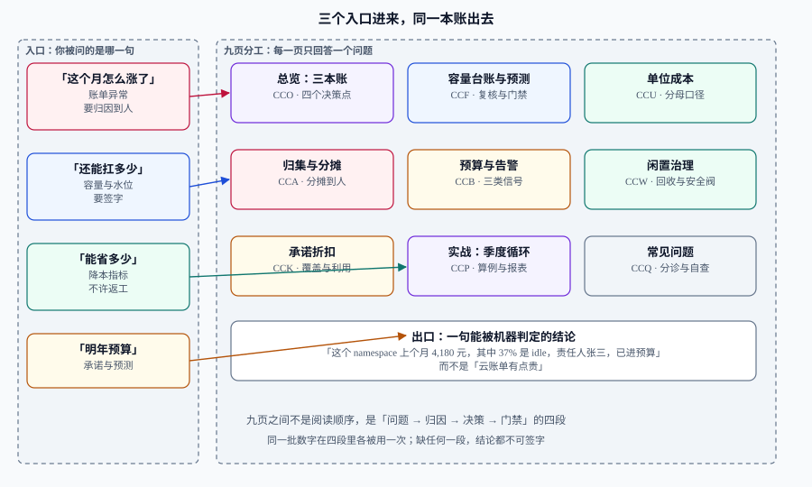

# 容量与成本治理

<p style="text-align:center;"></p>

容量与成本是**同一张账的两端**：容量是「你买了多少能力」，成本是「这些能力值多少钱」。把两者分开管，就会出现本领域最典型的两句话——「容量还有富余，不用管」和「这个月账单怎么又涨了」。前一句漏掉了**富余本身是要付钱的**，后一句漏掉了**涨价可能只是业务涨了**。

本专题讲的是**治理**，不是算题：怎么把账单归到人头上、怎么让单位成本可比较、怎么设定可执行的预算与告警、怎么回收没人认领的容量、怎么在「买承诺」与「保弹性」之间做取舍，以及**怎么把这一整套变成每月必跑、每季必审的循环**。

它不讲单实例能扛多少 QPS（那是 [性能与容量工程](../PerformanceEngineering/index.md) 的容量模型），不讲扩缩容怎么配（那是 [云上架构 · 弹性伸缩](../CloudArchitecture/AutoScaling/index.md)），也不讲某个云厂商控制台怎么点。

::: tip 一句话理解
成本治理的目标不是「把账单压下去」，而是**让每一块钱都能被指认、被比较、被决定**。
**账分不到人，就没人会去省；数不可比较，争论就只能靠音量。**
:::

## 与相邻专题的分工

「容量」「成本」「性能」「弹性」四个词经常混着用。本专题只管其中两件事的**治理面**，边界写死如下：

| 专题 | 讲什么 | 与本专题的关系 |
| --- | --- | --- |
| 本专题 | **归集与分摊、单位成本、预算与告警、浪费回收、承诺治理、季度循环** | —— |
| [性能与容量工程](../PerformanceEngineering/index.md) | SLO、定量建模、压测、瓶颈定位 | 那边回答「**还能扛多少**」；本专题回答「**扛这么多值不值、钱记在谁头上**」 |
| [性能与容量工程 · 容量规划](../PerformanceEngineering/Capacity/index.md) | 三输入模型、水位线 50%、HPA、容量报告模板 | **算例不重复**：本专题的容量页只讲**台账、复核节奏与评审门禁**，公式一律引用那边 |
| [云上架构 · 弹性伸缩](../CloudArchitecture/AutoScaling/index.md) | 扩缩容信号、冷却、最小最大实例数 | 那边决定**怎么扩**；本专题只回答**扩出来的钱从谁的预算里出、要不要为它买承诺** |
| [云上架构 · 成本与规格选型](../CloudArchitecture/Cost/index.md) | 七个降本杠杆、计费模型、规格选型、单位成本三问 | 那边是**单次决策**（这一台买多大、买哪种）；本专题是**周期治理**（谁负责、多久看一次、越线怎么办） |
| [监控告警](../Monitoring/index.md) | 指标模型、抓取、告警规则方法论 | 成本告警是**同一套告警工程**的另一类输入；规则怎么写引用那边，阈值从哪来由本专题回答 |
| [可观测性深入](../Observability/index.md) | 采样、保留、观测成本治理 | 观测成本是本专题的**一个特例**（自产自销的成本），方法论通用，具体策略在那边 |
| [Kubernetes](../Kubernetes/index.md) | `requests` / `limits`、副本、命名空间 | 分摊的**输入**；给错 `requests` 会让分摊结果与真实占用脱钩 |
| [Terraform](../Terraform/index.md) | IaC、状态、模块 | 成本门禁的**落地位置**：配额与规格约束写进 IaC 才拦得住 |
| [完整项目交付](../../Others/ProjectDelivery/index.md) | 验收清单的通用模板 | 本专题提供验收清单里「**成本达标**」那一条的可执行版本 |
| [在线协作任务看板](/project/Complete/TeamBoard/index.md) | 多租户项目的实例 | 那边是实例，本专题是方法；实例里的租户分摊要能追回本专题的定义 |

## 专题地图



| 页面 | 内容 | 适合谁读 |
| --- | --- | --- |
| [总览：三本账与四个决策点](./Overview/index.md) | 账单账 / 资源账 / 业务账、传导链、五种失败模式、五步起步 | 所有人，先读 |
| [容量台账与预测](./CapacityPlan/index.md) | 台账五个字段、业务日历与增长曲线、P50/P90、复核节奏、容量评审门禁、配额 | 要签字的人，**重点读** |
| [归集与分摊](./Allocation/index.md) | 三级归集、标签治理、未分摊池、K8s 分摊公式、showback 与 chargeback | 平台与财务对接的人，**重点读** |
| [单位成本](./UnitEconomics/index.md) | 分母的四种选法、三种分母陷阱、每千请求成本算例、与 SLO 的联合看板 | 要对「效率」下结论的人 |
| [预算与告警](./BudgetAlert/index.md) | 预算 / 预测 / 异常三类信号、阈值与提前量、分级路由、可执行性检查 | 值班与负责人 |
| [闲置与浪费治理](./Waste/index.md) | 五类浪费、利用率分位、`requests` 右调、非生产作息、回收流程与安全阀 | 平台工程 |
| [承诺折扣治理](./Commitment/index.md) | 覆盖率与利用率、四种工具对照、买错三例、阶梯购买、摊销口径 | 采购与架构 |
| [实战：一个季度的治理循环](./Practice/index.md) | 月度三步 + 季度一步、完整算例、报表 SQL、验收清单 | 要从零搭起来的人，**照着做** |
| [常见问题与最佳实践](./FAQ/index.md) | 四步分诊、高频十二问、十二条实践、术语表 | 所有人，收尾读 |

## 判据族总览

本专题每页给出一族判据，用来判断「这一页讲的约定有没有被破坏」。九族共 **72 条**：

| 页面 | 判据族 | 覆盖的约定 | 条数 |
| --- | --- | --- | --- |
| 总览 | `CCO-A` ~ `CCO-H` | 三本账不混用、传导链每一段可质疑 | 8 |
| 容量台账与预测 | `CCF-A` ~ `CCF-H` | 台账字段齐全、复核有触发条件、评审有门禁 | 8 |
| 归集与分摊 | `CCA-A` ~ `CCA-H` | 分摊合计等于账单、未分摊有归属、规则可复算 | 8 |
| 单位成本 | `CCU-A` ~ `CCU-H` | 分子分母口径固定、跨期可比 | 8 |
| 预算与告警 | `CCB-A` ~ `CCB-H` | 三类信号分开发、告警可执行、有抑制 | 8 |
| 闲置与浪费 | `CCW-A` ~ `CCW-H` | 判据用分位、回收有宽限、误杀可回滚 | 8 |
| 承诺折扣 | `CCK-A` ~ `CCK-H` | 覆盖与利用分开算、按 P10 买、到期有台账 | 8 |
| 实战循环 | `CCP-A` ~ `CCP-H` | 每月可复跑、报表可复算、结论可签字 | 8 |
| 常见问题 | `CCQ-A` ~ `CCQ-H` | 分诊顺序、口径不猜 | 8 |

## 事实与规格速览（2026-10 口径）

下表是**标准与工具**级的事实，已被本专题的算例引用；价格类数字不在表内（它们每天在变，写进文档就会过期）：

| 项 | 当前口径 | 对判断的影响 |
| --- | --- | --- |
| FOCUS 规范 | **FOCUS 1.3 于 2025-12-05 批准**；**77 列 / 14 个类别**，含 Cost and Usage 与 Contract Commitment 两个数据集 | 多云账单能用一套列名直接 union；**「支持 FOCUS」不等于列都填了**，要看 Conformance Gap Report |
| FOCUS 1.3 新增 | ① 合同承诺独立数据集 ② **拆分成本分摊**（谁被分摊、按什么方法）③ 数据**新鲜度与完整性**标记 | 分摊方法第一次成为账单里的字段，「规则不可复算」这件事开始有据可查 |
| FOCUS 列变更 | `Provider` / `Publisher` 自 1.3 起弃用，由 `ServiceProvider` / `HostProvider` 取代，**1.4 彻底移除** | 自建管道的字段映射要提前改，否则升级即断 |
| OpenCost | CNCF **Incubating**（2024-10-25 起）；**1.121.3（2026-09-16）**；1.121.0 起支持 **AI 推理按 token 计量** | K8s 侧分摊有了开源基线；用量成本基准的 bug 在 1.121.1 修过，**低于 1.121.1 不要用于对外报表** |
| Kubecost | 3.0（2025-09-29）改用 ClickHouse 存储、升级需全量重灌；**3.2.4（2026-08-21）**；2024 年被 IBM 收购，站点已并入 Apptio | 商业版的版本跃迁会带来一次**历史数据重建**，报表断代要提前对齐 |
| 覆盖率 / 利用率基准 | 第三方统计（700+ 环境，2026）：**覆盖率中位数 58%、利用率中位数 74%**；头部为 **71~78% 覆盖 + 91~95% 利用** | 这两个数是**参照**不是目标；照抄头部比例而没量自己的基线，等于按别人的身材买衣服 |
| 承诺工具的最小差异 | AWS：Standard RI / Convertible RI / EC2 Instance SP / Compute SP；Azure：Reservations + Savings Plan + Hybrid Benefit；GCP：resource-based CUD + spend-based（Flex）CUD | 灵活度与折扣深度**反向**；把「买哪种」当成主要问题，通常是因为「该不该买」还没算清 |

::: warning 这些数字的用法
基准数字只能回答「我们是不是明显偏离」。**任何一条降本结论都必须回到自己账单上的三行数**：这条资源是谁的、上个月多少钱、改完预期变成多少。拿行业均值当目标，最常见的后果是把「已经比自己三个月前更省」的团队继续压一遍。
:::

## 三条最容易踩的坑

::: danger 三个必须提前定下的口径
1. **把「账单下降」当成治理成果**。账单下降可能来自业务下滑、汇率变化、一次性抵扣入账，甚至来自上个月多记。**正确写法**：结论必须写成「单位成本从 X 降到 Y，业务量同期增长 Z%」，并把口径与窗口一起写出来。
2. **分摊比例拍脑袋，且不可复算**。给共享集群按「团队人数」分摊，第一次能过，第二次就会被质疑，第三次没人看。**正确写法**：规则写进配置（份额、权重、数据来源），任何一次分摊都能用同一份输入复算出同一个数，误差只允许来自舍入。
3. **用平均值判断浪费**。CPU 平均利用率 35% 看起来「还有富余」，但 P95 可能已经打了 3 次限流。**正确写法**：判断浪费用**分位数**（P95 / P99）与**被限流次数**，判断趋势才用均值。
:::

## 如何验证

本页是目录页，验证它「挂得对、数得对」：

```shell
# 1. 目录页列出的页面数 = 实际子页目录数（应为 9）
ls -d docs/Ops/CapacityCost/*/ | grep -v assets | wc -l

# 2. 每个子页都有 index.md（应输出 9）
find docs/Ops/CapacityCost -mindepth 2 -maxdepth 2 -name index.md | wc -l

# 3. 九个内容页的判据声明都在（应输出 9）
grep -rl '^## 判据族声明' docs/Ops/CapacityCost --include=index.md | wc -l
```

**预期输出**：依次为 `9`、`9`、`9`。若第 1 条小于 9，说明有页面目录建了却没写 `index.md`；若第 3 条少于 9，说明有内容页漏了判据族声明（本页是目录页，自己不需要声明，所以第 3 条的 9 必须由九个内容页凑满）。

## 参考资料

- [FinOps Foundation · FOCUS 1.3 发布说明](https://www.finops.org/insights/introducing-focus-1-3/)——合同承诺数据集、拆分分摊、新鲜度标记的来源
- [FOCUS Specification](https://focus.finops.org/)——列名与数据集的权威定义
- [OpenCost 文档](https://opencost.io/docs/)——K8s 成本分摊的开源规范与 API
- [CNCF · OpenCost 项目页](https://www.cncf.io/projects/opencost/)——项目成熟度与治理归属
- 下一站：[总览：三本账与四个决策点](./Overview/index.md) · [实战：一个季度的治理循环](./Practice/index.md)
