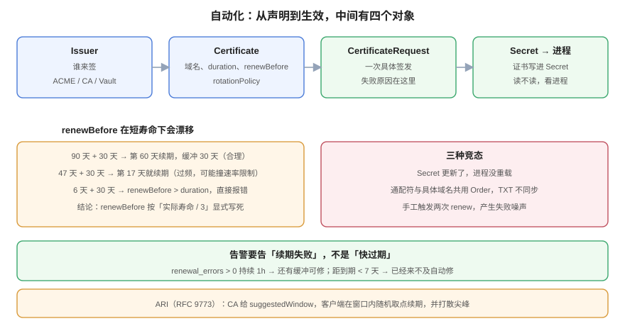

# 自动化：cert-manager 与 ARI

**自动化的目标不是「不用管」，而是「失败的时候有人知道」。** 这一句区分了两种团队：一种把证书交给 cert-manager 就再也不看，直到某天续期静默失败、30 天缓冲悄悄烧完；另一种把「续期失败」当成一个必须告警的指标，于是 47 天证书也只是多跑几次而已。本页讲清 `renewBefore` 的真实语义（它在短寿命下会漂移）、续期的三种竞态，以及为什么应该告「续期失败」而不是「快过期」。



## 一、四个对象，各管一段

| 对象 | 作用 | 出问题时的表现 |
| --- | --- | --- |
| `Issuer` / `ClusterIssuer` | 谁来签（ACME / CA / Vault / 自签） | `Certificate` 一直 `Ready=False`，事件里 `Issuer not ready` |
| `Certificate` | 我想要什么（域名、寿命、续期点） | 同上；`kubectl describe certificate` 有原因 |
| `CertificateRequest` | 一次具体的签发请求 | `Order` / `Challenge` 失败，或 CA 返回错误 |
| `Order` / `Challenge`（仅 ACME） | 域名验证的过程 | `Challenge` pending，通常是 DNS 或 80 端口不通 |

排障顺序固定：**`Certificate` → `CertificateRequest` → `Order` → `Challenge`**。反过来查（先看 Challenge）会浪费大量时间，因为大多数失败发生在 `Certificate` 的 spec 层（域名写错、`renewBefore > duration`）。

## 二、`renewBefore` 的语义，以及它在短寿命下的漂移

cert-manager 的默认值是 `duration: 90d` + `renewBefore: 30d`，续期点落在寿命的 **2/3** 处。官方文档还补了一条：**当未设置 `renewBefore` 且实际签发的证书寿命 ≤ 30 天时，`renewBefore` 取寿命的 2/3。**

问题在于「默认值」和「实际签发的寿命」是两件事：

```yaml
apiVersion: cert-manager.io/v1
kind: Certificate
metadata:
  name: board-tls
  namespace: board
spec:
  secretName: board-tls
  duration: 2160h          # 90 天（请求值）
  renewBefore: 720h        # 30 天（请求值）
  dnsNames:
    - board.example.com
  issuerRef:
    name: letsencrypt-prod
    kind: ClusterIssuer
```

上面这份配置发给一个「只签发 47 天」的 CA 时，**实际证书只有 47 天，而 `renewBefore` 仍是 30 天**——续期点变成第 17 天（寿命的 36%），缓冲 30 天反而**大于**剩余寿命的 2/3。它不会报错，只是「刚签完就开始准备续期」，续期频率远超预期，还可能撞上 CA 的速率限制。

| 实际寿命 | `renewBefore` | 续期点（签发后第几天） | 缓冲 | 评价 |
| --- | --- | --- | --- | --- |
| 90 天 | 30 天（默认） | 60 | 30 天 | 合理 |
| 90 天 | 720h 硬编码 | 60 | 30 天 | 合理但僵化 |
| 47 天 | 30 天（默认残留） | **17** | 30 天 | **续期过频** |
| 47 天 | 10 天（≈寿命 21%） | 37 | 10 天 | 合理 |
| 6 天 | 30 天（默认残留） | **负数** | —— | **立刻进入续期循环** |

::: danger `renewBefore` 必须小于 `duration`，否则直接报错
```text
spec.renewBefore: Invalid value: "720h": renewBefore must be shorter than duration
```
这条会在 `Certificate` 的 status 里显示，但**不会**让已有的 Secret 失效——旧证书继续用，直到它也过期。所以「配置错了」的表现是「一切正常，然后某天集体过期」。
:::

**正确做法**：`renewBefore` 按比例的显式写死，并在升级时跟着 CA 的寿命一起改。比例取 `寿命 / 3`（即 2/3 处续期）在 90 天、47 天、6 天三档上都成立。

## 三、三种竞态

### 3.1 Secret 更新了，进程没重载

cert-manager 只负责把新证书写进 Secret。**进程是否读到新证书，取决于进程怎么加载**：

| 加载方式 | 是否自动生效 | 说明 |
| --- | --- | --- |
| nginx Ingress Controller | ✅ | 监听 Secret 变化后 reload |
| Go 服务用 `tls.Config.GetCertificate` | ✅ | 每次握手回调读取 |
| Go 服务启动时 `tls.LoadX509KeyPair` | ❌ | 必须重启 |
| Java `SSLContext` 初始化后 | ❌ | 必须重建 context |
| 容器挂载 Secret 为文件 | ⚠️ | kubelet 会更新文件（约 1 分钟），但进程要自己重读 |

第三、四行是最常见的「续期成功了但线上还是旧证书」。**判断方法**：轮换后跑一次指纹对账（见[轮换](../Rotation/index.md)），不要看 `Certificate` 的 `Ready=True`。

### 3.2 多副本同时续期

`Certificate` 是集群级对象，续期由 controller 单点发起，不会有多副本竞争。但**手工触发**会：同时对同一个 `Certificate` 执行 `cmctl renew` 两次，会生成两个 `CertificateRequest`，其中一个必然失败——这不影响结果，但会在事件里留下噪声，掩盖真正的失败。

### 3.3 ACME 的验证竞态

`dns-01` 依赖 TXT 记录传播。如果 `Certificate` 的 `dnsNames` 里既有通配符又有具体域名，cert-manager 可能把它们放进**同一个 Order**，而 ACME 服务器要求的 TXT 名字不同（`_acme-challenge.example.com` 与 `_acme-challenge.board.example.com`），传播时间不同步就会出现「一个通过、一个超时」。

缓解办法：**把通配符与具体域名拆成两个 `Certificate`**，各自续期、各自重试。代价是两张证书都要监控。

## 四、告警：告「续期失败」，不告「快过期」

「证书 7 天后过期」是一条**迟到的告警**：它告诉你「已经来不及自动修了」。真正该告的是：

| 告警 | 表达式（Prometheus 风格，示意） | 触发含义 |
| --- | --- | --- |
| 续期失败 | `certmanager_certificate_renewal_errors > 0` 持续 1h | 自动化已经在坏，但还有缓冲 |
| 长时间未 Ready | `certmanager_certificate_ready_status{condition="False"} == 1` 持续 2h | 签发链路断了 |
| 距到期 < 阈值 | `certmanager_certificate_expiration_timestamp_seconds - time() < 7*86400` | 兜底（最后一道） |
| Secret 缺失 | `absent(certmanager_certificate_expiration_timestamp_seconds)` | 对象被删了 |

第一条是主力。它的提前量等于「缓冲窗口」——90 天证书有 30 天，47 天证书只有 16 天。所以 **`renewBefore` 决定了你有多少时间修，而不是告警阈值决定了**。

::: tip ARI：让 CA 告诉你什么时候续
ARI（ACME Renewal Information，**RFC 9773**）提供了一个 `renewalInfo` 端点，CA 返回一个 `suggestedWindow`（起止时间），客户端在窗口内**随机取一个点**续期。它解决两个问题：
1. **续期点不再由客户端猜**，CA 可以因为大规模吊销而提前窗口；
2. **打散尖峰**，避免全网在同一分钟续期。

Let's Encrypt 对「由 ARI 协调的续期」**免除速率限制**（新签发仍计入 50 个/注册域/周）。所以在支持 ARI 的客户端上应当默认开启。
:::

## 五、一份能用的 `Certificate` 与三条自检

```yaml
apiVersion: cert-manager.io/v1
kind: Certificate
metadata:
  name: board-tls
  namespace: board
spec:
  secretName: board-tls
  duration: 1128h            # 47 天（跟随 CA 实际寿命）
  renewBefore: 376h          # 约 15.7 天（寿命的 1/3）
  privateKey:
    algorithm: ECDSA
    size: 256
    rotationPolicy: Always   # 每次续期换 key
  dnsNames:
    - board.example.com
  issuerRef:
    name: letsencrypt-prod
    kind: ClusterIssuer
```

```shell
# 1) 看对象与事件（不要只看 Ready）
kubectl -n board describe certificate board-tls | sed -n '/Events/,$p'
# 2) 看实际签发出来的寿命（可能与 spec.duration 不同）
kubectl -n board get secret board-tls -o jsonpath='{.data.tls\.crt}' | base64 -d \
  | openssl x509 -noout -dates
# 3) 看服务端实际出示的是不是这张
openssl s_client -connect board.example.com:443 -servername board.example.com </dev/null 2>/dev/null \
  | openssl x509 -noout -fingerprint -sha256
```

第 2 条最容易被跳过：**`spec.duration` 是「请求」，CA 给的是「结果」。** 本专题的事实表里，公开 CA 的上限已经从 398 天压到 200 天，2027 年 100 天、2029 年 47 天——`spec.duration: 2160h` 在 2027 年会被 CA 直接截短，而 `renewBefore` 不会跟着变。

## 六、判据表：`CLA-A` ~ `CLA-H`

| 编号 | 判据 | 怎么验证 |
| --- | --- | --- |
| `CLA-A` | `renewBefore` 必须显式设置且小于 `duration` | `kubectl get certificate -o jsonpath='{.spec.renewBefore}'` 有值；`renewBefore < duration` |
| `CLA-B` | `renewBefore` 必须按**实际签发的寿命**校验，不能只看 `spec.duration` | `openssl x509 -dates` 算出的寿命与 `renewBefore` 之比在 2.5~3.5 之间 |
| `CLA-C` | 必须存在「续期失败」类告警，提前量 ≥ 缓冲窗口 | 告警规则里 `renewal_errors > 0` 持续时长 < `renewBefore` |
| `CLA-D` | 进程必须能感知 Secret 更新（回调加载或重启编排） | 轮换后 `s_client` 指纹与服务端 Secret 一致 |
| `CLA-E` | `rotationPolicy: Always`（每次续期换 key）用于私有 CA 与 mTLS 场景 | `spec.privateKey.rotationPolicy` 值为 `Always` |
| `CLA-F` | 通配符与具体域名拆成不同 `Certificate` | `kubectl get certificate -o yaml` 里没有同时含 `*.` 与具体域名的对象 |
| `CLA-G` | 客户端支持 ARI 时必须启用 | Issuer 配置或客户端参数里有 ARI 相关开关 |
| `CLA-H` | 每季度手工触发一次续期（`cmctl renew`）验证全链路可用 | 执行记录里有 `cmctl renew` 与随后的指纹变化 |

## 七、与相邻专题的分工

| 你想知道 | 去哪 |
| --- | --- |
| `Certificate` 在 Kubernetes 里怎么装、怎么和 Ingress 配合 | [Kubernetes 部署](../../Kubernetes/Deployment/index.md) |
| 续期的步骤与重叠窗口 | [轮换](../Rotation/index.md) |
| 到期了怎么办、阈值怎么定 | [过期治理](../Expiry/index.md) |
| 告警规则与静默 | [监控与告警](../../Monitoring/Alerting/index.md) |
| 证书签发的算法与 SAN 规则 | [签发](../Issuance/index.md) |

**本页特有的坑**：`spec.duration` 与「实际寿命」不一致时，**`Certificate` 对象依然是 `Ready=True`**。cert-manager 不校验「CA 给的寿命是否符合请求」，它只保证「Secret 里有一张能用的证书」。所以「配置正确」和「结果符合预期」是两件事——这也是为什么第 2 条自检（用 `openssl x509 -dates` 看实际寿命）必须写进巡检。

## 参考资料

- cert-manager：[*Certificate*](https://cert-manager.io/docs/usage/certificate/)（`duration` / `renewBefore` / `rotationPolicy` 的语义与默认值）
- cert-manager：[*FAQ*](https://cert-manager.io/docs/faq/)（`renewBefore` 未设置时的 2/3 规则）
- RFC 9773：*ACME Renewal Information (ARI) Extension*（`suggestedWindow`）
- Let's Encrypt：[*Rate Limits*](https://letsencrypt.org/docs/rate-limits/)（ARI 协调的续期豁免）
- 本站：[轮换](../Rotation/index.md)、[过期治理](../Expiry/index.md)
