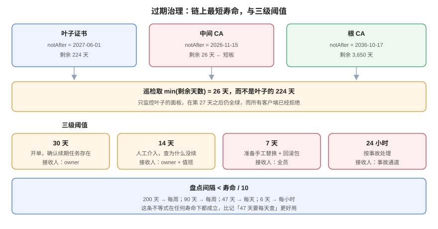

# 过期治理：谁先过期

**「证书什么时候过期」这个问题，标准答案不是叶子的 `notAfter`，而是「整条链上最早的那个 `notAfter`」。** 这两者的差别不是理论问题：本机实测一条链上叶子还剩 273 天、中间 CA 只剩 26 天，第 27 天起所有客户端都会拒绝——而任何只监控叶子证书的面板都是绿的。本页给出盘点方法、三个阈值、两个 `checkend` 的盲区，以及一种不用等到期就能验证「将来会挂」的方法。



## 一、第一个盲区：`checkend` 只判 `notAfter`

`openssl x509 -checkend N` 的语义是「**在 N 秒之后**这张证书是否仍然有效」，用退出码表达：`0` = 还没进窗口（好事），`1` = 已进入窗口（要处理）。

实测（今天 2026-10-20）：

| 证书 | `notBefore` | `notAfter` | `checkend 0` | 结论 |
| --- | --- | --- | --- | --- |
| `expired.crt` | 2025-01-01 | 2025-02-01 | **rc=1** | 正确报出「已过期」 |
| `future.crt` | 2027-01-01 | 2027-04-01 | **rc=0** | **错**：这张证书现在根本不能用 |
| `ok90.crt` | 2026-09-01 | 2026-12-01 | rc=0 | 正确 |

`future.crt` 的 `notBefore` 在未来，`checkend 0` 却返回 `0`（「没问题」）。**因为它只比较 `notAfter`。** 一个只用 `checkend` 写的巡检脚本，会把「明年才生效」的证书判成健康——这类证书在签发机时钟偏快时非常常见。

正确写法是两头都判：

```shell
#!/bin/sh
# 用法：cert_health.sh cert.pem
f="$1"
now=$(date -u +%s)
nb=$(date -u -j -f "%b %d %H:%M:%S %Y %Z" "$(openssl x509 -in "$f" -noout -startdate | cut -d= -f2)" +%s 2>/dev/null \
     || date -u -d "$(openssl x509 -in "$f" -noout -startdate | cut -d= -f2)" +%s)
na=$(date -u -j -f "%b %d %H:%M:%S %Y %Z" "$(openssl x509 -in "$f" -noout -enddate | cut -d= -f2)" +%s 2>/dev/null \
     || date -u -d "$(openssl x509 -in "$f" -noout -enddate | cut -d= -f2)" +%s)
[ "$now" -lt "$nb" ] && { echo "NOT_YET_VALID $f"; exit 2; }
days=$(( (na - now) / 86400 ))
echo "days_left=$days $f"
```

::: danger 第二个盲区：`notAfter` 是 GMT，`date` 默认按本地时区
`openssl x509 -enddate` 输出的时间**带 `GMT`**，而 `date -d "Dec  1 00:00:00 2026 GMT"` 在部分实现里会按本地时区解释。东八区会因此**多算或少算 8 小时**，在「还剩不到 1 天」的边界上直接翻转结论。所有换算都必须显式带 `-u`（或 `TZ=UTC`）。
:::

## 二、剩余天数怎么算才不骗人

实测一张 `notAfter=2026-12-01` 的证书，今天算出来是 **41.72 天**。这个小数很重要：

- 按 `41.72` 报「还剩 41.72 天」——精度是假的，但**趋势是真的**；
- 直接 `int()` 截断成 41 天——会让人以为「还有 41 整天」，实际只有 41 天 17 小时；
- `round()` 成 42 天——在「还剩 0.6 天」时会报成 1 天，而那时**已经进入按小时计的操作窗口**了。

**结论：内部计算用秒，对外展示向下取整，并在 < 1 天时改成小时。** 这条不是洁癖：阈值告警在边界上的误判，会直接变成「半夜被叫起来发现还有 20 小时」或「以为还有一天，其实已经过期」。

## 三、链上最短寿命：本页最重要的一条

本机造了一条「中间 CA 比叶子先过期」的链：

```shell
$ openssl x509 -in inter-short.crt -noout -dates
notBefore=Jan  1 00:00:00 2026 GMT
notAfter=Nov 15 00:00:00 2026 GMT      # 26 天后

$ openssl x509 -in leaf-under-short.crt -noout -dates
notBefore=Sep  1 00:00:00 2026 GMT
notAfter=Jun  1 00:00:00 2027 GMT      # 224 天后
```

叶子还有 224 天，中间证书只剩 26 天。用 `-attime` 把验证时间拨到 60 天后（不需要真的等）：

```shell
$ NOW=$(date +%s); T=$((NOW+60*86400))
$ openssl verify -CAfile ca/root.crt -untrusted inter-short.crt -attime $NOW leaf-under-short.crt
leaf-under-short.crt: OK
$ openssl verify -CAfile ca/root.crt -untrusted inter-short.crt -attime $T leaf-under-short.crt
error 10 at 1 depth lookup: certificate has expired
```

**注意 `at 1 depth`**：挂掉的是 depth 1 的中间证书，不是 depth 0 的叶子。而客户端的报错是同一句「证书已过期」，值班的人去看叶子会发现它明明写着 2027 年 6 月到期，然后开始怀疑人生。

::: warning 为什么「中间证书过期」比「叶子过期」更常见
叶子证书有续期自动化（ACME / cert-manager），中间证书是**CA 发给你的、你不会主动换**。一旦 CA 换了中间证书（或旧中间证书到期），而你手上的 `fullchain.pem` 还是老的那张，就会在某个毫无预兆的日期集体失效。**中间证书的到期时间必须和叶子一起进巡检。**
:::

## 四、盘点：三层来源，缺一层就有盲区

| 层 | 怎么盘 | 覆盖什么 | 漏什么 |
| --- | --- | --- | --- |
| **服务端实拉** | 对每个 `host:port` 跑 `s_client -showcerts`，逐张算天数 | 正在服务的证书（含链） | 还没上线的、备份域名、非 443 端口 |
| **配置与文件** | 扫描 nginx / Envoy / Java keystore / 容器挂载目录 | 已部署但暂未接流量的 | 别人手工传上去的 |
| **CT 日志** | 按域名查 Certificate Transparency | **你不知道自己有的**证书 | 私有 CA 签的（不进 CT） |

第一层是主力，因为它测的是**用户真正会遇到的**东西：

```shell
#!/bin/sh
# 对一个 host 拉全链并逐张报到期
host="$1"; port="${2:-443}"
openssl s_client -connect "$host:$port" -servername "$host" -showcerts </dev/null 2>/dev/null \
  | awk '/BEGIN CERTIFICATE/{n++} {print > ("/tmp/chain-" n ".pem")}'
for f in /tmp/chain-*.pem; do
  [ -s "$f" ] || continue
  subj=$(openssl x509 -in "$f" -noout -subject | cut -c1-60)
  end=$(openssl x509 -in "$f" -noout -enddate | cut -d= -f2)
  printf "%s\t%s\n" "$end" "$subj"
done | sort
```

`sort` 之后**第一行就是最先过期的证书**——这一条小技巧能把「谁先过期」变成一次排序，而不是逐个比对。

## 五、三个阈值与盘点频率

| 剩余时间 | 动作 | 通知对象 |
| --- | --- | --- |
| **30 天** | 开单，确认续期任务存在且上次成功 | 证书 owner |
| **14 天** | 升级：人工介入，检查续期为什么没生效 | owner + 值班 |
| **7 天** | 事故预备：准备手工替换（含回滚包），通知业务方 | 全员 |
| **24 小时** | 按事故处理，值班主管知情 | 事故通道 |

**盘点频率必须跟着寿命走**，否则会出现「两次盘点之间就过期了」：

| 证书寿命 | 最大安全盘点间隔 | 依据 |
| --- | --- | --- |
| 200 天 | 每周 | 有 28 次机会发现异常 |
| 90 天 | 每周 | 12 次 |
| 47 天 | **每天** | 6 次，一次失败只剩 16 天缓冲 |
| 6 天（160 小时） | **每小时** | 缓冲只有 2 天 |

::: tip 一个便宜的自检
`盘点间隔 < 证书寿命 / 10`。这条不等式在任何寿命下都成立，而且一眼能算——比记「47 天要每天查」更好用。
:::

## 六、不用等到期就能演练

`-attime` 是排障与演练里最被低估的参数：它让验证器「假装现在是某个时刻」，从而**在不改系统时间、不影响线上**的前提下验证未来。

```shell
# 30 天后还活着吗？
openssl verify -CAfile ca/root.crt -untrusted ca/inter.crt -attime $((NOW+30*86400)) leaf.crt
# 60 天后呢？
openssl verify -CAfile ca/root.crt -untrusted ca/inter.crt -attime $((NOW+60*86400)) leaf.crt
```

本机读数：`ok90.crt` 剩 41.72 天，`+30d` 时返回 `OK`，`+60d` 时返回 `error 10 ... certificate has expired`——与算出来的天数完全一致。

三个可落地的演练用法：

1. **验证「链上谁先挂」**：对链上每张证书各跑一次 `+30d / +60d / +90d`，第一张报 `error 10` 的就是短板。
2. **验证告警阈值**：把告警脚本的时间参数换成 `+25d`，确认它真的会触发，而不是「配置写了但没生效」。
3. **验证回滚包**：回滚用的旧证书是否还在有效期内？用 `-attime` 模拟「一个月后回滚」的场景。

## 七、判据表：`CLE-A` ~ `CLE-H`

| 编号 | 判据 | 怎么验证 |
| --- | --- | --- |
| `CLE-A` | 巡检必须同时判 `notBefore` 与 `notAfter`，不得只用 `checkend` | 脚本里同时出现 `-startdate` 与 `-enddate`（或等价的 `-checkend` + `-startdate`） |
| `CLE-B` | 巡检对象必须是**整条链**，输出取最小剩余天数 | 巡检输出里每个域名有多行（叶子 + 中间），并有一个 `min_days` 汇总 |
| `CLE-C` | 时间换算必须显式用 UTC，不得依赖本地时区 | 脚本里 `date` 带 `-u`，或设置 `TZ=UTC` |
| `CLE-D` | 剩余天数对外展示向下取整，< 1 天改小时 | 展示值 ≤ 实际值，且 < 1 天时单位是 `h` |
| `CLE-E` | 三级阈值（30/14/7 天）必须各有明确的接收人 | 告警配置里有三档，且接收人不同 |
| `CLE-F` | 盘点间隔必须小于证书寿命的 1/10 | 调度配置的周期与 `openssl x509 -dates` 的寿命相差 ≥ 10 倍 |
| `CLE-G` | 中间 CA 的到期时间必须单独纳入监控面板 | 面板里有「中间证书剩余天数」这一个独立指标 |
| `CLE-H` | 每季度至少一次 `-attime` 演练，验证告警与回滚包在未来时刻仍然有效 | 演练记录里有 `-attime` 命令与输出 |

## 八、与相邻专题的分工

| 你想知道 | 去哪 |
| --- | --- |
| 续期怎么自动化、失败了怎么告警 | [自动化](../Automation/index.md) |
| 到期了怎么换（步骤与重叠窗口） | [轮换](../Rotation/index.md) |
| 证书过期算不算事故、怎么定级 | [故障应急体系](../../IncidentResponse/index.md) |
| 入口证书过期怎么快速定位 | [云架构的分诊表](../../CloudArchitecture/FAQ/index.md) |
| 监控指标与告警规则的写法 | [监控与告警](../../Monitoring/Alerting/index.md) |

**本页特有的坑**：`openssl x509 -checkend` **用退出码表达结果**，在 `set -e` 的脚本里会**直接杀掉脚本**。本机第一次跑巡检时脚本在第一个「快过期」的证书处静默退出，看起来像「跑完了、没输出、一切正常」——**最危险的假绿**。所有 `checkend` 调用都必须显式接住退出码（`if openssl x509 ... -checkend N; then ...`）。

## 参考资料

- OpenSSL：[`openssl-x509`](https://docs.openssl.org/master/man1/openssl-x509/)（`-checkend`、`-startdate`、`-enddate` 的语义）
- OpenSSL：[`openssl-verify`](https://docs.openssl.org/master/man1/openssl-verify/)（`-attime` 的时间旅行验证）
- CA/Browser Forum：Ballot SC-081v3（寿命阶梯与由此决定的盘点频率）
- 本站：[轮换](../Rotation/index.md)、[自动化](../Automation/index.md)
