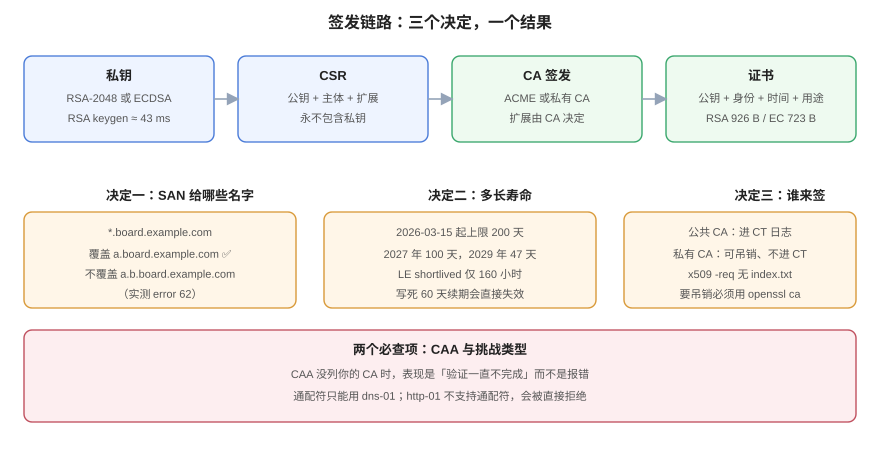

# 签发：CSR、SAN 与 ACME

**签发是三秒钟的事，签发前的三个决定才是事故源头：给哪些名字（SAN）、用多长的寿命、由谁来签。** 这三个决定一旦写错，后面所有的运维动作都是在给它们擦屁股。本页给出发 CSR 的最小写法、通配符的真实边界（实测跨两级就失效）、三种 ACME 挑战的选择依据，以及私有 CA 与公共 CA 在**可吊销性**上的根本差别。



## 一、CSR 里有什么，不该有什么

CSR（Certificate Signing Request）是「请帮我签这张公钥」的申请单，结构上包含三部分：

1. **公钥**（从私钥导出）；
2. **主体信息**（CN、O、C 等）；
3. **请求的扩展**（SAN、`keyUsage`）；
4. **自签名**（用对应私钥签一次，证明「我确实持有这把私钥」）。

它**永远不包含私钥**。这条不是建议：把私钥贴进 CSR 的工单，等于把钥匙和门牌号一起寄给 CA。

```shell
# 生成密钥 + CSR（一步到位；SAN 写在配置里）
cat > leaf.cnf <<'EOF'
[req]
distinguished_name = dn
prompt = no
[dn]
CN = board.example.com
O = CertLab
[v3_leaf]
basicConstraints = critical,CA:FALSE
keyUsage = critical,digitalSignature,keyEncipherment
extendedKeyUsage = serverAuth
subjectAltName = @san
[san]
DNS.1 = board.example.com
DNS.2 = *.board.example.com
EOF
openssl req -new -newkey rsa:2048 -nodes -keyout leaf.key -out leaf.csr -config leaf.cnf
```

::: warning CSR 里的扩展只是「请求」，不是「结果」
CA 可以增、删、改你请求的扩展。自建 CA 时用 `openssl x509 -req -extfile ...` 才是真正决定扩展的地方；用 `openssl ca` 时则由 `-extensions` 指定的段落决定段落内容。**判断一张证书最终带什么，永远看 `openssl x509 -text`，不要看 CSR。**
:::

## 二、SAN 的两个真实边界

### 2.1 通配符只覆盖一级

实测一张 SAN 为 `board.example.com` + `*.board.example.com` 的证书：

```shell
$ openssl verify -CAfile ca/root.crt -untrusted ca/inter.crt -verify_hostname a.board.example.com leaf.crt
leaf.crt: OK

$ openssl verify -CAfile ca/root.crt -untrusted ca/inter.crt -verify_hostname a.b.board.example.com leaf.crt
error 62 at 0 depth lookup: hostname mismatch
```

`*.board.example.com` 覆盖 `a.board.example.com`，**不覆盖** `a.b.board.example.com`。这条规则在多租户系统里是硬约束：`{tenant}.board.example.com` 可以用一张通配符证书，但 `{tenant}.{region}.board.example.com` 不行，必须逐个列出或用两张证书。

### 2.2 没有 SAN 的证书「能过 openssl，过不了浏览器」

```shell
$ openssl verify -CAfile ca/root.crt -untrusted ca/inter.crt -verify_hostname board.example.com nosan.crt
nosan.crt: OK
```

CN 只有 `board.example.com`、没有 SAN 的证书，`openssl` 会退回比对 CN 并判定通过。但 Chrome 从 58 起不再回退，Firefox 同样。**这是一条只能靠流程堵住的漏洞：发证时强制要求 SAN 非空。**

## 三、寿命：2026 年的上限已经不是 398 天

| 生效日期 | 公开 TLS 证书最长有效期 | DCV 复用期 |
| --- | --- | --- |
| ~2026-03-14 | 398 天 | 398 天 |
| **2026-03-15 起** | **200 天** | 200 天 |
| 2027-03-15 起 | 100 天 | 100 天 |
| 2029-03-15 起 | 47 天 | **10 天** |

这张表来自 CA/Browser Forum Ballot SC-081v3（2025-04 通过）。它管的是**公开可信**证书；私有 CA 不受约束，但**建议跟随**——否则内网证书的寿命会变成「只有内网才敢用的例外」，而内网恰恰是最容易忘记续期的地方。

Let's Encrypt 走得更快（官方口径，2026-10 核对）：

| 档位 | 有效期 | 可用性 |
| --- | --- | --- |
| `classic`（默认） | 90 天 | 现行；2027-02-10 起 64 天，2028-02-16 起 45 天 |
| `tlsserver` | 45 天 | 2026-05-13 起可选 |
| `shortlived` | 160 小时（≈6 天） | 2026-01-15 起 GA，opt-in |

对运维的含义很直接：**任何「写死 60 天续期」的 cron 都会在 45 天档位上把证书续成过期状态**——60 天比证书本身的寿命还长。

## 四、三种 ACME 挑战怎么选

| 挑战 | 证明什么 | 适用 | 硬限制 |
| --- | --- | --- | --- |
| `http-01` | 你能在 `http://域名/.well-known/acme-challenge/` 放指定内容 | 单域名、80 端口对外开放 | **不支持通配符**；不能有跳转劫持 |
| `dns-01` | 你能在 `_acme-challenge.域名` 放指定 TXT | 通配符、内网服务、80 端口被封 | 需要 DNS API 凭据；TXT 传播延迟 |
| `tls-alpn-01` | 你能在 443 上用 `acme-tls/1` 协议回应 | 只有 443 可用的场景 | 需要独占 443 或支持 ALPN 的服务器 |

选择顺序建议：**能 `dns-01` 就 `dns-01`**——它是唯一支持通配符、且不依赖入站端口的挑战。代价是 DNS 凭据的权限必须收窄（只允许改 `_acme-challenge` 记录），否则 Web 服务器被攻破就等于 DNS 被攻破。

::: danger 三个必踩的坑
1. **CAA 记录会静默阻断签发**：`CAA` 里没列你用的 CA，签发的表现是「验证一直不完成」，而不是明确报错。发证前先 `dig CAA 域名`。
2. **`http-01` 遇到 301 跳转**：ACME 服务器允许跟随有限次跳转，但如果跳到 HTTPS 而 HTTPS 证书本身有问题，就成了死循环。
3. **通配符必须 `dns-01`**：用 `http-01` 申请 `*.example.com` 会被直接拒绝，报 `wildcard requires dns-01`。
:::

## 五、私有 CA 的两种签法，能力差一个数量级

### 5.1 `openssl x509 -req`：够用，但没有吊销能力

```shell
openssl x509 -req -in leaf.csr -CA ca/inter.crt -CAkey ca/inter.key \
  -CAcreateserial -out leaf.crt -days 90 -sha256 -extfile ca/leaf.cnf -extensions v3_leaf
```

快、简单、不需要目录结构。**代价：不写 `index.txt`，因此无法生成 CRL、无法跑 OCSP 响应器。** 本专题早期实验就吃了这个亏——想测吊销时发现 `ca2/index.txt` 是空的，只能改用 `openssl ca` 重签。

### 5.2 `openssl ca`：能吊销、能跑 OCSP，但要配目录

```ini
[CA_default]
dir = /tmp/certlab/ca2
database = $dir/index.txt      # 所有签发记录，吊销与 CRL 都靠它
new_certs_dir = $dir/newcerts
certificate = /tmp/certlab/ca/inter.crt
private_key = /tmp/certlab/ca/inter.key
serial = $dir/serial
crlnumber = $dir/crlnumber
default_days = 90
unique_subject = no            # 允许同一主体多次签发（轮换需要）
```

```shell
# 指定起止时间（可以做「已过期」「未生效」的测试证书）
openssl ca -batch -config ca2/ca.cnf -extensions v3_leaf -in leaf.csr -out expired.crt \
  -startdate 250101000000Z -enddate 250201000000Z -notext
```

`-startdate` / `-enddate` 只在 `openssl ca` 里有，`openssl x509` 没有（它只认 `-days`）。**想造「未来才生效」或「已过期」的证书，只能用 `openssl ca`**——这一点决定了你能不能在本地演练过期事故。

### 5.3 `unique_subject = no` 是轮换的前提

默认 `unique_subject = yes` 会拒绝为同一主体重复签发，而**轮换恰恰是同一主体再签一次**。不关掉它，第一次续期就会报 `TXT_DB error number 2`。

## 六、密钥算法：签得快和验得快不是一回事

`openssl speed` 单核 2 秒采样（本机）：

| 算法 | 签名/秒 | 验签/秒 | 密钥生成/秒 |
| --- | --- | --- | --- |
| RSA-2048 | 1,832 | 56,919 | 23 |
| ECDSA P-256 | 41,888 | 15,758 | —— |

- **签名**：ECDSA 比 RSA 快 **22.9 倍**（41,888 / 1,832）。
- **验签**：RSA 比 ECDSA 快 **3.6 倍**（56,919 / 15,758）。
- **密钥生成**：RSA-2048 每次约 **43 ms**，ECDSA 在微秒级。

服务器每握手签名一次，客户端每次连接验签一次。所以「ECDSA 更快」**只在服务端成立**；对海量客户端（尤其低端设备）而言，RSA 的验签优势是实打实的。证书体积也差一截：同一套扩展下 RSA 叶子 **926 字节（DER）**、ECDSA P-256 叶子 **723 字节**，少 **22%**。

::: tip 什么时候值得上双证书
nginx 支持同时挂 RSA 与 ECDSA 两张证书（同一 `server_name` 两组 `ssl_certificate`）。实测 TLS 1.3 下客户端会按自己的偏好选到 ECDSA（`Peer signature type: ECDSA`），强制 TLS 1.2 时由套件决定（`ECDHE-ECDSA-*` 与 `ECDHE-RSA-*` 各走一张）。**代价是两张证书都要续期**——续期流程没自动化之前，不要开双证书，那等于把过期风险翻倍。
:::

## 七、判据表：`CLI-A` ~ `CLI-H`

| 编号 | 判据 | 怎么验证 |
| --- | --- | --- |
| `CLI-A` | 任何证书的 SAN 必须非空，且包含实际访问的每一个主机名 | `openssl x509 -noout -ext subjectAltName` 非空，且逐个 `-verify_hostname` 通过 |
| `CLI-B` | 通配符不得跨级使用（`*.a.example.com` 不覆盖 `x.y.a.example.com`） | 对实际域名跑 `-verify_hostname`，跨级场景返回 `error 62` 即证明需要单独证书 |
| `CLI-C` | 公开证书有效期不得超过当时上限（2026-03-15 起 200 天） | `openssl x509 -noout -dates` 算差 ≤ 200 天 |
| `CLI-D` | 通配符申请必须用 `dns-01`，且 DNS 凭据只允许改 `_acme-challenge` | 签发日志里挑战类型为 `dns-01`；凭据策略文档写明记录范围 |
| `CLI-E` | 签发前必须查 CAA 记录，且放行所用 CA | `dig +short CAA 域名` 含目标 CA 或为空 |
| `CLI-F` | 私有 CA 必须保留 `index.txt`（能生成 CRL / 跑 OCSP），不得只用 `x509 -req` 签发了事 | `openssl ca -gencrl` 能成功产出 CRL |
| `CLI-G` | 轮换场景下 `unique_subject` 必须为 `no` | `grep unique_subject` 输出 `no` |
| `CLI-H` | CSR 与工单中不得出现私钥内容 | 对 CSR 与工单做 `grep -c "PRIVATE KEY"` 结果为 0 |

## 八、与相邻专题的分工

| 你想知道 | 去哪 |
| --- | --- |
| 签出来的链怎么部署、怎么验 | [部署与链路完整性](../Serving/index.md) |
| 什么时候该续、续期怎么自动化 | [轮换](../Rotation/index.md)、[自动化](../Automation/index.md) |
| 私钥放哪、怎么下发到节点 | [密钥与凭据治理](../../SecurityHardening/SecretGovernance/index.md) |
| 证书透明度（CT）日志与监控 | [自动化](../Automation/index.md) 的巡检一节 |
| 客户端证书怎么签 | [mTLS](../MutualTLS/index.md) |

**本页特有的坑**：`openssl x509 -req` **不更新 `index.txt`**，所以「用它签了一百张证书」之后你想测吊销，会发现数据库是空的。这不是 bug，是它压根不维护 CA 数据库——**要吊销能力就必须从第一天用 `openssl ca`**，事后补不回来（除非重签全部证书）。

## 参考资料

- RFC 8555：*Automatic Certificate Management Environment (ACME)*（三种挑战的定义）
- RFC 9773：*ACME Renewal Information (ARI) Extension*
- CA/Browser Forum：Ballot SC-081v3（寿命阶梯与 DCV 复用期）
- Let's Encrypt：[*Certificate Profiles*](https://letsencrypt.org/docs/profiles/)（`classic` / `tlsserver` / `shortlived` 的字段差异）
- OpenSSL：[`openssl-ca`](https://docs.openssl.org/master/man1/openssl-ca/)（`-startdate` / `-enddate` / `unique_subject`）
- 本站：[信任链与 X.509](../TrustChain/index.md)、[轮换](../Rotation/index.md)
