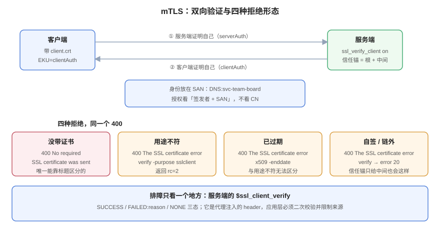

# mTLS：证书即身份

**mTLS 的本质不是「加密加强」，而是「把身份从口令换成证书」。** 一旦接受这个定位，很多设计问题就有了明确答案：身份叫什么（SAN 还是 CN）、谁有权签发（信任锚给到哪一层）、吊销要不要生效（CRL 还是短寿命）。本页用四种实测的拒绝形态说明「为什么客户端说证书没问题、服务端还是 400」，并给出两个反直觉数据：**中间 CA 不能单独作为客户端信任锚**，**OCSP 对不认识的证书会回 `good`**。



## 一、身份放在哪：CN 是历史，SAN 是现在

客户端证书里能承载身份的位置有两个：

| 位置 | 现状 | 用法 |
| --- | --- | --- |
| `subject.CN` | 已废弃（CA/B Forum 不推荐，浏览器不再回退） | 只在老系统里读取 |
| `subjectAltName` 的 DNS/URI 项 | **推荐** | `DNS:svc-team-board` 或 `URI:spiffe://example.com/ns/default/sa/board` |
| SAN 的 URI 项（SPIFFE） | 云原生场景主流 | 直接把「信任域 + 工作负载」编进名字 |

本机的客户端证书用的是 `SAN: DNS:svc-team-board`：

```shell
$ openssl x509 -in client.crt -noout -ext subjectAltName
X509v3 Subject Alternative Name:
    DNS:svc-team-board
```

::: danger 不要用 CN 做授权判断
授权逻辑如果读 CN，就会同时受两个问题影响：① 同一 CN 可以由不同 CA 签发（不同信任域撞名）；② CN 允许为空（Let's Encrypt 从 2025 年起签发不带 CN 的证书）。**授权必须以「签发者 + SAN」这个二元组为准**，缺一不可。
:::

## 二、信任锚：必须给「能走到自签根」的完整链

nginx 的 `ssl_client_certificate` 是**信任库**，不是「中间证书」的意思。本机把中间 CA 单独放进去时：

```text
400 Bad Request
The SSL certificate error
```

换成「根 + 中间」的合成文件，同一个客户端证书立刻通过：

```shell
$ cat ca/root.crt ca/inter.crt > ca-chain.pem
$ curl --cacert ca/root.crt --cert client.crt --key client.key https://board.example.com:18446/
ok-mtls verify=SUCCESS cn=O=CertLab,CN=svc-team-board
```

原因与 [信任链](../TrustChain/index.md) 里的 `error 2` 完全一致：OpenSSL 的默认路径验证要求走到自签根，中间 CA 不是自签的。想只用中间 CA 当锚，必须显式 `-partial_chain`——而 nginx 没有这个开关，所以**只能把根带上**。

## 三、四种拒绝，同一个 400

| 客户端行为 | 服务端响应 | 真实原因 | 怎么确认 |
| --- | --- | --- | --- |
| 不带客户端证书 | `400 No required SSL certificate was sent` | 服务端 `ssl_verify_client on` | 响应标题就能区分 |
| 用途不符（拿 `serverAuth` 证书当客户端证书） | `400 The SSL certificate error` | EKU 缺 `clientAuth` | `openssl verify -purpose sslclient client.crt` → `rc=2` |
| 已过期 | `400 The SSL certificate error` | `notAfter` 已过 | `openssl x509 -enddate` |
| 自签 / 不在信任链里 | `400 The SSL certificate error` | 无法构链 | `openssl verify -CAfile ca-chain.pem` → `error 20` |

后三种在 HTTP 层**完全无法区分**——同一个标题、同一个状态码。所以 mTLS 排障的第一条纪律是：**不要看 HTTP 状态码，去看服务端的验证结果**。

```nginx
# 把验证结果透传给应用（供日志与二次判断）
location / {
    proxy_set_header X-Client-Verify $ssl_client_verify;   # SUCCESS / FAILED:reason / NONE
    proxy_set_header X-Client-DN     $ssl_client_s_dn;
    proxy_set_header X-Client-Serial $ssl_client_serial;
    return 200 "verify=$ssl_client_verify\n";
}
```

`$ssl_client_verify` 的取值是 `SUCCESS` / `FAILED:<reason>` / `NONE` 三态。**应用层必须把它当成不可信输入**再校验一次——因为它是**由代理注入的 header**，如果代理前面还有一层可被绕过的入口，这个 header 可以被伪造。

::: danger 只信 header 是 mTLS 最常见的落地错误
`X-Client-Verify: SUCCESS` 是一个普通 HTTP 头。任何能直连后端的人都能带上它。三条硬要求：
1. 后端**只允许来自代理的流量**（网络策略 / 只监听 loopback）；
2. 代理必须**先删除**客户端传入的同名头再注入（`proxy_set_header` 会覆盖，但要确认没有 `underscores_in_headers` 之类的漏网）；
3. 身份字段用**签名过的**载体（如短的 JWT）而不是明文 header，跨多层时尤其如此。
:::

## 四、吊销：为什么它靠不住

### 4.1 CRL 的体积是线性长，但增长很慢

用 `openssl ca` 签 100 张叶子后逐步吊销，每次重新生成 CRL：

| 已吊销数 | CRL 体积（字节） | 说明 |
| --- | --- | --- |
| 1 | 650 | 基础结构 + 1 条记录 |
| 10 | 1,129 | 每条约 **53 字节** |
| 100 | 5,882 | 同上 |

每条吊销记录约 **53 字节**——所以 CRL 体积不是理论问题（一万条也才 500 KB）。真正的问题是**分发与时效**：CRL 有 `nextUpdate`，客户端多久拉一次、拉不到时是「放行」还是「拒绝」，各家实现都不一样。

### 4.2 吊销检查是「可选」的

```shell
# 已吊销的 tmp1，不开 CRL 检查
$ openssl verify -CAfile ca/root.crt -untrusted ca/inter.crt tmp1.crt
tmp1.crt: OK

# 开了才报
$ openssl verify -CAfile ca/root.crt -untrusted ca/inter.crt -CRLfile crl.pem -crl_check tmp1.crt
error 23 at 0 depth lookup: certificate revoked
```

nginx 要真正做吊销检查，必须显式配 `ssl_crl`；不配就完全不做。而**大部分客户端默认不做**——这就是「证书泄漏后仍然可用」的现实。

### 4.3 OCSP 对「不认识的证书」回 `good`

本机跑了一个 `openssl ocsp` 响应器，索引里只有 `openssl ca` 签过的证书。查询一张**不在索引里**的证书（`d20.crt` 是后来用 `ca` 签的，但当时索引里还没有它）：

```shell
$ openssl ocsp -issuer ca/inter.crt -cert d20.crt -url http://127.0.0.1:18888 -resp_text -noverify
Cert Status: good
```

**它回 `good`，而不是 `unknown`。** 这是理解「OCSP 不能作为唯一判据」的关键：`good` 只意味着「我没查到吊销记录」，不意味着「这张证书有效」。响应器不知道的证书、过期的签名、伪造的响应，都可能被读成「没问题」。

::: warning 现实中的三条替代路线
1. **短寿命**：6 天证书 + 自动续期，让「过期」成为唯一的失效机制（Let's Encrypt 自 2025-05-07 起已不再签发带 OCSP URL 的证书，改 CRL + ARI）。
2. **CRL + 短周期**：CRL 体积可控（53 字节/条），只要客户端愿意拉。
3. **服务端侧撤销名单**：mTLS 场景下，用「允许列表」（哪些 serial 可用）替代「拒绝列表」——**允许列表天然不受吊销延迟影响**，代价是要维护。
:::

## 五、客户端证书的轮换与生命周期

客户端证书比服务端证书难轮换，因为没有「所有人自动续期」的机制。三条实践：

1. **寿命要短**：30 天以内（本机示例用的就是 30 天），配合自动签发（如 SPIFFE/SPIRE、Vault PKI）。
2. **信任锚要能并存**：轮换期间信任库同时包含新旧 CA，直到确认所有对端都换完（与[轮换](../Rotation/index.md)的三阶段一致）。
3. **身份与证书解耦**：应用只认「身份标识」，证书只是承载它的容器。这样换证书不需要改配置。

## 六、判据表：`CLM-A` ~ `CLM-H`

| 编号 | 判据 | 怎么验证 |
| --- | --- | --- |
| `CLM-A` | 客户端身份必须来自 SAN（DNS 或 URI），不得依赖 CN | 授权代码里读取 `subjectAltName`；`grep -r "CN=" 授权模块` 无命中 |
| `CLM-B` | `ssl_client_certificate` 必须包含能走到自签根的完整链 | `openssl verify -CAfile <该文件> client.crt` 返回 OK（不加 `-partial_chain`） |
| `CLM-C` | 客户端证书必须带 `extendedKeyUsage=clientAuth` | `openssl x509 -noout -ext extendedKeyUsage` 含 `TLS Web Client Authentication` |
| `CLM-D` | 应用层必须二次校验 `$ssl_client_verify`，且后端只接受来自代理的流量 | 后端监听 loopback 或有网络策略；代码里有 `verify == "SUCCESS"` 判断 |
| `CLM-E` | 身份字段必须与签发者绑定校验（防跨 CA 撞名） | 授权时同时比对 `issuer` 与 SAN |
| `CLM-F` | 吊销策略必须显式：要么配 `ssl_crl` 并定期更新，要么声明「依赖短寿命」 | nginx 配置有 `ssl_crl`，或设计文档写明不使用吊销 |
| `CLM-G` | 客户端证书寿命 ≤ 30 天，且轮换自动化 | `openssl x509 -dates` 算得寿命 ≤ 30 天；存在自动签发任务 |
| `CLM-H` | 四种拒绝形态必须能区分（日志里能看出是哪一种） | 日志同时记录 `$ssl_client_verify` 与 TLS 层错误原因 |

## 七、与相邻专题的分工

| 你想知道 | 去哪 |
| --- | --- |
| 链怎么验、`pathlen` 是什么 | [信任链与 X.509](../TrustChain/index.md) |
| 服务端证书怎么配 | [部署与链路完整性](../Serving/index.md) |
| 服务网格里的 mTLS 怎么做（自动注入、SPIFFE） | [云原生与网格](../../CloudNative/index.md) |
| 客户端身份怎么映射到应用的用户/租户 | [认证与授权../../../Backend/Auth/Overview/index.md) |
| 私钥怎么安全下发到节点 | [密钥与凭据治理](../../SecurityHardening/SecretGovernance/index.md) |

**本页特有的坑**：`ssl_client_certificate` 只放中间 CA 时，**nginx 不报配置错误、启动正常、握手也成功**，只在应用层返回 400。也就是说这个错误在「服务健康检查」里完全看不出来——健康检查通常不带客户端证书，看到的是 `400 No required SSL certificate was sent`，和「没带证书」的表现一模一样。**mTLS 的健康检查必须带一张真证书。**

## 参考资料

- RFC 8446 §4.4：*Certificate* 与 *CertificateVerify*（客户端证书在 TLS 1.3 中的位置）
- RFC 6960：*Online Certificate Status Protocol*（`good` / `revoked` / `unknown` 的语义）
- SPIFFE：[*SPIFFE ID*](https://spiffe.io/docs/latest/spiffe-about/spiffe-concepts/)（用 URI SAN 承载工作负载身份）
- nginx：[`ngx_http_ssl_module`](https://nginx.org/en/docs/http/ngx_http_ssl_module.html)（`ssl_verify_client` / `ssl_client_certificate` / `ssl_crl` / `$ssl_client_verify`）
- 本站：[信任链与 X.509](../TrustChain/index.md)、[轮换](../Rotation/index.md)
