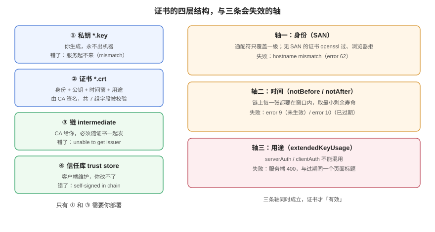

# 体系概述：链、时间、用途

**证书不是「一个文件」，而是一份带签名的时间窗声明。** 它同时声明三件事：这把公钥属于谁（身份）、在什么时间范围内有效（时间）、允许用来做什么（用途）。客户端验证失败时给出的提示几乎都一样（「连接不安全」），但失败的那一维不同，修法完全不同——本页先把这三条轴分开，再给出六种失效形态与各自的识别命令。



## 一、四层结构：私钥、证书、链、信任库

| 层 | 是什么 | 谁生成 | 出错时的现象 |
| --- | --- | --- | --- |
| **私钥**（`*.key`） | 与证书公钥配对的秘密 | 你自己（CSR 之前） | 服务起不来：`key values mismatch` |
| **证书**（`*.crt` / `*.pem`） | 身份 + 公钥 + 时间窗 + 用途，由上级 CA 签名 | CA | 单个客户端报错，取决于缺哪一维 |
| **链**（intermediate） | 从叶子到根的中间证书序列 | CA（必须由你随证书一起发出） | `unable to get local issuer certificate` |
| **信任库**（trust store） | 客户端内置的根证书集合 | 操作系统 / 浏览器 / 运行环境 | `self-signed certificate in certificate chain` |

四层里**只有私钥和链是需要你操心部署的**：证书本身由 CA 签发，信任库由客户端维护。而线上事故的分布恰好也是这两层——链少发一张、私钥与证书不配对。

::: tip 一个判断归属的窍门
问一句「**别的机器上是不是也这样**」：
- 只有某些客户端报错 → 大概率是**链**（老客户端不认新根、Java 不读系统库）；
- 所有客户端都报错 → 大概率是**时间或用途**（过期、`notBefore` 在未来、EKU 不对）；
- 只有一台服务报错 → 大概率是**私钥/证书配对**或**部署没生效**。
:::

## 二、三条轴，六种失效

下面六种形态全部在本机复现过（openssl 3.3.2 自建三级链 + nginx 1.31.6 四个容器），报错原文照抄。

### 2.1 链不全（最常见）

服务端只发叶子证书，不发中间证书。客户端手里只有根，拼不出完整路径：

```shell
# 只发叶子（nginx 里 ssl_certificate 指向 leaf.crt）
$ curl --cacert ca/root.crt --resolve board.example.com:18444:127.0.0.1 https://board.example.com:18444/
curl: (60) SSL certificate problem: unable to get local issuer certificate

# 同一台机器、同一份证书，只把中间证书拼进 fullchain
$ curl --cacert ca/root.crt --resolve board.example.com:18443:127.0.0.1 https://board.example.com:18443/
ok-fullchain
```

有意思的是，**把中间证书单独当信任锚也不管用**：

```shell
$ openssl verify -CAfile ca/inter.crt client.crt
error 2 at 1 depth lookup: unable to get issuer certificate
```

因为 OpenSSL 的默认行为是「必须走到自签根」，中间 CA 不是自签的。要么给完整链，要么显式 `-partial_chain`（见[信任链](../TrustChain/index.md)）。

### 2.2 过期（最容易，也最没技术含量）

```shell
$ openssl verify -CAfile ca/root.crt -untrusted ca/inter.crt expired.crt
error 10 at 0 depth lookup: certificate has expired
```

注意「过期」可能**不在叶子上**：链上的中间证书先过期时，叶子明明还没到期，客户端一样拒绝。这条单独在[过期治理](../Expiry/index.md)里用 `-attime` 做了证明。

### 2.3 还没生效

```shell
$ openssl verify -CAfile ca/root.crt -untrusted ca/inter.crt future.crt
error 9 at 0 depth lookup: certificate is not yet valid
```

`notBefore` 在未来通常来自**签发机时钟快了**。它比过期更阴险：过期是渐变（到点才挂），`notBefore` 在未来的证书**从签发那一刻起就是废的**，但 CA 面板上显示「有效」。

### 2.4 主机名不匹配

```shell
$ curl --cacert ca/root.crt --resolve evil.example.com:18443:127.0.0.1 https://evil.example.com:18443/
curl: (60) SSL: no alternative certificate subject name matches target host name 'evil.example.com'
```

`openssl` 报的是 `error 62 ... hostname mismatch`。**但 `openssl verify` 在没有 SAN 时会退回比对 CN**——这一点和浏览器不同：只有 CN 没有 SAN 的证书，`openssl verify -verify_hostname` 会返回 OK，而 Chrome 从 58 起直接拒绝。所以「本地 openssl 过了」不能作为「浏览器会过」的证据。

### 2.5 用途不符（mTLS 里最常见）

把服务端证书（`EKU: serverAuth`）当客户端证书用，链是好的、时间也是好的，照样被拒：

```shell
$ curl --cacert ca/root.crt --cert leaf.crt --key leaf.key https://board.example.com:18446/
# 服务端返回 400，页面标题是 "The SSL certificate error"
```

这条最坑的地方是**报错被统一了**：过期、用途不对、签名链不认识，nginx 的 `400` 页面标题都是同一句。要区分必须看 CA 侧的验证结果（`openssl verify -purpose`）或服务端日志。

### 2.6 私钥与证书不配对

nginx 直接起不来，而不是「起得来但报错」：

```text
[emerg] SSL_CTX_use_PrivateKey("/etc/nginx/certs/leaf.key") failed
(SSL: error:05800074:x509 certificate routines::key values mismatch)
```

同一条错误还能在**链顺序写反**时出现：把中间证书放在文件第一位，nginx 会拿第一张证书去对私钥，对不上就 `key values mismatch`。这与 `openssl verify` 的行为不同——`openssl verify` 不在乎 `-untrusted` 文件里的顺序（实测把 inter 放前面照样 `OK`），**只有真正加载证书的服务器在乎**。

## 三、六种形态的对照表

| 形态 | 典型报错 | 一句话定位命令 | 影响面 |
| --- | --- | --- | --- |
| 链不全 | `unable to get local issuer certificate`（60/20） | `openssl s_client -showcerts` 数证书张数 | 部分老客户端 |
| 叶子过期 | `certificate has expired`（10） | `openssl x509 -enddate` | 全量 |
| 中间过期 | `error 10 at 1 depth` | 逐张 `-enddate`，取最小值 | 全量 |
| 未生效 | `certificate is not yet valid`（9） | `openssl x509 -startdate` | 全量 |
| 主机名不符 | `no alternative certificate subject name matches`（62） | `openssl x509 -ext subjectAltName` | 特定域名 |
| 用途不符 | 服务端 400 / TLS alert | `openssl verify -purpose sslclient` | 该用途的全量 |
| 私钥不配对 | `key values mismatch` | `openssl pkey -pubout` 与证书公钥比对 | 服务起不来 |

## 四、本页不讲什么

- **TLS 握手每一步**：见 [HTTP 与 HTTPS../../../Backend/NetworkProgramming/HttpHttps/index.md)。
- **密钥怎么存、怎么下发**：见 [密钥与凭据治理](../../SecurityHardening/SecretGovernance/index.md)。本页只说一句：私钥权限 `600`、不进 Git、不进镜像层——这三条没有例外。
- **CA 商业选型**（DV/OV/EV 的价格与信任度）：本专题只讲技术差异，选型看合同与合规要求。

## 五、判据表：`CLO-A` ~ `CLO-H`

| 编号 | 判据 | 怎么验证 |
| --- | --- | --- |
| `CLO-A` | 每个对外域名必须能说出「叶子 + 中间 + 根」三张证书的到期时间 | 对域名逐张执行 `openssl s_client -showcerts` 后 `-enddate`，三个时间都有值 |
| `CLO-B` | 服务端发出的证书张数必须 ≥ 2（叶子 + 至少一张中间） | `openssl s_client -connect host:443 -showcerts` 的输出里 `BEGIN CERTIFICATE` 出现 ≥ 2 次 |
| `CLO-C` | 私钥与证书必须配对，且配对检查进入发布流程 | `diff <(openssl x509 -in c.pem -pubkey -noout) <(openssl pkey -in c.key -pubout)` 无输出 |
| `CLO-D` | 证书必须带 SAN，不得只靠 CN | `openssl x509 -noout -ext subjectAltName` 有输出 |
| `CLO-E` | 证书用途必须与使用场景一致（服务端 `serverAuth`、客户端 `clientAuth`） | `openssl x509 -noout -ext extendedKeyUsage` 与场景逐条对照 |
| `CLO-F` | 「证书是否有效」的判定必须包含链上所有证书，不能只查叶子 | 巡检脚本对链上每张证书取 `notAfter`，输出最小值 |
| `CLO-G` | 私钥文件权限必须为 `600`，且不得出现在镜像层或 Git 历史 | `stat -f%Lp key.pem` 输出 `600`；`git log --all -- '*.key'` 无输出 |
| `CLO-H` | 任一证书相关变更必须有「变更前/后各跑一次验证命令」的记录 | 变更单里能找到两条命令输出（修前红、修后绿） |

## 六、与相邻专题的分工

| 你想知道 | 去哪 |
| --- | --- |
| 密钥（API Key、口令）怎么轮换与托管 | [密钥与凭据治理](../../SecurityHardening/SecretGovernance/index.md) |
| 握手协议、会话复用、HTTP/2 | [HTTP 与 HTTPS../../../Backend/NetworkProgramming/HttpHttps/index.md) |
| nginx 具体配置项 | [Nginx HTTPS](../../Nginx/Https/index.md) |
| 证书该放在哪一层终止 | [云架构的安全层](../../CloudArchitecture/Security/index.md) |
| 换 CA / 换证书要不要走流程 | [变更管理](../../ChangeManagement/index.md)（属高危变更：秒级全量生效） |

**本页特有的坑**：`openssl verify` 对「只有 CN 没有 SAN」的证书会**放过**（退回比对 CN），而浏览器从 Chrome 58 起不再回退。本机实测 `-verify_hostname board.example.com` 对 CN-only 证书返回 `OK`——**这是 openssl 与浏览器的第一处系统性分歧**，第二处是 `-untrusted` 文件里的顺序（openssl 不在乎，服务器在乎）。

## 参考资料

- RFC 5280：*Internet X.509 Public Key Infrastructure Certificate and CRL Profile*（`basicConstraints` / `keyUsage` / `extendedKeyUsage` 的定义）
- CA/Browser Forum：[*Baseline Requirements for the Issuance and Management of Publicly-Trusted TLS Server Certificates*](https://cabforum.org/working-groups/server/baseline-requirements/)（Ballot SC-081v3 的寿命阶梯）
- OpenSSL 3.x：[`openssl-verification-options`](https://docs.openssl.org/master/man1/openssl-verification-options/)（`-verify_hostname`、`-partial_chain`、`-attime`、错误码含义）
- 本站：[信任链与 X.509](../TrustChain/index.md)、[过期治理](../Expiry/index.md)
