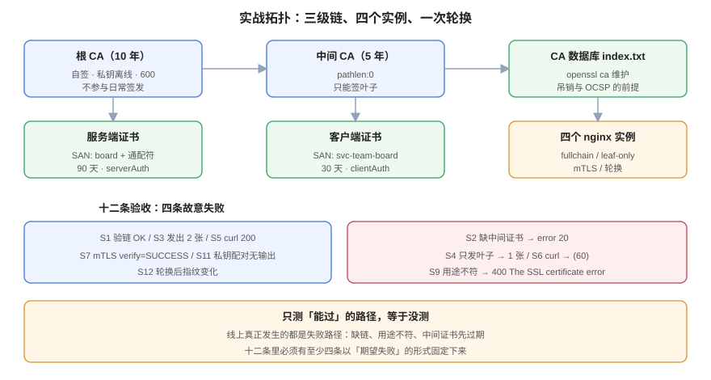

# 实战：一条可轮换的私有链

**这一页的目标是可复现：从空目录开始，四十分钟内得到一条「根 → 中间 → 叶子 / 客户端」的完整链，一条能吊销的 CA 数据库，一个能跑 mTLS 的 nginx，以及一次可回滚的轮换。** 全部命令在本机实测通过（openssl 3.3.2 / nginx 1.31.6），输出照抄。所有产物都在 `/tmp/certlab` 下，不进仓库。



## 零、拓扑与时间预算

| 组件 | 内容 | 预计耗时 |
| --- | --- | --- |
| 根 CA | 自签，10 年 | 1 分钟 |
| 中间 CA | 根签，5 年，`pathlen:0` | 1 分钟 |
| 服务端证书 | 中间签，90 天，SAN 两个 | 1 分钟 |
| 客户端证书 | 中间签，30 天，`clientAuth` | 1 分钟 |
| CA 数据库 | `index.txt`（为了吊销与 OCSP） | 2 分钟 |
| nginx 四实例 | fullchain / leaf-only / mTLS / 轮换 | 10 分钟 |
| 十二条验收 | 逐条跑 | 15 分钟 |

下面按顺序执行。**每一步都有「期望输出」**，不匹配就停下，不要往下走。

## 一、根 CA

```shell
mkdir -p /tmp/certlab/ca/private /tmp/certlab/ca/newcerts /tmp/certlab/ca/db
cd /tmp/certlab

cat > ca/root.cnf <<'EOF'
[req]
distinguished_name = dn
prompt = no
x509_extensions = v3_ca
[dn]
CN = CertLab Root CA
O = CertLab
[v3_ca]
basicConstraints = critical,CA:TRUE
keyUsage = critical,keyCertSign,cRLSign
subjectKeyIdentifier = hash
EOF

openssl req -x509 -newkey rsa:2048 -nodes -keyout ca/root.key -out ca/root.crt \
  -days 3650 -config ca/root.cnf -sha256
```

期望：

```text
subject=CN=CertLab Root CA, O=CertLab
notAfter=Oct 17 06:46:29 2036 GMT
X509v3 Basic Constraints: critical
    CA:TRUE
X509v3 Key Usage: critical
    Certificate Sign, CRL Sign
```

::: danger 根私钥的三条铁律
1. `chmod 600 ca/root.key`，并且**离线保存**（真实环境放 HSM 或离线机）。
2. 根私钥**不参与日常签发**——这就是为什么要中间 CA。
3. 根证书要能随时拿到（它要进所有客户端的信任库），根私钥不需要。
:::

## 二、中间 CA

```shell
cat > ca/inter.cnf <<'EOF'
[req]
distinguished_name = dn
prompt = no
[dn]
CN = CertLab Intermediate CA
O = CertLab
[v3_ca]
basicConstraints = critical,CA:TRUE,pathlen:0
keyUsage = critical,keyCertSign,cRLSign
subjectKeyIdentifier = hash
authorityKeyIdentifier = keyid:always
EOF

openssl req -new -newkey rsa:2048 -nodes -keyout ca/inter.key -out ca/inter.csr -config ca/inter.cnf
openssl x509 -req -in ca/inter.csr -CA ca/root.crt -CAkey ca/root.key -CAcreateserial \
  -out ca/inter.crt -days 1825 -sha256 -extfile ca/inter.cnf -extensions v3_ca
```

`pathlen:0` 的含义：**它只能签叶子，不能再签 CA**。实测越级签发会被客户端拒绝（`error 25 ... path length constraint exceeded`，见[信任链](../TrustChain/index.md)）。

## 三、服务端证书（带 SAN）

```shell
cat > ca/leaf.cnf <<'EOF'
[req]
distinguished_name = dn
prompt = no
[dn]
CN = board.example.com
O = CertLab
[v3_leaf]
basicConstraints = critical,CA:FALSE
keyUsage = critical,digitalSignature,keyEncipherment
extendedKeyUsage = serverAuth
subjectAltName = @san
subjectKeyIdentifier = hash
authorityKeyIdentifier = keyid,issuer
[san]
DNS.1 = board.example.com
DNS.2 = *.board.example.com
EOF

openssl req -new -newkey rsa:2048 -nodes -keyout leaf.key -out leaf.csr -config ca/leaf.cnf
openssl x509 -req -in leaf.csr -CA ca/inter.crt -CAkey ca/inter.key -CAcreateserial \
  -out leaf.crt -days 90 -sha256 -extfile ca/leaf.cnf -extensions v3_leaf

# 关键一步：拼链，叶子在前
cat leaf.crt ca/inter.crt > fullchain.pem
```

期望：

```shell
$ openssl verify -CAfile ca/root.crt -untrusted ca/inter.crt -verify_hostname board.example.com leaf.crt
leaf.crt: OK
$ wc -c leaf.crt fullchain.pem
    1310 leaf.crt
    2526 fullchain.pem
```

## 四、CA 数据库（为了能吊销）

前三步用的是 `openssl x509 -req`，它**不写 `index.txt`**，所以无法生成 CRL。要吊销就必须从这一步开始用 `openssl ca`：

```shell
mkdir -p ca2/newcerts && : > ca2/index.txt && echo 2000 > ca2/serial && echo 2000 > ca2/crlnumber

cat > ca2/ca.cnf <<'EOF'
[ca]
default_ca = CA_default
[CA_default]
dir = /tmp/certlab/ca2
database = $dir/index.txt
new_certs_dir = $dir/newcerts
certificate = /tmp/certlab/ca/inter.crt
private_key = /tmp/certlab/ca/inter.key
serial = $dir/serial
crlnumber = $dir/crlnumber
default_md = sha256
policy = policy_any
email_in_dn = no
rand_serial = no
unique_subject = no
copy_extensions = none
default_days = 90
[policy_any]
commonName = optional
organizationName = optional
[v3_leaf]
basicConstraints = critical,CA:FALSE
keyUsage = critical,digitalSignature,keyEncipherment
extendedKeyUsage = serverAuth
subjectAltName = @san
subjectKeyIdentifier = hash
authorityKeyIdentifier = keyid,issuer
[san]
DNS.1 = board.example.com
[v3_client]
basicConstraints = critical,CA:FALSE
keyUsage = critical,digitalSignature
extendedKeyUsage = clientAuth
subjectAltName = @csan
[csan]
DNS.1 = svc-team-board
EOF

# 用数据库签一张（可指定起止时间，用于造「已过期」测试证书）
openssl ca -batch -config ca2/ca.cnf -extensions v3_leaf -in leaf.csr -out ok90.crt \
  -startdate 260901000000Z -enddate 261201000000Z -notext
```

::: warning `unique_subject = no` 是轮换的前提
默认 `unique_subject = yes` 会拒绝为同一主体重复签发——而**轮换就是同一主体再签一次**。不关掉它，第一次续期就报 `TXT_DB error number 2`。
:::

## 五、客户端证书（mTLS）

```shell
openssl req -new -newkey rsa:2048 -nodes -keyout client.key -out client.csr -config ca/client.cnf
# ca/client.cnf 与 leaf.cnf 同构，但 extendedKeyUsage = clientAuth、SAN 为服务名
openssl ca -batch -config ca2/ca.cnf -extensions v3_client -in client.csr -out client.crt \
  -startdate 260920000000Z -enddate 261020000000Z -notext
```

期望：`openssl x509 -noout -ext extendedKeyUsage client.crt` 输出 `TLS Web Client Authentication`。

## 六、四个 nginx 实例

```shell
docker run -d --name certlab-full  -p 18443:443 -v /tmp/certlab:/etc/nginx/certs:ro \
  -v /tmp/certlab/nginx/full.conf:/etc/nginx/conf.d/default.conf:ro nginx:alpine
docker run -d --name certlab-leaf  -p 18444:443 -v /tmp/certlab:/etc/nginx/certs:ro \
  -v /tmp/certlab/nginx/leafonly.conf:/etc/nginx/conf.d/default.conf:ro nginx:alpine
docker run -d --name certlab-mtls  -p 18446:443 -v /tmp/certlab:/etc/nginx/certs:ro \
  -v /tmp/certlab/nginx/mtls.conf:/etc/nginx/conf.d/default.conf:ro nginx:alpine
docker run -d --name certlab-rot   -p 18447:443 -v /tmp/certlab:/etc/nginx/certs:ro \
  -v /tmp/certlab/nginx/rot.conf:/etc/nginx/conf.d/default.conf:ro nginx:alpine
```

四个实例只有一处差别：`ssl_certificate` 指向 `fullchain.pem` / `leaf.crt` / `fullchain.pem + ssl_verify_client` / `current-chain.pem`。**这样对比才能证明「差异来自配置，不来自证书」。**

## 七、十二条验收命令

| 编号 | 命令 | 期望 | 证明什么 |
| --- | --- | --- | --- |
| `S1` | `openssl verify -CAfile ca/root.crt -untrusted ca/inter.crt leaf.crt` | `OK` | 链完整 |
| `S2` | `openssl verify -CAfile ca/root.crt leaf.crt` | `error 20` | 缺中间证书会被拒 |
| `S3` | `s_client -showcerts` 数 `BEGIN CERTIFICATE`（18443） | `2` | 服务端发了完整链 |
| `S4` | 同上（18444） | `1` | 只发叶子 |
| `S5` | `curl --cacert ca/root.crt` 打 18443 | `200` | 客户端能验过 |
| `S6` | 同上打 18444 | `(60) unable to get local issuer certificate` | 链不全会失败 |
| `S7` | `curl --cert client.crt --key client.key` 打 18446 | `verify=SUCCESS` | mTLS 通过 |
| `S8` | 不带客户端证书打 18446 | `400 No required SSL certificate was sent` | 强制客户端证书 |
| `S9` | `curl --cert leaf.crt --key leaf.key` 打 18446 | `400 The SSL certificate error` | 用途不符被拒 |
| `S10` | `openssl verify -CAfile ca/root.crt -untrusted ca/inter.crt -attime $((NOW+60*86400)) leaf.crt` | `error 10` | 未来会过期（时间旅行） |
| `S11` | `diff <(openssl x509 -in fullchain.pem -pubkey -noout) <(openssl pkey -in leaf.key -pubout)` | 无输出 | 私钥配对 |
| `S12` | 轮换后用 `s_client` 取证书再 `x509 -fingerprint -sha256` | 与新文件一致 | 热加载生效 |

十二条里 `S2`、`S4`、`S6`、`S9` 是**故意失败**的用例。**只测「能过」的路径，等于没测**——线上真正发生的都是失败路径。

## 八、一次可回滚的轮换

```shell
# 1) 记录旧指纹
OLD=$(openssl x509 -in leaf.crt -noout -fingerprint -sha256 | cut -d= -f2)
OLD_PIN=$(openssl x509 -in leaf.crt -pubkey -noout | openssl pkey -pubin -outform der \
          | openssl dgst -sha256 -binary | base64)

# 2) 新 key + 新证书（另存新文件名，不覆盖）
openssl req -new -newkey rsa:2048 -nodes -keyout new.key -out new.csr -config ca/leaf.cnf
openssl x509 -req -in new.csr -CA ca/inter.crt -CAkey ca/inter.key -CAcreateserial \
  -out new.crt -days 90 -sha256 -extfile ca/leaf.cnf -extensions v3_leaf

# 3) 切换 + 重载
cp new.crt current.crt && cp new.key current.key && cat current.crt ca/inter.crt > current-chain.pem
docker exec certlab-rot nginx -s reload

# 4) 对账
NEW=$(openssl s_client -connect 127.0.0.1:18447 -servername board.example.com </dev/null 2>/dev/null \
      | openssl x509 -noout -fingerprint -sha256 | cut -d= -f2)
[ "$OLD" != "$NEW" ] && echo "轮换生效：$OLD -> $NEW"
```

本机实测（这是本页最有价值的一条）：

```text
1) 轮换前，带旧 pin 请求: http=200
2) 轮换后，仍带旧 pin:   curl: (90) SSL: public key does not match pinned public key
3) 轮换后，不带 pin:     http=200
4) 轮换后，用新 pin:     http=200
```

## 九、分诊表：十类现象

| 现象 | 先看哪一条 | 常见原因 |
| --- | --- | --- |
| 浏览器全站「不安全」 | `S3` 证书张数 | 链不全 / 叶子过期 |
| 只有老设备报错 | `S1` 用公共根包验 | 老设备不认新根（缺交叉签名） |
| `key values mismatch` | `S11` 配对 + 文件顺序 | 私钥不对 / `fullchain` 顺序反了 |
| 报错都过、但客户端仍拒绝 | `openssl x509 -ext ekU` | 用途不符 / SAN 缺域名 |
| 换了证书没生效 | `S12` 指纹 | 进程没重载；Java/Go 只启动时读 |
| mTLS 全 400 | 服务端 `$ssl_client_verify` | 信任锚只给了中间 CA |
| mTLS 健康检查「正常」 | 带证书的健康检查 | 健康检查没带证书，看到的是「没带证书」的 400 |
| 昨天好好的今天全挂 | 链上每张 `-enddate` | **中间证书过期** |
| 证书显示「明年到期」却不可用 | `-startdate` | `notBefore` 在未来 |
| 轮换后部分客户端失败 | 客户端是否 pin | pin 了叶子证书的 SPKI |

## 十、判据表：`CLP-A` ~ `CLP-H`

| 编号 | 判据 | 怎么验证 |
| --- | --- | --- |
| `CLP-A` | 演练必须包含失败路径（缺链、用途不符、过期），不能只测通过路径 | 至少有 4 条「期望失败」的用例并记录实际输出 |
| `CLP-B` | 根私钥必须 `600` 且不参与日常签发 | `stat -f%Lp ca/root.key` = `600`；日常签发用的是中间 CA 的 key |
| `CLP-C` | 中间 CA 必须声明 `pathlen:0` | `openssl x509 -noout -ext basicConstraints ca/inter.crt` 含 `pathlen:0` |
| `CLP-D` | 需要吊销能力时，必须从第一天使用 `openssl ca`（有 `index.txt`） | `openssl ca -gencrl` 能产出 CRL |
| `CLP-E` | 所有端口/实例的差异必须来自配置而非证书 | 多个实例共用同一份 `leaf.crt`，只有配置文件不同 |
| `CLP-F` | 轮换必须保留旧文件（可回滚），且指纹对账通过 | 目录里仍有旧 `leaf.crt`；新旧指纹都记录在案 |
| `CLP-G` | 十二条验收必须能一键跑完并输出 pass/fail | 存在脚本或清单，逐条有期望值与实际值 |
| `CLP-H` | 演练产物不得提交进仓库（密钥、证书、CRL） | `git status` 中无 `*.key` / `*.pem` / `*.crt` |

## 十一、与相邻专题的分工

| 你想知道 | 去哪 |
| --- | --- |
| 每一步背后的原理 | [信任链](../TrustChain/index.md)、[签发](../Issuance/index.md) |
| nginx 配置项的完整语义 | [Nginx HTTPS](../../Nginx/Https/index.md) |
| 生产环境怎么自动化 | [自动化](../Automation/index.md) |
| 到期与轮换的治理流程 | [过期治理](../Expiry/index.md)、[轮换](../Rotation/index.md) |
| 证书相关变更怎么审批 | [变更管理](../../ChangeManagement/index.md) |

**本页特有的坑（三个都是本轮踩的）**：

1. **`openssl x509` 没有 `-startdate` / `-enddate`**：想造「已过期」的证书只能用 `openssl ca`。看到 `x509: Use -help for summary` 就是参数用错了工具。
2. **`set -e` 会被 `checkend` 杀掉**：`openssl x509 -checkend` 用退出码表达结果，返回 1 时脚本直接退出，表现为「跑完了、没输出」。所有调用都要包在 `if` 里。
3. **`s_client` 不加 `-showcerts` 只打印叶子**：统计证书张数时两个实例都得 `1`，差点得出「fullchain 没生效」的错误结论。

## 参考资料

- OpenSSL：[*CA 操作手册*](https://docs.openssl.org/master/man1/openssl-ca/)（`index.txt` 结构与 `-gencrl`）
- OpenSSL：[*`openssl-req`*](https://docs.openssl.org/master/man1/openssl-req/)（`-addext` 与配置段）
- nginx：[*SSL 模块*](https://nginx.org/en/docs/http/ngx_http_ssl_module.html)（`ssl_client_certificate` / `ssl_crl` / `ssl_verify_client`）
- 本站：[体系概述](../Overview/index.md)、[部署与链路完整性](../Serving/index.md)
