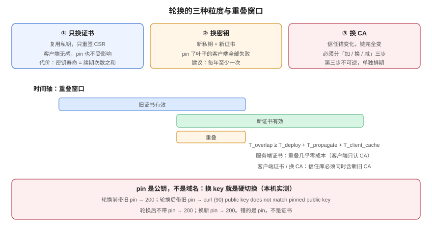

# 轮换：重叠窗口与密钥不重用

**轮换的目的不是「换一张新证书」，而是「在旧证书还有效的时候，让所有客户端都换成新的」。** 这两句话的差别决定了事故形态：只换证书不管重叠，等于在换的瞬间把所有「还记着旧证书」的客户端踢下线。本页把轮换拆成三种粒度（换证书 / 换密钥 / 换 CA），给出重叠窗口的下界公式，并用一条实测证明——**任何形式的证书固定（pinning）都会把「平滑轮换」变成「硬切换」**。



## 一、三种粒度，代价差一个数量级

| 粒度 | 换什么 | 客户端感知 | 典型周期 | 风险 |
| --- | --- | --- | --- | --- |
| **换证书，复用密钥** | 只重新签一次 CSR | 无（公钥没变） | 每次续期 | 低（但密钥泄漏无法通过它补救） |
| **换密钥** | 新私钥 + 新证书 | 有 pinning 的客户端会失败 | 90 天 ~ 1 年 | 中 |
| **换 CA** | 新的签发者，链完全变了 | 信任锚变化的客户端全部受影响 | 数年一次 | 高（等同一次「信任根切换」） |

::: danger 「复用密钥续期」不是省事，是把风险攒起来
复用密钥续期最省事：不用重配、不用重启、pin 也不会失效。代价是**密钥的生命周期等于证书续期次数的总和**——一张 90 天证书续 4 年，等于同一把私钥用了 4 年。而私钥泄漏的检测能力几乎为零。实践中的折中：**公开证书可以复用密钥续期若干次，但每年至少换一次 key；私有 CA 与 mTLS 客户端证书每次轮换都换 key。**
:::

## 二、重叠窗口：一个能算出来的下界

轮换期间必须存在一段时间，新旧两份材料**同时被接受**。窗口长度的下界由三件事相加：

```text
T_overlap ≥ T_deploy + T_propagate + T_client_cache
```

| 项 | 含义 | 典型值 |
| --- | --- | --- |
| `T_deploy` | 新证书推送到所有终端的耗时（多实例 + 多区域） | 分钟级 ~ 小时级 |
| `T_propagate` | DNS / 配置中心的传播与缓存过期 | TTL 的 1~2 倍 |
| `T_client_cache` | 客户端缓存旧证书/旧连接的时间 | 会话票据 timeout、连接池 keepalive |

**服务端证书**的重叠窗口几乎是零成本：新旧证书都由同一个 CA 签，客户端只认 CA 不认具体证书，所以「换」的瞬间没有客户端会失败——除非它 pin 了。

**客户端证书 / 换 CA** 才需要真正的重叠窗口：信任库必须**同时包含新旧两个 CA**，直到确认所有对端都已换完。

### 2.1 换 CA 的两阶段

1. **阶段一（加）**：信任库加入新 CA，服务端仍用旧 CA 签的证书。此时新旧都能验过。
2. **阶段二（换）**：服务端换成新 CA 签的证书。旧证书仍然有效，回滚只需换回文件。
3. **阶段三（减）**：确认无回滚需求后，从信任库移除旧 CA。**这一步必须单独排期**——它不可逆。

三个阶段各自是一次变更，中间至少隔一个观察窗。把三件事塞进一次发布，等于把「可回滚」变成「不可回滚」。

## 三、实测：pinning 会把轮换变成硬切换

本机搭了一条链（根 → 中间 → 叶子），用 `curl --pinnedpubkey` 模拟「客户端固定了服务端公钥」这一行为。流程与读数：

```shell
# 1) 记录旧证书的 SPKI 指纹
$ PIN=$(openssl x509 -in leaf.crt -pubkey -noout | openssl pkey -pubin -outform der | openssl dgst -sha256 -binary | base64)
$ echo "sha256//$PIN"
sha256//zunrc/jb11wFF/hOK0RRpiBpk21hoEzW94/t5G0PXOM=
```

| 步骤 | 命令 | 结果 |
| --- | --- | --- |
| 轮换前，带旧 pin | `curl --pinnedpubkey sha256//zunr...` | **200** |
| 换成新密钥 + 新证书，`nginx -s reload` | —— | 指纹变化，reload 立即生效 |
| 轮换后，仍带旧 pin | `curl --pinnedpubkey sha256//zunr...` | **失败**：`curl: (90) SSL: public key does not match pinned public key` |
| 轮换后，不带 pin | `curl --cacert ca/root.crt` | 200 |
| 轮换后，用新 pin | `curl --pinnedpubkey sha256//zUno...` | 200 |

结论很硬：**pin 的是公钥，不是域名、不是 CA。** 只要换了 key，所有 pin 过的客户端会在同一秒全部失败，而且它们的报错（`(90)`）和「证书过期」（`(60)`）完全不同，值班的人第一眼往往认不出来。

::: tip 如果非 pin 不可
1. **pin 中间 CA 或根 CA 的 SPKI**，不要 pin 叶子——这样换叶子不受影响，换 CA 才受影响（而换 CA 本来就要走三阶段）。
2. **至少准备两个备份 pin**（当前 + 下一个），并写进发布流程。
3. **不要 pin 在移动端**：App 的更新周期以周计，pin 错了只能等应用商店审核。
:::

## 四、热加载：换了文件不等于换了证书

```shell
# 换文件后重载
$ docker exec certlab-rot nginx -s reload
2026/10/20 06:48:09 [notice] 29#29: signal process started

# 立刻验指纹
$ openssl s_client -connect 127.0.0.1:18447 -servername board.example.com </dev/null 2>/dev/null \
    | openssl x509 -noout -fingerprint -sha256
```

实测 reload 后指纹**立即**变化，不需要等。但有两点必须知道：

1. **旧 worker 会服务完已建立的连接**（graceful），所以「reload 后仍有人拿到旧证书」是正常现象，直到旧连接自然结束。
2. **某些进程只在启动时读一次证书**：Java 的 `SSLContext`、Python 的 `ssl.SSLContext`、Go 的 `tls.Config`（除非用 `GetCertificate` 回调）都不会自动重载。**对这些服务，「换文件 + reload」等于没换**——必须重启或改造为回调加载。

## 五、短寿命时代的轮换节奏

2026 年起公开证书上限 200 天，2027 年 100 天，2029 年 47 天。轮换节奏必须跟着改：

| 证书寿命 | 建议续期点 | 剩余缓冲 | 每年轮换次数 |
| --- | --- | --- | --- |
| 398 天（历史） | 到期前 30 天 | 30 天 | ~1 |
| 200 天 | 寿命 2/3（约第 133 天） | 67 天 | ~2 |
| 90 天 | 寿命 2/3（第 60 天） | 30 天 | ~4 |
| 47 天 | 寿命 2/3（第 31 天） | 16 天 | ~12 |
| 6 天（160 小时） | 寿命 2/3（约第 4 天） | 2 天 | ~60 |

最后两行是质变：**每年 12 次、60 次**的轮换不可能靠人。而且「缓冲 2 天」意味着**一次失败就必须在 48 小时内修好**——这要求告警不是「证书快过期了」，而是「续期失败了」。

::: warning 固定天数续期是最常见的定时炸弹
「每 60 天跑一次 certbot renew」在 90 天证书时代是安全的；换成 47 天证书后，**第 60 天才续期时证书已经死了 13 天**。正确做法是让客户端按**证书实际寿命**算续期点（cert-manager 的 2/3、Certbot 4.x 的「剩余不足 1/3」、ARI 的 `suggestedWindow`），而不是写死天数。
:::

## 六、轮换的五步操作单

```text
1. 准备：新 key + 新 CSR + 新证书（不要覆盖旧文件，另存为新文件名）
2. 校验：openssl verify 通过、指纹记录、私钥配对检查
3. 切换：改配置指向新文件 → reload → 立刻验指纹
4. 观察：一个完整的业务周期（至少覆盖一次高峰），确认无异常
5. 归档：旧文件保留一个轮换周期再删（回滚要用），私钥按合规要求销毁
```

第 1 步的「不要覆盖」是硬要求：**覆盖式更换等于放弃了回滚能力**——出问题时你连旧文件都没有了。

## 七、判据表：`CLR-A` ~ `CLR-H`

| 编号 | 判据 | 怎么验证 |
| --- | --- | --- |
| `CLR-A` | 轮换前必须记录旧证书的 SHA-256 指纹，轮换后必须对账新指纹 | 变更记录里有两条 `-fingerprint -sha256` 输出且不相等 |
| `CLR-B` | 新证书必须另存新文件名，不得覆盖旧文件（保留回滚能力） | 目录里同时存在新旧两份，旧文件在观察期后才删除 |
| `CLR-C` | 轮换后必须验证「实际服务的是新证书」，不能只看文件 mtime | 用 `s_client` 取回证书后 `x509 -fingerprint`，与本地新文件一致 |
| `CLR-D` | 若客户端做了 pinning，必须 pin 中间/根 CA 的 SPKI，不得 pin 叶子 | pin 配置里的指纹与叶子证书 SPKI 不同 |
| `CLR-E` | 换 CA 必须分「加信任 → 换证书 → 减信任」三步，不得合并为一次变更 | 变更记录里三个阶段的日期不同 |
| `CLR-F` | 每次轮换必须判定是否换 key：公开证书至少每年换一次，mTLS 客户端证书每次换 | 轮换记录里有 `key_reused` 字段，且年度统计中换 key 次数 ≥ 1 |
| `CLR-G` | 不支持热加载的服务（Java/Go/Python 自建 TLS）必须重启，不能只 reload | 服务的重启时间与轮换时间一致；或代码用 `GetCertificate` 回调 |
| `CLR-H` | 续期调度必须按证书实际寿命计算，不得写死天数 | 配置里没有 `--days 60` 之类的固定阈值，或用 ARI |

## 八、与相邻专题的分工

| 你想知道 | 去哪 |
| --- | --- |
| 续期怎么自动化、失败怎么告警 | [自动化](../Automation/index.md) |
| 客户端的身份证书怎么轮换 | [mTLS](../MutualTLS/index.md) |
| 密钥（API Key）的轮换策略 | [密钥与凭据治理](../../SecurityHardening/SecretGovernance/index.md) |
| 换证书要走什么变更流程 | [变更管理](../../ChangeManagement/index.md)（属「即时全量生效」的高危变更） |
| 灰度发布能不能用于证书 | [变更管理的高危变更](../../ChangeManagement/HighRiskChange/index.md)（证书**不能**灰度，一改就是全量） |

**本页特有的坑**：pinning 失败与过期失败**都是 `curl` 的证书类错误，但退出码不同**（`(90)` vs `(60)`），而很多客户端 SDK 会把它们统一包装成「网络错误」。轮换前先确认「我们的客户端有没有 pin」——如果答不上来，就默认「有」，按 `CLR-D` 处理。

## 参考资料

- RFC 7469：*Public Key Pinning Extension for HTTP*（HPKP，已被废弃，但 SPKI pin 的思想仍在移动端与 App 中使用）
- RFC 8555 §7.4：*Certificate Revocation*（轮换与吊销的协议侧）
- RFC 9773：*ACME Renewal Information (ARI)*（`suggestedWindow` 驱动的续期）
- cert-manager：[*Certificate*](https://cert-manager.io/docs/usage/certificate/)（`renewBefore` / `duration` 的默认值与 2/3 规则）
- 本站：[自动化](../Automation/index.md)、[部署与链路完整性](../Serving/index.md)
