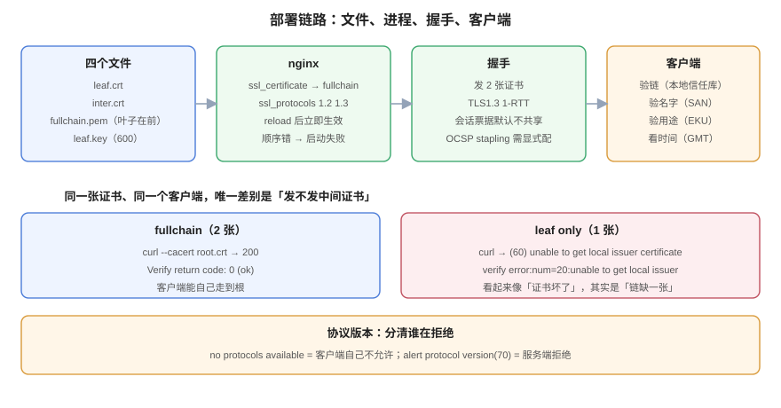

# 部署与链路完整性

**同一个证书文件，配对了是「安全」，配错了是「所有人打不开」。** 部署环节有三个不可协商的点：发出去的必须是**完整链**（叶子在前）、私钥与证书必须**配对**、协议版本必须由**服务端**拒绝而不是客户端拒绝。本页给出可直接抄的 nginx 配置、三条验证命令，以及一个常见误判——把客户端的拒绝当成服务端的配置生效。



## 一、四个文件，别搞混

| 文件 | 内容 | 给谁 |
| --- | --- | --- |
| `leaf.crt` | 只有叶子证书 | 拼 `fullchain` 用；**不要单独配给服务器** |
| `inter.crt` | 中间 CA（可能多张） | 拼 `fullchain` 用 |
| `fullchain.pem` | 叶子 + 中间（**叶子必须在前**） | `ssl_certificate` |
| `leaf.key` | 私钥 | `ssl_certificate_key` |

`fullchain` 里**不放根证书**。根在客户端信任库里已经有了，多发一张只会让每次握手的 `Certificate` 消息多 800 多字节（本机实测根证书 DER 812 字节），没有任何收益。

## 二、nginx 配置：能抄的那一版

```nginx
server {
    listen 443 ssl;
    http2 on;
    server_name board.example.com;

    ssl_certificate     /etc/nginx/certs/fullchain.pem;   # 叶子在前
    ssl_certificate_key /etc/nginx/certs/leaf.key;

    ssl_protocols       TLSv1.2 TLSv1.3;
    ssl_ciphers         ECDHE-ECDSA-AES128-GCM-SHA256:ECDHE-RSA-AES128-GCM-SHA256:ECDHE-ECDSA-CHACHA20-POLY1305:ECDHE-RSA-CHACHA20-POLY1305;
    ssl_prefer_server_ciphers off;

    ssl_session_cache   shared:SSL:10m;
    ssl_session_timeout 1d;
    ssl_session_tickets off;

    location / { return 200 "ok\n"; }
}
```

四条解释，都是踩过才知道的：

1. **`ssl_prefer_server_ciphers off`**：TLS 1.3 下这个指令无意义，TLS 1.2 下让客户端优先更利于性能（客户端最懂自己的硬件）。
2. **`ssl_session_tickets off`**：会话票据的密钥默认随进程生成，多实例之间不共享，回滚/扩容后旧票据全部失效。要用就必须显式配 `ssl_session_ticket_key` 并在实例间同步。
3. **不要写 `ssl on;`**：新版本已废弃，写了会有 warning。
4. **`http2 on;`** 是 nginx 1.25.1 之后的新写法，老写法 `listen 443 ssl http2;` 仍然可用但已标记废弃。

## 三、验证：三条命令，缺一不可

### 3.1 发出去了几张证书

```shell
$ openssl s_client -connect 127.0.0.1:18443 -servername board.example.com -showcerts </dev/null 2>/dev/null \
    | grep -c "BEGIN CERTIFICATE"
2
$ openssl s_client -connect 127.0.0.1:18444 -servername board.example.com -showcerts </dev/null 2>/dev/null \
    | grep -c "BEGIN CERTIFICATE"
1
```

端口 18443 是配了 `fullchain` 的实例，18444 是只配叶子的实例（同一张证书、同一个私钥）。**「几张」这一条能直接判出链是否完整，比看客户端报错快得多。**

### 3.2 客户端能不能验过

```shell
$ curl --cacert ca/root.crt --resolve board.example.com:18443:127.0.0.1 https://board.example.com:18443/
ok-fullchain
$ curl --cacert ca/root.crt --resolve board.example.com:18444:127.0.0.1 https://board.example.com:18444/
curl: (60) SSL certificate problem: unable to get local issuer certificate
```

注意：**同一个客户端、同一个信任库、同一张叶子证书**，唯一差别是发不发中间证书。所以看到 `(60)` 的第一反应应该是「链」，而不是「证书是不是过期」。

### 3.3 服务端返回的到底是不是「新」证书

换证书后最常见的问题是「文件换了、进程没加载」。用指纹对账，不要用肉眼看日期：

```shell
# 本地文件的指纹
openssl x509 -in fullchain.pem -noout -fingerprint -sha256
# 服务端实际出示的指纹
openssl s_client -connect 127.0.0.1:18443 -servername board.example.com </dev/null 2>/dev/null \
  | openssl x509 -noout -fingerprint -sha256
```

两个指纹必须逐字相等。实测 `nginx -s reload` 后指纹立即变化（旧 worker 仍会服务完已建立的连接，这是 graceful reload 的正常行为），所以**「reload 完立刻验一次」是可靠的**，不需要等。

::: danger 顺序写反时，nginx 不是「报错」，是「起不来」
把 `inter.crt` 放在 `fullchain.pem` 第一行，nginx 启动直接失败：
```text
[emerg] SSL_CTX_use_PrivateKey("/etc/nginx/certs/leaf.key") failed
(SSL: error:05800074:x509 certificate routines::key values mismatch)
```
它拿第一张证书去匹配私钥，对不上就退出。**这时候去看证书内容会看不出任何问题**（两张证书都是好的），只有顺序是错的。而 `openssl verify` 对同样的文件返回 `OK`——这就是为什么「本地校验通过」不能替代「服务能起来」。
:::

## 四、协议版本：怎么测才准

```shell
$ openssl s_client -connect 127.0.0.1:18443 -tls1_1 -servername board.example.com </dev/null 2>&1 | head -2
...:error:0A0000BF:SSL routines:tls_setup_handshake:no protocols available
```

这条输出**不能证明服务端禁用了 TLS 1.1**——它是客户端自己拒绝的（OpenSSL 3.x 默认安全级别把 TLS 1.0/1.1 移出了默认协议集）。把客户端的安全级别降下来再测，才能看到服务端的真实态度：

```shell
$ openssl s_client -connect 127.0.0.1:18443 -tls1_1 -cipher 'DEFAULT@SECLEVEL=0' -servername board.example.com </dev/null 2>&1 | grep alert
...:error:0A00042E:SSL routines:ssl3_read_bytes:tlsv1 alert protocol version:...:SSL alert number 70
```

`tlsv1 alert protocol version` 是**服务端发的 alert**（编号 70），这才是「服务端拒绝」的证据。

| 输出 | 含义 | 能不能作为「服务端已禁用」的证据 |
| --- | --- | --- |
| `no protocols available` | 客户端本地就不允许这个版本 | ❌ 不能 |
| `alert protocol version`（70） | 服务端明确拒绝 | ✅ 能 |
| `handshake failure`（40） | 协议能谈，但套件/证书不匹配 | ⚠️ 要看具体场景 |

::: tip 一条命令测完四个版本
```shell
for v in tls1 tls1_1 tls1_2 tls1_3; do
  printf "%-7s " "$v"
  openssl s_client -connect host:443 -$v -cipher 'DEFAULT@SECLEVEL=0' -servername host </dev/null 2>&1 \
    | grep -oE "Protocol *: [A-Za-z0-9.]+|alert [a-z ]+|no protocols available" | head -1
done
```
期望：前两行是 `alert protocol version`，后两行是 `Protocol : TLSv1.2` / `TLSv1.3`。
:::

## 五、双证书：能开，但先想清楚代价

同一 `server_name` 挂两组证书，让客户端按自己的能力选：

```nginx
ssl_certificate     /etc/nginx/certs/fullchain.pem;      # RSA
ssl_certificate_key /etc/nginx/certs/leaf.key;
ssl_certificate     /etc/nginx/certs/ec-chain.pem;       # ECDSA P-256
ssl_certificate_key /etc/nginx/certs/leaf-ec.key;
```

实测（同一实例）：

| 客户端行为 | 选中的证书 |
| --- | --- |
| TLS 1.3，默认偏好 | ECDSA（`Peer signature type: ECDSA`，`Server Temp Key: X25519`） |
| TLS 1.2 + `ECDHE-ECDSA-AES128-GCM-SHA256` | ECDSA |
| TLS 1.2 + `ECDHE-RSA-AES128-GCM-SHA256` | RSA |

收益是兼容老客户端（不支持 ECDSA 的）同时让新客户端用更小的证书；代价是**两张证书的续期、两套监控、两次故障可能**。没有自动化续期之前不要开。

## 六、部署后的五项自检

```shell
# 1) 证书张数（期望 ≥ 2）
openssl s_client -connect host:443 -servername host -showcerts </dev/null 2>/dev/null | grep -c "BEGIN CERTIFICATE"
# 2) 验链（期望 OK）
openssl s_client -connect host:443 -servername host -CAfile /etc/ssl/certs/ca-certificates.crt -verify_return_error </dev/null 2>&1 | grep "Verify return code"
# 3) 指纹对账（期望与服务端一致）
openssl s_client -connect host:443 -servername host </dev/null 2>/dev/null | openssl x509 -noout -fingerprint -sha256
# 4) 到期时间（期望 > 阈值）
openssl s_client -connect host:443 -servername host </dev/null 2>/dev/null | openssl x509 -noout -enddate
# 5) 私钥与证书配对（期望无输出）
diff <(openssl x509 -in fullchain.pem -pubkey -noout) <(openssl pkey -in leaf.key -pubout)
```

五条里有任何一条失败，都**不要**用「重启一下试试」去掩盖——重启只会让问题从「间歇」变成「持续」。

## 七、判据表：`CLC-A` ~ `CLC-H`

| 编号 | 判据 | 怎么验证 |
| --- | --- | --- |
| `CLC-A` | `ssl_certificate` 必须指向 `fullchain`，不得指向叶子单文件 | 配置文件里 `ssl_certificate` 的文件名含 `fullchain` 或 `chain` |
| `CLC-B` | `fullchain` 第一张必须是叶子 | `openssl crl2pkcs7 -nocrl -certfile fullchain.pem` 再 `pkcs7 -print_certs -noout`，首段 subject 等于域名 |
| `CLC-C` | 服务启动必须成功（顺序错会 `key values mismatch`） | `nginx -t` 返回 0，且 `systemctl status` 无 `[emerg]` |
| `CLC-D` | 私钥与证书必须配对 | `diff <(openssl x509 -in fullchain.pem -pubkey -noout) <(openssl pkey -in leaf.key -pubout)` 无输出 |
| `CLC-E` | 协议版本必须由服务端拒绝，验证时须降客户端安全级别 | `s_client -tls1_1 -cipher 'DEFAULT@SECLEVEL=0'` 输出含 `alert protocol version` |
| `CLC-F` | 换证书后必须用指纹对账，不能只看文件 mtime | 本地与服务端 `-fingerprint -sha256` 逐字相等 |
| `CLC-G` | `fullchain` 不得包含根证书 | 链内 `subject == issuer` 的证书数为 0 |
| `CLC-H` | 多实例部署时，所有实例出示的指纹必须一致 | 对每个实例跑一次 `s_client` 取证书后算指纹，结果集合大小为 1 |

## 八、与相邻专题的分工

| 你想知道 | 去哪 |
| --- | --- |
| nginx 指令的完整语义 | [Nginx HTTPS](../../Nginx/Https/index.md) |
| 握手协议细节、HTTP/2 与 HTTP/3 | [HTTP 与 HTTPS../../../Backend/NetworkProgramming/HttpHttps/index.md) |
| TLS 终止放在 LB 还是后端 | [云架构的安全层](../../CloudArchitecture/Security/index.md) |
| 证书怎么签出来 | [签发](../Issuance/index.md) |
| 换证书的窗口与流程 | [变更管理](../../ChangeManagement/index.md) |
| 边缘节点的证书与续期 | [边缘 CDN](../../EdgeCDN/FAQ/index.md) |

**本页特有的坑**：`openssl s_client` 不加 `-showcerts` 时只打印**叶子**，`grep -c "BEGIN CERTIFICATE"` 恒为 1——本机第一次统计时就掉进去了，两个实例都得 1，差点得出「fullchain 没生效」的错误结论。**统计张数必须带 `-showcerts`。**

## 参考资料

- nginx：[`ngx_http_ssl_module`](https://nginx.org/en/docs/http/ngx_http_ssl_module.html)（`ssl_certificate` 多证书、`ssl_verify_client`、`ssl_stapling`）
- OpenSSL：[`openssl-s_client`](https://docs.openssl.org/master/man1/openssl-s_client/)（`-showcerts`、`-verify_return_error`、`-status`）
- Mozilla：[*Server Side TLS*](https://wiki.mozilla.org/Security/Server_Side_TLS)（配置生成器的取舍依据）
- 本站：[mTLS](../MutualTLS/index.md)、[轮换](../Rotation/index.md)
