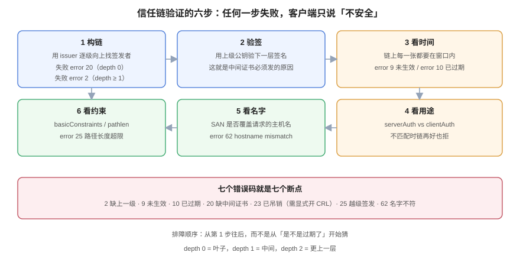

# 信任链与 X.509：谁签了谁

**「证书有效」这句话只有配上「在谁的信任库里」才有意义。** 一张证书本身只是「某把公钥 + 某些名字 + 一段时间」，它是否可信，取决于客户端能不能从它出发，沿着一串签名走到自己信任的某个根。本页把这条路径拆成六步，用七个错误码定位断在哪一步，并给出两个反直觉结论：**`-untrusted` 的顺序不影响校验，但服务器加载的顺序会影响启动**；**中间 CA 不能直接当信任锚**。



## 一、X.509 里真正会被校验的字段

一张证书有几十个字段，客户端真正会读的只有七组。其余都是给人看的。

| 字段 | 作用 | 配错的表现 |
| --- | --- | --- |
| `subject` | 证书主体（CN、O） | 只影响显示，**不参与现代浏览器的主机名校验** |
| `subjectAltName` | 真正被校验的名字列表 | 缺它即 `hostname mismatch` |
| `issuer` | 签发者 | 与上级证书的 `subject` 必须逐字相等 |
| `notBefore` / `notAfter` | 有效时间窗 | 过期 / 未生效 |
| `basicConstraints` | 是不是 CA、能再签几层 | `CA:FALSE` 的证书签子证书 → 校验失败 |
| `keyUsage` | 这把密钥能干什么（签名 / 加密 / 签证书） | CA 缺 `keyCertSign` → 子证书全部不可信 |
| `extendedKeyUsage` | 用途：`serverAuth` / `clientAuth` / `codeSigning` | 用途不符，链再好也拒 |
| `authorityKeyIdentifier` | 指向签发者的 key id | 缺失时链构建可能选错签发者 |

::: tip 一张证书自检的三条命令
```shell
openssl x509 -in leaf.crt -noout -subject -issuer -dates      # 谁、什么时候
openssl x509 -in leaf.crt -noout -ext subjectAltName,extendedKeyUsage,basicConstraints
openssl x509 -in leaf.crt -noout -fingerprint -sha256          # 指纹（对账用）
```
三行输出就能覆盖 90% 的「这张证书对不对」问题。**剩下的 10% 必须靠验证，不能靠看**——因为签名是二进制，肉眼看不出对错。
:::

## 二、验证的六步

客户端拿到证书后做的事，顺序固定：

1. **构链**：用 `issuer` 去信任库和「服务端发来的中间证书」里找签发者，一层层向上，直到遇到自签根或信任锚。
2. **验签**：每一层用上级的公钥验下一层的签名（这就是为什么中间证书必须发给你——没有它，你连第一层都验不了）。
3. **看时间**：链上**每一张**证书都要在 `notBefore` ~ `notAfter` 之间。
4. **看用途**：`extendedKeyUsage` 是否包含当前场景（浏览器要 `serverAuth`，mTLS 服务端要 `clientAuth`）。
5. **看名字**：叶子证书的 SAN 是否覆盖请求的主机名（通配符只覆盖一级）。
6. **看约束**：`basicConstraints` 的 `pathlen` 是否允许这么长的链、`keyUsage` 是否允许签证书。

六步里任何一步失败，客户端只会说「不安全」。**所以排障的正确顺序是「从第 1 步往后」，而不是从「证书是不是过期了」开始猜。**

## 三、七个错误码，逐个实测

下面每条都是在本机三级链（根 → 中间 → 叶子）上跑出来的原文：

| 错误码 | 原文 | 断在第几步 | 典型原因 |
| --- | --- | --- | --- |
| `2` | `unable to get issuer certificate` | 1 构链 | 把中间 CA 当唯一信任锚；或链缺上一级 |
| `9` | `certificate is not yet valid` | 3 时间 | 签发机时钟偏快，`notBefore` 在未来 |
| `10` | `certificate has expired` | 3 时间 | 叶子或**链上任意一张**过期 |
| `20` | `unable to get local issuer certificate` | 1 构链 | 服务端没发中间证书（最常见） |
| `23` | `certificate revoked` | 链后（需显式开 CRL/OCSP） | 证书被吊销，且客户端做了吊销检查 |
| `25` | `path length constraint exceeded` | 6 约束 | `pathlen:0` 的中间 CA 又签了子 CA |
| `62` | `hostname mismatch` | 5 名字 | SAN 不含该域名；通配符跨了两级 |

### 3.1 `error 20` 与 `error 2` 的区别，决定了你该找谁

```shell
# 只信任根，且不给中间证书
$ openssl verify -CAfile ca/root.crt leaf.crt
error 20 at 0 depth lookup: unable to get local issuer certificate

# 把中间证书当信任锚（很多「图省事」的配置这么干）
$ openssl verify -CAfile ca/inter.crt client.crt
error 2 at 1 depth lookup: unable to get issuer certificate
```

`20` 出现在**叶子层**，说明「我连它的签发者都没找到」——去查服务端发了什么；
`2` 出现在**中间层**，说明「我找到了签发者，但它自己接不上根」——去查信任锚选错了。

### 3.2 `pathlen:0` 真的会拦住越级签发

中间 CA 若声明 `pathlen:0`，它只能签叶子，不能再签 CA。实测让这个中间 CA 去签一个子 CA，再由子 CA 签叶子：

```shell
$ openssl verify -CAfile ca/root.crt -untrusted ca/inter.crt -untrusted subca.crt leaf-under-sub.crt
error 25 at 2 depth lookup: path length constraint exceeded
```

**注意报错深度是 2**，不是 1。排障时「depth 越小越靠近叶子」这条直觉能省很多时间：depth 0 = 叶子，1 = 中间，2 = 更上一层。

### 3.3 吊销是「可选」的：不开检查就查不出来

```shell
$ openssl verify -CAfile ca/root.crt -untrusted ca/inter.crt tmp1.crt
tmp1.crt: OK                                    # 已吊销，但没开 CRL 检查

$ openssl verify -CAfile ca/root.crt -untrusted ca/inter.crt -CRLfile crl.pem -crl_check tmp1.crt
error 23 at 0 depth lookup: certificate revoked  # 开了才报
```

这是理解「为什么业界转向短寿命证书」的关键：**吊销信息只有客户端愿意查才有用**，而绝大多数客户端默认不查。CA/Browser Forum 在缩短寿命的提案里正是这么论证的——「到期」是唯一不依赖客户端配合的失效机制。

## 四、两个反直觉的结论

### 4.1 `-untrusted` 文件的顺序不影响校验，但影响服务器启动

把中间证书放在文件第一位（顺序反了），再用 `openssl verify`：

```shell
$ cat ca/inter.crt leaf.crt > badorder.pem
$ openssl verify -CAfile ca/root.crt -untrusted badorder.pem leaf.crt
leaf.crt: OK
```

`openssl verify` 把 `-untrusted` 当成一个「候选池」，顺序无所谓。但把同一个文件交给 nginx 当 `ssl_certificate`：

```text
[emerg] SSL_CTX_use_PrivateKey("/etc/nginx/certs/leaf.key") failed
(SSL: error:05800074:x509 certificate routines::key values mismatch)
```

因为服务器要用**文件里第一张**证书去匹配私钥。**结论：`fullchain` 必须叶子在前，这条规则不能靠 `openssl verify` 来验证，只能靠「服务能不能起来 + 客户端能不能验过」。**

### 4.2 中间 CA 当锚，要显式 `-partial_chain`

某些内网场景确实只想信任自己的中间 CA（不想把根下发）。这时必须显式声明：

```shell
$ openssl verify -CAfile ca/inter.crt -partial_chain client.crt
client.crt: OK
```

对**服务器**而言，等价的做法是把「根 + 中间」一起放进信任文件（nginx 的 `ssl_client_certificate` 就是这个语义，实测只放中间会 400）。细节见 [mTLS](../MutualTLS/index.md)。

## 五、把链「摆出来」的三条命令

```shell
# 1) 服务端到底发了什么（张数 + 顺序 + 每张的主体）
openssl s_client -connect board.example.com:443 -servername board.example.com -showcerts </dev/null \
  | grep -E "^ *[0-9]+ s:|^ *i:|BEGIN CERTIFICATE"

# 2) 只取链、不建连（本地文件）
openssl crl2pkcs7 -nocrl -certfile fullchain.pem | openssl pkcs7 -print_certs -noout

# 3) 校一条完整链（根在本地，中间随证书带）
openssl verify -CAfile ca/root.crt -untrusted ca/inter.crt -verify_hostname board.example.com leaf.crt
```

第 1 条是本专题里最值得背下来的一条：**`s:` 是主体、`i:` 是签发者，两个交替出现，就能一眼看出链断在哪。** 只发叶子时 `s_client` 只输出一组 `s:/i:`，而 `i:` 那行在本地信任库里找不到，问题就定位了。

## 六、判据表：`CLT-A` ~ `CLT-H`

| 编号 | 判据 | 怎么验证 |
| --- | --- | --- |
| `CLT-A` | 每个对外服务的证书链必须能用「只含公共根」的信任库验证通过 | `openssl verify -CAfile <公共根包> -untrusted <chain> leaf.crt` 返回 `OK` |
| `CLT-B` | 链文件第一张必须是叶子证书 | `openssl crl2pkcs7 -nocrl -certfile fullchain.pem` 再 `pkcs7 -print_certs -noout`，第一段 `subject` 等于域名 |
| `CLT-C` | 服务端发出的证书张数 ≥ 2 | `openssl s_client -showcerts` 输出里 `BEGIN CERTIFICATE` 计数 ≥ 2 |
| `CLT-D` | 中间 CA 不得作为唯一信任锚（要么给根，要么显式 `-partial_chain`） | 校验命令里有 `-partial_chain` 或信任包含自签根 |
| `CLT-E` | 每条判据的失败必须能落到具体错误码（2/9/10/20/23/25/62），不接受「证书有问题」 | 排障记录里有 `error NN` 原文 |
| `CLT-F` | 证书必须声明 `basicConstraints` 与 `keyUsage`，且 CA 证书必须带 `keyCertSign` | `openssl x509 -noout -ext basicConstraints,keyUsage` 两段都有输出 |
| `CLT-G` | 叶子证书的 `pathlen` 语义必须被遵守：`pathlen:0` 的中间 CA 不得再签 CA | 子 CA 的 `issuer` 不得指向 `pathlen:0` 的中间 CA |
| `CLT-H` | 吊销检查要么真的开（CRL/OCSP），要么在文档里明写「依赖短寿命而非吊销」 | 校验命令含 `-crl_check`，或设计文档有「不依赖吊销」的说明 |

## 七、与相邻专题的分工

| 你想知道 | 去哪 |
| --- | --- |
| 为什么 CA 签出来的证书「浏览器就认」 | [体系概述](../Overview/index.md)（四层结构） |
| 证书怎么签发、CSR 里放什么 | [签发](../Issuance/index.md) |
| 服务器上的链怎么配、双证书怎么开 | [部署与链路完整性](../Serving/index.md) |
| 吊销列表有多大、OCSP 怎么响应 | [mTLS](../MutualTLS/index.md) 的吊销一节 |
| 哈希、签名算法本身 | [密码学基础../../../Backend/Auth/Security/index.md) |

**本页特有的坑**：`error 20` 与 `error 2` 都是「拿不到签发者」，但一个在 depth 0、一个在 depth 1，处置完全不同。很多人看到 `unable to get` 就去重新下载证书，实际是**信任锚选错**（`error 2`）——重下十次也没用。

## 参考资料

- RFC 5280 §6：*Certification Path Validation*（六步验证的形式化定义）
- OpenSSL：[`openssl-verify`](https://docs.openssl.org/master/man1/openssl-verify/)（`-untrusted`、`-partial_chain`、`-attime`、`-verify_hostname`）
- OpenSSL：[`X509_verify_cert` 错误码表](https://docs.openssl.org/master/man3/X509_verify_cert/)（`X509_V_ERR_*` 与数字的对应）
- 本站：[体系概述](../Overview/index.md)、[过期治理](../Expiry/index.md)
