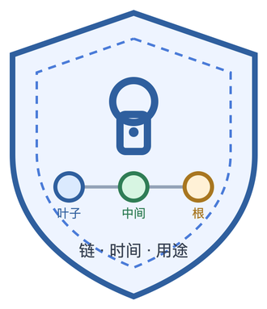
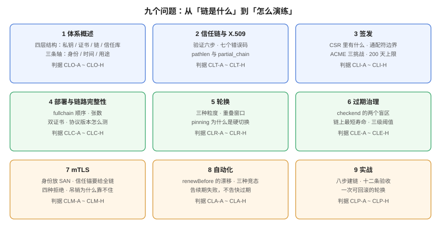

# 证书与信任链生命周期

证书过期是云上**最没有技术含量、却最频繁**的全站不可用原因。但把它归因于「忘了续期」并不准确——真正的原因是：证书不是「一个文件」，而是**一条链**（叶子 → 中间 → 根）、**一段时间**（`notBefore` / `notAfter`）、**一个用途**（`serverAuth` / `clientAuth`）三者的联合体。这三样里任何一样出错，客户端看到的现象都是同一句「连接不安全」，而排查方向完全不同。

本专题只回答一件事：**一条证书从签发到退役，在哪些环节会静默失效，以及每个环节怎么用命令证明它没坏。** 它不讲 TLS 握手原理（那是 HTTPS 专题的活），也不讲密钥怎么存（那是密钥治理的活）。

面向负责「站点不能因为证书挂掉」的 SRE、运维与后端。

::: tip 一句话理解
**证书的问题几乎从不发生在「签发」那一步，而发生在「链、时间、用途」三个维度上。** 签发只花三秒，链配错能让你查三天，时间算错能让你在凌晨三点被叫起来，用途写错能让 mTLS 在「证书明明有效」的情况下拒绝所有人。
:::

## 本专题的九页

| 页面 | 回答的问题 | 判据族 |
| --- | --- | --- |
| [体系概述：链、时间、用途](Overview/index.md) | 证书的四层结构、六种失效形态、本专题不回答什么 | `CLO-A` ~ `CLO-H` |
| [信任链与 X.509：谁签了谁](TrustChain/index.md) | 链怎么验、七个错误码各指什么、`pathlen` 与 `partial_chain` | `CLT-A` ~ `CLT-H` |
| [签发：CSR、SAN 与 ACME](Issuance/index.md) | CSR 里到底有什么、通配符的边界、三种挑战怎么选 | `CLI-A` ~ `CLI-H` |
| [部署与链路完整性](Serving/index.md) | `fullchain` 的顺序、双证书、协议版本怎么测才准 | `CLC-A` ~ `CLC-H` |
| [轮换：重叠窗口与密钥不重用](Rotation/index.md) | 什么时候换、换 key 还是换 cert、pinning 为什么会炸 | `CLR-A` ~ `CLR-H` |
| [过期治理：谁先过期](Expiry/index.md) | `checkend` 的盲区、链上最短剩余寿命、阈值分级 | `CLE-A` ~ `CLE-H` |
| [mTLS：证书即身份](MutualTLS/index.md) | 信任锚要给全链、四种拒绝形态、吊销为什么靠不住 | `CLM-A` ~ `CLM-H` |
| [自动化：cert-manager 与 ARI](Automation/index.md) | `renewBefore` 的语义、竞态、续期失败怎么告警 | `CLA-A` ~ `CLA-H` |
| [实战：一条可轮换的私有链](Practice/index.md) | 从零搭 CA 到轮换演练，十二条验收命令 | `CLP-A` ~ `CLP-H` |

## 本专题与相邻专题的分工

「证书」「密钥」「TLS」「mTLS」这四个词在库里被反复使用，边界写死，否则读者会在五个专题之间反复横跳：

| 你想要的 | 去哪里 |
| --- | --- |
| **API Key、数据库口令、Token 怎么存、怎么轮换** | [密钥与凭据治理](../SecurityHardening/SecretGovernance/index.md)（密钥的六阶段生命周期） |
| **TLS 握手每一步在做什么、HTTPS 为什么安全** | [HTTP 与 HTTPS](../../Backend/NetworkProgramming/HttpHttps/index.md) |
| **nginx 的 `ssl_certificate` 怎么写、HTTP/2 怎么开** | [Nginx HTTPS](../Nginx/Https/index.md) |
| **证书放在负载均衡还是后端、入口怎么终止 TLS** | [云架构的安全层](../CloudArchitecture/Security/index.md) |
| **边缘节点证书自动续期失败怎么排查** | [边缘 CDN 的分诊表](../EdgeCDN/FAQ/index.md) |
| **Kubernetes 里 `Certificate` 资源怎么用** | [Kubernetes 部署](../Kubernetes/Deployment/index.md)（本专题只讲 `renewBefore` 的语义与竞态） |
| **服务间零信任、SPIFFE、服务网格的证书** | [服务网格](../../Ops/CloudNative/index.md)（本专题只讲 X.509 侧） |
| **镜像签名、制品供应链的签名链** | [SBOM 与供应链](../SecurityHardening/SbomSupplyChain/index.md) |
| **变更窗口、换 CA 要走什么流程** | [变更管理](../ChangeManagement/index.md)（换 CA 属高危变更） |

::: warning 一句话划界
密钥治理回答「**这把钥匙谁能拿到**」，本专题回答「**这张身份证有没有过期、是不是真的、给谁用**」。前者丢了可以换，后者错了是**全站同时不可用**——两者的爆炸半径差一个数量级。
:::

## 判据纪律

本专题九页各有一族判据，共 **72 条**（9 族 × 8 条），前缀逐页唯一，全库不与他处撞号：

| 页面 | 判据族 | 数量 | 判据回答的三个问题 |
| --- | --- | --- | --- |
| 体系概述 | `CLO` | 8 | 约定是什么 / 定错的后果 / 怎么验证没被破坏 |
| 信任链 | `CLT` | 8 | 同上 |
| 签发 | `CLI` | 8 | 同上 |
| 部署与链路 | `CLC` | 8 | 同上 |
| 轮换 | `CLR` | 8 | 同上 |
| 过期治理 | `CLE` | 8 | 同上 |
| mTLS | `CLM` | 8 | 同上 |
| 自动化 | `CLA` | 8 | 同上 |
| 实战 | `CLP` | 8 | 同上 |

每条判据的「怎么验证」都必须是一条**能跑的命令或一次能观察到的输出**，不接受「检查证书是否有效」这类形容词。

## 本专题的实测口径

文中数字分三类，**严格区分**：

1. **本机实跑（openssl 3.3.2，macOS x86_64）**：在 `/tmp/certlab` 下自建根 CA → 中间 CA → 叶子 / 客户端证书，用 `nginx:alpine`（nginx 1.31.6）四个容器分别验证 fullchain、leaf-only、mTLS、轮换。命令都写在页面里。
2. **本机基准（`openssl speed`）**：签名/验签速率，2 秒采样，单核实测，只用于比较量级。
3. **官方口径（联网核对，2026-10）**：CA/Browser Forum、Let's Encrypt、cert-manager 的规则与日期，写进下面的事实表。

::: danger 不要把三类数字混着读
区分方法：**实测一定带命令与输出**，基准一定带采样参数，官方口径一定带出处与生效日期。看到没有命令的「证书有效期一般是 90 天」，就当它是历史印象——2026 年 3 月起这个数字已经不是 90 了。
:::

## 事实表（2026-10 核对）

| 事实 | 口径与日期 | 出处 |
| --- | --- | --- |
| 公开 TLS 证书最长有效期 **200 天** | 自 **2026-03-15** 起（此前 398 天） | CA/Browser Forum Ballot SC-081v3（2025-04 通过） |
| 后续两档：**100 天**（2027-03-15）、**47 天**（2029-03-15） | 同时 DCV 复用期收到 **10 天** | 同上 |
| 部分 CA 实际签发 **199 天** | 留一天余量避免越线（DigiCert 自 2026-02-24 起） | DigiCert 公告 |
| Let's Encrypt `shortlived` 档 **160 小时** | **2026-01-15** 正式可用（opt-in） | letsencrypt.org |
| Let's Encrypt `tlsserver` 档 **45 天** | 自 **2026-05-13** 起可选 | letsencrypt.org/docs/profiles |
| Let's Encrypt 默认档路线：90 天 → **64 天**（2027-02-10）→ **45 天**（2028-02-16） | 固定 60 天续期将失效 | letsencrypt.org |
| Let's Encrypt 自 **2025-05-07** 起不再签发带 OCSP URL 的证书 | 改用 CRL + ARI | letsencrypt.org |
| cert-manager 默认 `duration=90d`、`renewBefore=30d`；未设 `renewBefore` 且 `duration ≤ 30d` 时取 **2/3 寿命** | 续期点默认在寿命 2/3 处 | cert-manager 文档 |
| cert-manager **1.21**（2026-07-08）为当前主线，补丁 **1.21.2**（2026-09-10）；支持窗口 N+2 | 1.19 已于 2026-07-08 EOL | endoflife.date/cert-manager |
| ARI（ACME Renewal Information）为 **RFC 9773**，提供 `suggestedWindow` | 客户端在窗口内随机取点续期 | IETF RFC 9773 |

::: info 为什么这张表比正文更重要
本专题的所有「阈值」都建立在这些日期上。**200 天不是建议值而是上限**，所以「90 天证书 + 30 天前续期」这套老经验在 2026 年已经偏保守、在 2027 年会直接失效——47 天证书按固定 60 天续期，等于**证书还没到期就已经过期了**。
:::
