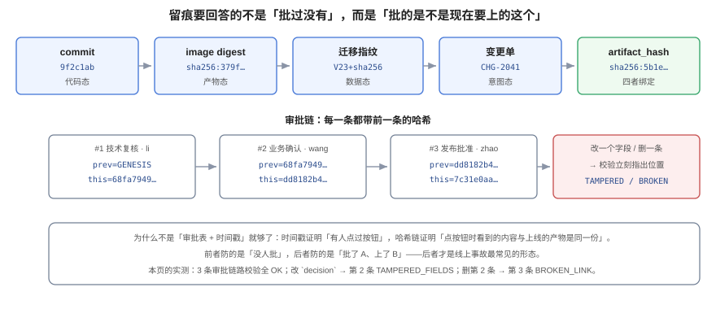

# 审批留痕：批的是哪一个产物

**审批留痕要回答的不是「有没有人批」，而是「批的是不是现在要上的这一份」。** 一张带时间戳的审批表只能证明有人点过按钮；它证明不了「点按钮时看到的版本」与「上线时跑的版本」是同一份。本页把留痕拆成四态绑定与一条哈希链，并给出改一个字段、删一条记录之后校验如何指出位置的真实输出。



## 一、留痕必须回答的四个问题

| 问题 | 答不出来的后果 | 靠什么答 |
| --- | --- | --- |
| **谁批的** | 事故里只能问「谁批的」，回答是「群里说过」 | 审批人标识（人 / 角色 / 服务账号） |
| **什么时候批的** | 无法判断「批完之后产物有没有变」 | 服务端时间戳（不是客户端） |
| **批的是哪一份** | 批了 A、上了 B，且永远查不清 | 产物摘要（commit + digest + 迁移指纹） |
| **批准还有效吗** | 三个月前的批准被拿来上线今天的新包 | 摘要比对 + 有效期 |

第四个问题最容易被忽略：**批准是有时效的**。一次「同意加列」的批准，不该在两周后仍然授权一次完全不同的发布。

## 二、四态绑定：把「意图」钉在「产物」上

一次变更涉及四种状态，留痕的价值在于把它们钉在一起：

| 态 | 标识 | 从哪来 | 变了意味着什么 |
| --- | --- | --- | --- |
| 代码态 | `commit` | Git | 代码与评审时不同 |
| 产物态 | `image digest` | 镜像仓库（`sha256:…`） | 构建不可复现或换了基础镜像 |
| 数据态 | 迁移指纹 | `V23__*.sql` 的内容哈希 | 库结构与评审时不同 |
| 意图态 | 变更单号 | 变更系统 | 意图被改（加需求、改范围） |

四者拼成一个 `artifact_hash`：

```text
artifact_hash = sha256( commit | digest | migration_fingerprint | change_code )
```

::: danger 为什么不能只用版本号
`v1.4.2` 是一个**可以被重建的标签**。同一个 tag 在不同时间可以指向不同的镜像 ID——本仓第 169 天的实测是「同一份 Dockerfile 连续构建 6 次出 5 个不同 image ID」。所以「批准 v1.4.2」在技术上等于「批准一个名字」，而不是「批准一份内容」。
:::

## 三、哈希链：让「改记录」和「删记录」都留下痕迹

单条审批记录可以被改，也可以被删。把每条记录的哈希指向前一条，就得到一个**能被校验的链**：

```sql
CREATE EXTENSION IF NOT EXISTS pgcrypto;

CREATE TABLE approval (
  id            bigserial PRIMARY KEY,
  change_code   text NOT NULL,
  seq           int  NOT NULL,
  approver      text NOT NULL,
  decision      text NOT NULL CHECK (decision IN ('approve','reject','abstain')),
  artifact_hash text NOT NULL,
  decided_at    timestamptz NOT NULL DEFAULT now(),
  prev_hash     text NOT NULL,
  this_hash     text NOT NULL,
  UNIQUE (change_code, seq)
);

CREATE OR REPLACE FUNCTION seal(p_code text, p_seq int, p_approver text, p_decision text,
                                p_artifact text, p_prev text)
RETURNS text LANGUAGE sql IMMUTABLE AS $$
  SELECT 'sha256:' || encode(digest(
    p_prev || '|' || p_code || '|' || p_seq::text || '|' || p_approver || '|' ||
    p_decision || '|' || p_artifact, 'sha256'), 'hex')
$$;
```

校验函数做两件事：重算每条的 `this_hash`，并检查每条的 `prev_hash` 是否等于上一条的 `this_hash`。

```sql
CREATE OR REPLACE FUNCTION verify_chain(p_code text)
RETURNS TABLE(seq int, verdict text) LANGUAGE sql STABLE AS $$
  WITH ordered AS (
    SELECT a.*, lag(a.this_hash) OVER (ORDER BY a.seq) AS expect_prev
    FROM approval a WHERE a.change_code = p_code
  )
  SELECT o.seq,
         CASE
           WHEN o.seq > 1 AND o.prev_hash IS DISTINCT FROM o.expect_prev THEN 'BROKEN_LINK'
           WHEN o.this_hash IS DISTINCT FROM
                seal(o.change_code, o.seq, o.approver, o.decision, o.artifact_hash, o.prev_hash)
             THEN 'TAMPERED_FIELDS'
           ELSE 'OK'
         END
  FROM ordered o ORDER BY o.seq
$$;
```

### 3.1 三种状态的真实输出（本机实跑）

写入三条审批（技术复核 → 业务确认 → 发布批准），原始链校验：

| seq | verdict |
| --- | --- |
| 1 | `OK` |
| 2 | `OK` |
| 3 | `OK` |

把第 2 条的 `decision` 从 `approve` 改成 `reject`（模拟「事后篡改结论」）：

| seq | verdict |
| --- | --- |
| 1 | `OK` |
| 2 | **`TAMPERED_FIELDS`** |
| 3 | `OK` |

把第 2 条整行删掉（模拟「抹掉一个反对意见」）：

| seq | verdict |
| --- | --- |
| 1 | `OK` |
| 3 | **`BROKEN_LINK`** |

两种篡改被两种判据分开识别——这正是哈希链相对于「单条签名」的价值：签名能证明「这条是真的」，链能证明「这条还在原来的位置上」。

::: warning 哈希链不防「整条链重写」
如果你能同时改所有记录并重算全部哈希，链就自洽了。所以生产上还要两个额外手段：① 定期把链头（最后一条的 `this_hash`）写到**外部不可改**的地方（对象存储的合规桶、另一个系统的日志）；② 审批记录表只允许 `INSERT`，不允许 `UPDATE` / `DELETE`（用权限或触发器强制）。
:::

## 四、审计怎么查：从事故时间点反查

真实的审计问题不是「列出所有审批」，而是「**在 14:32 那一刻，是谁授权了这次变更，他看到的摘要是什么**」。这需要一条按时间定位的查询：

```sql
-- 给定变更单与服务端的「生效时刻」，找出当时有效的最后一条批准
SELECT a.seq, a.approver, a.decision, a.decided_at, left(a.this_hash, 19) AS hash_head
FROM approval a
WHERE a.change_code = 'CHG-2041'
  AND a.decision = 'approve'
  AND a.decided_at <= timestamptz '2026-10-24 14:32:00+08'
ORDER BY a.seq DESC
LIMIT 1;
```

查询本身很简单，难点在于**表里要有能对上的字段**：`change_code`（意图）、`artifact_hash`（产物）、`decided_at`（服务端时间）。三者缺一，这条查询就写不出来。

## 五、四类伪造与各自的拦法

| 伪造方式 | 表现 | 拦法 |
| --- | --- | --- |
| **改结论** | 把 `reject` 改成 `approve` | 哈希链 → `TAMPERED_FIELDS` |
| **删反对意见** | 少一条记录，链断 | 哈希链 → `BROKEN_LINK` |
| **换产物** | 批准的是 A，上线的是 B | 部署前比对 `artifact_hash`，不一致拒发 |
| **重放旧批准** | 拿三个月前的批准上线新包 | 批准带 `artifact_hash` 与有效期，摘要不匹配即失效 |

第三、四类**哈希链拦不住**，因为它们不改审批记录，改的是「上线的那个东西」。所以留痕必须与发布流程接上：**部署脚本在执行前重新计算一次产物摘要，与批准记录比对**，不一致就拒绝。这一步不做，前面所有哈希都只是文档。

## 六、保留期与隐私

审批记录里有人名，属于个人信息。三条实践：

1. **只留必要字段**：姓名 / 工号 / 角色三选一，不要留邮箱、IP、设备信息。
2. **保留期与合规对齐**：金融类常见 5~7 年，普通业务 1~2 年；到期做**聚合**（保留「某月 N 次批准」）而不是直接删。
3. **离职不等于删除**：审批人是「当时在职的某角色」，记录要保留，但展示时用角色 + 工号，不展示个人信息。

## 七、验证方式

```shell
# ① 链是否完好：对每个变更单跑一次校验
psql -c "SELECT * FROM chg.verify_chain('CHG-101');"
# 期望：全部 OK。出现 TAMPERED_FIELDS / BROKEN_LINK 即为真缺陷，不是噪声

# ② 批准是否绑定产物：查批准记录里的摘要与部署记录是否一致
psql -c "SELECT change_code, artifact_hash FROM chg.approval WHERE decision='approve' ORDER BY id DESC LIMIT 5;"
# 期望：每条的 artifact_hash 都能在部署记录里找到同一个值

# ③ 表是否只允许插入：尝试更新一条审批
psql -c "UPDATE chg.approval SET decision='approve' WHERE seq=1;"
# 期望：被权限或触发器拒绝。能改说明链只是「事后可查」，不是「当时可信」
```

## 八、判据族 `ATR`

| 判据 | 内容 | 怎么验证 |
| --- | --- | --- |
| `ATR-A` | 每条审批必须带 `artifact_hash`，且该值由 commit + digest + 迁移指纹算出 | 批准记录的摘要能按公式复算出来 |
| `ATR-B` | 审批表必须只允许插入，不允许更新与删除 | 用应用账号执行 `UPDATE` / `DELETE` 被拒 |
| `ATR-C` | 审批记录必须串成哈希链，且提供校验函数/脚本 | 存在 `verify_chain` 之类的可执行校验，输出逐条结论 |
| `ATR-D` | 部署前必须重新计算产物摘要并与批准记录比对，不一致则拒绝 | 部署脚本里有比对步骤，且有一次「故意改 digest」的负向测试 |
| `ATR-E` | 批准必须有时效（有效期或「绑定单次部署」） | 批准记录有 `expires_at` 或 `deploy_id` 字段 |
| `ATR-F` | 时间戳必须来自服务端，不得由客户端传入 | 表字段默认值为 `now()`，插入语句不显式写时间 |
| `ATR-G` | 链头必须周期性外写到不可改位置 | 有外部备份记录（对象存储对象 / 另一系统的日志条目） |
| `ATR-H` | 审计查询必须能按「生效时刻」定位到最后一条有效批准 | 能写出并跑通「`decided_at <= T` 取最后一条」的查询 |

## 九、与相邻专题的分工

| 你想知道 | 去哪 |
| --- | --- |
| 谁有权批、批几层 | [变更分级](../Classification/index.md) |
| 什么时候能批 | [窗口与冻结期](../ChangeWindow/index.md) |
| 业务审批流引擎怎么实现（会签、或签、加签） | [审批流引擎](../../../Backend/WorkflowEngine/ApprovalFlow/index.md) |
| 操作审计日志怎么采 | [审计与检测](../../SecurityHardening/AuditDetection/index.md) |
| 镜像 digest 怎么来、为什么 tag 不可信 | [发布与回滚](../../../Tools/CICD/DeployRollback/index.md) |

::: tip 一条边界
**审批流引擎解决「流程怎么走」，留痕解决「走完之后留下什么」。** 前者可以换实现（自研、钉钉、Jira），后者必须满足「不可改、可校验、能对外证明」——所以留痕不能完全托付给流程引擎的数据库，至少要把链头外写一份。
:::

## 与「技术决策与评审」的分工（第 178 天补充）

本页回答「一次变更的审批链怎么留痕、怎么防篡改」（四问、四态绑定、`seal()` 与 `verify_chain()`）；[技术决策与评审](../../../Others/TechDecision/index.md) 回答「要不要这么定」——审批发生在决定**之后**。

| 这件事 | 归哪边 | 边界在哪 |
| --- | --- | --- |
| 审批链与签字 | **改的动作被授权** | 授权不解释「为什么这么定」 |
| 证据包的哈希链 | **留痕不可篡改** | 不可篡改 ≠ 可理解：链对得上，理由仍然可能为空 |
| 四态绑定（申请 / 审批 / 执行 / 回执） | **流程完整性** | 流程完整不等于决策有选项与判据 |
| 冻结期与例外审批 | **时间维度的约束** | 例外审批的理由往往就是一条没被记录的决策 |

本页特有的一个坑：**审批通过 ≠ 决策被记录。** 一次变更的审批链能证明「谁在什么时候同意了改」，但回答不了「为什么选这个方案而不是那个」。审计时最容易踩的坑是把「审批齐全」当成「决策充分」——两者是不同的证据链，缺任何一条都会在半年后失效。
## 参考资料

- PostgreSQL 18 文档：[`pgcrypto`](https://www.postgresql.org/docs/current/pgcrypto.html)、[Window Functions](https://www.postgresql.org/docs/current/tutorial-window.html)（`lag()` 用于链校验）
- NIST SP 800-92：*Guide to Computer Security Log Management*（日志完整性与保留）
- Google SRE Book：[*Postmortem Culture*](https://sre.google/sre-book/postmortem-culture/)（记录事实、不追责的原则）
- 本站：[变更分级](../Classification/index.md)、[变更日历](../ChangeCalendar/index.md)
