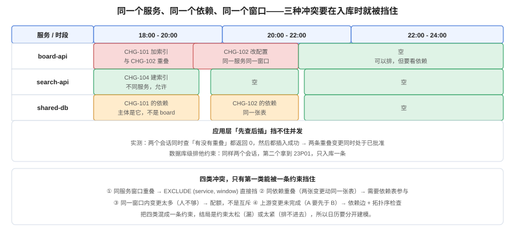

# 变更日历：冲突要在入库时挡住

**变更日历不是一张共享表格，而是一组约束。** 共享表格记录「谁打算什么时候做什么」，约束保证「两件互相破坏的事不会同时发生」。二者的区别在事故里最清楚：表格只能说「当时大家都看到了」，约束能说「当时根本排不进去」。



## 一、四类冲突，只有一类能被一条约束挡住

| # | 冲突 | 例子 | 能不能用一条约束挡住 |
| --- | --- | --- | --- |
| 1 | **同服务窗口重叠** | 两个变更同时改 `board-api` | ✅ `EXCLUDE (service, window)` |
| 2 | **同依赖重叠** | 两个变更动同一张表 `cards` | ⚠️ 需要「依赖」参与，不能只看服务名 |
| 3 | **同窗口过载** | 一个窗口排了 8 个变更，只有 2 个人 | ❌ 这是配额，不是互斥 |
| 4 | **顺序依赖** | A 必须先于 B（加列 → 回填） | ❌ 这是有向图，需要拓扑序检查 |

先把第 1 类做对，再谈后三类。很多团队一上来就想「把四类都塞进一张表」，结果是约束太松（漏掉依赖）或太紧（正常排期排不进去）。

## 二、第 1 类：同服务窗口互斥

### 2.1 表结构与约束

```sql
CREATE EXTENSION IF NOT EXISTS btree_gist;   -- 关键：text 的 GiST 等值需要它

CREATE TABLE change_request (
  id             bigserial PRIMARY KEY,
  code           text NOT NULL UNIQUE,
  service        text NOT NULL,
  planned_window tstzrange NOT NULL,
  level          text NOT NULL CHECK (level IN ('standard','normal','emergency')),
  status         text NOT NULL CHECK (status IN ('draft','approved','scheduled','done','rolled_back','cancelled')),
  risk_score     int  NOT NULL CHECK (risk_score BETWEEN 0 AND 100),
  approver       text,
  artifact_hash  text,
  CONSTRAINT cr_window_nonempty CHECK (NOT isempty(planned_window)),
  CONSTRAINT cr_approved_has_evidence CHECK (
    status NOT IN ('approved','scheduled') OR (approver IS NOT NULL AND artifact_hash IS NOT NULL)
  )
);

ALTER TABLE change_request
  ADD CONSTRAINT cr_no_overlap
  EXCLUDE USING gist (service WITH =, planned_window WITH &&)
  WHERE (status IN ('approved','scheduled'));
```

三个设计决定，每一个都对应一类实际故障：

1. **`WHERE status IN ('approved','scheduled')`**：只对**已授权**的变更做互斥。草稿必须允许重叠——否则「先排期、后审批」的正常流程会走不通（排期时还没批）。
2. **`planned_window` 用 `tstzrange`**：半开区间 `[start, end)`，首尾相接不算冲突。用 `[start, end]` 会让「10:00-12:00」与「12:00-14:00」被判成重叠。
3. **`cr_approved_has_evidence`**：批准状态必须有授权人与产物摘要——这是把[审批留痕](../ApprovalTrail/index.md)的约束下沉到数据库，而不是靠应用记得填。

::: danger 第一个坑：`text` 没有默认的 GiST 操作符类
不加 `btree_gist` 直接建约束，会报：

```text
ERROR: data type text has no default operator class for access method "gist"
HINT: You must specify an operator class for the index or define a default operator class for the data type.
```

这不是语法错，是「GiST 只认识几何/范围类型，不认识字符串的等值」。`btree_gist` 提供的正是「把 B 树的等值语义借给 GiST」。**没有这条扩展，约束建不上，而建不上的约束不会报错两次**——后续所有插入都会成功，你以为有保护，其实没有。
:::

### 2.2 六个判定（本机实跑）

| # | 场景 | 期望 | 实际 |
| --- | --- | --- | --- |
| T1 | 同服务重叠（10:00-12:00 vs 11:00-13:00） | 拒绝 | `23P01 conflicting key value violates exclusion constraint "cr_no_overlap"` |
| T2 | 首尾相接（12:00 起） | 通过 | `INSERT 0 1` |
| T3 | 不同服务同窗口 | 通过 | `INSERT 0 1` |
| T4 | 两条草稿重叠 | 通过 | `INSERT 0 1` |
| T5 | 把重叠的草稿改成已批准 | **在 UPDATE 时才拒绝** | `23P01` |
| T6 | 批准但缺 `approver` / `artifact_hash` | 拒绝 | `23514` 违反 `cr_approved_has_evidence` |
| T7 | 空窗口 `'empty'` | 拒绝 | `23514` 违反 `cr_window_nonempty` |

T5 是这套设计最关键的一条：**冲突检查发生在状态跃迁时，而不是插入时**。这符合真实流程——排期时允许「先占位」，批准时才需要保证不打架。

## 三、并发：为什么「先查后插」不够

几乎所有团队的第一版都长这样：

```text
1. SELECT count(*) FROM change WHERE service=? AND window && ?
2. 如果 0，INSERT
```

它在单线程下完全正确，在并发下完全失效。本机用两个会话同时执行（各自 `BEGIN` → 查询 → `pg_sleep(1)` → 插入 → `COMMIT`）实测：

| 方案 | 会话 A 看到 | 会话 B 看到 | 结果 |
| --- | --- | --- | --- |
| **应用层先查后插**（无约束） | 1 条无关记录 | 1 条无关记录 | **两条重叠变更都插入成功** |
| **数据库排他约束** | 0 条冲突 | 0 条冲突 | 第二个拿到 `23P01`，**只入库 1 条** |

注意有约束时两个会话「看到的」也都是 0——**查询结果从来不是保护，保护来自写入那一刻的约束**。这也解释了为什么「我们查过了」这句话在事故复盘里毫无价值。

## 四、代价：约束不是免费的

在 5 万条变更（40 个服务、每条 30 分钟）的表上量一次「找重叠」：

| 方案 | 计划 | 时间 | Buffers |
| --- | --- | --- | --- |
| 无索引 | `Seq Scan`，`Rows Removed by Filter: 50000` | 6.526 ms | 468 |
| GiST 索引 | `Index Only Scan` | **0.838 ms** | **3** |

索引体积对照：

| 对象 | 大小 |
| --- | --- |
| 堆（`cr_big`） | 3,744 kB |
| GiST 索引 | 2,600 kB（约为堆的 69%） |
| 主键 | 1,112 kB |

插入侧：50 次非重叠插入（含 `DO` 块循环）合计 **5.052 ms**，平均每次约 0.1 ms。

::: tip 什么时候不该用排他约束
GiST 排他索引的体积与写入代价都高于普通索引。它适合**变更表这种「每天几十到几百行」**的场景，不适合**每秒几千行的事件表**。判据很简单：表的写入频率 × 单行代价 < 你愿意为「不会排错」付的钱。变更表的答案是显然的。
:::

## 五、后三类冲突怎么处理

### 5.1 同依赖：把「依赖」建成一张表

```sql
CREATE TABLE change_dependency (
  change_code text NOT NULL,
  resource    text NOT NULL,          -- 例如 'table:cards' / 'service:redis'
  mode        text NOT NULL CHECK (mode IN ('read','write','exclusive')),
  PRIMARY KEY (change_code, resource)
);
```

有了它，「两个变更同时以写模式动 `table:cards`」就变成一条可判定的查询。注意它**不能用一条 EXCLUDE 解决**，因为冲突条件依赖 `mode` 的组合（读读不冲突、读写冲突、写写冲突）——这属于「需要触发器或应用层事务 + 行锁」的范畴。

### 5.2 同窗口过载：配额而不是互斥

一个窗口能排几个变更，取决于**当晚有多少人能处理回滚**，不是技术约束。实现方式是一条计数查询 + 阈值告警，而不是数据库约束：

```sql
SELECT date_trunc('hour', lower(planned_window)) AS slot, count(*)
FROM change_request
WHERE status IN ('approved','scheduled')
GROUP BY 1 HAVING count(*) > 4
ORDER BY 1;
```

### 5.3 顺序依赖：拓扑序检查

A（加列）必须先于 B（回填），B 必须先于 C（切读）。这类关系建模成有向边，排期时做一次拓扑排序；有环就拒绝。

```sql
CREATE TABLE change_edge (
  before_code text NOT NULL,
  after_code  text NOT NULL,
  PRIMARY KEY (before_code, after_code),
  CHECK (before_code <> after_code)
);
```

检查一条即可：`WITH RECURSIVE` 从 `after_code` 出发能否回到 `before_code`——能回到就是环。

## 六、找空闲槽：把「什么时候能发」变成一条查询

日历的另一个用途是**回答「最近哪里有窗口」**。这条查询在沙盒里跑出的结果（`board-api` 与 `search-api`，2026-10-24 08:00-20:00，两小时一档）：

```sql
SELECT s.service, g.slot
FROM (VALUES ('board-api'),('search-api')) AS s(service)
CROSS JOIN LATERAL (
  SELECT tstzrange(ts, ts + interval '2 hour') AS slot
  FROM generate_series(timestamptz '2026-10-24 08:00+08',
                       timestamptz '2026-10-24 20:00+08', interval '2 hour') ts
  WHERE NOT EXISTS (
    SELECT 1 FROM change_request c
    WHERE c.service = s.service
      AND c.status IN ('approved','scheduled')
      AND c.planned_window && tstzrange(ts, ts + interval '2 hour')
  )
) g
ORDER BY s.service, g.slot;
```

输出（节选）：`board-api` 剩 5 个空档（10:00-12:00、12:00-14:00 已被占），`search-api` 剩 6 个。这类查询的价值在于**排期不再是「问一下谁在改」**，而是「查一下哪里空」。

## 七、验证方式

```shell
# ① 约束真的存在（不是「代码里有检查」）
psql -c "\d chg.change_request" | grep -A2 "cr_no_overlap"
# 期望：看到 EXCLUDE USING gist (service WITH =, planned_window WITH &&) WHERE ...

# ② 负向测试：插一条必然冲突的记录，必须失败
psql -c "INSERT INTO chg.change_request(code,service,planned_window,level,status,risk_score,approver,artifact_hash)
         VALUES ('T-DUP','board-api','[2026-10-24 11:00+08,2026-10-24 13:00+08)','normal','approved',30,'li','sha256:x');"
# 期望：ERROR 23P01。成功说明约束没生效（先查 btree_gist 装没装）

# ③ 草稿允许重叠：同样窗口但 status='draft'，必须成功
psql -c "INSERT INTO chg.change_request(code,service,planned_window,level,status,risk_score)
         VALUES ('T-DRAFT','board-api','[2026-10-24 11:00+08,2026-10-24 13:00+08)','normal','draft',30);"
# 期望：INSERT 0 1

# ④ 批准必须有证据：把上面那条改成 approved 但不给 approver
psql -c "UPDATE chg.change_request SET status='approved' WHERE code='T-DRAFT';"
# 期望：ERROR 23514 违反 cr_approved_has_evidence
```

## 八、判据族 `CCL`

| 判据 | 内容 | 怎么验证 |
| --- | --- | --- |
| `CCL-A` | 同服务窗口互斥必须由数据库约束保证，不得只靠应用层查询 | `\d` 能看到 `EXCLUDE USING gist`；删掉应用检查后仍能拒绝重叠 |
| `CCL-B` | 互斥必须只作用于「已授权」状态，草稿允许重叠 | 两条草稿同窗口能插入；改为 approved 时被拒 |
| `CCL-C` | 窗口必须是半开区间，首尾相接不算冲突 | 12:00 结束与 12:00 开始的记录能共存 |
| `CCL-D` | 批准状态必须强制具备授权人与产物摘要 | 缺字段时 `23514`，不是应用层报错 |
| `CCL-E` | 空窗口必须被拒绝 | 插入 `'empty'` 时报 `23514` |
| `CCL-F` | 同依赖冲突必须单独建模（依赖表 + 模式），不得混入服务互斥 | 存在 `change_dependency` 表，含 `mode` 字段 |
| `CCL-G` | 顺序依赖必须有环检测 | 能对 `change_edge` 跑递归查询并报出环 |
| `CCL-H` | 必须能查询「某服务在某个日期范围内的空闲槽」 | 有一条可执行的空闲槽 SQL，且结果与已批准记录不冲突 |

## 九、与相邻专题的分工

| 你想知道 | 去哪 |
| --- | --- |
| 窗口怎么选、冻结期怎么算 | [窗口与冻结期](../ChangeWindow/index.md) |
| 批准要绑哪些证据 | [审批留痕](../ApprovalTrail/index.md) |
| 多个变更的发布顺序怎么编排（流水线层） | [流水线设计](../../../Tools/CICD/PipelineDesign/index.md) |
| 数据库区间类型与 GiST 的更多用法 | [PostgreSQL 进阶](../../../DB/Relational/PostgreSQL/Advanced/index.md) |

## 参考资料

- PostgreSQL 18 文档：[Exclusion Constraints](https://www.postgresql.org/docs/current/sql-createtable.html#SQL-CREATETABLE-EXCLUDE)、[`btree_gist`](https://www.postgresql.org/docs/current/btree-gist.html)、[Range Operators](https://www.postgresql.org/docs/current/functions-range.html)
- PostgreSQL 18 文档：[WITH Queries (Recursive)](https://www.postgresql.org/docs/current/queries-with.html)（拓扑序与环检测）
- ITIL 4：*Change Enablement*（变更日历与冲突协调的实践描述）
- 本站：[窗口与冻结期](../ChangeWindow/index.md)、[审批留痕](../ApprovalTrail/index.md)
