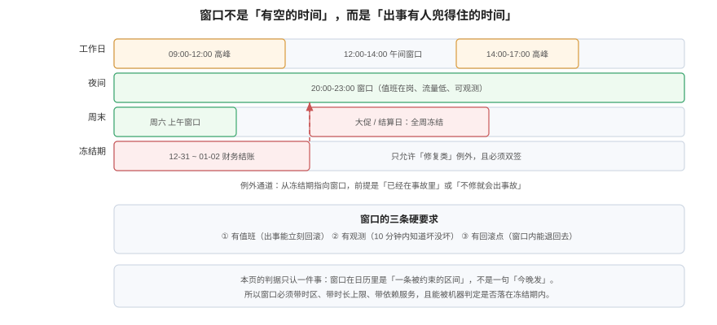

# 窗口与冻结期：什么时候能做

**变更窗口不是「我有空的时间」，而是「出事有人兜得住的时间」。** 它由三个客观条件夹出来：流量够低、值班在岗、观测能在十分钟内给出结论。冻结期则是这条时间轴上被明确封住的部分——封的是「业务不能承受波动」的那几天，不是「领导不想看到故障」的那几天。



## 一、窗口由三个条件夹出来

| 条件 | 不满足会怎样 | 怎么量 |
| --- | --- | --- |
| **流量够低** | 变更本身的资源消耗与用户流量叠加，把「性能抖动」放大成「超时」 | 取近 30 天同一时段的 P95 QPS，与日峰值比 |
| **值班在岗** | 出事没人能立刻回滚，只能等第二天 | 值班表覆盖 + 15 分钟内响应 |
| **观测可用** | 坏了不知道，等到用户投诉才知道 | 关键指标 + 告警 + 冒烟，三条齐 |

窗口长度不是拍脑袋定的，而是三段相加：

```text
窗口时长 ≥ 部署耗时 + 观察时长 + 回滚耗时
```

代入一组常见值（推演）：部署 8 分钟、观察 15 分钟、回滚 10 分钟 → **至少 33 分钟**。若你们的窗口只有 20 分钟，那么「观察」实际上被压缩到 2 分钟——这不是窗口，是赌博。

## 二、窗口不是越晚越好

很多团队的历史习惯是「凌晨发布」，理由是流量最低。但这个习惯有一个隐含前提：**凌晨有人在**。如果凌晨只有一个人值班，且他不熟悉这个服务，那么「流量最低」换来的收益，会被「定位慢三倍」抵掉。

| 时段 | 流量 | 值班密度 | 观测质量 | 适用 |
| --- | --- | --- | --- | --- |
| 工作日 10:00-12:00 | 高 | 高 | 好（同事都在） | 只适合可一键回滚的小变更 |
| 工作日 12:00-14:00 | 中 | 中 | 好 | 中等风险变更的常用窗口 |
| 工作日 20:00-23:00 | 低 | 中 | 中 | 常规变更的默认窗口 |
| 周末白天 | 低 | 低 | 中 | 需要长时间观察的变更（如数据回填） |
| 凌晨 02:00-05:00 | 最低 | 极低 | 差 | **只在前一条已演练过时使用** |

::: tip 一个反直觉的调整
把「凌晨发布」改成「工作日午间发布」，短期看流量高了，长期看**平均恢复时间下降**——因为出问题时能立刻拉到写这段代码的人。DORA 2025 的数据也支持这个方向：失败部署恢复在 1 小时内的团队占 21.3%，而恢复速度主要取决于「谁能立刻做决定」，不是「流量有多低」。
:::

## 三、冻结期的三种来源

冻结期必须有**明确来源**，否则它会变成「这周大家都别发」的模糊倡议。

| 来源 | 例子 | 判定方式 | 谁能解冻 |
| --- | --- | --- | --- |
| **业务事件** | 大促、财务结账、月度结算 | 业务日历（日期区间 + 影响服务） | 业务负责人 |
| **监管 / 合同** | 审计期、等保测评窗口 | 合规日历 | 合规负责人 |
| **组织事件** | 长假、全员大会、关键客户演示 | 人力日历 | 团队负责人 |

三类冻结期的共同点是「**可被写成日期区间**」。写不成日期区间的，不是冻结期，是心情。

## 四、冻结期要落成数据，不是公告

冻结期一旦只存在于公告里，它就只能靠人记得。正确做法是把它做成一张表，让「某个窗口是否落在冻结期」变成一条 SQL：

```sql
CREATE TABLE freeze_window (
  id     bigserial PRIMARY KEY,
  reason text NOT NULL,
  scope  text NOT NULL,          -- '*' 表示全局，否则是服务名
  days   daterange NOT NULL
);

INSERT INTO freeze_window (reason, scope, days) VALUES
  ('财务结账','*','[2026-12-31, 2027-01-02)'),
  ('大促','board-api','[2026-11-10, 2026-11-12)');

CREATE VIEW v_change_in_freeze AS
SELECT c.code, c.service,
       c.planned_window,
       ((lower(c.planned_window) AT TIME ZONE 'Asia/Shanghai')::date) AS local_start_date,
       f.reason
FROM change_request c
JOIN freeze_window f
  ON (f.scope = '*' OR f.scope = c.service)
 AND f.days @> ((lower(c.planned_window) AT TIME ZONE 'Asia/Shanghai')::date);
```

三个细节决定了这条视图对不对：

1. **`lower()`**：`tstzrange` 不能直接转 `date`，必须先取边界（实测报 `cannot cast type tstzrange to date`）。
2. **`AT TIME ZONE 'Asia/Shanghai'`**：`timestamptz` 转 `date` 用的是**会话时区**，不是数据里带的时区。
3. **半开区间**：冻结期用 `[12-31, 01-02)`，表示 12-31 与 01-01 两天冻结、01-02 零点解除。写成闭区间会让「解冻当天」也被算进去。

### 4.1 时区：同一行数据，两种判定（本机实测）

在沙盒里插入两条变更：

| 变更 | 计划窗口（+08） | 当地起始日 | 是否命中财务结账 |
| --- | --- | --- | --- |
| `CHG-201` | `[2026-12-31 23:30, 2027-01-01 01:00)` | 2026-12-31 | **命中** |
| `CHG-202` | `[2027-01-02 00:30, 2027-01-02 02:00)` | 2027-01-02 | 不命中 |

接着把会话时区改成 UTC，再取同两行的日期：

| 会话时区 | `CHG-201` | `CHG-202` |
| --- | --- | --- |
| `UTC` | 2026-12-31 | **2027-01-01** |
| `Asia/Shanghai` | 2026-12-31 | 2027-01-02 |

`CHG-202` 在 UTC 会话下会被算成 2027-01-01——**一条本已解冻的变更被误判成冻结期内**。这就是「冻结期判定依赖执行环境」的典型形态：SQL 没错，结果错了。

::: danger 冻结期判定的三个必错点
1. **用 `(planned_window)::date`**：直接报类型错误；用 `lower()` 才是对的。
2. **用 `lower(planned_window)::date` 而不带 `AT TIME ZONE`**：UTC 会话下整体偏移 8 小时，跨零点的变更会被算到前一天或后一天。
3. **把冻结期存成 `timestamptz`**：冻结是「业务日历上的日子」，不是「一个绝对时刻」。存成 `daterange` 才是语义正确的。
:::

## 五、例外通道：谁能开、开多久、留什么

冻结期一定会有例外。问题不是「要不要允许」，而是「允许的痕迹能不能被查」。

| 要素 | 要求 | 反例 |
| --- | --- | --- |
| **谁能开** | 业务负责人 + 技术负责人双签，缺一不可 | 「跟主管说了一声」 |
| **开多久** | 只对一个变更单、一个窗口有效，不设「长期豁免」 | 「大促期间我们组都不用走流程」 |
| **留什么** | 为什么不能等（业务损失的数字）、改什么（产物摘要）、更坏怎么办（回滚） | 只写「业务紧急」 |
| **怎么复核** | 例外单进月度统计，超过阈值要改计划而不是催人 | 例外单不进任何报表 |

例外通道的正确用法是**修复类**：已经在事故里，或「不修就会出事故」（如证书 3 天后过期）。错误用法是**计划类**：早就知道要做的迁移，拖到冻结期前一周才动手。

## 六、窗口冲突：本页只管「什么时候」，不管「和谁撞」

一个窗口里能排几个变更、两个变更动了同一张表怎么办——那是[变更日历](../ChangeCalendar/index.md)要解决的问题。这里只写死一条边界：

> **窗口是时间维度的约束，日历是资源维度的约束。** 窗口回答「这个点能不能做」，日历回答「这个点是不是已经有人在做同一件事」。

两者混在一起建模，最常见的后果是「窗口很宽松，但同一晚排了六个变更，谁也不知道彼此的依赖」。

## 七、验证方式

```shell
# ① 冻结期是不是数据：查表存不存在
psql -c "\d chg.freeze_window"
# 期望：存在 reason / scope / days 三列。表不存在说明冻结期还停留在公告里

# ② 判定是否依赖会话时区：同一行在两个时区下取日期
psql -c "SET TimeZone='UTC'; SELECT code,(lower(planned_window))::date FROM chg.change_request WHERE code='CHG-202';"
psql -c "SET TimeZone='Asia/Shanghai'; SELECT code,(lower(planned_window) AT TIME ZONE 'Asia/Shanghai')::date FROM chg.change_request WHERE code='CHG-202';"
# 期望：第二条恒为业务当地日期；若团队允许两套结果，说明判定不可复现

# ③ 窗口长度是否够三段：取最近 20 个窗口，算「部署+观察+回滚」是否超出窗口
psql -c "SELECT code, upper(planned_window)-lower(planned_window) AS win FROM chg.change_request ORDER BY id DESC LIMIT 20;"
# 期望：每个窗口都 >= 33 分钟（按你自己的三段之和替换）
```

## 八、判据族 `CWN`

| 判据 | 内容 | 怎么验证 |
| --- | --- | --- |
| `CWN-A` | 窗口必须带时区（`timestamptz` 或显式 `+08`），不得只写「今晚八点」 | 变更单里窗口字段是带时区的时间类型或字符串 |
| `CWN-B` | 窗口时长必须 ≥ 部署 + 观察 + 回滚三段之和 | 三段耗时写在 runbook 里，窗口时长可与之比较 |
| `CWN-C` | 窗口必须落在值班覆盖时段内 | 值班表与窗口取交集非空 |
| `CWN-D` | 冻结期必须存为日期区间数据，且可按服务作用域判定 | `freeze_window` 表存在，`scope` 支持 `*` 与服务名 |
| `CWN-E` | 冻结期判定不得依赖会话时区 | 同一条记录在 UTC 与业务时区下判定结果一致 |
| `CWN-F` | 例外必须双签、只对单次变更有效、且进月度统计 | 例外表有 `approver_1` / `approver_2` / `change_code` 三个字段 |
| `CWN-G` | 冻结期解除必须有明确日期，不得写成「另行通知」 | 每条冻结记录的 `days` 上界是具体日期 |
| `CWN-H` | 窗口选择必须写明理由（流量 / 值班 / 观测三条中的哪几条满足） | 变更单里有窗口理由字段，不是空白 |

## 九、与相邻专题的分工

| 你想知道 | 去哪 |
| --- | --- |
| 谁批准、批的是哪个产物 | [审批留痕](../ApprovalTrail/index.md) |
| 同一窗口排冲突了怎么办 | [变更日历](../ChangeCalendar/index.md) |
| 灰度与回滚的具体动作 | [发布与回滚](../../../Tools/CICD/DeployRollback/index.md) |
| 切流的时间与回切 | [流量切换](../../MultiActive/TrafficSwitch/index.md) |

## 参考资料

- PostgreSQL 18 文档：[Date/Time Types](https://www.postgresql.org/docs/current/datatype-datetime.html)（`timestamptz` 与 `AT TIME ZONE` 的语义）、[Range Types](https://www.postgresql.org/docs/current/rangetypes.html)
- Google SRE Workbook：[*Canarying Releases*](https://sre.google/workbook/canarying-releases/)（观察窗口与判定标准）
- DORA：[*State of AI-assisted Software Development 2025*](https://dora.dev/research/2025/dora-report/)（失败部署恢复时间分布）
- 本站：[变更分级](../Classification/index.md)、[紧急变更](../EmergencyChange/index.md)
