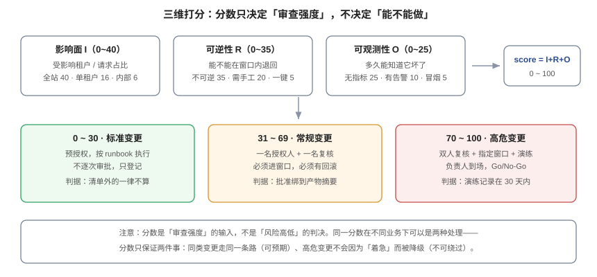

# 变更分级：把「多大的事」算出来

**分级不是为了给变更贴标签，而是为了决定「几个人看、什么时候做、要不要演练」。** 靠感觉分级，在赶工期时会自动降级到「小事」；靠规则分级，至少能被复算、被审计、被争议。本页给出一套三维打分、四个真实算例、阈值怎么定，以及一个「规则漏了一行、风险差了两档」的实例。



## 一、为什么必须「算」而不是「评」

三种常见做法的差别不在精确度，而在**可争议性**：

| 做法 | 谁定级 | 赶工期时会发生什么 | 事后能不能复核 |
| --- | --- | --- | --- |
| 发起人自评「高中低」 | 发起人 | 一律填「中」或「低」 | 不能，没有依据 |
| 评审会讨论定级 | 集体 | 会议被压缩时跳过讨论 | 不能，只有结论 |
| **规则算分** | 规则 | 分数不会因为「今天很急」而变 | **能**，输入可复算 |

第三种做法的价值不在准确，而在**一致**：同一类变更永远走同一条路，团队才能形成肌肉记忆；也才能在事后说清「当时为什么判成常规变更」。

## 二、三个维度与权重

只保留三个能问出具体数字的维度。权重是**推演值**，用于给出量级，不是行业标准——你们的阈值应该用自己的事故数据反推。

| 维度 | 取值 | 分数 | 依据 |
| --- | --- | --- | --- |
| **影响面 I** | 全站可见（>50% 请求） | 40 | 影响面是唯一与「损失金额」近似线性的量 |
| | 多租户（10%~50%） | 28 | |
| | 单租户（≤10%） | 16 | |
| | 内部工具 | 6 | |
| | 无用户可见 | 0 | |
| **可逆性 R** | 不可逆（删数据 / 删列 / 改类型） | 35 | 不可逆意味着「只能向前修」，恢复时间不可控 |
| | 需手工回滚（写反向 SQL / 改配置） | 20 | |
| | 一键回滚（换镜像 / 关开关） | 5 | |
| **可观测性 O** | 无指标无告警 | 25 | 「多久知道它坏了」直接决定影响持续时长 |
| | 有指标有告警 | 10 | |
| | 有冒烟与告警 | 5 | |

三项相加得 0~100 分，再按两档阈值分三型：

| 分数 | 类型 | 审查强度 |
| --- | --- | --- |
| 0 ~ 30 | **标准变更** | 预授权，按 runbook 执行，只登记 |
| 31 ~ 69 | **常规变更** | 一名授权人 + 一名复核，必须进窗口、必须有回滚方案 |
| 70 ~ 100 | **高危变更** | 双人复核 + 指定窗口 + 30 天内的演练记录 + 负责人到场 |

## 三、实现：规则即数据

分级规则必须能被审计——「为什么这次被判成高危」要能查到是哪条规则、多少分。所以规则放表里，不放代码里：

```sql
CREATE TABLE class_rule (
  rule_id text PRIMARY KEY,
  kind    text NOT NULL CHECK (kind IN ('impact','reversibility','observability','floor')),
  label   text NOT NULL,
  points  int  NOT NULL CHECK (points BETWEEN 0 AND 100),
  pattern text,
  note    text NOT NULL
);
```

`floor`（下限）是第四类规则：**命中即抬到某个分数**，不是加项。它解决的是「三维相加漏掉的风险」——例如删列，按可逆性算是 35 分，但它的真实风险是「旧代码立刻报错」，三维模型抓不住这个形状。

```sql
CREATE OR REPLACE FUNCTION score(p_impact text, p_rev text, p_obs text, p_text text DEFAULT '')
RETURNS TABLE(impact int, rev int, obs int, raw int, floor int, final int, klass text)
LANGUAGE sql STABLE AS $$
  WITH s AS (
    SELECT (SELECT points FROM class_rule WHERE kind='impact'        AND pattern=p_impact) AS i,
           (SELECT points FROM class_rule WHERE kind='reversibility' AND pattern=p_rev)    AS r,
           (SELECT points FROM class_rule WHERE kind='observability' AND pattern=p_obs)    AS o
  ), f AS (
    SELECT coalesce(max(points), 0) AS fl FROM class_rule
     WHERE kind='floor' AND p_text ~* pattern
  )
  SELECT s.i, s.r, s.o, s.i+s.r+s.o, f.fl,
         greatest(s.i+s.r+s.o, f.fl),
         CASE WHEN greatest(s.i+s.r+s.o, f.fl) <= 30 THEN 'standard'
              WHEN greatest(s.i+s.r+s.o, f.fl) <= 69 THEN 'normal'
              ELSE 'high' END
  FROM s, f
$$;
```

## 四、四个算例（本机实跑）

在 PostgreSQL 18.6 沙盒（schema `chg`）上，用上面的规则表与函数跑出来的真实输出：

| 变更 | I | R | O | raw | floor | final | 类型 |
| --- | --- | --- | --- | --- | --- | --- | --- |
| `CREATE INDEX CONCURRENTLY idx ON cards(id)` | 16 | 5 | 5 | 26 | 0 | **26** | standard |
| `ALTER TABLE cards ADD COLUMN norm text DEFAULT ''` | 28 | 20 | 10 | 58 | 0 | **58** | normal |
| `ALTER TABLE cards DROP COLUMN legacy` | 16 | 35 | 10 | 61 | **70** | **70** | high |
| `UPDATE routing SET weight=80 WHERE svc='api'` | 28 | 5 | 10 | 43 | **70** | **70** | high |

读表注意后两行：**如果没有 floor 规则，删列是 61 分（常规），改流量权重是 43 分（常规）**——两个最容易出事的变更都会被判成「走个流程就行」。floor 的存在不是为了加严，而是为了补上三维模型的盲区。

::: danger 一个真实的分级漏洞：少了一个否定词
第一版规则里只有一条 `DDL 破坏性`，正则是 `drop|rename|alter column|set not null|add constraint`。于是 `CREATE INDEX idx ON cards(id)`（不带 `CONCURRENTLY`）拿到的分数是 **26 / standard** ——它会持 `SHARE` 锁阻塞所有写。

补一条带否定前瞻的规则后：

```sql
INSERT INTO class_rule VALUES
 ('F-IDX','floor','非并发建索引',70,'create index(?!.*concurrently)','会持 SHARE 锁阻塞写');
```

同一条 SQL 重新打分：**70 / high**；而带 `CONCURRENTLY` 的那条仍是 **26 / standard**。

**这一条比整套权重都值钱**：分级的准确度不取决于权重调得多细，而取决于「高危形状有没有被枚举全」。规则漏一种写法，权重再精细也没用。
:::

## 五、阈值怎么定：用事故反推，不要拍脑袋

一个可行的方法（推演，用你们自己的数据替换）：

1. 拉最近 12 个月的变更记录，标出「导致事故」的那些。
2. 对每条算分，看它们落在哪些分数段。
3. 若 70 分以上的变更里 60% 出过事，而 30 分以下只有 2% 出过事，阈值就大致合理。
4. 若 30 分以下也经常出事，说明**规则漏了形状**，不是阈值太低——先补规则。

第二步常用一个对照：DORA 2025 报告的 CFR 分布是 0~2% 占 8.5%、2~4% 占 8.1%、4~8% 占 19.6%、8~16% 占 26%。如果你们的 CFR 在 8%~16% 区间，先别急着「加审批」，而要问「哪一类变更贡献了失败」——多数时候集中在两三类形状上。

## 六、两种分级错误的代价不对称

| 错误 | 表现 | 代价 | 修法 |
| --- | --- | --- | --- |
| **评级过高**（把小事判成大事） | 所有变更都要双签、都进窗口 | 等待成本线性增长，最终导致「绕过流程」 | 扩充标准变更清单，而不是降低高危阈值 |
| **评级过低**（把大事判成小事） | 删列、切流、改权限走了快速通道 | 单次事故成本可能是一次全站故障 | 补 floor 规则，且**不允许人工下调** |

不对称的地方在于：评级过高是**慢性失血**（每天多等两小时），评级过低是**急性失血**（一次事故抵一年等待）。所以设计原则是：**允许人工上调，不允许人工下调**；下调只能通过改规则并留痕。

::: tip 一条能落地的小规则
变更单上放两个字段：`computed_class`（规则算的）与 `override_reason`（人工调整的理由）。二者不一致时必须填理由，且理由进月度统计。**统计「override 率」比统计「变更数」有用得多**——override 率高说明规则与现实脱节，而不是人不行。
:::

## 七、五个常见错误

1. **按「服务数」算影响面**：改了 1 个服务但它是所有请求的入口，影响面是全站。影响面要按**用户/请求占比**算，不按服务个数。
2. **把「紧急」当分级**：紧急是**通道**，不是级别。一个紧急的删列变更仍然是高危，只是它走紧急通道（见[紧急变更](../EmergencyChange/index.md)）。
3. **规则改了不版本化**：三个月后回看「当时为什么判成常规」，规则已经改了两版，无法复算。规则表要带 `effective_from`，变更要记录当时用的规则版本。
4. **用「有没有测试」当可逆性**：测试覆盖不等于可回滚。可逆性只问一件事：**窗口内能不能退回去**。
5. **把标准变更清单当垃圾桶**：清单越长，预授权越像「免审」。清单里每一条都应该有「最近 90 天失败次数」这个字段，失败过的移出清单。

## 八、验证方式

```shell
# ① 分级能不能被复算：随便挑一个已完成的变更，用规则重算
psql -c "SELECT * FROM chg.score('multi','manual','alert','ALTER TABLE cards ADD COLUMN norm text');"
# 期望：final 与变更单上的 computed_class 一致；不一致说明规则已漂移

# ② 规则表里 floor 规则是否覆盖了四类高危形状
psql -c "SELECT kind, count(*) FROM chg.class_rule GROUP BY kind;"
# 期望：floor 至少 4 条（DDL / 权限 / 流量 / 密钥），少于 4 条说明形状没枚举全

# ③ 变更单是否记录了「算出来的」而不是「填进去的」类型
grep -rn "computed_class\|override_reason" --include="*.sql" --include="*.md" . | head
# 期望：两个字段都存在。只有 class 一个字段，说明分级仍是手填
```

## 九、判据族 `CLS`

| 判据 | 内容 | 怎么验证 |
| --- | --- | --- |
| `CLS-A` | 分级必须由三维输入算出，不得由发起人直接选择类型 | 能用一个函数/脚本从输入复算输出；手填即不合格 |
| `CLS-B` | 三个维度的取值必须有明确边界（按请求占比、回滚方式、发现手段），不得写「视情况」 | 规则表里每档都有可判定的条件 |
| `CLS-C` | 必须存在 floor 规则，覆盖 DDL / 权限 / 流量 / 密钥四类高危形状 | 规则表 `kind='floor'` 至少 4 条且四类各一 |
| `CLS-D` | 规则必须版本化：每次变更记录「当时使用的规则版本」 | 变更单或审计表里有 `rule_version` 字段 |
| `CLS-E` | 允许人工上调，不允许人工下调；下调只能改规则 | 代码/流程里没有「下调」入口，或下调需改规则并留痕 |
| `CLS-F` | 标准变更清单的每一条都必须有「最近 90 天失败次数」 | 清单是一张表，含失败次数字段；纯文本清单不合格 |
| `CLS-G` | 影响面按用户/请求占比计算，不得按服务个数计算 | 规则输入里有百分比字段，不是 `services` 计数 |
| `CLS-H` | 「紧急」不得作为分级结果，只能作为通道 | 类型枚举里没有 `emergency` 之外的语义混用；紧急单仍带原分级 |

## 十、与相邻专题的分工

| 你想知道 | 去哪 |
| --- | --- |
| 分完之后什么时候能做 | [窗口与冻结期](../ChangeWindow/index.md) |
| 高危形状怎么写成静态规则 | [高危变更](../HighRiskChange/index.md) |
| 紧急单怎么走 | [紧急变更](../EmergencyChange/index.md) |
| 失败率怎么算、口径怎么定 | [常见问题](../FAQ/index.md) 第六节 |

## 与「研发效能度量」专题的分工（第 172 天补充）

本页的分级回答「这次变更该走几道门」；[研发效能度量](../../../Tools/EngineeringMetrics/index.md) 回答「这些门让交付变成多长」。两者在**返工率**上交汇：分级里的「紧急变更」包含回滚与热修，而 DORA 的返工率只数**非计划、由生产事件触发的部署**。

| 问题 | 归本页 | 归研发效能度量 |
| --- | --- | --- |
| 三维打分、分级规则、哪个级别要几道审批 | ✅ | —— |
| 分级规则少一个否定词导致 `CREATE INDEX` 拿 26 分 | ✅ 本页的实测 | —— |
| 返工率的分母是变更单还是部署 | —— | ✅ [交付指标](../../../Tools/EngineeringMetrics/DeliveryMetrics/index.md) |
| 分级带来的等待占交付周期多少 | —— | ✅ [流动指标](../../../Tools/EngineeringMetrics/FlowMetrics/index.md) 的流动效率 |

**本页特有的坑**：变更单与部署不是一对一。一次部署可能带 20 个变更（本项目实测平均 20.5、最大 30），也可能一个变更被部署多次（回滚后重发）。因此**返工率不能按变更单算**——按变更单算会把一次回滚记成一次返工，而实际受影响的是一整批；分母必须落到部署上。

## 参考资料

- ITIL 4：*Change Enablement*（Standard / Normal / Emergency 三型的定义与授权差异）
- DORA：[*State of AI-assisted Software Development 2025*](https://dora.dev/research/2025/dora-report/)（CFR 分布，Figure 14）
- PostgreSQL 18 文档：[Pattern Matching](https://www.postgresql.org/docs/current/functions-matching.html)（`~*` 与否定前瞻的写法）
- 本站：[审批留痕](../ApprovalTrail/index.md)、[高危变更](../HighRiskChange/index.md)
