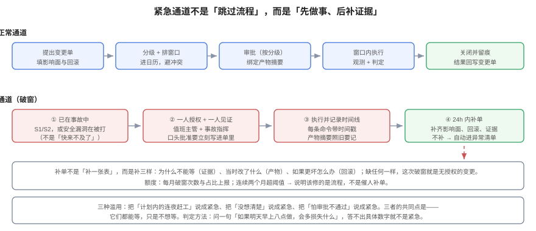

# 紧急变更：破窗的边界与额度

**紧急变更不是「跳过流程」，而是「先做事、后补证据」。** 它的合法性来自一个判断：**等到下一个窗口再做，损失大于现在做的风险**。这个判断必须能被写成证据，否则「紧急」会变成所有变更的默认通道——而所有变更都紧急，等于所有变更都没有审查。



## 一、三条硬条件，缺一不可

| # | 条件 | 不满足的例子 | 为什么必须 |
| --- | --- | --- | --- |
| 1 | **已经在事故里**（S1/S2），或安全漏洞正在被利用 | 「明天大促，今晚先上」 | 事故是唯一能证明「损失正在发生」的状态 |
| 2 | **没有等效的缓解手段**（限流、降级、关开关都不行） | 「关掉开关也能挡住，但要改文案」 | 有更轻的手段时，先用轻的 |
| 3 | **不做会扩大影响**（每小时的损失可估算） | 「早点上早点安心」 | 无法估算损失，就无法证明「不能等」 |

三个条件都满足，才是紧急变更。只满足第 1 条，那是事故处置里的一次操作；只满足第 3 条，那是排期问题。

::: tip 一句能挡住 80% 滥用的问话
**「如果明天早上八点做，会多损失什么？」**

- 答得出具体数字（「每小时 3 万元订单失败」「证书 36 小时后过期」）→ 是紧急。
- 答不出，只说「客户会不高兴」「老板在问」→ 不是紧急，是优先级问题。
:::

## 二、破窗的四步

### 2.1 一人授权 + 一人见证

紧急情况下不可能凑齐双签，但**不能只有一个人**：

- **授权人**：值班主管或事故指挥（Incident Commander），他对「现在做」这件事负责；
- **见证人**：另一名工程师，负责记录时间线与命令。

口头批准有效，但必须在**五分钟内**写进变更单——「当时口头说过」在事后等于没说过。

### 2.2 执行并记录时间线

紧急变更的时间线不是写给审计看的，是写给**下一个接手的人**看的。最小要求：

```text
14:02 事故确认：卡片列表 500，影响全部租户
14:05 决定：回滚 search-api 到 v1.3.9（IC 批准，见证：wang）
14:07 执行：kubectl -n prod rollout undo deploy/search-api
14:09 现象：错误率 38% → 4%
14:12 残留：仍有 2% 超时，继续观察
```

每条都要带时间与命令。**没有命令的时间线，事后无法复现。**

### 2.3 24 小时内补单

补单不是「补一张表」，而是补三样：

| 补什么 | 具体内容 | 缺了会怎样 |
| --- | --- | --- |
| **为什么不能等** | 损失估算 + 已尝试的缓解手段 | 无法区分「紧急」与「着急」 |
| **当时改了什么** | commit / digest / 实际操作命令 | 无法复现，也无法证明改的就是这个 |
| **如果更坏怎么办** | 回滚命令 + 回滚点 | 下一次更坏时手忙脚乱 |

三样缺任何一样，这次破窗在记录上就是**一次无授权的变更**——不是「流程瑕疵」，是「没人知道发生了什么」。

### 2.4 自动进异常清单

补单超时、缺字段、或补单内容与时间线对不上，都进异常清单。异常清单要**每周有人看**，否则它就是另一个没人填的表。

## 三、三种滥用与识别方法

| 滥用 | 表现 | 识别 |
| --- | --- | --- |
| **计划内赶工** | 早就知道要做的迁移，拖到冻结期前一周 | 看变更单的创建时间与计划时间：创建于 3 天前却走紧急通道 |
| **没想清楚** | 方案没定，先上线再看 | 补单里「回滚方式」写的是「再看」 |
| **怕审批不通过** | 明知是常规变更，绕开评审 | 同一人连续多次紧急，且都发生在评审会前一天 |

三种滥用的共同点是：**它们都能等，只是不想等**。

## 四、额度：用数字把「例外」变回「例外」

没有额度的例外通道，三个月内就会变成主通道。建议三个指标（阈值按团队规模调整，下面是推演值）：

| 指标 | 建议阈值 | 超了说明什么 |
| --- | --- | --- |
| 紧急变更占比 | ≤ 10% | 超过 20%：计划能力不足，不是响应能力不足 |
| 24 小时补单率 | ≥ 95% | 低于 90%：通道没有闭环，记录不可信 |
| 同一人月度紧急次数 | ≤ 2 | 超过 3 次：要么他在救火，要么他在绕流程 |

```sql
-- 月度紧急变更占比（可直接跑在变更表上）
SELECT date_trunc('month', created_at) AS mon,
       count(*) FILTER (WHERE level = 'emergency') AS emergency,
       count(*) AS total,
       round(100.0 * count(*) FILTER (WHERE level='emergency') / count(*), 1) AS pct
FROM change_request
GROUP BY 1 ORDER BY 1 DESC;
```

## 五、紧急单不得降级

一条容易走偏的规则：**「紧急」是通道，不是级别**。

一个紧急的删列变更，仍然是**高危**：它要走紧急通道（快），但仍然需要双人复核（一个人在电话里、一个人在线上）、仍然需要回滚方案、仍然要演练记录。把「紧急」当成降级理由，等于把两个正交的维度压成一维：

| | 常规通道 | 紧急通道 |
| --- | --- | --- |
| **标准变更** | 预授权，登记即可 | 极少出现（标准变更不该紧急） |
| **常规变更** | 一人批准 + 复核 | 一人授权 + 一人见证，24h 补单 |
| **高危变更** | 双人复核 + 窗口 + 演练 | **仍是双人**（可远程）+ 事后补演练证据 |

## 六、与事故响应的分工

紧急变更发生在事故里，所以必须和事故指挥体系对齐，否则会出现「两个人同时在下命令」。

| 角色 | 管什么 | 不管什么 |
| --- | --- | --- |
| **事故指挥（IC）** | 定级、决策、对外沟通、决定「做什么」 | 具体命令怎么写 |
| **变更授权人** | 批准「这次操作可以作为一次变更执行」 | 事故定级 |
| **执行人** | 按 runbook 执行、记录时间线 | 决定做什么 |

小团队里 IC 与授权人常常是同一个人，这没问题——但**执行人必须是另一个人**。一个人既决策又执行，时间线就没人记，事故里最容易丢的恰恰是时间线。

::: warning 一条不能省的边界
事故中的「止血操作」（重启、扩容、切流、回滚到上一版）**不需要变更单**，它们是事故处置的一部分；但**任何改变代码或数据形状的操作**（热修、改配置默认值、加索引）都需要——因为它们不会随事故结束而消失。
:::

## 七、验证方式

```shell
# ① 紧急单是否有额度统计
psql -c "SELECT count(*) FILTER (WHERE level='emergency')::float / count(*) AS ratio FROM chg.change_request;"
# 期望：<= 0.10。高于 0.20 说明紧急通道已变成主通道

# ② 补单是否闭环：查超过 24h 仍未补单的紧急变更
psql -c "SELECT code, created_at FROM chg.change_request
         WHERE level='emergency' AND status='done'
           AND (artifact_hash IS NULL OR approver IS NULL)
           AND created_at < now() - interval '24 hour';"
# 期望：0 行。有行说明破窗没有闭环

# ③ 时间线是否可复现：随便挑一个紧急单，看补单里有没有命令
grep -rn "kubectl\|psql -c\|rollout undo" docs/changes/ 2>/dev/null | head
# 期望：能看到具体命令。只有「已回滚」三个字，等于没有记录
```

## 八、判据族 `EMG`

| 判据 | 内容 | 怎么验证 |
| --- | --- | --- |
| `EMG-A` | 紧急变更必须同时满足「在事故中 / 无等效缓解 / 损失可估算」三条 | 补单里三个问题都有书面答案 |
| `EMG-B` | 必须一人授权 + 一人见证，且授权人与执行人不得为同一人 | 变更单里 `approver` 与 `executor` 不同 |
| `EMG-C` | 口头批准必须在 5 分钟内落成记录 | 记录时间与事故时间线相差 ≤ 5 分钟 |
| `EMG-D` | 必须在 24 小时内补单，补单含损失估算、产物摘要、回滚方案 | 三个字段均非空；超时进异常清单 |
| `EMG-E` | 紧急单不得改变原分级；高危仍按高危复核 | 紧急单的 `class` 与原分级一致，且复核记录存在 |
| `EMG-F` | 必须能统计紧急变更占比与补单率，并有阈值 | 有一条 SQL 能算出两个比率 |
| `EMG-G` | 时间线必须含「时间 + 命令 + 现象」三要素 | 抽查 3 个紧急单，每条记录都有命令 |
| `EMG-H` | 止血操作与形状变更必须区分：后者仍要变更单 | 文档里写明边界，且有一次实际按此区分的记录 |

## 九、与相邻专题的分工

| 你想知道 | 去哪 |
| --- | --- |
| 事故怎么定级、谁指挥 | [故障应急体系](../../IncidentResponse/index.md) |
| 回滚动作怎么执行、怎么判定成功 | [发布与回滚](../../../Tools/CICD/DeployRollback/index.md) |
| 开关能不能替代紧急发布 | [功能开关](../../../Tools/ObservabilityDriven/FeatureFlag/index.md) |
| 冻结期内怎么开例外 | [窗口与冻结期](../ChangeWindow/index.md) |

## 参考资料

- ITIL 4：*Change Enablement*（Emergency Change 与 ECAB 的定位）
- Google SRE Book：[*Managing Incidents*](https://sre.google/sre-book/managing-incidents/)（角色分工与时间线记录）
- DORA：[*State of AI-assisted Software Development 2025*](https://dora.dev/research/2025/dora-report/)（失败部署恢复时间：1 小时内 21.3%）
- 本站：[故障应急体系](../../IncidentResponse/index.md)、[窗口与冻结期](../ChangeWindow/index.md)
