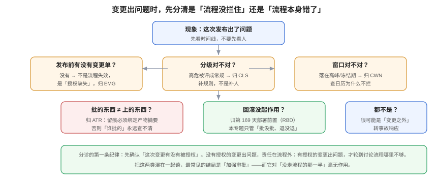

# 常见问题与最佳实践

**变更管理的问题很少是「流程不存在」，多数是「流程存在但没用」。** 本页把九类典型现象按「先查什么」排序，给出十二个高频问题、十二项上线自查，以及一个经常被算错的口径：变更失败率的分母。

## 一、九类现象的分诊表

顺序很重要：**先确认「这次变更有没有被授权」，再讨论流程哪里不够**。顺序反了，最常见的结局是「加强审批」——而它对「没走流程的那一半」毫无作用。

| 现象 | 先查什么 | 大概率归属 |
| --- | --- | --- |
| 发布很慢，什么都排队 | 标准变更清单覆盖了多少比例的日常变更 | [变更分级](../Classification/index.md)（清单太窄） |
| 审批通过了但没人看 | 抽查 20 个单，问审批人回滚方式 | [体系概述](../Overview/index.md)（流程空转） |
| 事故里查不到谁批的 | 变更单有没有 `artifact_hash` | [审批留痕](../ApprovalTrail/index.md) |
| 批的是 A、上的是 B | 部署前有没有重新比对摘要 | [审批留痕](../ApprovalTrail/index.md) 第五节 |
| 同一晚两个变更互相破坏 | 有没有数据库级互斥 | [变更日历](../ChangeCalendar/index.md) |
| 冻结期还是有人发版 | 冻结期是公告还是数据 | [窗口与冻结期](../ChangeWindow/index.md) |
| 删列导致旧代码全挂 | 分级规则有没有 floor | [高危变更](../HighRiskChange/index.md) |
| 紧急变更占比越来越高 | 区分「计划内赶工」与「真事故」 | [紧急变更](../EmergencyChange/index.md) |
| CFR 算出来每个人都不一样 | 分母是「全部变更」还是「已部署变更」 | 本页第六节 |

## 二、十二个高频问题

**Q1：小团队只有五个人，也要做变更管理吗？**
要，但只需要两件：**一条意图记录**（PR 描述即可）与**一个产物摘要**（commit + digest）。分级与日历可以后补——先有记录，再谈流程。

**Q2：变更单和 PR 描述重复吗？**
不重复。PR 描述回答「代码为什么这么改」，变更单回答「为什么现在上、影响谁、怎么退」。二者可以互相链接，但不能互相替代。

**Q3：CAB 还要不要开？**
如果开会的产出是「同意」，那就不需要。ITIL 4 里 CAB 是**建议机构**：它提供风险、依赖、就绪度的输入，决策权在 Change Authority。把 CAB 当审批会，等于集体负责=没人负责。

**Q4：标准变更清单应该多长？**
短到能被维护，长到能覆盖 60%~80% 的日常变更。判据不是条数，而是**每一条都有最近 90 天失败次数**；失败过的移出清单。

**Q5：冻结期是不是形式主义？**
取决于它是不是数据。写在公告里的冻结期确实是形式；写成 `daterange` 并能被 SQL 判定的冻结期，会在排期时直接拦住——本机实测里，一条跨零点的变更因为时区处理不同，会得到「冻结」与「不冻结」两种结果，这正是「必须由数据判定」的理由。

**Q6：紧急变更要不要事后追责？**
不要追责，要**追证据**。补单缺的是「为什么不能等」，不是「谁批准」。追责的直接后果是下次没人敢走紧急通道，于是大家改成「悄悄发」。

**Q7：灰度能不能替代变更审批？**
部分能。灰度降低的是「影响面」，不降低「不可逆性」。删列、改权限、轮换证书，灰度帮不上——它们一改就是全量。

**Q8：变更失败率多少算好？**
DORA 2025 的分布是：0~2% 占 8.5%，2~4% 占 8.1%，4~8% 占 19.6%，8~16% 占 26%。**先看自己的趋势，再看分位**；不同业务的可接受区间差别很大（有合规门禁的金融业务与一天发二十次的 SaaS 不可比）。

**Q9：变更记录要留多久？**
与合规对齐：金融常见 5~7 年，普通业务 1~2 年。到期做聚合（保留「某月 N 次批准」），不要直接删——删除会破坏哈希链。

**Q10：多个服务一起发，算一个变更还是多个？**
按**可独立回滚的最小单元**拆。能一起回滚的算一个；一个回滚会导致另一个不可用的，必须拆成有依赖边的两个。

**Q11：怎么说服团队接受「不许下调分级」？**
用数字：统计最近半年「被人工下调的变更」里出过几次事故。如果为 0，说明下调没造成损失，可以讨论放宽；如果不为 0，规则自己会说话。

**Q12：变更管理与 SRE 的「错误预算」什么关系？**
错误预算是**结果**约束（这个季度还能错多少），变更管理是**过程**约束（这次能不能做）。两者可以互相引用：预算耗尽时，高危变更自动要求更高一层授权。

## 三、十二项上线自查

每项都能用一条命令或一次查询回答，不接受「应该有」。

1. 每个生产变更都能定位到一条意图记录（变更单 / PR / 发布记录）。
2. 授权人是具体角色或个人，不是「团队」。
3. 分级能由规则复算，且记录了当时使用的规则版本。
4. floor 规则覆盖 DDL / 权限 / 流量 / 密钥四类。
5. 批准记录里有 `artifact_hash`，且能复算。
6. 部署前会重新比对摘要，不一致则拒绝。
7. 审批表只允许插入（`UPDATE` / `DELETE` 被拒）。
8. 同服务窗口互斥由数据库约束保证（`\d` 能看到 `EXCLUDE`）。
9. 冻结期是 `daterange` 数据，且判定不依赖会话时区。
10. 紧急变更占比与 24h 补单率可统计。
11. 高危变更的演练记录在 30 天内，且演练了回滚写路径。
12. 变更关闭时同时记录 `result` 与 `approval_chain`。

## 四、一个常被算错的口径：变更失败率

「失败率」看起来是最简单的指标，实际最容易算错。本机用 20 条变更做了一次对照（其中 4 条标记失败，但有 1 条从未部署）：

| 口径 | 算式 | 结果 | 问题 |
| --- | --- | --- | --- |
| **全部变更**为分母 | 4 / 20 | **20.0%** | 把「没上线的失败」也算进去 |
| **已部署变更**为分母 | 3 / 16 | **18.75%** | 更接近 DORA 的定义（失败指「部署后需补救」） |

同一批数据，差 1.25 个百分点。看起来不大，但如果「未部署的失败」占比更高（比如大量变更在预发就被拦下），两种口径会差出十几个点——而这恰恰是**你的门禁在起作用**的证据，用第一种口径反而会惩罚有效的门禁。

同一批数据还能算出两个更有用的比率：

| 指标 | 算式 | 结果 |
| --- | --- | --- |
| 紧急变更占比 | 4 / 20 | 20%（已超过 10% 的建议阈值） |
| 失败中引发事故的比例 | 2 / 4 | 50% |

按级别看：`emergency` 25%（1/4）、`normal` 20%（2/10）、`standard` 16.7%（1/6）。

::: danger 三个口径陷阱
1. **把「回滚」算成两次变更**：一次变更 + 一次回滚，分母变 2、分子变 1，失败率被人为压低。回滚是失败的一部分，不是新变更。
2. **把「修复类发布」算进分母**：为修上一个事故而发的补丁，不应作为新的变更计入分母（否则事故会同时抬高分子与分母）。
3. **用「工单数」代替「变更数」**：一个变更可能对应多张工单（建表、改配置、发版），按工单算会把大变更拆成多个「成功」。
:::

## 五、五种「听起来对」的错误建议

| 建议 | 为什么错 | 更好的做法 |
| --- | --- | --- |
| 「所有变更都要 CAB 审批」 | 集体审批=没人负责，且必然退化成盖章 | 按分级分配授权人，CAB 只做建议 |
| 「加强审批就能减少事故」 | 事故的主因常是「没走流程」而不是「流程不严」 | 先让流程值得走（快、可预期），再谈严格 |
| 「上 DevOps 就不需要变更管理」 | 高频发布放大的是「每次变更的影响面」，不是消除它 | 用分级 + 自动化校验替代人工审批 |
| 「变更失败率越低越好」 | 过低通常意味着变更太少或分级过严 | 与部署频率一起看，看趋势 |
| 「紧急通道要尽量少用」 | 目标不是少用，而是**只在真紧急时用** | 用额度 + 补单率两个指标管理，而不是压数量 |

## 六、术语表

| 术语 | 含义 | 最容易混淆的点 |
| --- | --- | --- |
| Change | 对生产环境的任何修改 | 不只是代码，配置与权限也算 |
| Release | 一批变更打包成用户可见的新版本 | 发布 ≠ 部署：可以部署但不开开关 |
| Deployment | 把制品装到环境里的动作 | 部署成功 ≠ 服务可用 |
| Standard Change | 预授权、可重复的低风险变更 | 前提是清单被维护 |
| Normal Change | 需评估与授权的变更 | 可按风险再分轻/重 |
| Emergency Change | 为恢复服务或阻止扩大而加速的变更 | 是通道，不是级别 |
| Change Authority | 有决策权的角色/个人 | 不是 CAB |
| CAB | 变更建议机构 | 只给建议，不背决定 |
| Freeze Window | 业务不能承受波动的时间区间 | 必须可被机器判定 |
| Artifact Hash | 代码/产物/迁移/意图四态的摘要 | 不是版本号，也不是 tag |
| CFR | 变更失败率 | 分母口径必须先写死 |
| Break-glass | 破窗：紧急通道的俗称 | 破窗后必须补证据 |

## 七、判据族 `CHQ`

| 判据 | 内容 | 怎么验证 |
| --- | --- | --- |
| `CHQ-A` | 分诊必须先问「有没有被授权」，再问「流程哪里不够」 | 分诊表第一行是授权检查 |
| `CHQ-B` | CFR 的分母口径必须写死在文档里，且全公司一致 | 文档里明确「全部变更」或「已部署变更」 |
| `CHQ-C` | 回滚不得计为一次新变更 | 统计脚本里回滚记录与失败记录合并 |
| `CHQ-D` | 修复类发布不得计入 CFR 分母 | 统计口径有「fix-only」排除规则 |
| `CHQ-E` | 团队必须能回答「最近一次高危变更的演练时间」 | 抽查一个高危变更，能给出日期与结论 |
| `CHQ-F` | 每个季度至少复核一次分级规则（规则漂移检查） | 有复核记录，且记录里含「本次改了什么规则」 |
| `CHQ-G` | 十二项自查必须能逐项给出命令或查询，不得只写「已确认」 | 抽查三项，每项都能现场跑 |
| `CHQ-H` | 术语表必须区分 release / deployment / change 三词 | 文档里三词各有定义且不混用 |

## 八、与相邻专题的分工

| 你想知道 | 去哪 |
| --- | --- |
| 发布动作与回滚策略 | [发布与回滚](../../../Tools/CICD/DeployRollback/index.md) |
| 事故定级与指挥 | [故障应急体系](../../IncidentResponse/index.md) |
| 开关与灰度度量 | [功能开关](../../../Tools/ObservabilityDriven/FeatureFlag/index.md) |
| 交付验收清单 | [一键部署与上线验收](../../../Others/ProjectDelivery/Delivery/index.md) |
| 观测信号与告警 | [告警设计](../../Monitoring/Alerting/index.md) |

## 参考资料

- ITIL 4：*Change Enablement*（三型变更与授权层级）
- DORA：[*State of AI-assisted Software Development 2025*](https://dora.dev/research/2025/dora-report/)（CFR 与恢复时间分布）
- Google SRE Book：[*Postmortem Culture*](https://sre.google/sre-book/postmortem-culture/)（记录事实、不追责）
- 本站：[体系概述](../Overview/index.md)、[变更分级](../Classification/index.md)、[审批留痕](../ApprovalTrail/index.md)
