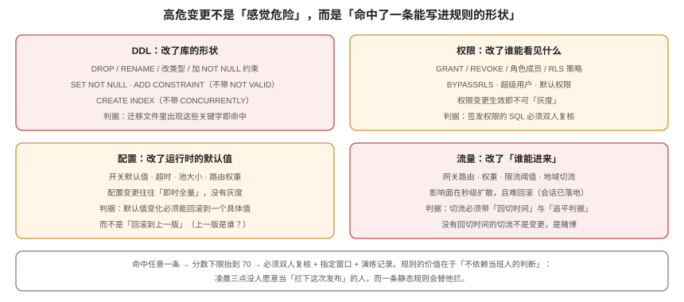

# 高危变更：能写进规则的形状

**「高危」不是一种感觉，而是一组可以被正则和查询命中的形状。** 把高危写成规则的价值不在于精确，而在于**不依赖当班人的判断**——凌晨三点，没人愿意做那个「拦下这次发布」的人，而一条静态规则会替他拦。



## 一、四类形状

高危变更集中在四个方向，每一类都有「一改就全量生效、几乎没有灰度」的共同点：

| 类 | 典型动作 | 为什么高危 | 可观测的窗口 |
| --- | --- | --- | --- |
| **DDL** | `DROP COLUMN`、`RENAME`、改类型、`SET NOT NULL`、非并发建索引 | 持强锁、旧代码立刻报错、不可逆 | 秒级（锁一上来就全站超时） |
| **权限** | `GRANT` / `REVOKE`、角色成员、RLS 策略、`BYPASSRLS` | 生效即全量，没有「部分用户」 | 分钟级（越权不会立刻报警） |
| **配置** | 开关默认值、超时、池大小、路由权重 | 配置变更往往即时全推，没有灰度 | 秒级 |
| **密钥 / 证书** | 轮换、换 CA、改 TLS 版本 | 弄错就是全站不可用 | 秒级 |

::: danger 一个容易漏的第五类
**「删数据」不一定以 DDL 形式出现**。一条 `DELETE FROM cards WHERE ...` 的脚本、一次「清理历史数据」的定时任务、一次「重置测试租户」的运维操作，都属于不可逆变更。规则里必须包含「任何 `DELETE` / `TRUNCATE` / 大批量 `UPDATE`」这一形状，并且要求**先备份或先软删**。
:::

## 二、规则怎么写：三类匹配

规则不是一条正则，而是三种匹配的组合：

| 匹配对象 | 怎么取 | 例子 |
| --- | --- | --- |
| **迁移文件内容** | 遍历 `migrations/*.sql` | `ALTER TABLE ... DROP COLUMN` |
| **变更描述文本** | 变更单的标题与正文 | 「调整网关权重到 80%」 |
| **配置 diff** | 对比 `config/` 与上一版本的差异 | `pool.size: 20 → 5` |

```shell
# 一个最小可用的扫描：找出本次变更涉及的迁移文件里的高危语句
git diff --name-only origin/main...HEAD -- 'migrations/*.sql' \
  | xargs -r grep -nEi 'drop[[:space:]]+(column|table)|rename[[:space:]]+column|alter[[:space:]]+column.*type|set[[:space:]]+not[[:space:]]+null|create[[:space:]]+index(?!.*concurrently)|truncate|delete[[:space:]]+from'
# 期望：无输出。有输出即命中高危，必须抬级并进入双人复核
```

这段脚本有两个细节值得注意：

1. **`create index(?!.*concurrently)`**：不带 `CONCURRENTLY` 的建索引会持 `SHARE` 锁阻塞写。少了这个否定前瞻，它会被判成「加个索引而已」。
2. **`-- 'migrations/*.sql'`**：路径过滤必须写死，否则会扫到测试夹具里的 `DROP TABLE`，产生大量假阳性——假阳性多了，规则就会被整体关掉。

## 三、规则要能被审计：命中要留证据

规则命中之后，最重要的不是「拦住」，而是**留下「为什么被判成高危」的记录**：

```sql
CREATE TABLE risk_hit (
  id          bigserial PRIMARY KEY,
  change_code text NOT NULL,
  rule_id     text NOT NULL,
  file_path   text,
  line_no     int,
  snippet     text NOT NULL,
  hit_at      timestamptz NOT NULL DEFAULT now()
);
```

一条命中记录至少要有 `file_path` + `line_no` + `snippet`。只有 `rule_id` 的记录，在事后争议时无法自证——「你说命中了，命中在哪一行？」

## 四、双人复核：复核的不是「同意」，是三个假设

高危变更的双人复核经常退化成「第二个人也点一下」。它应该复核三件具体的事：

| 复核项 | 要回答的问题 | 不合格的样子 |
| --- | --- | --- |
| **影响面假设** | 「只影响 5% 请求」这个数字从哪来？ | 「应该不多」 |
| **回滚可执行性** | 回滚命令是什么？在已迁移的库上跑过吗？ | 「回滚就是再发一次旧的」 |
| **观测手段** | 坏了的第一个信号是什么？谁在看？ | 「看监控」 |

第 2 项是本仓第 169 天的核心教训：**能起来 ≠ 能写入**。加列带默认值时旧代码还能写（`101 | 0`），`DROP DEFAULT` 后旧代码插入直接 `not-null violation`，`DROP COLUMN` 后值随列消失。所以「回滚演练」必须在**已迁移**的库上做，而不是在旧库上做。

::: warning 「演练过」的三种假通过
1. **在错误的库上演练**：在未迁移的库上回滚，当然成功。
2. **只演练启动**：服务起来了就认为回滚成功，没验证写路径。
3. **演练的是上一个版本**：回滚目标是 `v1.3`，演练用的是 `v1.2`。
:::

## 五、为什么不允许人工下调

高危变更最危险的一刻不是执行时，而是**评级时**：有人说「这次真的很急，就按常规走吧」。

三条理由让「不许下调」成为硬规则：

1. **下调的动机永远存在**：赶工期、赶大促、赶汇报。只要开口子，它就会被用。
2. **下调的代价不对称**：多等两小时是确定的成本，出事是不可估的成本。
3. **下调会污染统计**：一旦允许下调，CFR 里就再也分不清「高危但没出事」和「本该高危却被降级」。

正确的出口只有两个：**改规则**（并留下版本记录），或者**走[紧急变更](../EmergencyChange/index.md)**（那是通道，不是降级——紧急单仍然带着原分级）。

## 六、高危变更的「减速带」

抬级之后不是加会议，而是加三个**能自动跑的检查**：

```shell
# 减速带 1：迁移的锁级别（在预发库上跑，用 lock_timeout 保护）
psql -c "SET lock_timeout='200ms'; \i migrations/V23__add_norm.sql"
# 期望：要么 0.2s 内完成，要么明确失败。失败说明它要等锁，不能在生产直接跑

# 减速带 2：非并发索引是否被误用
grep -rn "CREATE INDEX" migrations/ | grep -v CONCURRENTLY
# 期望：无输出。有输出则必须改成 CONCURRENTLY（或确认表很小且可停写）

# 减速带 3：权限变更是否有对应的回收脚本
ls migrations/ | grep -i "grant\|revoke" | wc -l
# 期望：grant 与 revoke 数量匹配；只授不回收，半年后没人知道谁能干什么
```

## 七、什么时候「高危」可以降为标准

只有一种情况：**同一形状已经重复执行过 N 次且零失败**。这时它可以进标准变更清单，但必须满足：

1. 有 runbook（不是「照着上次做」）；
2. 有最近 90 天的失败次数（为 0）；
3. 有自动化校验（能机器判定「这次和上次是不是同一形状」）。

三条缺一条，它就还是高危——**「上次没事」不是证据，「上次没事且这次能被证明是同一件事」才是**。

## 八、验证方式

```shell
# ① 规则覆盖度：四类形状是否都有规则
grep -c "kind='floor'" <(psql -c "SELECT * FROM chg.class_rule")
# 期望：>= 4（DDL / 权限 / 流量 / 密钥），且每类各至少一条

# ② 负向测试：构造一条删列迁移，扫描必须命中
printf 'ALTER TABLE cards DROP COLUMN legacy;\n' > /tmp/V99__drop.sql
grep -nEi 'drop[[:space:]]+column' /tmp/V99__drop.sql
# 期望：命中第 1 行；同时 change 的分级必须是 high（floor 生效）

# ③ 命中是否留证：查最近一次高危命中的片段
psql -c "SELECT change_code, rule_id, file_path, line_no, snippet FROM chg.risk_hit ORDER BY id DESC LIMIT 3;"
# 期望：每行都有文件与行号，不是只有规则名
```

## 九、判据族 `HRS`

| 判据 | 内容 | 怎么验证 |
| --- | --- | --- |
| `HRS-A` | 高危必须由规则判定（迁移内容 / 描述文本 / 配置 diff 至少两类），不得人工指定 | 有一条可执行的扫描脚本，且能对样例报出命中 |
| `HRS-B` | DDL 规则必须覆盖「非并发建索引」「SET NOT NULL」「DROP/RENAME」，并区分 `CONCURRENTLY` | 用带与不带 `CONCURRENTLY` 的两条 SQL 测试，结果不同 |
| `HRS-C` | 删数据类动作（`DELETE` / `TRUNCATE` / 大批量 `UPDATE`）必须纳入高危 | 规则里存在对应模式，且命中后要求备份或软删 |
| `HRS-D` | 每次命中必须留 `file_path` + `line_no` + `snippet` | `risk_hit` 表三条字段均非空 |
| `HRS-E` | 双人复核必须留下三个假设的书面答案（影响面 / 回滚 / 观测） | 变更单里三个字段都有内容，不是「已复核」 |
| `HRS-F` | 高危变更的演练记录必须在 30 天内，且演练的是回滚写路径 | 演练记录含「回滚后写入成功」的读数，不是只有「服务起来了」 |
| `HRS-G` | 不允许人工下调分级；下调只能改规则 | 代码/流程无下调入口；规则表有版本字段 |
| `HRS-H` | 高危形状不得因「上次没事」而自动降级，必须满足 runbook + 90 天零失败 + 自动校验 | 标准清单里每条都能给出这三项证据 |

## 十、与相邻专题的分工

| 你想知道 | 去哪 |
| --- | --- |
| 锁级别与迁移前置的实测 | [迁移前置闸门](../../../../project/Complete/TeamBoard/MigrationPreflight/index.md) |
| 回滚矩阵的四种场景 | [回滚矩阵](../../../../project/Complete/TeamBoard/RollbackMatrix/index.md) |
| 发布与回滚的策略 | [发布与回滚](../../../Tools/CICD/DeployRollback/index.md) |
| 权限模型怎么设计 | [授权模型](../../../Backend/Auth/Authorization/index.md) |

## 参考资料

- PostgreSQL 18 文档：[Explicit Locking](https://www.postgresql.org/docs/current/explicit-locking.html)（各 DDL 的锁级别）、[`CREATE INDEX`](https://www.postgresql.org/docs/current/sql-createindex.html)（`CONCURRENTLY` 的限制）
- Google SRE Book：[*Release Engineering*](https://sre.google/sre-book/release-engineering/)
- NIST SP 800-40 Rev.4：*Guide to Enterprise Patch Management Planning*（高危变更与补丁管理的关系）
- 本站：[变更分级](../Classification/index.md)、[审批留痕](../ApprovalTrail/index.md)
