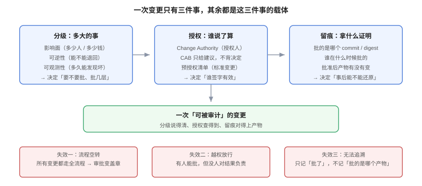

# 体系概述：分级、授权、留痕

**变更管理不是「一道门」，而是「一套决策记录」。** 它的目标不是让变更变少，而是让每一次变更都能回答三个问题：这件事有多大、谁有权决定、事后凭什么说得清。本页给出三个词的分野、三件事的边界、五种失效模式，以及一条「什么时候不该走流程」的判断线。



## 一、先把三个词分清

日常说的「变更」「发布」「部署」经常混用，混用的直接后果是**责任边界糊掉**——出事时没人说得清该查哪一环。

| 词 | 指什么 | 谁负责 | 失败时的表现 |
| --- | --- | --- | --- |
| **变更（Change）** | 对生产环境的**任何**修改：代码、配置、数据、权限、网络、证书 | 变更发起人 + 授权人 | 有人改了东西，但没人知道改过 |
| **发布（Release）** | 把一批变更**打包**成对用户可见的新版本 | 发布负责人 | 版本上了，但用户看不到（开关没开） |
| **部署（Deployment）** | 把制品**装到**某个环境里的动作 | 执行人 / 流水线 | 装完了，但跑不起来 |

三者的关系是：**一次发布包含若干变更，一次部署承载一次发布**。所以「回滚」也有三种：回滚部署（换回旧镜像）、回滚发布（关开关）、撤销变更（反向 DDL / 恢复配置）。三者的速度差一个数量级，事故里选错一种，就会把「五分钟恢复」拖成「五小时恢复」。

::: tip 一个实用判据
如果一个动作**不需要改代码、也不需要动数据**（比如调一个限流阈值、加一条网关路由），它仍然是一次变更——因为它的失败模式和发版完全一样。库里大量的线上事故属于这一类，而它们恰恰最容易被「顺手改一下」跳过流程。
:::

## 二、三件事：分级、授权、留痕

变更管理的所有机制，都是这三件事的载体。载体可以换（表单换成 PR、CAB 换成值班主管），三件事不能少。

### 2.1 分级：多大的事

分级的产出不是「标签」，而是**审查强度**：需要几个人看、要不要进窗口、要不要演练。分级的输入只有三个可量化的维度：

1. **影响面**：受影响租户 / 请求占比 / 金额。
2. **可逆性**：能不能在窗口内退回，退回要多久。
3. **可观测性**：坏了之后多久能发现。

三维打分与阈值见[变更分级](../Classification/index.md)。这里只强调一条：**分级必须能被机器算出来**。靠「我觉得这是个大事」的分级，在赶工期时会自动降级——而赶工期恰恰是最需要它不准降级的时候。

### 2.2 授权：谁说了算

ITIL 4 把决策权交给 **Change Authority**（授权人），CAB 只提供建议。这个区分看起来是术语问题，实际是责任问题：

- CAB 是**集体**，集体决定等于没人负责；
- 授权人是**个人**（或一个明确的值班角色），他签字就要对结果负责；
- 预授权（Standard Change）是把「已经评审过的决策」固化成清单，让重复的小事不必每次找人——**预授权的前提是清单被维护**，否则它会变成「什么都算标准变更」。

### 2.3 留痕：拿什么证明

留痕最常见的形式是「审批表 + 时间戳」，它证明的是「有人点过按钮」。它证明不了的是：**点按钮时看到的内容，和最终上线的产物，是不是同一份**。

正确的做法是把批准绑定到**产物摘要**上（commit + image digest + 迁移指纹），并用哈希链把多条审批串起来。实测与实现见[审批留痕](../ApprovalTrail/index.md)。

## 三、五个失效模式

这五种情况在流程图上都「有流程」，实际能力差别巨大。识别方法写在最后一列。

### 3.1 流程空转

所有变更都走完整流程：填单、评审、CAB、双签。结果是**审批人一天看四十个单子，每个看三十秒**。

- 看起来：控制很严。
- 实际上：真正危险的三个变更混在三十七个安全变更里，没人多看一眼。
- 识别：抽 20 个已批准的单，问审批人「这个变更的回滚方式是什么」——答不上来的比例就是空转率。

### 3.2 越权放行

有人能批准，但批准之后**没有任何人能拦住他**。

- 看起来：有审批链。
- 实际上：最后一个签字的人同时是发起人和执行人。
- 识别：查最近 30 天的变更，统计「发起人 = 唯一审批人」的比例；大于 0 就说明存在自批。

### 3.3 留痕不绑产物

单子上写着「发布 1.4.2」，实际上去的是 `1.4.2-hotfix3`。

- 看起来：记录完整。
- 实际上：出事时对不上账，只能靠人回忆。
- 识别：拿一个已关闭的变更单，用它记录的版本号去查当时的部署记录，看能不能对上 digest。

### 3.4 冻结期无人守

冻结期写在公告里，但没有任何机器判定。

- 看起来：大家都知道年底不发版。
- 实际上：某个团队「就改一个配置」，没人拦。
- 识别：`grep` 一下发布记录里落在冻结期内的条目——如果靠人查才发现，说明它没被自动化。

### 3.5 紧急通道常开

「紧急变更」从例外变成常态。

- 看起来：响应很快。
- 实际上：所有变更都紧急，等于所有变更都没有审查。
- 识别：统计紧急变更占比；超过 20% 说明问题不在响应速度，在计划能力。

::: danger 五种失效的共同根因
它们都不是「人不负责」，而是**流程设计把决策变成了动作**：填表是动作、点同意是动作、发公告是动作——而「这件事该不该现在做」这个决策，从来没有被明确指派给某个人。所以修流程的方向不是加签，而是**把决策点写出来并指派人**。
:::

## 四、什么时候不该走流程

变更管理也有反例。以下四类场景，上流程只会增加成本、不降低风险：

| 场景 | 为什么不该走 | 该做什么 |
| --- | --- | --- |
| **已经在事故里，且修复动作可逆** | 每多一层审批，故障时长就多一段 | 走[紧急变更](../EmergencyChange/index.md)，事后补单 |
| **完全隔离的预发 / 沙盒环境** | 影响面为零 | 只要求「可重建」，不要求审批 |
| **纯回退到已验证的上一版本** | 回退的目标状态是已知的、被验证过的 | 预授权，只需登记 |
| **读侧查询与报表** | 不改状态 | 不需要变更流程，需要的是数据权限 |

反过来，以下三类**看起来无害但必须走流程**：改限流阈值、加网关路由、改证书。它们的共同点是「即时全量生效、没有灰度、影响面在秒级扩散」。

## 五、一条可用的判断线

流程的价值可以用一个粗糙但有用的式子衡量（推演，用于比较而不是精算）：

```text
流程净收益 = 拦住的坏事 × 单次损失 − 所有人等待的时间成本
```

代入一组假设：团队每周 20 次变更，流程让每次多等 4 小时（10 人 × 0.4 小时），一年等待成本 ≈ 20 × 52 × 4 × 10 × 人均时薪。若一年只拦住 1 次 2 小时的故障，这笔账是亏的；若拦住 1 次 30 分钟的**全站**故障，账立刻反过来。

结论不是「流程不值得」，而是：**流程要拦的是「影响面大且不可逆」的那一小部分**。分级的意义就在于把审查强度压到这一小部分上，让其余 90% 的变更快速通过。

## 六、验证方式

以下四条都是只读操作，用来判断「你现在的变更管理缺的是哪一件」：

```shell
# ① 有没有「变更」这个概念：找变更单 / PR 模板 / 发布记录
ls .github/PULL_REQUEST_TEMPLATE* docs/change* 2>/dev/null
# 期望：至少存在一种载体。全都没有，说明变更没有「意图记录」

# ② 授权是不是「个人」：看审批人字段与角色定义
grep -rn "approver\|change_authority\|release_manager" --include="*.yml" --include="*.yaml" --include="*.md" . | head
# 期望：能定位到具体角色或人。只有 "team" / "CAB" 这类集体名，等于没有授权人

# ③ 留痕有没有绑定产物：查变更单里有没有 digest / commit 字段
grep -rn "digest\|commit_sha\|image_sha" docs/ 2>/dev/null | head
# 期望：变更记录里出现产物摘要。只有版本号（如 v1.4.2）不够——tag 可以被重建

# ④ 冻结期有没有机器判定：找日历 / 冻结规则的定义
grep -rn "freeze\|冻结" --include="*.yml" --include="*.yaml" --include="*.sql" . | head
# 期望：冻结期是一条可被查询的数据（表或配置），不是一句公告
```

四条里缺哪一条，就先去补那一条——**不要同时上四套机制**，那正是「流程空转」的起点。

## 七、判据族 `CHG`

| 判据 | 内容 | 怎么验证 |
| --- | --- | --- |
| `CHG-A` | 变更、发布、部署三个词必须在团队文档里有各自的定义，且不混用 | 文档里能 `grep` 到三段定义；同一段里出现「发布即部署」这类混用即不合格 |
| `CHG-B` | 每次生产修改都必须有一条「意图记录」（变更单 / PR 描述 / 发布记录之一） | 抽查最近 20 次生产修改，全部能定位到载体；有 1 次找不到即不合格 |
| `CHG-C` | 授权人必须是具体角色或个人，不得写成「团队」「CAB」这类集体名 | `grep` 审批配置，`approver` 字段的值是角色 ID 或人名 |
| `CHG-D` | 分级必须由规则算出，不得由发起人手填「高/中/低」 | 分级结果能从输入（影响面/可逆性/可观测性）复算出来 |
| `CHG-E` | 留痕必须绑定产物摘要，不得只记版本号或 tag | 变更记录里存在 `digest` / `commit` 字段，且能对上部署记录 |
| `CHG-F` | 冻结期必须是可查询的数据，不是公告文本 | 有一条 SQL / 配置能判定「某时间窗是否落在冻结期内」 |
| `CHG-G` | 紧急变更占比必须可统计，且有阈值 | 能算出一个百分比；无阈值则无法判断是否滥用 |
| `CHG-H` | 「不走流程」的四类场景必须书面列出，并写明替代控制 | 文档里有四类清单；只有「特殊情况特殊处理」即不合格 |

## 八、与相邻专题的分工

| 你想知道 | 去哪 |
| --- | --- |
| 一次发布怎么灰度、怎么回滚 | [发布与回滚](../../../Tools/CICD/DeployRollback/index.md) |
| 发布前的七道闸门 | [上线前置闸门](../../../../project/Complete/TeamBoard/PreLaunchGate/index.md) |
| 出了事故怎么定级与止损 | [故障应急体系](../../IncidentResponse/index.md) |
| 业务审批流怎么实现 | [审批流引擎](../../../Backend/WorkflowEngine/ApprovalFlow/index.md) |
| 开关与灰度度量 | [功能开关](../../../Tools/ObservabilityDriven/FeatureFlag/index.md) |

## 与「数据库变更与在线 Schema 演进」专题的分工

| 关注点 | 本页负责 | 由专题负责 |
| --- | --- | --- |
| 变更怎么分级、怎么审批 | 变更单、灰度、冻结期 | 不管 |
| 表结构变更怎么排批次 | 只写「需 DBA 评审」 | 扩展-收缩的三段式与退出条件 |
| 回滚怎么写才不是空话 | 代码回滚 | 不可回滚操作清单与备份 RTO |

完整方法见 [数据库变更与在线 Schema 演进](../../../DB/SchemaEvolution/index.md)。

::: warning 本页特有的坑
变更单里「回滚：执行 rollback.sql」这句话多数没被验证过：`DROP COLUMN` 的反向操作**不是** `ADD COLUMN`——加回来的是空列，数据只在备份里。判据是「回滚脚本在影子库跑通过一次，并记录耗时与数据丢失范围」，跑不通就直接写「恢复备份，RTO = X 分钟」。
:::

## 与「配置管理与动态配置」专题的分工（第 188 天补充）

配置变更在这套分级体系里经常被**低估**：它不涉及代码、不需要构建、控制台上点一下就生效，于是被评为"低风险"。而实际情况是——**配置是变更频率最高、影响面最广、回滚最容易被忽略的一类变更**：代码回滚有流水线，配置回滚常常靠"记得旧值"。

处置建议（不改本页的分级方法，只补一条判定）：

| 配置变更的特征 | 建议级别 | 理由 |
| --- | --- | --- |
| 改业务阈值、开关、文案 | 低 | 影响面可枚举，回滚成本≈0 |
| 改超时、重试、池大小、线程数 | **中** | 会改变容量与失败模式，可能引发级联 |
| 改数据源、序列化、路由规则 | **高** | 影响所有实例且多半需要重启 |
| 改生产命名空间的任意值 | 至少中 | 生产配置没有"低风险"这一档 |

配套的两条要求写在配置专题里：**回滚点必须在发布前记录**（判据 `CFP-C`：发布参数里带 `rollback_nid`）、**每次变更必须能对应到一个版本号**（判据 `CFA-B`）。这两个字段正好是"审批留痕"在配置这个场景下的落地形态——批的是"这一版"，不是"这个文件"。

## 参考资料

- ITIL 4：*Change Enablement* 实践指南（三型变更、Change Authority、CAB 的建议角色）
- DORA：[*State of AI-assisted Software Development 2025*](https://dora.dev/research/2025/dora-report/)
- Google SRE Book：[*Release Engineering*](https://sre.google/sre-book/release-engineering/)（发布即变更、变更即风险）
- 本站：[变更分级](../Classification/index.md)、[审批留痕](../ApprovalTrail/index.md)、[紧急变更](../EmergencyChange/index.md)
