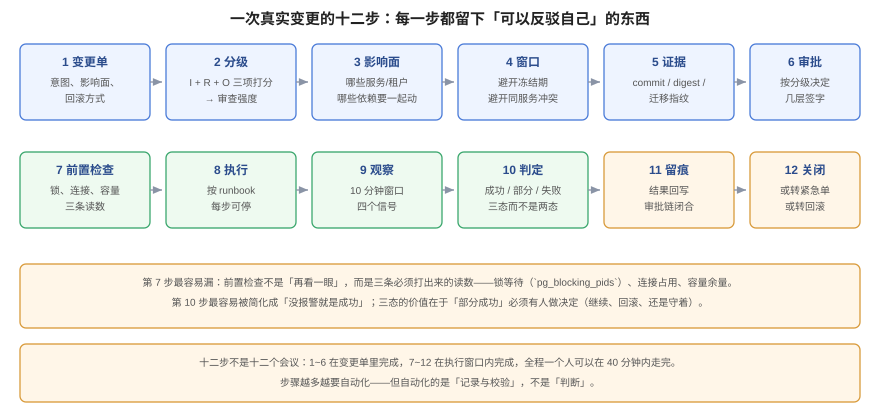

# 实战：一次加列 + 回填 + 切读

**这是本专题唯一一页「从头到尾走一遍」的内容。** 变更是协作看板 TeamBoard 的一个真实需求：给 `cards` 表加一列规范化描述 `description_norm`，用它替代运行时对 `description` 做 `lower(regexp_replace(...))` 的函数索引——因为那个表达式索引在每次查询时都要重算，且无法被全文检索的权重排序复用。

本页只讲**变更流程**怎么走：变更单、分级、窗口、证据、审批、执行、判定、留痕。回填本身的工程细节（批次大小、断点续跑、并发影响）在[项目章节 · 分批回填](../../../../project/Complete/TeamBoard/BatchBackfill/index.md)。



## 一、变更单：先写「不做什么」

```markdown
## CHG-2041 卡片描述规范化列

### 要做
1. `cards` 加列 `description_norm text`（可空，无默认值）
2. 分批回填 50 万行（keyset 游标 + 进度表）
3. 读路径从「函数索引」切到 `description_norm`

### 不做（本单范围外）
- 不改 `description` 的写入逻辑（双写留给下一个变更）
- 不删旧函数索引（等新列稳定 7 天后再删）
- 不动全文检索的权重列（那是 CHG-2039 的范围）

### 失败会怎样
- 回填中断：进度表记录游标，可续跑；已回填行不受影响
- 切读后结果不一致：`degraded=true` 时回落到旧表达式
- 最坏情况：加列可 `DROP COLUMN` 回退（但已回填数据丢失，需重跑）

### 影响面
- `cards` 当前 50 万行 / 2,000 个看板 / 全部租户
- 加列本身不重写表（PG 18 常量默认值语义，本单无默认值更轻）
- 回填期间写路径 P99 目标：不超过基线 ×1.20
```

写「不做什么」比写「做什么」更重要：它把变更的范围锁死，避免执行中途「顺手」扩建。

## 二、分级：用规则算，不用感觉

```sql
SELECT * FROM chg.score('multi','manual','alert',
  'ALTER TABLE cards ADD COLUMN description_norm text; UPDATE cards SET description_norm = ...');
```

真实输出：

| impact | rev | obs | raw | floor | final | klass |
| --- | --- | --- | --- | --- | --- | --- |
| 28 | 20 | 10 | 58 | **70** | **70** | **high** |

两个细节：

1. **raw 是 58（常规），floor 把它抬到 70（高危）**——因为变更文本里同时出现了 `ALTER TABLE` 与全表 `UPDATE`。如果没有 floor，这次变更会以「常规」通过。
2. **`rev=20`（需手工回滚）**：加列可以 `DROP COLUMN` 回退，但回填的数据会丢，所以不是「一键回滚」。

抬到高危意味着三件事：双人复核、指定窗口、30 天内的演练记录。

## 三、窗口：查空档，不靠问人

```sql
SELECT slot FROM (
  SELECT tstzrange(ts, ts + interval '2 hour') AS slot
  FROM generate_series(timestamptz '2026-10-24 08:00+08',
                       timestamptz '2026-10-24 20:00+08', interval '2 hour') ts
) s
WHERE NOT EXISTS (
  SELECT 1 FROM chg.change_request c
  WHERE c.service='board-api' AND c.status IN ('approved','scheduled')
    AND c.planned_window && s.slot
);
```

结果取 `20:00-22:00`：流量低、值班在岗、且不与 CHG-2039（同服务的检索权重变更）冲突。窗口长度 2 小时，按「部署 8 分钟 + 回填 40 分钟 + 观察 30 分钟 + 回滚 10 分钟」定，留 30 分钟余量。

## 四、证据：把四态钉成一个摘要

```shell
printf '9f2c1ab|sha256:379f51bf8c1e|V23:4f9a1c2d|CHG-2041' | shasum -a 256
# c3ee87dc500e2f782817fe55eca085264678d814c5a79fab51a573ad526ec84b
```

四段分别是：commit、image digest、迁移指纹（`V23` + 文件内容哈希）、变更单号。任何一段变化，摘要都会变——这就是「批准的是这一份」的技术含义。

迁移文件本身的指纹可以单独算，便于在 CI 里比对：

```shell
printf 'ALTER TABLE cards ADD COLUMN description_norm text;\n' | shasum -a 256
# ba802aeb1613ab67a63cca9859fb0e9ea5cb07ce33d000d0d715bf9830717b8f
```

## 五、审批：三条记录，一条链

| seq | 角色 | 决定 | 关注点 |
| --- | --- | --- | --- |
| 1 | 技术复核（li） | approve | 加列是否重写表、回填是否可续跑 |
| 2 | 业务确认（wang） | approve | 回填期间写延迟对拖动的影响 |
| 3 | 发布批准（zhao） | approve | 窗口、回滚、观测三件事是否齐 |

三条记录串成链后，`verify_chain('CHG-2041')` 返回全 `OK`；如果第 2 条被改成 `reject`，校验报 `TAMPERED_FIELDS`；如果第 2 条被删，第 3 条报 `BROKEN_LINK`（实测见[审批留痕](../ApprovalTrail/index.md)）。

## 六、前置检查：三条必须打出来的读数

执行前不是「再看一眼」，而是三条读数：

```sql
-- ① 有没有人在等锁（迁移会排在它们后面）
SELECT pid, state, wait_event_type, left(query, 40)
FROM pg_stat_activity
WHERE datname = current_database() AND state <> 'idle'
ORDER BY query_start LIMIT 5;

-- ② 连接占用（回填要用一条连接，别把池占满）
SELECT count(*) AS used, current_setting('max_connections')::int AS max_conn
FROM pg_stat_activity WHERE datname = current_database();

-- ③ 回填批次会不会超过锁等待预算
SHOW lock_timeout;
```

三条都正常才执行。第 169 天的实测给了两个数字作参照：`lock_timeout=200ms` 时迁移会 0.238 s 自杀，而不设上限时会 1.42 s 排队——**排队中的 `ALTER` 会把一条纯读也堵 1.19 s**。

## 七、执行：三段，每段可停

| 段 | 动作 | 可停吗 | 停下来会怎样 |
| --- | --- | --- | --- |
| **A 加列** | `ALTER TABLE cards ADD COLUMN description_norm text;` | 不需要（毫秒级） | 自动回滚 |
| **B 回填** | 每批 5,000 行 + 游标更新，同一语句提交 | **可以** | 最多丢当前批，游标不变 |
| **C 切读** | 改开关 `card.norm.read=true` | 可以（关开关） | 立即回到旧表达式 |

B 段的三个关键数字（本机实测，详见[分批回填](../../../../project/Complete/TeamBoard/BatchBackfill/index.md)）：

| 方案 | 总耗时 | 单批最长 | 总 WAL |
| --- | --- | --- | --- |
| 单事务全表 | 6,826.8 ms | 6,826.8 ms | 184.1 MB |
| 5,000 行 × 101 批 | 24,965.9 ms | 551.6 ms | 240.3 MB |
| 50,000 行 × 11 批 | 11,161.7 ms | 1,335.8 ms | 241.0 MB |

读法：**分批不是为了更快，而是为了把「单次持锁时长」从 6.8 秒压到 0.55 秒**。代价是总耗时变长、WAL 多 30%。

## 八、观察与判定：三态，不是两态

观察窗口 30 分钟，看四个信号：

| 信号 | 正常 | 异常 | 处置 |
| --- | --- | --- | --- |
| 写路径 P99 | ≤ 基线 ×1.20 | > ×1.50 持续 5 分钟 | 关开关 + 停回填 |
| 错误率 | 与基线持平 | 出现 `42703`（列不存在） | 说明切读早于加列，立即回退 |
| 回填进度 | 单调递增 | 长时间不动 | 查锁等待与连接 |
| 结果一致性 | 新旧表达式结果集相同 | 出现差异行 | 停切读，保留旧路径 |

判定必须写成三态：

- **成功**：四个信号全正常，回填 100% 完成；
- **部分成功**：回填完成但切读回退（例如一致性校验有 3 行差异）；
- **失败**：切读后错误率上升，已回退。

「部分成功」不是含糊其辞，而是一个**需要人接手的状态**：谁接手、什么时限、怎么收尾，都要写进变更单。

## 九、留痕与关闭

关闭时回写四样：

```text
result            = partial
deployed_digest   = sha256:379f51bf8c1e
backfill_done     = 500000 / 500000
read_switch       = reverted (3 rows mismatch, ticket BUG-8821)
approval_chain    = OK (3 nodes)
```

`result=partial` 与 `approval_chain=OK` 同时存在，这是完全正常的：**审批链证明「流程走了」，结果证明「事情做成了几分」**。把两者混成一个「成功/失败」，就会出现「流程走完即成功」的自欺。

## 十、`S1~S10` 验收序列

顺序不能换——每一步的通过是下一步的前提：

| 步 | 验什么 | 命令要点 | 通过判据 |
| --- | --- | --- | --- |
| S1 | 变更单存在且四段齐全 | 查变更系统 / 文件 | 做什么、不做什么、失败会怎样、影响面 |
| S2 | 分级可复算 | `SELECT * FROM chg.score(...)` | final 与单上一致 |
| S3 | 窗口不与已批准变更冲突 | 空闲槽查询 | 返回该窗口 |
| S4 | 证据摘要可复算 | `shasum -a 256` | 与单上 `artifact_hash` 一致 |
| S5 | 审批链完好 | `verify_chain()` | 全部 `OK` |
| S6 | 前置检查三条读数 | `pg_stat_activity` / `SHOW` | 无长事务、连接有余量、`lock_timeout` 已设 |
| S7 | 加列不重写表 | `pg_relation_size` 前后对比 | 大小不变 |
| S8 | 回填可续跑 | 中断后 `SELECT count(*) WHERE norm IS NULL` | 与游标一致，重跑同批返回 0 |
| S9 | 切读可回退 | 关开关 + 再查一次 | 结果与旧路径一致 |
| S10 | 留痕闭合 | 查 `result` 与 `approval_chain` | 两者都有值，且不一致时能解释 |

## 十一、本页刻意不做的四件事

1. **不讲回填的批次算法**（游标、空批次、部分索引的实测）——归[分批回填](../../../../project/Complete/TeamBoard/BatchBackfill/index.md)。
2. **不讲迁移的锁级别推导**——归[迁移前置闸门](../../../../project/Complete/TeamBoard/MigrationPreflight/index.md)。
3. **不讲回滚矩阵的四种场景**——归[回滚矩阵](../../../../project/Complete/TeamBoard/RollbackMatrix/index.md)。
4. **不讲检索权重列怎么改**——那是 CHG-2039，属于另一个变更单。**一个变更单只做一件事**，这是范围纪律。

## 十二、判据族 `CHP`

| 判据 | 内容 | 怎么验证 |
| --- | --- | --- |
| `CHP-A` | 变更单必须含「不做什么」与「失败会怎样」两节 | 文档里两节都存在且非空 |
| `CHP-B` | 分级结果必须由规则算出，且与变更单记录一致 | 用 `score()` 复算，final 与单上相同 |
| `CHP-C` | 窗口必须来自空闲槽查询，不得与已批准变更重叠 | 空闲槽 SQL 返回该窗口 |
| `CHP-D` | 证据摘要必须可按公式复算 | 四段拼接后 `sha256` 与单上一致 |
| `CHP-E` | 审批链必须校验通过，且节点数 ≥ 分级要求 | `verify_chain()` 全 OK，节点数符合高危 ≥ 2 |
| `CHP-F` | 执行必须分三段且每段可停（加列 / 回填 / 切读） | runbook 里三段分明，回填带游标 |
| `CHP-G` | 观察必须给出四个信号的基线与阈值 | 变更单里四个信号都有「正常/异常/处置」 |
| `CHP-H` | 关闭必须同时记录 `result` 与 `approval_chain`，不得合并成一个状态 | 两个字段都在，且允许「链 OK + 结果 partial」 |

## 十三、与相邻专题的分工

| 你想知道 | 去哪 |
| --- | --- |
| 回填的批次、断点、并发影响 | [分批回填](../../../../project/Complete/TeamBoard/BatchBackfill/index.md) |
| 迁移的锁与前置动作 | [迁移前置闸门](../../../../project/Complete/TeamBoard/MigrationPreflight/index.md) |
| 回滚的四种场景 | [回滚矩阵](../../../../project/Complete/TeamBoard/RollbackMatrix/index.md) |
| 发布前七道闸门 | [上线前置闸门](../../../../project/Complete/TeamBoard/PreLaunchGate/index.md) |
| 分级规则与阈值 | [变更分级](../Classification/index.md) |

## 参考资料

- PostgreSQL 18 文档：[`ALTER TABLE`](https://www.postgresql.org/docs/current/sql-altertable.html)、[`CREATE INDEX`](https://www.postgresql.org/docs/current/sql-createindex.html)
- 本项目：[分批回填](../../../../project/Complete/TeamBoard/BatchBackfill/index.md)、[迁移前置闸门](../../../../project/Complete/TeamBoard/MigrationPreflight/index.md)
- 本站：[变更分级](../Classification/index.md)、[审批留痕](../ApprovalTrail/index.md)、[窗口与冻结期](../ChangeWindow/index.md)
