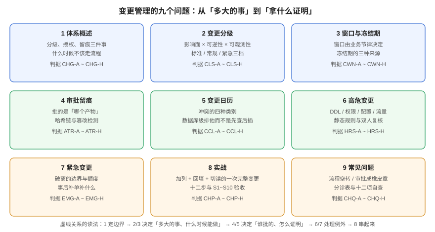

# 变更管理与发布工程

「变更管理」这四个字在多数团队里指向一张没人爱填的表单。但真正的问题从来不是表单——而是**当一个人说「今晚发」的时候，团队凭什么相信这件事不会变成事故，以及万一变成了事故，能不能在十分钟内说清「谁批的、批的是哪一个产物、现在退到哪一步」**。

本专题把变更管理还原成三件事：**分级**（多大的事、要几层审查）、**授权**（谁签字有效）、**留痕**（拿什么证明批的和上的是同一份）。其余的一切——变更单、CAB、冻结期、审批流、变更日历——都只是这三件事的载体；载体可以换，三件事缺一件，流程就会退化成盖章。

面向需要为「发得出去、也退得回来」负责的 SRE、后端与研发管理者。读完你应当能回答：**我们现在的变更流程，到底拦住了什么？**

::: tip 一句话理解
**变更管理的产出不是「审批通过」，而是「一条能在事故中救命的证据链」。** 事故里没人关心流程走过几步，只关心三件事：谁批的、批的是哪个版本、回滚点在哪。
:::

## 本专题的九页

| 页面 | 回答的问题 | 判据族 |
| --- | --- | --- |
| [体系概述：分级、授权、留痕](Overview/index.md) | 变更管理到底在管什么，什么时候**不该**走流程 | `CHG-A` ~ `CHG-H` |
| [变更分级：把「多大的事」算出来](Classification/index.md) | 三维打分怎么定、阈值凭什么、分级错了会怎样 | `CLS-A` ~ `CLS-H` |
| [窗口与冻结期：什么时候能做](ChangeWindow/index.md) | 窗口由什么决定、冻结期有几种、例外怎么走 | `CWN-A` ~ `CWN-H` |
| [审批留痕：批的是哪一个产物](ApprovalTrail/index.md) | 证据怎么绑定、哈希链怎么防篡改、审计怎么查 | `ATR-A` ~ `ATR-H` |
| [变更日历：冲突要在入库时挡住](ChangeCalendar/index.md) | 四类冲突怎么建模、为什么「先查后插」不够 | `CCL-A` ~ `CCL-H` |
| [高危变更：能写进规则的形状](HighRiskChange/index.md) | 哪四类必须抬级、静态规则怎么写、双人复核复核什么 | `HRS-A` ~ `HRS-H` |
| [紧急变更：破窗的边界与额度](EmergencyChange/index.md) | 什么才算紧急、破窗后补什么、滥用怎么识别 | `EMG-A` ~ `EMG-H` |
| [实战：一次加列 + 回填 + 切读](Practice/index.md) | 十二步怎么落地、`S1~S10` 怎么验、读数在哪 | `CHP-A` ~ `CHP-H` |
| [常见问题与最佳实践](FAQ/index.md) | 九类现象怎么分诊、十二问、上线自查 | `CHQ-A` ~ `CHQ-H` |

## 本专题与相邻专题的分工

「发布」「回滚」「灰度」「审批」这几个词在库里被反复使用，边界必须写死，否则读者会在五个专题之间反复横跳：

| 你想要的 | 去哪里 |
| --- | --- |
| **一次发布怎么灰度、怎么回滚、回滚怎么判定成功** | [发布与回滚](../../Tools/CICD/DeployRollback/index.md)（动作与策略层） |
| **流水线怎么编排、制品怎么晋级、环境怎么推进** | [流水线设计](../../Tools/CICD/PipelineDesign/index.md) |
| **这次发布前的七道闸门**（镜像、环境、迁移、退出、冒烟、回滚、容量） | 本项目[上线前置闸门](../../../project/Complete/TeamBoard/PreLaunchGate/index.md) |
| **出了事故怎么定级、怎么指挥、怎么止损** | [故障应急体系](../IncidentResponse/index.md) |
| **业务审批流引擎**（请假、报销、合同会签）怎么实现 | [审批流引擎](../../Backend/WorkflowEngine/ApprovalFlow/index.md) |
| **流量怎么切、切多久、怎么回切** | [流量切换](../MultiActive/TrafficSwitch/index.md) |
| **开关怎么设计、灰度怎么度量、什么时候自动回滚** | [功能开关](../../Tools/ObservabilityDriven/FeatureFlag/index.md) |
| **告警规则怎么写、静默怎么设** | [告警设计](../Monitoring/Alerting/index.md) |
| **交付文档与上线验收清单** | [一键部署与上线验收](../../Others/ProjectDelivery/Delivery/index.md) |
| **操作审计日志怎么采、怎么查** | [审计与检测](../SecurityHardening/AuditDetection/index.md) |

::: warning 一句话划界
发布工程回答「**怎么把东西安全地换上去**」，本专题回答「**这件事该不该现在做、谁批准的、事后凭什么说得清**」。前者是操作手册，后者是决策与证据——两者都不做，就会出现「发得很快，但没人知道是谁决定的」。
:::

## 判据纪律

本专题九页各有一族判据，共 **72 条**（9 族 × 8 条），前缀逐页唯一，全库不与他处撞号：

| 页面 | 判据族 | 数量 | 判据回答的三个问题 |
| --- | --- | --- | --- |
| 体系概述 | `CHG` | 8 | 约定是什么 / 定错的后果 / 怎么验证没被破坏 |
| 变更分级 | `CLS` | 8 | 同上 |
| 窗口与冻结期 | `CWN` | 8 | 同上 |
| 审批留痕 | `ATR` | 8 | 同上 |
| 变更日历 | `CCL` | 8 | 同上 |
| 高危变更 | `HRS` | 8 | 同上 |
| 紧急变更 | `EMG` | 8 | 同上 |
| 实战 | `CHP` | 8 | 同上 |
| 常见问题 | `CHQ` | 8 | 同上 |

每条判据的「怎么验证」都必须是一条**能跑的命令或一次能观察到的现象**，不接受「检查流程是否规范」这类形容词。

## 本专题的实测口径

文中数字分两类，**严格区分**：

1. **本机实跑**：2026-10-19 在本机 PostgreSQL **18.6**（容器 `teamboard-sandbox-db-1`，`select version()` = `18.6-1.pgdg13+2`）上执行，库为 `chg` 与 `bf` 两个沙盒 schema，命令都写在页面里。这类数字可复现。
2. **推演**：审批耗时、成本、额度这类算例，明确标注「推演」并给出算式。

::: danger 不要把两类数字混着读
区分方法很简单：**实测一定带命令与输出，推演一定带公式与假设**。看到没有命令的数字，就当它是推演——本仓历史上出现过把推演写成实测的情况，那是比数字错更严重的问题。
:::

## 会过期的事实（2026-10 核对）

| 事实 | 当前口径 | 为什么重要 |
| --- | --- | --- |
| ITIL 4 把「变更管理」改名为 **Change Enablement**（变更使能） | 仍是 Standard / Normal / Emergency 三型 | 名字变了，但「按风险配置控制强度」的内核没变 |
| ITIL 4 的 **CAB 是建议机构**，不是决策机构 | 决策权在 Change Authority | 把 CAB 当审批会，「谁负责」永远没有答案 |
| DORA 2025 报告：CFR 在 **0~2%** 的团队占 **8.5%**，2~4% 占 **8.1%**（累计 16.7%） | 4~8% 占 19.6%，8~16% 占 26% | 不要把「行业平均」当目标，先看自己的趋势 |
| DORA 2025 报告：失败部署恢复 **1 小时内**占 21.3%，1 天内累计 56.5% | 恢复时间是变更设计的直接结果 | 「能不能退」比「会不会错」更可控 |
| Uptime Institute 2025 分析：人为重大中断中 **85%** 源于未按流程执行或流程本身有缺陷 | 两类问题要分开治 | 只加强审批治不了「没走流程」的那一半 |
| PostgreSQL 18 的 **`tstzrange` + `EXCLUDE USING gist`** 可直接表达「同服务窗口不重叠」 | 需要 `btree_gist` 扩展才能对 `text` 建 GiST 等值 | 日历的互斥可以交给数据库，不必写在应用里 |

## 学习路径

1. 先读[体系概述](Overview/index.md)，用「五问」判断你的团队现在缺的是分级、授权还是留痕——**多数团队缺的是留痕**。
2. 接着读[变更分级](Classification/index.md)与[窗口与冻结期](ChangeWindow/index.md)，这两页决定「同样的事，不同的人做会不会走同一条路」。
3. 再读[审批留痕](ApprovalTrail/index.md)与[变更日历](ChangeCalendar/index.md)，这两页是「事故里能不能说清」的分水岭。
4. 最后读[高危变更](HighRiskChange/index.md)、[紧急变更](EmergencyChange/index.md)，把例外通道的边界写死。
5. 动手前把[实战](Practice/index.md)的 `S1~S10` 抄成自己的验收序列，遇到现象查[常见问题](FAQ/index.md)的分诊表。

## 参考资料

- ITIL 4 官方实践指南：*Change Enablement*（三型变更、Change Authority、CAB 的建议角色）
- DORA：[*State of AI-assisted Software Development 2025*](https://dora.dev/research/2025/dora-report/)（CFR 与失败部署恢复时间的分布，Figure 13 / 14）
- Google SRE Workbook：[*Canarying Releases*](https://sre.google/workbook/canarying-releases/) 与 [*Postmortem Culture*](https://sre.google/sre-book/postmortem-culture/)（变更风险与「不留责」的记录原则）
- PostgreSQL 18 文档：[Range Types](https://www.postgresql.org/docs/current/rangetypes.html)、[Exclusion Constraints](https://www.postgresql.org/docs/current/sql-createtable.html#SQL-CREATETABLE-EXCLUDE)、[`btree_gist`](https://www.postgresql.org/docs/current/btree-gist.html)
- 本站相邻专题：[发布与回滚](../../Tools/CICD/DeployRollback/index.md)、[故障应急体系](../IncidentResponse/index.md)、[功能开关](../../Tools/ObservabilityDriven/FeatureFlag/index.md)
