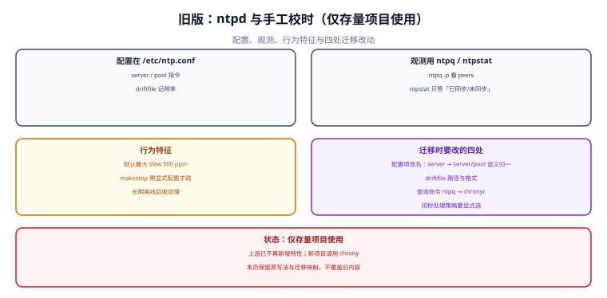

# 旧版守护进程 ntpd（仅存量项目使用）

::: danger 版本状态：仅存量项目使用 · 已停止新增
本页覆盖的是经典 NTP 守护进程 `ntpd`（RFC 5905 实现，`/etc/ntp.conf`）的写法、读数与行为特征。上游已不再为它新增特性，存量机器仍大量在跑，所以内容原样保留、不删除、不与新版合并。**需要新增能力时一律写进[当前主线 chrony](../ModernChrony/index.md)；本页只用于维护存量与做迁移映射。**
:::



## 一、配置结构：`/etc/ntp.conf`

经典配置只有五类指令，但每类的语义与后来的实现不完全一样：

```text
# /etc/ntp.conf（经典写法）
driftfile /var/lib/ntp/drift

# 上游：pool 是「域名展开成多个地址」，server 是「就用这一个地址」
pool 0.pool.ntp.org iburst
pool 1.pool.ntp.org iburst
pool 2.pool.ntp.org iburst
pool 3.pool.ntp.org iburst

# 访问控制：默认拒绝一切，再逐条放行（顺序敏感）
restrict default kod nomodify notrap nopeer noquery
restrict 127.0.0.1
restrict ::1

# 频率与步进的调参（旧版唯一的「tinker」入口）
tinker panic 0
```

| 指令 | 作用 | 与 chrony 的对应 | 迁移时要改什么 |
| --- | --- | --- | --- |
| `driftfile` | 持久化频率估计 | `driftfile` | 路径与属主（chrony 常用 `/var/lib/chrony/drift`） |
| `server` | 固定上游地址 | `server` | 语义一致，可选加 `nts` |
| `pool` | 域名展开为多个上游 | `pool` | chrony 亦支持，且 `iburst` 语义相同 |
| `restrict` | 访问控制（含 `noquery`） | `allow` / `deny` | 写法完全不同，必须重写 |
| `tinker` | 频率/步进/panic 阈值 | `makestep` / `maxslewrate` / `maxdistance` | 逐项映射，见第三节 |

::: info 术语首次出现
`restrict` 的默认策略是「全部允许，再逐条收紧」，所以安全写法必须是**先写一条 `restrict default ...`** 再放行本机。反过来（先放行再收紧）在旧版里是常见错误——后面的规则不会覆盖前面的允许。
:::

## 二、观测：`ntpq` 与 `ntpstat`

| 命令 | 读什么 | 与 `chronyc` 的对应 |
| --- | --- | --- |
| `ntpq -p` | 每个源的 `remote` / `st` / `when` / `poll` / `reach` / `delay` / `offset` / `jitter` | `chronyc sources -v` + `sourcestats` |
| `ntpq -c rv` | 本机 `stratum` / `offset` / `frequency` / `sys_jitter` 等 | `chronyc tracking` |
| `ntpstat` | 只回答「已同步 / 未同步」与粗略精度 | 无直接对应（信息量更低） |
| `ntpdc` | 旧的查询工具 | **已废弃**，不要在新脚本里用 |

::: danger `ntpstat` 最容易被误用
它只输出「synchronised to NTP server ... at stratum X」和一句「time correct to within Y ms」。这句 `within` 是**粗略估计**，不是误差界，也不是 SLA 依据。历史上「`ntpstat` 说 correct to within 3 ms，但对账差了 30 ms」的来路就是把它当误差界用了。
:::

## 三、行为特征：三个与新版的真实差异

| 特征 | 旧版 `ntpd` | 新版 `chrony` | 工程后果 |
| --- | --- | --- | --- |
| 最大 slew 速率 | 约 **500 ppm**（硬编码量级） | `maxslewrate` 默认 **83333.333 ppm** | 120 ms 偏差：旧版磨 **240 s**，新版磨 **1.44 s** |
| 启动大偏差的处理 | 需要 `-g` 才允许首次大跳 | `makestep 1.0 3` 显式表达 | 旧版不给 `-g` 时可能一直磨不完 |
| 认证 | 对称密钥（`keys` / `trustedkey`），弱 | NTS（TLS 1.3 + 认证扩展字段） | 旧版没有可用的现代认证方案 |

第一条差异最具体：**同一个 120 ms 偏差，旧版要磨 4 分钟，期间「一秒」长 0.05%**。这在按秒计费或高频采集的场景里会被看见。

::: warning 旧版的一个常见陷阱
`tinker panic 0` 表示「即使偏差超过 1000 s 也不退出」。它的本意是让长时间离线的机器能恢复，但副作用是：**一台 RTC 严重错误的机器会安静地磨上几小时**，期间所有时间读数都是错的。判据是：允许 `panic 0` 的机器必须在监控里有 `System time` 的告警。
:::

## 四、迁移映射表：从 `ntp.conf` 到 `chrony.conf`

| 旧写法 | 新写法 | 语义差异 |
| --- | --- | --- |
| `server a.b.c iburst` | `server a.b.c iburst` | 无 |
| `pool p.ntp.org iburst` | `pool p.ntp.org iburst` | 无 |
| `driftfile /var/lib/ntp/drift` | `driftfile /var/lib/chrony/drift` | 路径与权限 |
| `restrict default kod nomodify notrap nopeer noquery` | `allow 10.0.0.0/8`（按需） | 默认策略方向相反：chrony 默认拒绝客户端查询 |
| `tinker step 0.128` | `makestep 0.128 3` | 旧版是「偏差超过阈值就跳」，新版多了「仅前 N 次」 |
| （无对应项） | `maxslewrate 83333.333` | 旧版硬编码 500 ppm |
| `keys` + `trustedkey`（对称密钥） | `server ... nts` + `ntsdumpdir` | 认证机制换代 |
| `ntpq -p` | `chronyc sources -v` | 状态符含义不同，脚本要改 |
| `ntpstat` | `chronyc tracking` | 新版给出更多读数 |

::: danger 迁移时最容易漏的两处
1. **`restrict` 的方向反了。** 旧版默认允许、逐条收紧；chrony 的 `allow` 是白名单。直接把 `restrict` 行翻译成 `allow` 会把「默认允许」变成「默认拒绝」，导致下游客户端全部查不到。
2. **`drift` 文件不兼容。** 两代的文件格式不同，直接拷过去会被忽略（有的版本会告警）。正确做法是让新服务自己学一遍，或从旧读数里手工抄频率值。

两处都不是「会报错」的问题：第一处表现为「客户端查不到时间但服务是 active」，第二处表现为「重启后精度变差」。
:::

## 五、什么情况下还得留着它

| 情况 | 理由 | 处置 |
| --- | --- | --- |
| 老旧发行版（RHEL/CentOS 6 时代） | 官方仓库没有 chrony | 保留，按本页维护；升级系统时一并换 |
| 依赖 `ntpd` 的 refclock 硬件 | 某些 GPS 接收机驱动只对接 `ntpd` | 保留，但把授时对象集中到少数机器 |
| 有第三方脚本解析 `ntpq` 输出 | 换实现会破坏解析 | 先改脚本，再换实现 |
| 合规要求「不得变更时间服务」 | 变更需要审批 | 走变更流程，不在维护窗口外动 |

## 本页判据

本页判据族 `CKN-A` ~ `CKN-H`，共 8 条。

| 判据 | 约定 | 定错了会怎样 | 怎么验证 |
| --- | --- | --- | --- |
| `CKN-A` | 本页只描述旧写法与迁移映射，不在此新增能力 | 新旧写法混在一起，读者照抄出错 | 新增内容是否都在新版页 |
| `CKN-B` | `restrict` 必须「先 default 再逐条放行」 | 顺序反了等于全放开 | 配置文件前两行顺序可核对 |
| `CKN-C` | 不把 `ntpstat` 的 `within` 当误差界 | 用 3 ms 的估计承诺 3 ms 的 SLA | 精度结论不引用 `ntpstat` |
| `CKN-D` | 迁移时必须重写 `restrict`（方向相反） | 客户端全部查不到时间 | 迁移后从客户端实测查询 |
| `CKN-E` | `drift` 文件不跨代拷贝 | 精度变差且无报错 | 新服务自行学习频率 |
| `CKN-F` | 允许 `tinker panic 0` 的机器必须有 `System time` 告警 | 大幅偏差安静地磨几小时 | 监控规则存在 |
| `CKN-G` | 解析 `ntpq` 输出的第三方脚本列入迁移清单 | 换实现后脚本静默失效 | 清单里有脚本条目 |
| `CKN-H` | 迁移后必须重跑一次「四步只读」定位 | 只验证服务 active 就收工 | 迁移记录里有读数 |

## 验证方式

```shell
# 1. 确认当前跑的是哪一代（存量机器）
systemctl is-active ntpd chronyd 2>/dev/null
ps -o cmd= -C ntpd,chronyd 2>/dev/null
# 期望：只有一个为 active；据此决定看哪一页

# 2. 读旧版状态
ntpq -p
# 期望：每个源一行，remote 前有 * 号者为当前同步源

# 3. 对照迁移前后的偏差读数（迁移前先存一份）
ntpq -c rv | grep -E 'offset|frequency|stratum'
# 期望：记录 offset 与 frequency，迁移后用 chronyc tracking 对照

# 4. 检查本页判据族定义完整
grep -c 'CKN-[A-H]' docs/Ops/ClockSync/ClassicNtpd/index.md
# 期望：≥ 8
```

## 参考资料

- [ntpd 官方文档（4.2.8 系列）— ntp.conf 指令全集](https://www.ntp.org/documentation/4.2.8-series/ntpd/)
- [ntpq 官方文档 — 状态符与字段含义](https://www.ntp.org/documentation/4.2.8-series/ntpq/)
- [RFC 5905 — Network Time Protocol Version 4](https://www.rfc-editor.org/info/rfc5905)
- [chrony 官方文档 — 从 ntpd 迁移的对照说明](https://chrony-project.org/documentation.html)
- [本册：当前主线 chrony](../ModernChrony/index.md)
- [本册目录页](../index.md)
