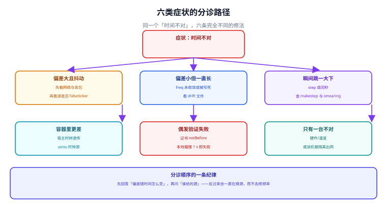

# 常见问题与症状分诊

「时间不对」这句话有六种完全不同的含义，对应六条互不相干的修法。这一页把它们拆开，每条给出判定路径、需要读的数与最常见的误判。**先分清是哪一种，再动手**——顺序错了，多数时间会花在换源上，而问题在频率。



## 一、分诊表：先回答「偏差随时间怎么变」

| 症状 | 判定读数 | 最可能的原因 | 第一动作 |
| --- | --- | --- | --- |
| 偏差大且抖动 | `Last offset` 与 `RMS offset` 同量级、`Residual freq` 大 | 网络丢包、源不稳 | 看 `Root delay` 与 `Reach` |
| 偏差小但一直长 | `Frequency` 稳定且非零 | 频率没被修正或被写死 | 查 `drift` 文件与 `Frequency` 是否被应用 |
| 瞬间跳一大下 | `System time` 阶跃、日志里 `Stepping` / `Slew` 提示 | `makestep` 全时段允许、或闰秒 | 查 `makestep` 与 `Leap status` |
| 容器里更差 | 同宿主其他容器同向偏移 | 宿主时钟或调度问题 | 比对宿主与客户机 `Frequency` |
| 偶发验证失败 | 证书 `not yet valid`、TOTP 全窗失效 | 本地偏慢 | 只查一件事：本地慢多少秒 |
| 只有一台不对 | 该机 `Frequency` 与其它机器差异大 | 硬件、温度、被隔离出网 | 查该机的源与硬件 |

## 二、逐条判定路径

### 症状一：偏差大且抖动

```shell
chronyc tracking | grep -E 'Last offset|RMS offset|Residual freq|Root delay'
chronyc sources -v | tail -n +3 | awk '{print $1, $2, $3, $6}'
```

判据是**「抖动」与「漂移」的区分**：`RMS offset` 与 `Last offset` 同量级，说明偏差在正负之间来回摆（抖动）；`RMS offset` 稳定增长，说明是单向积累（漂移，属症状二）。

抖动优先查网络：`Root delay` 是否比历史值大 2 倍以上、`Reach` 是否从 `377` 掉到 `357` 之类。**抖动时不要加大 `poll`**——周期变长只会让抖动被平滑掉，问题仍在。

### 症状二：偏差小但一直长

```shell
chronyc tracking | grep -E 'Frequency|Skew|Residual freq'
ls -l /var/lib/chrony/drift
```

关键判断：`Frequency` 是否被真正应用。三个反例：

| 反例 | 表现 | 判据 |
| --- | --- | --- |
| `drift` 文件每次启动都丢 | 重启后 `Frequency` 从 0 开始 | 容器没挂卷 |
| 有人手工 `adjtimex -f 0` 清零 | `Frequency` 恒为 0，偏差单向积累 | 与历史读数对比 |
| 宿主调度饥饿（虚拟化） | 同宿主多台同向偏移 | 同向性检查 |

### 症状三：瞬间跳一大下

```shell
journalctl -u chronyd --since '2 hours ago' | grep -iE 'step|slew|makestep'
grep -E '^\s*makestep' /etc/chrony.conf /etc/chrony/chrony.conf 2>/dev/null
```

判据：**先确认是不是闰秒**。若跳变发生在 6 月 30 日或 12 月 31 日的 23:59 前后，且 `Leap status` 非 `Normal`，那是标尺变化；否则查 `makestep` 配置。全时段允许跳（第二个参数为负）是最高频的自伤写法。

### 症状四：容器里更差

```shell
# 宿主与容器各跑一次，比较 Frequency
chronyc tracking | grep Frequency
```

判据是**同向性**：宿主与容器同向 → 问题在宿主；只有容器偏 → 容器内有别的时钟服务在抢（两个 daemon 各自修正，互相打架）。容器里正确的做法是**不修正，只读**。

### 症状五：偶发验证失败

```shell
date -u +%s.%N
openssl x509 -in /etc/ssl/cert.pem -noout -dates 2>/dev/null | head -2
```

判据只有一条：**本地偏慢 1 秒就会 `not yet valid`，偏快不会**。所以「新证书一上线就失败」几乎总是本地慢。反过来，「证书突然过期」要看是不是本地快了。

### 症状六：只有一台不对

```shell
chronyc sources -v                      # 该机的源
chronyc tracking | grep -E 'Frequency|Skew'
```

判据：若其它机器的源与它不同，先怀疑源；若源相同而只有它偏，怀疑**硬件钟或环境**（温度、RTC 电池、长期高温）。本机模型：温度每变化 20 ℃ 约 0.70 ppm，即每天 0.060 s——单看一天不明显，看一周就能看出来。

## 三、二十个高频问题

| 问题 | 一句话回答 |
| --- | --- |
| `chronyd` 是 active 就说明时间准吗 | 不。active 只说明进程活着 |
| `timedatectl` 显示 `synchronized: yes` 就够吗 | 不。它不告诉你误差界 |
| 为什么 `System time` 很小但 `RMS offset` 很大 | 瞬时值恰好过零，长期偏差仍在 |
| `Skew` 几十 ppm 正常吗 | 刚启动正常；持续如此说明样本跨度不足或源在抖 |
| 一定要 4 个源吗 | 要容忍 1 个坏源至少 3 个；要容忍 2 个至少 5 个 |
| 全用同一个云的 NTP 行不行 | 不行，共因失效下检出率 0% |
| stratum 1 一定更准吗 | 不。层级是跳数，不是精度 |
| `iburst` 能提高精度吗 | 不能，只缩短起步时间 |
| 可以定时 `ntpdate` 吗 | 不建议，它跳时钟且不给误差界 |
| 闰秒要处理吗 | 要，凡是用「天 × 86400」算跨度的地方都受影响 |
| smear 了就没事了吗 | 只在同一策略的内部成立，跨机构最多差 0.5 s |
| 为什么回拨会让任务跑两次 | 去重窗口前移，已处理事件重新变新 |
| 租约要留多少余量 | 至少 3 倍观测偏差，且必须有 Fencing |
| 时间戳能用来排序吗 | 只有 Δ/σ ≥ 3.3 时错误率才低于 1% |
| 容器里要装 chrony 吗 | 不要，只读宿主时钟 |
| 虚拟机时间慢是配置问题吗 | 先看同宿主其他机器是否同向 |
| 怎么证明时间是对的 | 两台机器、两个上游互比，用误差界判断 |
| PTP 一定比 NTP 准吗 | 只在整链都换（含透明时钟）时才成立 |
| 证书失败先查什么 | 先查本地是否偏慢，再查证书链 |
| 2035 年取消闰秒还要处理吗 | 要，存量系统寿命更长 |

## 四、排查工具箱

| 工具 | 用途 | 注意 |
| --- | --- | --- |
| `chronyc tracking` | 偏差、频率、误差界 | `Skew` 大时 `Frequency` 不可信 |
| `chronyc sources -v` | 源状态、`Reach`、每源 offset | 状态符逐个解释，不只看有没有 `^*` |
| `chronyc sourcestats` | 每源的频率/偏差统计 | 判断哪个源在抖 |
| `chronyc -N authdata` | NTS 是否生效 | 空输出 = 没走 NTS |
| `timedatectl` | 系统级概览 | 不提供误差界 |
| `journalctl -u chronyd` | step/slew 历史 | 定位「跳变」的唯一证据 |
| `adjtimex -p`（或 `-c`） | 内核态的 `offset` / `freq` / `status` | `-f` 改频率、`-o` 改偏差，别搞反 |
| `ntpq -p`（旧版） | 与 `chronyc sources` 对应 | 状态符含义不同，别混用 |

::: danger 三个「查了但没用」的动作
1. **只看 `date`。** 它只给一个瞬间值，不给误差界、不给频率。
2. **只重启服务。** 清空采样历史，把可归因的问题变成不可归因。
3. **在容器里装 chrony。** 两个 daemon 各自修正，读数互相打架，且容器重启后全部丢失。
- **正确做法**：先 `chronyc tracking` 取误差界，再看 `chronyc sources` 的候选状态，两步都在同一次会话里留下读数——只留结果不留过程，下次没人能复现。
:::

## 五、什么时候该升级到「改架构」

以下三种情况，调参解决不了，需要改架构：

| 情况 | 为什么调参没用 | 该做什么 |
| --- | --- | --- |
| 需要亚毫秒且跨机房 | 公网 `root delay` 就是毫秒级 | 局域网授时或 PTP 整链 |
| 需要严格全序 | 时间戳的判错率由 Δ/σ 决定，压不下去 | 逻辑时钟 / 单一写入方序号 |
| 多租户共享宿主 | 宿主调度不可控 | 独立宿主或专用授时 |

## 本页判据

本页判据族 `CKQ-A` ~ `CKQ-H`，共 8 条。

| 判据 | 约定 | 定错了会怎样 | 怎么验证 |
| --- | --- | --- | --- |
| `CKQ-A` | 分诊第一问是「偏差随时间怎么变」，不是「用哪个源」 | 一直在换源，不修频率 | 分诊表首列是变化形态 |
| `CKQ-B` | 抖动与漂移分开判定（`RMS` 与 `Last` 的关系） | 抖动被当成漂移，加大 `poll` 无效 | 判定句里两个读数并列 |
| `CKQ-C` | 跳变先查闰秒与 `makestep`，再查源 | 误判为源故障 | 分诊表里有闰秒分支 |
| `CKQ-D` | 容器问题先查同向性，不在容器内装时钟服务 | 两个 daemon 互相打架 | 容器里无 clock 服务 |
| `CKQ-E` | 证书/OTP 失败先查「本地慢多少秒」 | 反复重签证书 | 分诊表第一条是本地时钟 |
| `CKQ-F` | 状态符逐个解释，不把 `^?` 说成「不准」 | 把「没有源」当成「源不准」 | 工具箱表里符号有别名 |
| `CKQ-G` | `adjtimex -f`（频率）与 `-o`（偏差）不混用 | 越调越偏 | 命令说明里标注两者 |
| `CKQ-H` | 三种「调参解决不了」的情况要指向架构改造 | 在错误层面反复尝试 | 末节三行与处置对应 |

## 验证方式

```shell
# 1. 分诊第一步：拿到变化形态（连续取三次，看 RMS 与 Last 的关系）
for i in 1 2 3; do chronyc tracking | grep -E 'System time|RMS offset'; sleep 5; done
# 期望：Last 在正负间摆动且 RMS 稳定 = 抖动；RMS 单调增长 = 漂移

# 2. 查跳变历史（近 24 小时）
journalctl -u chronyd --since '24 hours ago' | grep -iE 'step|slew' | tail
# 期望：无输出 = 期间没有跳变；有输出则核对是否落在闰秒时刻

# 3. 查 `makestep` 是否全时段允许
grep -E '^\s*makestep' /etc/chrony.conf /etc/chrony/chrony.conf 2>/dev/null
# 期望：第二个参数为正且较小（如 3）

# 4. 检查本页判据族定义完整
grep -c 'CKQ-[A-H]' docs/Ops/ClockSync/FAQ/index.md
# 期望：≥ 8
```

## 参考资料

- [chrony 官方文档 — FAQ 与常见读数解释](https://chrony-project.org/faq.html)
- [chrony 官方文档 — chronyc 命令全集](https://chrony-project.org/doc/4.6/chronyc.html)
- [RFC 8633 — NTP Best Current Practices](https://www.rfc-editor.org/info/rfc8633)
- [Linux man-pages — adjtimex(2)（`-f` 与 `-o` 的区别）](https://man7.org/linux/man-pages/man2/adjtimex.2.html)
- [本册：实战七步定位](../Practice/index.md)
- [本册目录页](../index.md)
