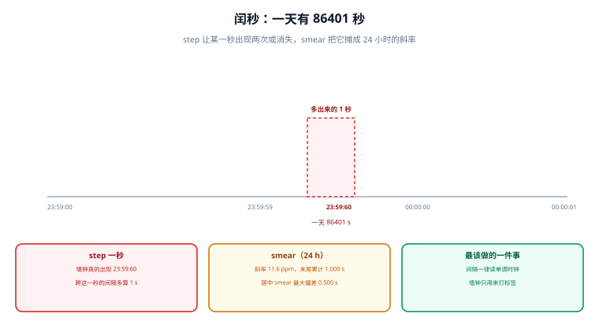

# 闰秒与 smearing

一年里有那么一天，它只有 86,401 秒。多出来的那一秒不是精度问题，而是**标尺本身被改了一格**——所有假设「一天 86,400 秒」的代码，都会在这一秒上得到一次不明显的错。



## 一、闰秒是怎么来的

UTC 是一条**用原子钟走、但被人为对齐地球自转**的标尺。地球自转并不均匀，长期趋势是变慢；当「原子钟走出来的日」与「地球自转的日」差值接近 0.9 秒时，IERS（International Earth Rotation and Reference Systems Service，国际地球自转与参考系统服务）会发布公告，在某个 UTC 日的末尾插入或删除一秒。

| 事实 | 值 | 影响 |
| --- | --- | --- |
| 闰秒日的长度 | 86,401 s（正闰秒）或 85,399 s（负闰秒） | 「一天 = 86400 s」不再成立 |
| 时刻的自然写法 | `23:59:60` | 大量时间解析器不认这个值 |
| 历史上全部为正闰秒 | 自 1972 年起共 27 次，最近一次 2016-12-31 | 运维经验里几乎只有「插入」没有「删除」 |
| 判定权威 | IERS Bulletin C（提前约半年公告） | 不能靠推算，只能订阅公告 |
| 未来安排 | 2022 年 CGPM 决议：2035 年前取消闰秒 | 缓冲期内的存量系统仍需处理 |

::: info 术语首次出现
TAI（International Atomic Time，国际原子时间）是连续均匀的原子时标；UTC = TAI − 当前闰秒累计差。到 2017 年起这个差值是 37 秒。**闰秒改变的是这个差值**，不改变 TAI 的连续性——这也是为什么「用 TAI 记账」在天文与卫星领域是常规做法。
:::

## 二、两种处理：跳一秒，还是摊成一条斜线

| 方式 | 做法 | 谁在用 | 代价 |
| --- | --- | --- | --- |
| step（跳变） | 让 `23:59:60` 真实存在，或在负闰秒时直接跳过一秒 | 内核的 `leap` 标志、部分硬件时钟 | 这一秒内的时间戳会重复或缺失 |
| smearing（涂抹） | 在若干小时内把 1 秒摊成频率偏差，让「秒」变长一点点 | 大型云厂商、部分金融机构 | 窗口内**每一刻都偏离 UTC 最多 0.5 s** |

smearing 的斜率是可以算的：1 秒摊到 W 小时内，频率偏差 = 1 / (W × 3600)。本机算出来是这样：

| smear 窗口 | 斜率 | 窗口末尾累计偏差 | 居中 smear 的最大偏差 |
| --- | --- | --- | --- |
| 24 h | 11.6 ppm | 1.000 s | 0.500 s |
| 12 h | 23.1 ppm | 1.000 s | 0.500 s |
| 6 h | 46.3 ppm | 1.000 s | 0.500 s |
| 1 h | 277.8 ppm | 1.000 s | 0.500 s |

::: danger 「smear 了就没有问题」是错的
- smearing 把「一秒的跳变」换成「几小时的偏移」。它在**同一朵云内部**是自洽的（所有机器按同一斜率偏），但与**不 smear 的外部世界**就对不上了：窗口内最多偏 0.5 s。这就是为什么跨云、跨机构对账时经常出现「差半秒」的记录——两边都对，只是标尺不同。

- 判据不是「有没有 smear」，而是：**你的对账对象是否与你用同一套闰秒策略**。跨机构时必须显式约定：要么都用 UTC+smear 并声明窗口，要么都用 TAI。
:::

## 三、四笔账，每一笔都会在业务里出现

### 账一：跨闰秒的间隔

本机算过一段 10 秒的间隔刚好跨过闰秒：按墙上时钟读，差值是 **11.0 s**，真实经过 **10.0 s**，多算 1 秒。如果这 10 秒是一次限流窗口、一次心跳超时或一次计费区间，结论就错了。

**唯一正确的写法是读单调时钟**（`clock_gettime(CLOCK_MONOTONIC)`）——它只数「内核认为过了多少」，不关心标尺被改了几格。

### 账二：日长折算

30 天窗口里含 1 次闰秒，真实总秒数 2,592,001 s。若代码按「86400 × 天数」折算，会得到 **30.000012 天**，即少算 1 秒。看起来无害，但它会让「按天聚合」与「按秒累加」两条路径在这一天出现 1 秒的口径差——月末对账时正好是那 1 秒。

### 账三：`23:59:60` 的解析

| 语言 / 组件 | 遇到 `23:59:60` 的行为 | 该怎么办 |
| --- | --- | --- |
| ISO 8601 严格解析（多数标准库） | 报错或抛异常 | 不要假设解析一定成功 |
| POSIX `time_t` | **根本不表示这一秒**（同一秒出现两次） | 用单调序号或逻辑时钟 |
| Java `Instant`（`java.time`） | 解析失败；`Instant` 本身按 POSIX 秒处理 | 记录时保留原始字符串 |
| 数据库 `timestamptz` | 取决于驱动；多数把 `:60` 归一化 | 入库前显式归一化并留原值 |

### 账四：有效期与 TOTP

证书的 `notBefore` / `notAfter`、JWT 的 `nbf` / `exp`、TOTP 的 30 秒窗口，都是「拿本地时钟与一个绝对时刻比较」。闰秒当天偏移只有 1 秒，**对 TOTP 是致命的**（30 秒窗口的 1/30），对证书则通常无感（有效期以天计）。这类差异说明：**同一秒的误差，在不同组件上的后果差两个数量级**，不能用一个「时间要准」笼统覆盖。

## 四、最小可运行：算 smear 的斜率与偏差上界

```python
#!/usr/bin/env python3
"""闰秒与 smearing 的四个数：日长、斜率、累计偏差、跨闰秒的间隔误算。"""
DAY = 86400


def smear_rate(window_h):
    """把 1 s 摊到 window_h 小时上的频率偏差（ppm）。"""
    return 1.0 / (window_h * 3600) * 1e6


def cumulative(window_h):
    """窗口末尾累计偏差（秒）。"""
    return 1.0 / (window_h * 3600) * window_h * 3600


def day_fraction_error(days, leaps):
    """按 86400 s/天 折算 days 天、含 leaps 次正闰秒时的天数误差。"""
    real = days * DAY + leaps
    return real / DAY - days, real


print("闰秒日长度 =", DAY + 1, "s")
for w in (24, 12, 6, 1):
    print(f"  smear {w:2d} h -> 斜率 {smear_rate(w):6.1f} ppm；"
          f"末尾累计 {cumulative(w):.3f} s；居中最大 {cumulative(w)/2:.3f} s")

err, real = day_fraction_error(30, 1)
print(f"30 天含 1 次闰秒：真实 {real} s，按 86400 折算得 {real/DAY:.6f} 天，"
      f"多算 {err:.6f} 天 = {err*DAY:.0f} s")

# 跨闰秒的一段 10 s 间隔，按墙钟与按单调时钟各读一次
gap = 1.0
print(f"一段 10 s 间隔跨过闰秒：墙钟差 {10 + gap:.1f} s，真实 10.0 s，多算 {gap:.0f} s")
```

输出：

```text
闰秒日长度 = 86401 s
  smear 24 h -> 斜率   11.6 ppm；末尾累计 1.000 s；居中最大 0.500 s
  smear 12 h -> 斜率   23.1 ppm；末尾累计 1.000 s；居中最大 0.500 s
  smear  6 h -> 斜率   46.3 ppm；末尾累计 1.000 s；居中最大 0.500 s
  smear  1 h -> 斜率  277.8 ppm；末尾累计 1.000 s；居中最大 0.500 s
30 天含 1 次闰秒：真实 2592001 s，按 86400 折算得 30.000012 天，多算 0.000012 天 = 1 s
一段 10 s 间隔跨过闰秒：墙钟差 11.0 s，真实 10.0 s，多算 1 s
```

::: tip 这四行数各自对应一个真实故障
- **斜率 11.6 ppm**：说明把闰秒摊到 24 小时，代价是这一整天里有 11.6 ppm 的频率偏差——对一般业务无感，对**收费按秒**或**高频采集**有影响。
- **末尾累计 1.000 s / 居中 0.500 s**：决定了对账误差的上界。居中策略把最大偏差减半，这是我们选 smear 实现时要问清的第一个问题。
- **1 s 的日长误差**：决定了「按天聚合」与「按秒累加」两条路径会不会在月末差一秒。
- **跨闰秒的 11.0 s**：这是唯一一条「已经在你代码里发生」的错误——只要那段间隔读的是墙钟。
:::

## 五、易错点

::: danger 六个真实踩过的坑
1. **用 `86400 * days` 算时间跨度。** 含闰秒的窗口必然差 1 秒。判据：跨度计算用单调时钟或 TAI。
2. **以为 `%S` 永远在 `00~59`。** `23:59:60` 会让格式化/解析路径抛异常或产生 `60`。判据：解析器有异常兜底，且日志里保留原字符串。
3. **用 `sleep(86400)` 等一天。** 睡眠期间跨过闰秒，醒来时刻会差 1 秒。判据：长睡眠用「目标时刻 - 当前时刻」循环计算，不用固定睡眠。
4. **跨云对账时两边 smear 策略不同。** 最多差 0.5 s，且**两边都自认正确**。判据：对接文档里写明闰秒策略与窗口。
5. **认为「2035 年取消闰秒」就可以不管。** 存量系统寿命普遍长于 10 年，且取消前仍会插入。判据：把「闰秒处理」写成一条常驻判据，而不是待办。
6. **自建 NTP 源未同步 `leap` 标志。** 上游插入了闰秒，本地 `Leap status` 仍是 `Normal`，于是本地时钟不跳、与上游差 1 秒。判据：闰秒前后比对 `Leap status` 与上游。
:::

## 本页判据

本页判据族 `CKL-A` ~ `CKL-H`，共 8 条。

| 判据 | 约定 | 定错了会怎样 | 怎么验证 |
| --- | --- | --- | --- |
| `CKL-A` | 时间跨度一律用单调时钟或 TAI 计算，不用「天 × 86400」 | 含闰秒的窗口差 1 秒 | 检索跨度计算处是否用了固定日长 |
| `CKL-B` | 解析器必须能处理 `23:59:60`（报错或归一化），且保留原始值 | 日志/入库在这一秒失败 | 用 `2026-12-31T23:59:60Z` 做一次解析用例 |
| `CKL-C` | 闰秒处理策略（step / smear / 窗口）写进对接文档 | 跨云对账差 0.5 s 且双方都自认正确 | 对接文档里有「闰秒策略」一节 |
| `CKL-D` | 订阅 IERS Bulletin C，不靠推算 | 临时处置，无预案 | 订阅记录或值班手册里有条目 |
| `CKL-E` | 长睡眠用「目标时刻 − 当前时刻」循环，不用固定 `sleep` | 醒来时刻差 1 秒 | 代码里无「sleep 一整天」的写法 |
| `CKL-F` | 自建 NTP 源要同步并透传 `leap` 标志 | 本地与上游差 1 秒且不报错 | 闰秒前后 `Leap status` 与上游一致 |
| `CKL-G` | 按秒计费 / TOTP / 高频采集三类组件单独评估闰秒影响 | 用「一般业务无感」的结论掩盖高风险组件 | 组件清单里三类都有结论 |
| `CKL-H` | 「2035 取消闰秒」不作为跳过处理的理由 | 存量系统在取消前仍会遇到 | 判据清单里这一条是常驻项 |

## 验证方式

```shell
# 1. 复跑本页脚本（存成 /tmp/ck_leap.py）
python3 /tmp/ck_leap.py
# 期望：smear 24 h -> 11.6 ppm；30 天含 1 次闰秒 -> 多算 1 s；跨闰秒 10 s -> 11.0 s

# 2. 查本机对未来闰秒的处理策略（Linux）
timedatectl show-timesync --property=ServerName --property=PollInterval
chronyc tracking | grep -i leap
# 期望：Leap status 为 Normal 或 Insert/Delete 之一，且与上游一致

# 3. 验证解析器对 23:59:60 的行为（Python 3.11+）
python3 -c "from datetime import datetime; \
print(datetime.fromisoformat('2026-12-31T23:59:60+00:00'))" 2>&1 | tail -1
# 期望：抛 ValueError（说明必须在应用层兜底，不能假设解析总成功）

# 4. 检查跨度计算没有用固定日长
grep -rn --include='*.py' '86400' . | grep -v 'test' | head
# 期望：命中处逐一核对，跨度计算不得直接乘天数

# 5. 检查本页判据族定义完整
grep -c 'CKL-[A-H]' docs/Ops/ClockSync/LeapSecond/index.md
# 期望：≥ 8
```

## 参考资料

- [IERS Bulletin C — 闰秒公告（唯一权威来源）](https://www.iers.org/IERS/EN/Publications/Bulletins/bulletins.html)
- [RFC 8536 — TZif 时区文件格式（闰秒表如何被携带）](https://www.rfc-editor.org/info/rfc8536)
- [BIPM — 2022 年 CGPM 关于闰秒的决议](https://www.bipm.org/en/cgpm-2022)
- [Google — Leap Smear 白皮书（24 小时窗口的做法）](https://developers.google.com/time/smear)
- [Linux man-pages — clock_gettime(2)（CLOCK_TAI 可用性）](https://man7.org/linux/man-pages/man2/clock_gettime.2.html)
- [本册目录页](../index.md)
