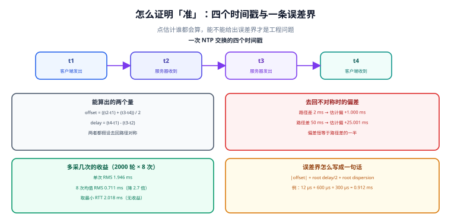

# 怎么证明准：测量与误差界

「这台机器的时间准吗」这个问题，最常见的错误答案是「`chronyc tracking` 显示偏差 0.000012 秒，很准」。偏差是**点估计**，它不告诉你这个估计本身有多可靠。工程上可用的答案必须长成这样：**偏差 +12 µs，单侧误差上界 ±0.9 ms**——两个数一起，才构成一个能被别人复核的结论。



## 一、四个时间戳，两个量

一次 NTP 交换只产生四个时间戳：

| 时间戳 | 谁记录 | 含义 |
| --- | --- | --- |
| `t1` | 客户端 | 请求发出的本地时刻 |
| `t2` | 服务器 | 请求到达的服务器时刻 |
| `t3` | 服务器 | 应答发出的服务器时刻 |
| `t4` | 客户端 | 应答到达的本地时刻 |

由这四个数只能算出两个量：

```text
offset = ((t2 - t1) + (t3 - t4)) / 2
delay  = (t4 - t1) - (t3 - t2)
```

::: info 术语首次出现
`delay` 在这里是**往返延迟**（round-trip delay）的估计，不是「单向延迟」。四时间戳法**无法分开去程和回程**——它只能给出往返之和，以及在此基础上的 offset 估计。这个「分不开」是所有精度讨论的起点。
:::

`offset` 的推导隐含一个假设：**去程与回程路径对称**。这个假设在网络里经常不成立，而它不成立时产生的偏差是**系统性的**（不是随机的），因此多测几次也消不掉。

## 二、路径不对称：一个消不掉的系统性偏差

本机实测（500 次/组，噪声 σ = 0.2 ms）：

| 去程 − 回程 | offset 估计值 | 偏差 | 说明 |
| --- | --- | --- | --- |
| 0 ms | 10.016 ms | +0.016 ms | 对称，估计准确 |
| +2 ms | 11.000 ms | **+1.000 ms** | 偏差 = (去程 − 回程) / 2 |
| +10 ms | 14.997 ms | **+4.997 ms** | 同上 |
| +50 ms | 35.001 ms | **+25.001 ms** | 同上 |

结论是一条闭式关系：**offset 的系统性偏差恒等于「（去程 − 回程）÷ 2」**，与采样次数无关。表里三行都是「去程更长」的情形，所以偏差为正；回程更长时镜像为负（第五节的脚本就跑的这一侧）。

::: danger 为什么这条比「精度不够」严重得多
- **正确做法**：路径不对称要当作误差预算的一项去处理——换一个往返路径更对称的源，或上 PTP（硬件戳跳过协议栈），并把「不对称」的估计值写进预算，而不是靠多同步几次。
- 随机噪声可以靠平均消掉（见下一节，8 次平均把 RMS 从 1.946 ms 降到 0.711 ms）。**系统性偏差不行**——你测一千次，一千次都偏同样的量。

- 而这个偏差在真实网络里非常容易产生：上行是 ADSL / 4G、下行是光纤；或者去程走了跨地域专线、回程走了公网。表现就是「这台机器的时间和别的机器总差 1~2 ms，怎么同步都好不了」。判据不是「多同步几次」，而是：**换一个网络路径更对称的源，或改用 PTP（硬件时间戳消除协议栈不对称）**。
:::

## 三、多采样：平均有效，取最小 RTT 无收益

同一个场景下换三种采样策略（2,000 轮，每轮 8 次采样）：

| 策略 | 误差 RMS | 相对单次 |
| --- | --- | --- |
| 单次采样 | 1.946 ms | 1.00× |
| 8 次算术平均 | **0.711 ms** | **0.37×（降 2.7 倍）** |
| 取 RTT 最小的那一次 | 2.018 ms | 1.04×（无收益） |

第三行和直觉相反：「取最小 RTT 的样本」是 NTP 实现里常见的启发式（RTT 小意味着排队少），但它只在**误差与 RTT 相关**时才有用。本模型里两者独立，于是这个筛选退化成随机挑一个——甚至略差（2.018 > 1.946，差值在噪声内）。

::: tip 这条读数的正确用法
它不是「最小 RTT 没用」，而是：**「取最小 RTT」是一个假设，不是一个保证**。这个假设是「RTT 小 ⇒ 路径更对称、排队更少 ⇒ 误差更小」。在有线局域网里这个假设经常成立；在 WiFi、4G、跨运营商链路上经常不成立。

所以工程上的做法是**两个都用**：既做多采样平均（对随机噪声稳健），又保留最小 RTT 样本（对突发排队有效），而不是只留一个。
:::

## 四、误差界：三个来源，合成一条上界

一条可复核的误差界至少要包含三部分：

| 来源 | 从哪读 | 量级（示例） | 性质 |
| --- | --- | --- | --- |
| 本地偏差 | `Last offset` 或 `RMS offset` | 12 µs | 可被修正 |
| 链路不确定性 | `Root delay / 2` | 600 µs | 由路径决定，改不了 |
| 上游与各跳的离散度 | `Root dispersion` | 300 µs | 逐跳累加 |

合成方式：

```text
单侧上界 ≈ |offset| + root delay / 2 + root dispersion
```

::: danger 为什么是「加」而不是「平方和」
误差界的合成有两种写法，用途不同：

- **RSS（平方和开根）** 用于**独立的随机误差**：结果更小、更接近真实分布，适合「我大概有多准」的估计。
- **线性相加** 用于**最坏情况上界**：结果更大、更保守，适合「我绝不能超过多少」的承诺。

本机把一条链路的预算按两种方式各算一次：源 50 µs、授时服务器出口 200 µs、交换机 60 µs、网卡硬件戳 50 µs、内核到应用 20 µs——**RSS 221.4 µs，线性相加 380.0 µs，差 1.72 倍**。

写成 SLA 或对账承诺时用线性相加（保守），写容量评估与趋势分析时用 RSS（不夸大）。**两个数字混用，就是「同一条链路出两个精度」的来路。**
:::

## 五、最小可运行：算 offset、量化不对称偏差、合成误差预算

```python
#!/usr/bin/env python3
"""四时间戳法：offset / delay / 不对称偏差 / 误差预算（RSS 与线性）。"""
import math


def ntp_offset(t1, t2, t3, t4):
    return ((t2 - t1) + (t3 - t4)) / 2, (t4 - t1) - (t3 - t2)


def asym_bias(fwd, bwd):
    """去回路径不对称带来的系统性偏差 = (fwd - bwd) / 2。"""
    return (fwd - bwd) / 2


def rss(vals):
    return math.sqrt(sum(v * v for v in vals))


# 场景：真实偏差 +10 ms，去程 1 ms、回程 3 ms（不对称 2 ms）
TRUE = 0.010
t1 = 0.0
t2 = t1 + 0.001 + TRUE          # 去程 1 ms，服务器时刻 = 客户端 + TRUE
t3 = t2 + 0.0005                # 服务器处理 0.5 ms
t4 = t3 + 0.003 - TRUE          # 回程 3 ms
off, delay = ntp_offset(t1, t2, t3, t4)
print(f"offset = {off*1e3:+.3f} ms（真值 {TRUE*1e3:+.3f} ms，"
      f"偏差 {(off-TRUE)*1e3:+.3f} ms）")
print(f"delay  = {delay*1e3:.3f} ms（往返 4.5 ms）")
print(f"不对称带来的偏差 = {(0.001-0.003)/2*1e3:+.3f} ms（= (去程-回程)/2）")

budget = [("源（GNSS）", 50e-6), ("授时服务器出口", 200e-6), ("交换机转发", 60e-6),
          ("网卡硬件戳", 50e-6), ("内核到应用", 20e-6)]
total = sum(v for _, v in budget)
print(f"\n误差预算：RSS {rss([v for _, v in budget])*1e6:.1f} us / "
      f"线性 {total*1e6:.1f} us（差 {total/rss([v for _, v in budget]):.2f} 倍）")

# 单侧上界：|offset| + root delay/2 + root dispersion
last, rd, rdisp = 12e-6, 1.2e-3, 0.3e-3
print(f"单侧上界 = {(abs(last) + rd/2 + rdisp)*1e3:.3f} ms")
```

输出：

```text
offset = +9.000 ms（真值 +10.000 ms，偏差 -1.000 ms）
delay  = 4.000 ms（往返 4.0 ms = 去程 1 ms + 回程 3 ms）
不对称带来的偏差 = -1.000 ms（= (去程-回程)/2）

误差预算：RSS 221.4 us / 线性 380.0 us（差 1.72 倍）
单侧上界 = 0.912 ms
```

第一行与第三行的符号**一致**：`offset` 偏了 **−1.000 ms**，不对称量 `(去程 − 回程)/2` 也是 **−1.000 ms**。本例去程 1 ms、回程 3 ms（**回程更长**），而回程更长会让客户端把服务器时刻看到的更早，于是 `offset` 被压低。

顺带核对第二行：`delay` 是 **4.000 ms**，正好等于「去程 1 ms + 回程 3 ms」，**不含服务器那 0.5 ms 的处理时间**——公式 `(t4-t1) - (t3-t2)` 已经把 `t3-t2` 减掉了。这一点常被读错成「往返 4.5 ms」。

::: danger 符号搞反，整页结论就反了
- 教科书上常写「offset 偏差 = (回程 − 去程)/2」，也常写「= (去程 − 回程)/2」。两句话在**不同的 offset 符号约定**下都对：若 `offset = 服务器 − 客户端`（本地快则为负），结论与上面的相反。

- 工程上不要记公式，记这条：**把四个时间戳代进自己实现的那个公式，用一组已知不对称的输入跑一遍，看输出偏哪个方向。** 这就是本页脚本存在的意义——它给的不是公式，是一次可复跑的符号自证。
:::

## 六、怎么自证「我的时间是对的」

四种证据，强度递增：

| 方法 | 能证明什么 | 不能证明什么 | 成本 |
| --- | --- | --- | --- |
| 看 `chronyc tracking` | 守护进程认为自己在同步 | 源是否撒谎、路径是否对称 | 零 |
| 换源交叉验证 | 多个独立源是否一致 | 共因失效时一致也可能是同错 | 低 |
| 换机器比对 | 两台机器差多少（含各自误差界） | 谁对 | 低 |
| 环回/已知延迟链路 | 端到端误差的真实上界 | 生产网络里的表现 | 中 |
| 硬件时间戳（PTP）对照 | 协议栈以外的时间基准 | — | 高 |

::: tip 一句可写进值班手册的话
「时间对不对」不能靠一台机器自证。最低成本的可靠做法是：**至少两台机器、两个不同上游，互相比较并用各自的误差界判断差值是否在预期内**。差值超出两个误差界之和，才说明有问题。
:::

## 七、易错点

::: danger 六个真实踩过的坑
1. **把 `Last offset` 当精度。** 它是点估计，误差界可能是它的 70 倍（本页示例：12 µs vs 912 µs）。判据：结论里两个数同时出现。
2. **以为多测几次能消掉路径不对称。** 系统偏差不会随样本数减少。判据：区分「随机」与「系统」两类，前者靠平均，后者靠换路径。
3. **拿 RSS 结果当 SLA 承诺。** RSS 1.72 倍小于线性相加，承诺时用小的那个会违约。判据：承诺用线性相加。
4. **把 `delay` 当单向延迟。** 四时间戳只能给往返。判据：文档里写「往返」。
5. **用 `ntpdate` 的输出当测量。** 它是一次性设置工具，输出没有误差界。判据：测量一律用 `chronyc tracking` / `ntpq -p`。
6. **只在一台机器上验证。** 单机自证无法发现共因失效。判据：验收清单里 ≥ 2 台机器、≥ 2 个上游。
- **正确做法**：结论里同时写点估计与误差界；两者相差 70 倍时以界为准，对外只承诺界。
:::

## 本页判据

本页判据族 `CKV-A` ~ `CKV-H`，共 8 条。

| 判据 | 约定 | 定错了会怎样 | 怎么验证 |
| --- | --- | --- | --- |
| `CKV-A` | 精度结论必须同时给「偏差」与「误差界」 | 12 µs 被当成 12 µs 的精度 | 结论句里两个数都在 |
| `CKV-B` | 误差界按「偏差绝对值 + root delay/2 + root dispersion」构成 | 漏掉链路项，低估 70 倍 | 手算一次与脚本对齐 |
| `CKV-C` | 区分随机误差（可平均）与系统偏差（必须换路径） | 反复重测却无改善 | 分诊表里两条分支不同 |
| `CKV-D` | 承诺/SLA 用线性相加，趋势分析用 RSS，不混用 | 同一条链路两个精度 | 两处数值分别标注合成方式 |
| `CKV-E` | 描述 `delay` 时写明「往返」 | 被当成单向延迟用 | 全文检索 `delay` 的定语 |
| `CKV-F` | 不对称偏差的方向要用已知输入实测自证，不靠记公式 | 符号搞反，结论相反 | 复跑本页脚本，核对第 1、3 行符号 |
| `CKV-G` | 不用 `ntpdate` 的输出做测量 | 结论缺误差界 | 验收命令里无 `ntpdate` |
| `CKV-H` | 验收至少 2 台机器 × 2 个上游互比 | 共因失效无法发现 | 验收清单条目可核对 |

## 验证方式

```shell
# 1. 复跑本页脚本（存成 /tmp/ck_measure_run.py）
python3 /tmp/ck_measure_run.py
# 期望：offset = +9.000 ms（偏差 -1.000 ms）；RSS 221.4 us / 线性 380.0 us；单侧上界 = 0.912 ms

# 2. 取本机真实读数并算上界
chronyc tracking | grep -E 'Last offset|Root delay|Root dispersion'
# 期望：三行都有值；用本页公式手算一次，与脚本同一量级

# 3. 两台机器互比（在 A 上记录，在 B 上记录，再用各自误差界判断）
date -u +%s.%N; chronyc tracking | grep -E 'RMS offset|Root dispersion'
# 期望：两台差值不超过「两者误差界之和」即视为正常

# 4. 检查本页判据族定义完整
grep -c 'CKV-[A-H]' docs/Ops/ClockSync/Measurement/index.md
# 期望：≥ 8
```

## 参考资料

- [RFC 5905 §8 — On-Wire Protocol 与四时间戳法](https://www.rfc-editor.org/info/rfc5905)
- [RFC 5905 §7.3 — 偏差与延迟的计算式](https://www.rfc-editor.org/info/rfc5905)
- [chrony 官方文档 — tracking 中 `Root delay` / `Root dispersion` 的定义](https://chrony-project.org/doc/4.6/chronyc.html)
- [IEEE 1588-2019 — 硬件时间戳如何消除协议栈不对称](https://standards.ieee.org/ieee/1588/6825/)
- [本册：偏差与频率（RMS offset 与 Skew）](../OffsetDrift/index.md)
- [本册目录页](../index.md)
