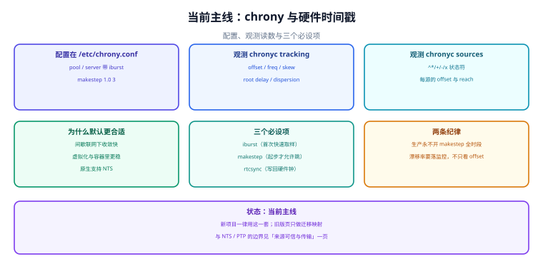

# 当前主线 chrony

::: danger 版本状态：当前主线 · 持续维护
本页是时间同步的当前基线：`chronyd` + `/etc/chrony.conf` + `chronyc`。它的默认行为（大步长 slew、显式 `makestep`、原生 NTS）与上一代实现在同一批判据上给出不同结论，所以单独成页。存量机器请对照[旧版 ntpd](../ClassicNtpd/index.md) 的迁移映射表。
:::



## 一、为什么它是当前基线

三个差异决定了它不是「换个工具」，而是「换了一套默认行为」：

| 维度 | 具体表现 | 工程意义 |
| --- | --- | --- |
| 大步长 slew | `maxslewrate` 默认 `83333.333` ppm | 120 ms 偏差 **1.44 s** 磨完（上一代约 240 s） |
| 显式步进策略 | `makestep 1.0 3` 写在配置里，可审计 | 「什么时候允许跳」变成可评审的一行 |
| 间歇联网友好 | 断网期间继续用本地估计，恢复后快速收敛 | 笔记本、边缘设备、按需启动的容器 |
| 原生 NTS | `server ... nts` 一行 | 认证不再依赖对称密钥 |
| 自带统计 | `sourcestats` / `ntpdata` / `authdata` | 排障不必再猜 |

::: info 术语首次出现
`slew` 与 `step` 是本册第 4 章的两个动作。chrony 的默认策略可以一句话概括：**磨得快（83333 ppm），但只在前 3 次更新里允许跳（`makestep 1.0 3`）**。理解这一句，就等于理解了它的全部时间行为。
:::

## 二、`/etc/chrony.conf` 的六个关键项

```text
# /etc/chrony.conf（最小可用 + 三个必设项）

# 1) 上游：pool 会展开成多个地址；iburst 让起步只花几十秒
pool ntp.aliyun.com iburst
pool time.cloudflare.com iburst
server time1.example.net iburst nts          # 自建源，启用 NTS
ntsdumpdir /var/lib/chrony                    # cookie 持久化

# 2) 频率：重启后立刻用上次的估计
driftfile /var/lib/chrony/drift

# 3) 步进：只在前 3 次更新里允许跳 1 s 以上
makestep 1.0 3

# 4) 速率上限（默认 83333.333，写明便于评审）
maxslewrate 83333.333

# 5) 写回硬件钟（RTC），让下次开机起点更近
rtcsync

# 6) 日志：把统计落盘，排障时才有历史
logdir /var/log/chrony
log measurements statistics tracking
```

| 项 | 默认值 | 改动它会怎样 | 建议 |
| --- | --- | --- | --- |
| `makestep` | 发行版常带 `1.0 3` | 第二参数为负 = 全时段可跳，事故源 | 保持为正且 ≤ 5 |
| `maxslewrate` | `83333.333` | 调小 → 磨得慢但秒长更稳 | 按秒计费场景可降到 500 |
| `rtcsync` | 部分发行版默认开 | 不开则重启后起点差 | 物理机开启 |
| `driftfile` | 视发行版 | 不配则每次重学频率 | 必须配，且持久化 |
| `ntsdumpdir` | 未配 | NTS 每次重启重新握手 | 用 NTS 就必须配 |
| `log` | 未配 | 无历史，无法归因 | 至少开 `tracking` |

## 三、`chronyc` 速查：五个子命令覆盖八成场景

| 子命令 | 回答什么问题 | 关键字段 |
| --- | --- | --- |
| `chronyc tracking` | 我现在准不准、走多快 | `System time` / `Frequency` / `Skew` / `Root delay` / `Root dispersion` / `Leap status` |
| `chronyc sources -v` | 我在跟谁对时、谁被选中 | 状态符 `^* ^+ ^- ^x ^? ^~`、`Reach` |
| `chronyc sourcestats` | 每个源的频率与偏差统计 | `NP` / `NR` / `Span` / `Freq` / `Skew` |
| `chronyc -N authdata` | NTS 是否生效 | `Mode` / `Key` / `Cookies` |
| `chronyc ntpdata` | 最后一个包的四时间戳细节 | `Offset` / `Delay` / `Root delay` |

::: danger `chronyc makestep` 不是「重启命令」
- **正确做法**：跳完用 `chronyc tracking` 确认 `Skew` 是否收敛；确实要清历史才用 `systemctl restart chronyd`，并且这件事要写进 runbook——它是「丢证据」动作，不是常规操作。
- 它跳的是时钟，不是进程：`Frequency` 的估计不会因此重估，采样历史也不会清空。跳完仍要观察 `Skew` 是否收敛。

- 真正要「重来一遍」时用 `systemctl restart chronyd`——但那会清掉历史，属于丢失证据的动作（见实战页第 2 节）。
:::

## 四、三个必设项与两条纪律

| 必设项 | 不设的后果 | 判据 |
| --- | --- | --- |
| `makestep 1.0 3` | 大步长 slew 下，大偏差要磨很久；或默认全时段可跳 | 配置里显式一行且第二参数为正 |
| `driftfile` | 重启后从 0 ppm 重学，前十几分钟精度最差 | 文件存在且重启后仍在 |
| `rtcsync` | 重启后起点偏，`makestep` 更容易触发 | 物理机开启并核对 |

| 纪律 | 具体写法 | 为什么 |
| --- | --- | --- |
| 生产永不全时段 `makestep` | 第二参数为正 | 一次回拨打断所有墙钟计时 |
| 频率要进监控 | 采 `Frequency` 的变化率，不只看绝对值 | 「将要偏」比「已经偏」更值得告警 |

## 五、容器与虚拟化：三条落地建议

| 环境 | 做法 | 理由 |
| --- | --- | --- |
| 普通容器 | **不装**时钟服务，只读宿主时钟 | 两个 daemon 各自修正会互相打架 |
| 需要 `CAP_SYS_TIME` 的特权容器 | 只允许一个实例修正，其余只读 | 同上，且权限要收敛 |
| 虚拟机 | 优先用宿主透传时钟源；同宿主多台要核对是否同向偏移 | 宿主调度饥饿会被误记成「晶振慢」 |

::: warning 容器里最隐蔽的一种
镜像里的 `/var/lib/chrony` 没有挂卷 → 每次重建都从 0 ppm 开始，于是「容器启动后十几分钟时间偏差最大」。这个现象经常被归因为「容器时钟不准」，实际是 `drift` 文件没持久化。判据：`ls -l /var/lib/chrony/drift` 在容器重建后是否还在。
:::

## 六、与 NTS、PTP 的边界

| 需求 | 用什么 | 本册哪一页 |
| --- | --- | --- |
| 防伪造应答 | `server ... nts` | [来源可信与传输](../TrustBoundary/index.md) |
| 亚微秒 | PTP 整链（含透明时钟） | [来源可信与传输](../TrustBoundary/index.md) |
| 毫秒级且跨机房 | chrony + 就近源 | 本页 |
| 严格全序 | 逻辑时钟 / 单调序号 | [应用侧四条纪律](../AppUsage/index.md) |

## 七、从上一代迁过来的检查单

| 检查项 | 命令 | 通过判据 |
| --- | --- | --- |
| 只有一个时间服务在跑 | `systemctl is-active chronyd ntpd` | 只有 `chronyd` 为 active |
| `drift` 已重新学习 | `chronyc tracking` | `Skew` < 1 ppm 且 `Frequency` 稳定 |
| 访问控制已重写 | `grep -E '^(allow\|deny)' /etc/chrony.conf` | 不是把旧 `restrict` 直译成 `allow` |
| `makestep` 可控 | `grep makestep /etc/chrony.conf` | 第二参数为正且 ≤ 5 |
| NTS 生效（若启用） | `chronyc -N authdata` | 非空且有 `Cookies` |
| 迁移前后读数对照 | 两代各取一次 `offset` / `frequency` | 同一量级，趋势一致 |

## 本页判据

本页判据族 `CKG-A` ~ `CKG-H`，共 8 条。

| 判据 | 约定 | 定错了会怎样 | 怎么验证 |
| --- | --- | --- | --- |
| `CKG-A` | 本页是当前基线，新增能力写在这里而非旧版页 | 能力散落在两处，读者照抄旧写法 | 新版能力只在本页出现 |
| `CKG-B` | `makestep` 显式配置且第二参数为正 ≤ 5 | 全时段可跳，事故源 | 配置文件一行可核对 |
| `CKG-C` | `driftfile` 必须持久化（容器要挂卷） | 每次重建从 0 ppm 重学 | 重建后文件仍在 |
| `CKG-D` | 物理机开 `rtcsync` | 重启起点偏，易触发步进 | 配置项与 `adjtimex` 读数 |
| `CKG-E` | 用 NTS 就必须配 `ntsdumpdir` | 每次重启重新握手 | `chronyc -N authdata` 非空 |
| `CKG-F` | 容器内不跑第二个时间服务 | 两个 daemon 互相修正 | 容器进程清单 |
| `CKG-G` | 监控采 `Frequency` 变化率而非只看绝对值 | 只报警「已偏」 | 告警规则两条都在 |
| `CKG-H` | 迁移按七项检查单逐条过，不只验 active | 表面通过、精度变差 | 检查单有勾选记录 |

## 验证方式

```shell
# 1. 确认版本与服务
chronyd -v
systemctl is-active chronyd
# 期望：版本号 4.x 或 5.x；active

# 2. 三个必设项是否都在
grep -E '^\s*(makestep|driftfile|rtcsync|maxslewrate|ntsdumpdir)' \
  /etc/chrony.conf /etc/chrony/chrony.conf 2>/dev/null
# 期望：makestep 第二参数为正；driftfile 有值

# 3. 读一次完整状态
chronyc tracking
chronyc sources -v | tail -n +3 | head -6
# 期望：Leap status = Normal；有且只有一个 ^*

# 4. 容器场景：确认 drift 文件持久化
ls -l /var/lib/chrony/drift
# 期望：存在；容器重建后仍存在（说明挂卷成功）

# 5. 检查本页判据族定义完整
grep -c 'CKG-[A-H]' docs/Ops/ClockSync/ModernChrony/index.md
# 期望：≥ 8
```

## 参考资料

- [chrony 官方文档 — chrony.conf 全部指令](https://chrony-project.org/doc/4.6/chrony.conf.html)
- [chrony 官方文档 — chronyc 命令全集](https://chrony-project.org/doc/4.6/chronyc.html)
- [chrony 官方 FAQ — 容器与虚拟化环境建议](https://chrony-project.org/faq.html)
- [RFC 8915 — NTS（`server ... nts` 的协议依据）](https://www.rfc-editor.org/info/rfc8915)
- [本册：旧版 ntpd（迁移映射）](../ClassicNtpd/index.md)
- [本册目录页](../index.md)
