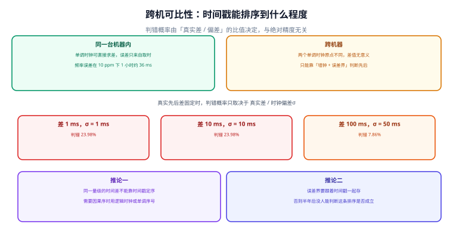

# 三种时钟与可测间隔

内核给用户态提供了不止一个「时间」。它们的名字很像，语义完全不同：一个回答「现在几点」，一个回答「过了多久」，还有一个回答「包括休眠在内过了多久」。用错哪一个，代码在测试环境永远正常，在线上偶发出错。



## 一、五种时钟，三种用途

| 时钟 | 语义 | 会被 step 改变 | 休眠时是否前进 | 典型用途 |
| --- | --- | --- | --- | --- |
| `CLOCK_REALTIME` | 墙上时间，随 NTP 修正 | 会 | 会 | 日志时间戳、证书比较、业务记账时点 |
| `CLOCK_MONOTONIC` | 从开机起单调递增 | 不会 | **不会** | 超时、退避、耗时统计 |
| `CLOCK_BOOTTIME` | 与 `MONOTONIC` 相同但**包含休眠** | 不会 | 会 | 「用户感觉过了多久」、长周期定时 |
| `CLOCK_MONOTONIC_RAW` | 未做 NTP 频率修正的原始计数 | 不会 | 不会 | 需要硬件原始频率的测量 |
| `CLOCK_TAI` | 原子时（不含闰秒） | 不会 | 会 | 需要连续标尺的计量与科研 |

::: info 术语首次出现
`CLOCK_MONOTONIC` 的「单调」只保证**不减**，不保证「等于真实经过的时间」。它同样受频率修正影响（`adjtimex` 的 `freq` 会作用在它上面），因此两台机器的单调时钟走速也可能不同。它唯一可靠的用途是**同一台机器内的差值**。
:::

`MONOTONIC` 与 `BOOTTIME` 的差别只在休眠：笔记本合盖 8 小时，`MONOTONIC` 只前进了几秒，`BOOTTIME` 前进了 8 小时。容器里这个区别更重要——多数容器运行时把 `BOOTTIME` 当作「容器活着多久」的依据。

## 二、一次 step 之后，两个时钟就分叉了

本机实测：一次 −1.00 s 的 step 发生在第 10 秒。

| 读法 | 第 10 秒时的值 | 一个 30 s 超时的剩余 |
| --- | --- | --- |
| `CLOCK_REALTIME` | 9.00 s | **21.00 s** |
| `CLOCK_MONOTONIC` | 10.00 s | **20.00 s** |

前跳 0.35 s 时镜像发生：`REALTIME` 剩余 19.65 s，`MONOTONIC` 仍是 20.00 s。

::: danger 这类 bug 在测试环境几乎不可能复现
- 测试机的时钟很准，也不会被 step。所以「用墙钟算超时」的代码在 CI 里永远绿，在线上只在「恰好遇到一次时钟修正」时出错。这也是为什么这条纪律必须写成**代码检索**，而不是写成「注意一下」：

```shell
# 找出所有「用墙钟做差」的地方，逐一改成单调时钟
grep -rn --include='*.go' -E 'time\.Now\(\)\.Sub\(' .
grep -rn --include='*.py' -E 'time\.time\(\)\s*-\s*' .
grep -rn --include='*.java' -E 'System\.currentTimeMillis\(\)\s*-' .
```

:::

## 三、跨机：「时间戳能不能用来判先后」

这是时钟治理里最容易被高估的一件事。两台机器的墙钟各有误差，当**真实的时间差**与**误差**同量级时，比较时间戳得出的顺序基本是随机的。

设两台机器的相对偏差服从 σ 的正态分布，真实先后差为 Δ，则判错概率为：

```text
P(判错) = 1 − Φ( Δ / (σ·√2) )
```

本机算出的表：

| 真实先后差 | σ = 0.1 ms | σ = 1 ms | σ = 10 ms | σ = 50 ms |
| --- | --- | --- | --- | --- |
| 1 ms | 0.00% | **23.98%** | **47.18%** | **49.44%** |
| 10 ms | 0.00% | 0.00% | **23.98%** | **44.38%** |
| 100 ms | 0.00% | 0.00% | 0.00% | 7.86% |

读法：**判错概率只由「Δ / σ」这个比值决定，与绝对精度无关。** σ = 1 ms 的机器判断 1 ms 的先后，和 σ = 50 ms 的机器判断 50 ms 的先后，错率都是 23.98%。

反过来问更有用：要把判错率压到多少，需要多准的时钟？

| 可容忍判错率 | 所需 σ（真实差 10 ms 时） | 差 / σ 比值 |
| --- | --- | --- |
| ≤ 0.1% | σ ≤ 2.29 ms | 4.37 |
| ≤ 1% | σ ≤ 3.04 ms | 3.29 |
| ≤ 5% | σ ≤ 4.30 ms | 2.33 |
| ≤ 10% | σ ≤ 5.52 ms | 1.81 |

::: tip 一条可以直接用的经验值
**要让时间戳可靠地判断先后，时钟偏差必须小于「真实差」的 1/3.3**（这样判错率约 1%）。换句话说：如果你的业务需要区分 10 ms 内的先后，机器时钟的偏差必须控制在 **3 ms** 以内——这已经超出普通 NTP 在公网上的能力（`root delay` 常常就是几毫秒），需要局域网内授时或 PTP。

**做不到时就不要用时间戳定序。** 正确做法是换一种序：逻辑时钟（Lamport）、单调序号（每台机器一个持久递增计数器 + 机器 ID）、或由写入方统一分配的序号。
:::

## 四、容器与虚拟化：三个容易踩的差异

| 环境 | 差异 | 后果 | 处置 |
| --- | --- | --- | --- |
| 容器共享宿主内核 | 时钟是宿主的；`MONOTONIC` 默认也随宿主 | 宿主跳变会同时影响所有容器 | 容器内不做时钟修正，只读 |
| 时间命名空间（Linux 5.6+） | `MONOTONIC` / `BOOTTIME` 可设固定偏移 | 容器内算出的「运行时长」与宿主不同 | 不要把容器内 uptime 当宿主 uptime |
| 虚拟机 | 客户机时钟受宿主调度影响 | 频率偏差可达几十 ppm | 用宿主透传时钟源；必要时 PTP |

## 五、最小可运行：给出「我这套时钟够不够判先后」的结论

```python
#!/usr/bin/env python3
"""跨机判错概率：给定真实差与时钟偏差，算判错率；反推所需精度。"""
import math


def phi(x):
    return 0.5 * (1 + math.erf(x / math.sqrt(2)))


def p_misorder(delta_s, sigma_s):
    """两台机器判错先后的概率。"""
    return 1 - phi(delta_s / (sigma_s * math.sqrt(2)))


def max_sigma(delta_s, target):
    """要把判错率压到 target 以下，时钟偏差必须不超过多少。"""
    lo, hi = 1e-9, 10.0
    for _ in range(300):
        mid = (lo + hi) / 2
        if p_misorder(delta_s, mid) > target:
            hi = mid
        else:
            lo = mid
    return lo


print("判错概率表（行=真实先后差，列=时钟偏差 σ）")
for d in (0.001, 0.010, 0.100):
    row = "  ".join(f"σ={s*1e3:5.1f}ms->{p_misorder(d, s)*100:5.2f}%"
                    for s in (0.0001, 0.001, 0.010, 0.050))
    print(f"  差 {d*1e3:5.1f} ms: {row}")

print("\n真实差 10 ms 时，可容忍判错率反推所需 σ 上限")
for p in (0.001, 0.01, 0.05, 0.10):
    s = max_sigma(0.010, p)
    print(f"  P <= {p*100:4.1f}% 需 σ <= {s*1e3:5.2f} ms（差/σ = {0.010/s:5.2f}）")
```

输出：

```text
判错概率表（行=真实先后差，列=时钟偏差 σ）
  差   1.0 ms: σ=  0.1ms-> 0.00%  σ=  1.0ms->23.98%  σ= 10.0ms->47.18%  σ= 50.0ms->49.44%
  差  10.0 ms: σ=  0.1ms-> 0.00%  σ=  1.0ms-> 0.00%  σ= 10.0ms->23.98%  σ= 50.0ms->44.38%
  差 100.0 ms: σ=  0.1ms-> 0.00%  σ=  1.0ms-> 0.00%  σ= 10.0ms-> 0.00%  σ= 50.0ms-> 7.86%

真实差 10 ms 时，可容忍判错率反推所需 σ 上限
  P <=  0.1% 需 σ <=  2.29 ms（差/σ =  4.37）
  P <=  1.0% 需 σ <=  3.04 ms（差/σ =  3.29）
  P <=  5.0% 需 σ <=  4.30 ms（差/σ =  2.33）
  P <= 10.0% 需 σ <=  5.52 ms（差/σ =  1.81）
```

::: danger 表里最容易被忽略的一格
- **正确做法**：要跨机定序就换成「生产者实例号 + 实例内单调序号」拼全序键，时间戳退回展示；确实要用时间戳，就必须把误差界一起存下来，界重叠的两条不许断言先后。
- σ = 50 ms、真实差 1 ms：判错率 **49.44%**。这已经不是「有点误差」，是**抛硬币**。而 σ = 50 ms 在跨可用区、走公网 NTP 的环境里非常常见。

- 也就是说：**「按时间戳排序」这条规则，在一半的情况下给出的是错的顺序，而且没有任何迹象。** 如果这段排序决定了「哪条是最后写入的」，那它决定的就是一条错误的业务结论。
:::

## 六、易错点

::: danger 六个真实踩过的坑
1. **用 `MONOTONIC` 记「跨重启的时长」。** 它开机归零。判据：跨重启的时间必须用墙钟 + 持久化。
2. **用 `REALTIME` 算超时。** 一次 step 就能把 20 s 变成 21 s。判据：代码检索墙钟做差。
3. **用 `MONOTONIC` 跨机比较。** 两台机器的原点无关，差值可以任意大或为负。判据：跨机比对只用墙钟 + 误差界。
4. **把 `BOOTTIME` 当 `MONOTONIC`。** 合盖/休眠场景下两者差几小时。判据：明确写「是否包含休眠」。
5. **以为容器里的 uptime 是宿主 uptime。** 时间命名空间可以设偏移。判据：宿主指标必须在宿主侧采集。
6. **以为「都装了 NTP 就能排序」。** 判错率取决于 Δ/σ，与「装没装」无关。判据：给出 σ 与 Δ 两个数的比值。
:::

## 本页判据

本页判据族 `CKM-A` ~ `CKM-H`，共 8 条。

| 判据 | 约定 | 定错了会怎样 | 怎么验证 |
| --- | --- | --- | --- |
| `CKM-A` | 间隔一律读 `MONOTONIC`（或 `BOOTTIME`），不读 `REALTIME` | step 时超时被延长或提前 | 代码检索墙钟做差 |
| `CKM-B` | 跨重启的时长用墙钟 + 持久化基准，不用单调时钟 | 重启后算出负数或巨大值 | 检索 `MONOTONIC` 的持久化用法 |
| `CKM-C` | 跨机不比较单调时钟，只用墙钟 + 误差界 | 顺序随机且无迹象 | 代码里无跨机单调时钟差值 |
| `CKM-D` | 用时间戳定序前，必须给出 Δ/σ 的比值并论证 ≥ 3.3 | 判错率 > 1% 却不自知 | 设计文档里有该比值 |
| `CKM-E` | Δ/σ 达不到要求时，改用逻辑时钟或单调序号 | 用墙钟排序得出错误业务结论 | 有替代序的实现或明确说明不适用 |
| `CKM-F` | 显式区分 `MONOTONIC` 与 `BOOTTIME`（是否含休眠） | 休眠场景时长差几小时 | 文档与代码里注明所选用途 |
| `CKM-G` | 容器内不做时钟修正，只读宿主时钟 | 多个容器互相打架 | 容器配置里无 clock 服务 |
| `CKM-H` | 容器 uptime 不作为宿主 uptime 指标 | 监控误判宿主重启 | 宿主指标从宿主侧采集 |

## 验证方式

```shell
# 1. 复跑本页脚本（存成 /tmp/ck_mono.py）
python3 /tmp/ck_mono.py
# 期望：差 1.0 ms / σ=1.0ms -> 23.98%；反推 P<=1% 需 σ <= 3.04 ms

# 2. 在本机看四种时钟（Linux）
python3 -c "import time;print('mono',time.monotonic(),'boot',time.clock_gettime(time.CLOCK_BOOTTIME) \
if hasattr(time,'CLOCK_BOOTTIME') else 'n/a','real',time.time())"
# 期望：mono 与 boot 接近（未休眠），real 是 Unix 时间戳

# 3. 检索用墙钟做差的代码（示例：Python 与 Go）
grep -rn --include='*.py' -E 'time\.time\(\)\s*-\s*' . | head
grep -rn --include='*.go' -E 'time\.Now\(\)\.Sub\(' . | head
# 期望：命中处逐一确认是否属于「间隔」语义，是则改单调时钟

# 4. 检查本页判据族定义完整
grep -c 'CKM-[A-H]' docs/Ops/ClockSync/Monotonic/index.md
# 期望：≥ 8
```

## 参考资料

- [Linux man-pages — clock_gettime(2) 五种时钟的语义](https://man7.org/linux/man-pages/man2/clock_gettime.2.html)
- [Linux 文档 — time_namespaces(7)](https://man7.org/linux/man-pages/man7/time_namespaces.7.html)
- [RFC 9562 — UUIDv7 的时间语义与单调性要求](https://www.rfc-editor.org/info/rfc9562)
- [本库：事件集成 · 顺序与分区](../../../Backend/EventIntegration/OrderingPartition/index.md)
- [本库：分片 ID 生成（单调序号与时钟回拨）](../../../DB/Relational/Sharding/IDGeneration/index.md)
- [本册目录页](../index.md)
