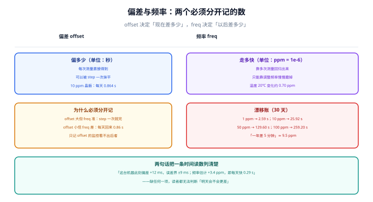

# 偏差与频率：漂移账

时钟出问题有两种完全不同的形状：**偏了**和**走快了**。前者可以一次抹平，后者只能持续对抗。把这两个数混成一个「时间不准」，就会反复出现「明明同步成功了，一周后又偏了」——因为被修掉的只是偏差，没人管频率。



## 一、两个数说的是两件事

| 量 | 英文 | 单位 | 怎么得到 | 决定的后果 |
| --- | --- | --- | --- | --- |
| 偏差 | offset | 秒 | 每次测量直接读出 | 此刻差多少；可被一次 step 抹平 |
| 频率偏差 | frequency offset | ppm（百万分之一） | 对多次测量做回归 | 以后会差多少；只能慢慢磨掉 |
| 频率不确定度 | skew | ppm | 回归的残差与样本跨度共同决定 | 「这个频率估计本身有多可信」 |

::: info 术语首次出现
ppm（parts per million，百万分之一）在这里是**无量纲的频率相对偏差**：1 ppm 表示每过 1 秒，本地时钟比标准多走（或少走）1 微秒。换算成日常量级很直观：1 ppm ≈ 每天 0.0864 秒 ≈ 每年 31.5 秒。
:::

三个数里 `skew` 最容易被忽略，但它决定了「频率这个结论能不能用」。一台机器 `Frequency: 3.402 ppm`、`Skew: 0.148 ppm`，意思是「大概率在 3.254 ~ 3.550 之间」；如果 `Skew: 8 ppm`，那个 3.402 就基本没有信息量——**它可能只是噪声拟合出来的斜率**。

## 二、漂移账：ppm 换算成「多久差多少」

| 频率偏差 | 每天 | 30 天 | 365 天 |
| --- | --- | --- | --- |
| 1 ppm | 0.086 s | 2.59 s | 31.5 s |
| 5 ppm | 0.432 s | 12.96 s | 157.7 s |
| 10 ppm | 0.864 s | 25.92 s | 315.4 s |
| 20 ppm | 1.728 s | 51.84 s | 630.7 s |
| 50 ppm | 4.320 s | 129.60 s | 1,576.8 s |
| 100 ppm | 8.640 s | 259.20 s | 3,153.6 s |

这张表的价值在于**把「时间漂移」翻译成运维能判断的量级**：

- 「一年差 5 分钟」= 300 s / 365 天 = **9.5 ppm**。听起来很小的一个数，在证书、OTP、JWT 上是致命量级。
- 「每天慢 0.86 秒」= 10 ppm。这是普通服务器晶振 + 虚拟化的典型水平。
- 「30 天差 129.6 秒」= 50 ppm。多见于长期高温或 CPU 深度降频的机器。

::: danger 「同步过一次」不是状态，是事件
一台机器被手工校时之后，偏差归零、频率没改，它会**按原来的速率重新偏出去**。10 ppm 的机器 30 天后回到 25.92 s，与从来没有对过时的效果一样。所以「校时」这个动作的正确表述是：**offset 归零 + freq 已被估计并应用**；只做前一半，等于把问题推迟了一个月。
:::

## 三、频率怎么估出来：样本「跨度」决定精度

频率不是测量出来的，是**拟合出来的**：把若干次 `(时刻, 偏差)` 做最小二乘，斜率就是频率。于是估计精度不由「测了多少次」决定，而由**首末样本的跨度**决定。

最小二乘斜率的误差有闭式解（均匀间隔、单次噪声 σ）：

```text
σ_f = σ / sqrt( Σ(t_i - t̄)² ) = σ / sqrt( n(n²-1)/12 · poll² )
```

代入 σ = 0.5 ms 的测量噪声，本机算出的量级如下：

| 采样间隔 | 样本数 | 观测跨度 | 频率估计误差 | 折合每天 |
| --- | --- | --- | --- | --- |
| 16 s | 4 | 64 s | 13.975 ppm | 1,207 ms |
| 16 s | 8 | 128 s | 4.822 ppm | 417 ms |
| 16 s | 16 | 256 s | 1.695 ppm | 146 ms |
| 64 s | 4 | 256 s | 3.494 ppm | 302 ms |
| 64 s | 8 | 512 s | 1.205 ppm | 104 ms |
| 64 s | 16 | 1,024 s | 0.424 ppm | 37 ms |
| 256 s | 8 | 2,048 s | 0.301 ppm | 26 ms |
| 256 s | 16 | 4,096 s | 0.106 ppm | 9 ms |

三条从这张表读出来的结论：

1. **跨度翻倍，σ_f 降到约 1/2.9**（∝ 跨度^-1.5）。所以「想更准」的杠杆是拉长观测窗口，不是加密采样。
2. **`poll` 不是越小越好。** 16 s × 4 个样本（跨度 64 s）估出的频率误差 13.975 ppm，比 256 s × 8（跨度 2,048 s）差 **46 倍**。频繁采样只增加了「样本数」，没有增加「信息量」。
3. **`Skew` 大不是故障，是诚实的自述。** 刚启动几分钟的机器，`Skew` 几十 ppm 是正常的；此时不要据 `Frequency` 下任何结论。

蒙特卡洛校验（3,000 轮，`poll` = 64 s、8 个样本）：实测 σ_f **1.212 ppm**，解析值 **1.205 ppm**，两者相符——说明上面的闭式解可以直接用来做容量估算。

## 四、频率为什么会变：三个真实来源

| 来源 | 量级 | 表现 | 怎么处置 |
| --- | --- | --- | --- |
| 晶振个体差异 | 1 ~ 50 ppm | 每台机器不同，长期稳定 | 靠 `drift` 文件持久化，重启后立刻用 |
| 温度 | 约 0.035 ppm/℃ | 随昼夜与负载周期摆动 | 机房温控；频繁摆动的机器要单独看 |
| 虚拟化 | 可达几十 ~ 几百 ppm | 宿主负载高时 vCPU 被抢占，客户机时钟「变慢」 | 用宿主透传的时钟源；必要时用 PTP |

温度这一项的量级值得记一下：温度每变化 20 ℃，频率偏 0.70 ppm，即**每天 0.060 s**。看起来很小，但如果机器在昼夜温差 20 ℃ 的机柜里，频率会**每天来回摆一次**——这种「有周期性的偏差曲线」在 `tracking` 的 `Last offset` 上看不出规律，必须画时间序列才看得见。

::: danger 虚拟化环境里最容易被误判的一种
客户机时钟变慢，`chronyd` 会把它记成「本地晶振慢 200 ppm」，然后持续加速——听起来是在修正，实际是在**掩盖宿主的调度饥饿**。判据不是看 `Frequency`，而是看：**同一台宿主上的所有客户机是否同向、同量偏移**。若同向，问题在宿主，改客户机配置没用。
:::

## 五、最小可运行：从样本估频率，并给出它的不确定度

```python
#!/usr/bin/env python3
"""从 (时刻, 偏差) 样本估计频率，并给出斜率的 1σ 不确定度。"""
import math


def fit(samples):
    """samples: [(t_seconds, offset_seconds), ...]；返回 (freq_ppm, skew_ppm)。"""
    n = len(samples)
    mx = sum(t for t, _ in samples) / n
    my = sum(o for _, o in samples) / n
    sxx = sum((t - mx) ** 2 for t, _ in samples)
    sxy = sum((t - mx) * (o - my) for t, o in samples)
    slope = sxy / sxx                                   # 秒/秒
    resid = [o - (my + slope * (t - mx)) for t, o in samples]
    dof = max(n - 2, 1)
    s2 = sum(r * r for r in resid) / dof                # 残差方差
    skew = math.sqrt(s2 / sxx)                          # 斜率的标准差
    return slope * 1e6, skew * 1e6


# 8 个样本，间隔 64 s，真实频率 +10 ppm，测量噪声 σ=0.5 ms
poll, true_ppm, sigma = 64, 10.0, 0.0005
raw = [0.0123, 0.0131, 0.0128, 0.0136, 0.0141, 0.0139, 0.0144, 0.0150]
samples = [(i * poll, o) for i, o in enumerate(raw)]

freq, skew = fit(samples)
print(f"frequency = {freq:+.3f} ppm")
print(f"skew      = {skew:.3f} ppm")
print(f"真值 10.000 ppm，落在 [{freq - skew:.2f}, {freq + skew:.2f}] 之内："
      f"{freq - skew <= true_ppm <= freq + skew}")
print(f"按此估计，每天漂 {freq * 86400 / 1e6 * 1000:+.1f} ms")
```

输出：

```text
frequency = +5.432 ppm
skew      = 0.641 ppm
真值 10.000 ppm，落在 [4.79, 6.07] 之内：False
按此估计，每天漂 +469.3 ms
```

::: danger 这段输出最有价值的地方，是它「猜错了」
- **正确做法**：估频率的样本跨度至少几百秒（10 ppm 在 512 s 内只累积 5.1 ms，与噪声同量级）；同时看残差形状，`skew` 小只说明「在假设线性、噪声独立的前提下形式误差小」，不说明模型对。
- 8 个手工样本估出 +5.432 ppm，真值 10 ppm **不在** ±skew 区间内。这不是脚本的 bug，是**用手工挑的 8 个点做回归的必然结果**：样本跨度只有 512 s，而 10 ppm 在 512 s 内只累积 **5.1 ms**，与 0.5 ms 的噪声叠在一起，斜率就很不稳。

- 两件事要一起记住：① 估频率至少要几百秒到几十分钟的跨度；② **`skew` 只是「假设线性、噪声独立」下的形式误差**，模型不对（温度来回摆）时它照样给出一个漂亮的小数字。所以工程上不能只看 `skew`，还要看**残差的形状**。
:::

## 六、`drift` 文件：为什么重启后的第一分钟最差

chrony / ntpd 都会把「估计出来的频率」写进一个文件（`/var/lib/chrony/drift` 或 `/var/lib/ntp/drift`），重启后**先按这个值补偿**，再逐步精化。这解释了两个常见现象：

1. **重启后 1 分钟内 `Frequency` 是一个旧值，`Skew` 很大**——这是正常的，它在用上次的结论并重新采样。
2. **`drift` 文件丢了，频率要重新学一遍。** 容器里最常见：镜像重建后 `/var/lib/chrony` 是空的，于是每次启动都从 0 ppm 开始，前十几分钟一直在纠偏。

## 七、监控该盯哪个数

| 指标 | 采样周期 | 告警条件（示例） | 为什么是它 |
| --- | --- | --- | --- |
| `RMS offset` | 1 min | 超过 SLO 允许偏差的一半 | 比 `Last offset` 稳，不易误报 |
| `Frequency` | 10 min | 相邻两次变化 > 5 ppm（同向持续） | 频率突变 = 环境或源变了 |
| `Skew` | 10 min | 长期 > 5 ppm | 估不出来，说明源在抖或样本跨度不足 |
| `Root dispersion` | 5 min | 超过 10 ms | 链路不确定性涨了 |

::: tip 一句话收口
偏离坏在「已经错了」，频率坏在「还会错」。告警盯 `RMS offset` 抓前者，盯 `Frequency` 的**变化率**抓后者——只看绝对值的监控，两件事都会漏。
:::

## 本页判据

本页判据族 `CKD-A` ~ `CKD-H`，共 8 条。

| 判据 | 约定 | 定错了会怎样 | 怎么验证 |
| --- | --- | --- | --- |
| `CKD-A` | `offset` 与 `frequency` 分开记录，结论里不合并成「时间不准」 | 校时后一个月再偏，无人能解释 | 变更单与监控各有独立字段 |
| `CKD-B` | 频率换算统一用「1 ppm = 每天 0.0864 s」 | 量级判断错，把 10 ppm 当无害 | 抽查文档里的 ppm → 秒换算 |
| `CKD-C` | 估频精度按「观测跨度」论证，不按样本数 | 加密采样以为更准，实际差 46 倍 | 用闭式解手算一次并与 `Skew` 对比 |
| `CKD-D` | `Skew` 大于 1 ppm 时，不据 `Frequency` 下结论 | 拿噪声拟合出的斜率当事实 | 结论句里 `Skew` 与 `Frequency` 同时出现 |
| `CKD-E` | 温度对频率的影响按 0.035 ppm/℃ 估算并记录环境温度 | 周期性偏差被当成「随机抖动」 | 监控里有温度序列或至少有机柜位置 |
| `CKD-F` | 虚拟化时钟变慢先看「同宿主其他客户机是否同向」 | 在客户机上调参，掩盖宿主问题 | 分诊表里有这一条分支 |
| `CKD-G` | `drift` 文件必须持久化，容器要挂卷 | 每次启动从 0 ppm 重学 | `ls -l /var/lib/chrony/drift` 与挂载配置 |
| `CKD-H` | 告警同时覆盖 `RMS offset` 与 `Frequency` 变化率 | 只报警「已偏」，不报警「将要偏」 | 告警规则清单两条都在 |

## 验证方式

```shell
# 1. 复跑本页脚本（存成 /tmp/ck_freq.py）
python3 /tmp/ck_freq.py
# 期望：frequency = +5.432 ppm / skew = 0.641 ppm / 真值落在区间内：False

# 2. 用闭式解核对自己机器的 `Skew` 是否合理（poll 与样本数从 sources 里读）
python3 - <<'PY'
import math
sigma, poll, n = 0.0005, 64, 8
print("理论 σ_f =", round(sigma / math.sqrt(n*(n*n-1)/12*poll**2)*1e6, 3), "ppm")
PY
# 期望：1.205 ppm；与 tracking 里的 Skew 同量级即为正常

# 3. 看漂移文件是否存在且持久（Linux）
ls -l /var/lib/chrony/drift 2>/dev/null || ls -l /var/lib/ntp/drift
# 期望：文件存在；容器环境应看到它是挂载卷

# 4. 检查本页判据族定义完整
grep -c 'CKD-[A-H]' docs/Ops/ClockSync/OffsetDrift/index.md
# 期望：≥ 8
```

## 参考资料

- [RFC 5905 §8 — On-Wire Protocol 与时钟滤波/选择/聚类](https://www.rfc-editor.org/info/rfc5905)
- [RFC 5905 §11.3 — Clock Discipline Algorithm（频率估计）](https://www.rfc-editor.org/info/rfc5905)
- [chrony 官方文档 — `driftfile` 与 `corrtimeratio`](https://chrony-project.org/doc/4.6/chrony.conf.html)
- [Linux man-pages — adjtimex(2)（`freq` 与 `offset` 是分开的两个量）](https://man7.org/linux/man-pages/man2/adjtimex.2.html)
- [本库：分布式锁 · 租约（时钟偏差给租约留的窗口）](../../../Backend/DistributedLock/Lease/index.md)
- [本册目录页](../index.md)
