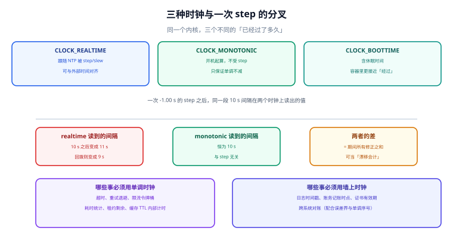

# 总览：三个「现在是几点」

一次「时间是对的」这个判断，至少要经过四个互不相同的环节：有人给出了标准、这台机器把标准取回来、取回来的过程有误差、应用又用自己的方式读了一次。这一页不教 `chronyc` 怎么敲，而是把「谁在给时间、这个读数能信到什么程度、拿它做判断会错在哪里」这套判定语言固定下来，后面十二页都用它说话。



## 一、四个角色

| 角色 | 英文 | 手里有什么 | 对什么负责 | 不负责什么 |
| --- | --- | --- | --- | --- |
| 时间源 | Reference clock / time source | GNSS 接收机、铯钟、上游授时服务 | 产生一个接近 UTC 的参考 | 不保证你取回来的路上没延迟 |
| 授时服务器 | NTP server | 自己的时钟、层级（stratum）、`root dispersion` | 按协议应答、声明自己的不确定性 | 不保证应答在网络里没被改（除非 NTS） |
| 本机守护进程 | Clock discipline daemon（chronyd / ntpd） | 采样历史、频率估计、内核时钟偏移 | 把本地时钟伺服到参考上 | 不保证应用会用对时钟 |
| 应用 | Application | 一次 `clock_gettime` 或 `Date.now()` | 选对时钟、用对语义 | 不能修正时钟（也不该尝试） |

::: info 术语首次出现
NTP（Network Time Protocol，网络时间协议）是一套**估计**协议，不是**告知**协议。它做的四件事是：测量往返延迟、估计偏差、估计频率、按策略修正本地时钟。理解这一点，才能理解为什么「NTP 同步了」不等于「时间是准的」——它只承诺把偏差压到某个界内，而那个界取决于网络与源的质量。
:::

四个角色里最容易混淆的是**授时服务器与本机守护进程**：服务器声明的 `root dispersion` 只描述**它自己离参考有多远**，不包含**你到它这一段网络**的不确定性。所以「上游说它误差 300 µs」完全不能推出「你本地误差 300 µs」。

## 二、三种「现在是几点」

| 说法 | 实际含义 | 谁定义 | 会被什么改变 | 典型误用 |
| --- | --- | --- | --- | --- |
| 瞬时 UTC | 本机对 UTC 标尺的估计值 | 守护进程 + 内核 | step、slew、闰秒、源污染 | 当成「标准时间」直接做差 |
| 挂钟本地时间 | UTC 叠加时区规则后的显示值 | 内核 + tzdb | 再叠加 DST 与规则版本 | 用它算「过了多久」 |
| 单调间隔 | 内核某原点起算、只增不减的计数 | 内核 | 不受 step 影响；开机归零 | 拿它跨机比较先后 |

三者不是「同一个东西的三种精度」，而是**三个不同的量**：

1. **瞬时 UTC 是「坐标」**——问的是「这件事在标尺上的位置」。它一定有误差，所以合理的写法是「12 ms ± 9 ms」。
2. **挂钟本地时间是「显示」**——问的是「人看到几点」。它比 UTC 多一层规则，因此错法更多（见时区册）。
3. **单调间隔是「长度」**——问的是「过了多久」。它没有绝对意义，但**只有它能安全地度量长度**。

::: danger 最贵的一类混淆：拿「坐标差」当「长度」
- 墙上时钟的两次读数相减，看起来就是「经过了多久」。这在时钟被修正过的时候是错的：本机实测一次 −1.00 s 的 step 发生在第 10 秒，**按墙上时钟算，30 s 超时还剩 21.00 s；按单调时钟算，还剩 20.00 s**。差的这 1 秒不是精度问题，是语义错误——超时被悄悄延长了。

- 正确写法只有一句：**凡是「过了多久」，一律读单调时钟；凡是「什么时候」，一律读墙上时钟并带上误差界。**
:::

## 三、判定语言：读数里哪几个数在说话

排障时第一步不是「重启 chronyd」，而是**把六个读数分开读**。以 chrony 的 `tracking` 输出为例：

| 读数 | 含义 | 量纲 | 读错会怎样 |
| --- | --- | --- | --- |
| `System time` | 当前偏差（正=本地快） | 秒 | 只读它，会以为「偏差小就没问题」 |
| `Last offset` | 上一次测量的偏差 | 秒 | 单次读数抖动大，不能当结论 |
| `RMS offset` | 长期偏差的均方根 | 秒 | 它比 `Last offset` 更能代表真实水平 |
| `Frequency` | 本地时钟相对参考的频率偏差 | ppm | **这一项才决定「明天会不会更差」** |
| `Residual freq` | 频率估计的残差 | ppm | 残差大说明模型不稳（源在抖） |
| `Skew` | 频率估计的不确定度 | ppm | skew 大时，`Frequency` 本身不可信 |
| `Root delay` | 到参考的总往返延迟 | 秒 | 它是误差界的**下界来源**，不是精度 |
| `Root dispersion` | 到参考的总离散度 | 秒 | 链路上每一跳的误差累加 |
| `Leap status` | 闰秒状态 | 枚举 | 非 `Normal` 时，下一秒可能是 23:59:60 |

六个读数里，**只有 `Frequency` 和 `Skew` 是「预测性」的**——其余都是对过去的描述。

## 四、一页纸的判定顺序

遇到「时间不对」，按这个顺序问，顺序错了会白花时间：

1. **偏差随时间怎么变？** 抖动 → 网络或源不稳；单调增长 → 频率没被修正。这一步只读 `Last offset` / `RMS offset` / `Frequency`，不改任何配置。
2. **谁给的源？** `chronyc sources -v` 看状态符：`^*` 是被选中的同步源，`^+` 是备选，`^-` 是被排除，`^x` 是 falseticker，`^?` 是不可达。**全是 `^?` 时不是「时间不准」，是「没有源」。**
3. **路径有多远？** `Root delay` 突然从 1 ms 涨到 80 ms，说明网络路径变了，误差界跟着变大。
4. **环境变了什么？** 虚拟机迁移、CPU 降频、机房温度、宿主负载——这些都会改晶振的实际频率（本机模型：温度每变化 20 ℃ 约 0.70 ppm，即每天 0.060 s）。
5. **要不要跳？** 偏差小于 slew 能在可接受时间内磨完的量就不跳；超过就跳，但**跳之前要先确认没有依赖墙钟间隔的东西在跑**。
6. **怎么收口？** 把「偏差 + 误差界 + 频率」三个数写进监控与变更记录。

前四步**只读不写**。这条纪律的价值在于：一旦先改了配置，后面的读数就都是「改完之后」的，无法归因。

## 五、最小可运行：把一条 `tracking` 输出算成一个误差界

下面这段脚本读一段 `chronyc tracking` 的输出，算出**单侧误差上界**并给出结论。它不判断「准不准」，只回答「这个读数能支持多强的结论」。

```python
#!/usr/bin/env python3
"""把一段 chronyc tracking 输出算成误差界（示例，输入为文本）。"""
import re

SAMPLE = """\
Reference ID    : C0A80101 (10.0.1.1)
Stratum         : 3
System time     : 0.000012345 seconds fast of NTP time
Last offset     : +0.000011800 seconds
RMS offset      : 0.000008200 seconds
Frequency       : 3.402 ppm slow
Residual freq   : +0.021 ppm
Skew            : 0.148 ppm
Root delay      : 0.001200000 seconds
Root dispersion : 0.000300000 seconds
Leap status     : Normal
"""


def parse(text):
    def num(pat):
        m = re.search(pat, text)
        return float(m.group(1)) if m else None

    freq = num(r"Frequency\s*:\s*([-\d.]+) ppm")
    if freq is not None and re.search(r"Frequency\s*:\s*[-\d.]+ ppm slow", text):
        freq = -freq                      # slow = 本地偏慢，频率记负
    return {
        "last_offset": num(r"Last offset\s*:\s*([+\-\d.]+) seconds"),
        "rms_offset": num(r"RMS offset\s*:\s*([-\d.]+) seconds"),
        "frequency": freq,
        "skew": num(r"Skew\s*:\s*([-\d.]+) ppm"),
        "root_delay": num(r"Root delay\s*:\s*([-\d.]+) seconds"),
        "root_disp": num(r"Root dispersion\s*:\s*([-\d.]+) seconds"),
    }


def bound(r):
    """单侧上界：|offset| + root delay/2 + root dispersion。"""
    return abs(r["last_offset"]) + r["root_delay"] / 2 + r["root_disp"]


def drift_per_day(r):
    """按当前频率估计，一天会漂多少秒（正=快）。"""
    return r["frequency"] * 1e-6 * 86400


r = parse(SAMPLE)
print(f"offset   = {r['last_offset']*1e6:+.1f} us")
print(f"误差上界 = ±{bound(r)*1e3:.3f} ms")
print(f"频率     = {r['frequency']:+.3f} ppm (±{r['skew']:.3f})")
print(f"按此频率 = 每天漂 {drift_per_day(r):+.3f} s")
print(f"结论     = 当前偏差在 {bound(r)*1e3:.1f} ms 内可信；"
      f"30 天后累积 {abs(drift_per_day(r))*30:.1f} s")
```

输出：

```text
offset   = +11.8 us
误差上界 = ±0.912 ms
频率     = -3.402 ppm (±0.148)
按此频率 = 每天漂 -0.294 s
结论     = 当前偏差在 0.9 ms 内可信；30 天后累积 8.8 s
```

注意这两行读数说的不是一件事：**偏差只有 11.8 µs，误差界却有 912 µs**——因为 `root delay` 是 1.2 ms，路径本身就贡献了 600 µs 的不确定性。这就是「偏差小不等于准」的具体形状：点估计落在误差界的中间，而误差界由链路决定。

::: tip 这段代码真正在示范什么
不是「怎么解析文本」，而是**任何一条时间结论都必须由三个数构成**：偏差、误差界、频率。只有偏差的那句话（「偏差 12 ms」）在工程上是不可用的——读者无法判断它明天会不会变成 12 秒。
:::

## 六、什么时候该怀疑时钟，而不是怀疑业务

按「症状 → 该查哪一段」列一张对照表，比记住命令有用：

| 症状 | 最可能的段 | 第一句该问的话 |
| --- | --- | --- |
| 证书突然「尚未生效」/「已过期」 | 用 | 本地偏慢还是偏快？偏差多少秒？ |
| 超时偶发提前触发或迟迟不触发 | 用 | 这段超时读的是哪种时钟？ |
| 两条日志顺序反了 | 跨 | 两台机器的偏差 σ 与真实间隔的量级差多少？ |
| 分布式锁出现两个持有者 | 跨 | 租约时长与最大偏差的比值是多少？ |
| 定时任务一天跑两次或漏跑 | 用 | 触发判定用的是墙钟还是单调时钟？ |
| 指标出现规律性锯齿 | 稳 | 频率有没有被修正？方向一致吗？ |
| 同一批机器只有一台偏 | 源 / 稳 | 那台的源是不是同一个？硬件钟有没有问题？ |

第 6、8、9 章会把其中四条展开成可复跑的判定。

## 本页判据

本页判据族 `CKO-A` ~ `CKO-H`，共 8 条。

| 判据 | 约定 | 定错了会怎样 | 怎么验证 |
| --- | --- | --- | --- |
| `CKO-A` | 区分「瞬时 UTC / 挂钟本地 / 单调间隔」三种读数，正文里不说「时间」两个字了事 | 用坐标差当长度，超时被 step 悄悄改写 | 全文检索「经过」「持续」处是否都指向单调时钟 |
| `CKO-B` | 任何时间结论必须同时给「偏差、误差界、频率」 | 只给偏差，无法判断趋势 | 结论句里三个数齐全 |
| `CKO-C` | 误差界至少包含 `root delay/2 + root dispersion` | 把「上游精度」当成「本地精度」 | 手算一次上界并与脚本输出对齐 |
| `CKO-D` | 排障前四步只读不写，改配置必须留「改前读数」 | 改完之后的读数无法归因 | 变更记录里有改前/改后两组读数 |
| `CKO-E` | `chronyc sources` 的状态符要逐个别名解释，不把 `^?` 说成「不准」 | 把「没有源」误判成「源不准」，去调频率 | 分诊表里每个符号都有对应处置 |
| `CKO-F` | 区分授时服务器声明的 `root dispersion` 与本机误差 | 用上游精度替代本机误差界 | 两处数值分别记录、不互相替代 |
| `CKO-G` | `Leap status` 非 `Normal` 时必须单独说明，不能只看偏差 | 闰秒当秒被当成「抖动」 | 状态行纳入巡检输出 |
| `CKO-H` | 每条结论带「哪台、什么时刻、什么源」 | 结论不可复核、无法跨人交接 | 断言里含主机名与采样时刻 |

## 验证方式

```shell
# 1. 复跑本页脚本（存成 /tmp/ck_bound.py）
python3 /tmp/ck_bound.py
# 期望：offset = +11.8 us / 误差上界 = ±0.912 ms / 每天漂 -0.294 s

# 2. 在本机取一段真实读数（Linux 主机；Windows 用 w32tm /query /status）
chronyc tracking
# 期望：能看到 System time / Frequency / Skew / Root delay / Root dispersion / Leap status 六行

# 3. 确认单调时钟不受墙钟跳变影响（Python 3.7+ 的 perf_counter 即单调时钟）
python3 -c "import time; a=time.perf_counter(); w=time.time(); \
time.sleep(0.2); print(round(time.perf_counter()-a,3), round(time.time()-w,3))"
# 期望：两个数都约 0.2，但前者不会因 NTP step 变成负数或跳变

# 4. 检查本页判据族定义完整
grep -c 'CKO-[A-H]' docs/Ops/ClockSync/Overview/index.md
# 期望：≥ 8
```

## 参考资料

- [RFC 5905 §7.3 — NTP 偏差与延迟的计算](https://www.rfc-editor.org/info/rfc5905)
- [RFC 8633 — NTP Best Current Practices（选源与部署建议）](https://www.rfc-editor.org/info/rfc8633)
- [chrony 官方文档 — chronyc tracking 各字段含义](https://chrony-project.org/doc/4.6/chronyc.html)
- [Linux man-pages — clock_gettime(2)](https://man7.org/linux/man-pages/man2/clock_gettime.2.html)
- [本库：globalization 时区与 DST 折叠](../../../Backend/Globalization/TimeZoneDST/index.md)
- [本册目录页](../index.md)
