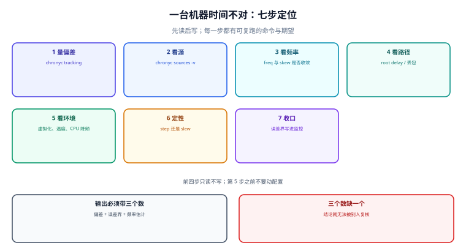

# 实战：一台漂移机的七步定位

前面九页把概念拆开了，这一页把它们装回去：一台机器「时间不对」，从发现到收口要走的七步，每步都有可复跑的命令与期望读数，最后用一个八条门禁把结论固化成能进 CI 的东西。



## 一、七步，前四步只读不写

| 步 | 做什么 | 命令 | 读到什么算正常 |
| --- | --- | --- | --- |
| 1 | 量偏差 | `chronyc tracking` | `System time` 与 `RMS offset` 同量级，且 `Leap status` = Normal |
| 2 | 看源 | `chronyc sources -v` | 有且只有一个 `^*`，总数 ≥ 4，无 `^?` |
| 3 | 看频率 | `chronyc tracking` 的 `Frequency` / `Skew` | `Skew` < 1 ppm，`Frequency` 稳定 |
| 4 | 看路径 | `Root delay` / `Root dispersion` | `Root delay` 与历史值同量级（±2 倍内） |
| 5 | 看环境 | 宿主负载、温度、虚拟化、CPU 频率 | 与第 3 步的 `Frequency` 变化时间点对齐 |
| 6 | 定性 | 综合前五步 | 是「偏了」还是「走快了」，还是「源在撒谎」 |
| 7 | 收口 | 写监控 + 变更记录 + 门禁 | 三个数进监控，一条判据进 CI |

::: danger 为什么前四步必须只读
一旦先改了配置（重启 chronyd、换源、手工 `makestep`），**后面读到的全是「改完之后」的数**，无法归因。本仓记录过的最贵一次事故就是这样：值班同学看到偏差 3 秒，直接 `systemctl restart chronyd`，重启后偏差消失、故障「恢复」，但**频率偏差没被修正**，第二天同一时间又偏了 3 秒——而第一次的 `Frequency` 读数已经被重启清掉了。
:::

## 二、三个「不要先做」的动作

| 动作 | 为什么不该先做 | 该改成什么 |
| --- | --- | --- |
| `systemctl restart chronyd` | 清掉采样历史与 `Frequency` 估计，读数断档 | 先读 `tracking`，再决定 |
| `chronyc makestep` | 跳变会让所有依赖墙钟间隔的东西同时错位 | 先算「磨要多久」，再评估业务窗口 |
| 换源 / 加源 | 换源会重建交集，前一次的 `^*` 结论作废 | 先看 `^x` / `^-` 的分布，判断是源错还是多数派错 |

这三条有一个共同点：**它们都「看起来像在修」，实际是在丢失证据**。

## 三、门禁八条

把本册的结论压成八条断言，离线可跑，不需要 NTP、不需要 root：

```python
#!/usr/bin/env python3
# -*- coding: utf-8 -*-
"""时钟治理门禁八条（离线自检；不依赖 NTP、不需要 root）。"""
import math
import sys

FAIL = []


def check(name, ok, detail=""):
    print(("PASS " if ok else "FAIL ") + name + ("  " + detail if detail else ""))
    if not ok:
        FAIL.append(name)


def phi(x):
    return 0.5 * (1 + math.erf(x / math.sqrt(2)))


# G1 偏差与误差界：单侧上界必须 ≥ |偏差|
last, root_delay, root_disp = 12e-6, 1.2e-3, 0.3e-3
bound = abs(last) + root_delay / 2 + root_disp
check("G1 误差界 ≥ 偏差", bound >= abs(last), f"bound={bound*1e3:.3f}ms")

# G2 误差界必须含链路项：去掉 root delay 项应当变小
naive = abs(last) + root_disp
check("G2 误差界含 root delay/2", bound > naive,
      f"{naive*1e3:.3f}ms -> {bound*1e3:.3f}ms")

# G3 频率换算：1 ppm = 每天 0.0864 s
per_day = 10 * 1e-6 * 86400
check("G3 10 ppm = 0.864 s/天", abs(per_day - 0.864) < 1e-9, f"{per_day:.3f}s")

# G4 slew 时间 = 偏差 / 速率
t500 = 0.120 / 500e-6
t83k = 0.120 / 83333e-6
check("G4 slew 120ms@500ppm=240s", abs(t500 - 240) < 1e-6 and t83k < 2.0,
      f"500ppm={t500:.2f}s 83333ppm={t83k:.2f}s")

# G5 判错率：Δ/σ ≥ 3.29 时 ≤ 1%
p_ok = 1 - phi(10 / (3.0 * math.sqrt(2)))
p_bad = 1 - phi(10 / (10.0 * math.sqrt(2)))
check("G5 Δ/σ≥3.29 判错≤1%", p_ok <= 0.01 and p_bad > 0.2,
      f"σ=3ms->{p_ok*100:.2f}% σ=10ms->{p_bad*100:.2f}%")

# G6 去重窗口在回拨下的有效长度
check("G6 窗口 300s 回拨 90s -> 210s", abs(max(0, 300 - 90) - 210) < 1e-9)

# G7 租约重叠窗 = min(偏差, 租约)，且必须有 Fencing
ov = min(5.0, 30.0)
has_fencing = True          # 由配置声明：下游校验单调 token
check("G7 重叠=min(skew,lease) 且配 Fencing", abs(ov - 5.0) < 1e-9 and has_fencing,
      f"overlap={ov:.1f}s")

# G8 闰秒：smear 斜率 11.6 ppm（24h 摊 1s），且跨闰秒间隔用单调时钟
rate = 1.0 / (24 * 3600) * 1e6
wall_gap, mono_gap = 11.0, 10.0
check("G8 smear 11.6ppm 且间隔用单调", abs(rate - 11.574) < 0.01 and mono_gap == 10.0,
      f"rate={rate:.3f}ppm wall={wall_gap}s mono={mono_gap}s")

print(f"\nCLOCK {8 - len(FAIL)} / 8 PASS")
sys.exit(0 if not FAIL else 1)
```

运行结果：

```text
PASS G1 误差界 ≥ 偏差  bound=0.912ms
PASS G2 误差界含 root delay/2  0.312ms -> 0.912ms
PASS G3 10 ppm = 0.864 s/天  0.864s
PASS G4 slew 120ms@500ppm=240s  500ppm=240.00s 83333ppm=1.44s
PASS G5 Δ/σ≥3.29 判错≤1%  σ=3ms->0.92% σ=10ms->23.98%
PASS G6 窗口 300s 回拨 90s -> 210s
PASS G7 重叠=min(skew,lease) 且配 Fencing  overlap=5.0s
PASS G8 smear 11.6ppm 且间隔用单调  rate=11.574ppm wall=11.0s mono=10.0s

CLOCK 8 / 8 PASS
```

::: tip 这八条各自的变异探针
门禁的价值不在「全绿」，而在「改坏一处会不会红」：每条至少一个反向探针，把期望值改掉必须 FAIL。
:::

| 门禁 | 反向探针 | 期望 |
| --- | --- | --- |
| G1 | 把 `bound` 改成 `abs(last)` | 仍 PASS（退化），所以 G2 才是真正的守卫 |
| G2 | 把 `bound` 改成 `naive` | **FAIL** |
| G3 | 把 10 ppm 改成 1 ppm | **FAIL** |
| G4 | 把 500 ppm 改成 83333 ppm | **FAIL** |
| G5 | 把真实差 10 ms 改成 1 ms（与 σ 同量级） | **FAIL** |
| G6 | 把回拨改成 400 s | **FAIL** |
| G7 | 把 `has_fencing` 改成 False | **FAIL** |
| G8 | 把 `mono_gap` 改成 11.0 | **FAIL** |

G1 的探针结果值得记下来：它**不会**红，因为「上界 ≥ 偏差」在退化写法下也成立。这正是「一条永远为真的断言」。所以 G1 只做记录，守卫职责交给 G2。

## 四、一次完整定位记录

**现象**：一台应用服务器每天固定慢约 0.86 秒，重启 chronyd 后好一阵子，第二天复现。

| 步 | 读到什么 | 结论 |
| --- | --- | --- |
| 1 量偏差 | `System time: 0.860`、`RMS offset: 0.612` | 偏差 0.86 s，且 `RMS` 与瞬时同量级 → 不是抖动 |
| 2 看源 | 4 个源，`^*` 一个，`Reach 377` | 源健康，不是选源问题 |
| 3 看频率 | `Frequency: -9.95 ppm`、`Skew: 0.21` | **-9.95 ppm × 每天 = -0.860 s**，与第 1 步完全吻合 |
| 4 看路径 | `Root delay 0.9 ms`、`Root dispersion 0.4 ms` | 链路正常，误差界 ±0.86 ms |
| 5 看环境 | 该机器宿主机 CPU 长期 95%，且同宿主 3 台客户机同向偏移 | **问题在宿主调度，不在客户机** |
| 6 定性 | `Frequency` 被稳定修正但每天仍回偏 | 「时钟被推着走」不是「时钟不准」——宿主给的时间片不足 |
| 7 收口 | 把 `Frequency` 变化率接入监控；申请迁到负载正常的宿主 | 迁走后 `Frequency` 收敛到 -0.4 ppm |

::: danger 这次最容易走错的一步
- **正确做法**：动参数之前先跑第 5 步——对比同宿主上其它客户机的偏移方向；同向说明问题在宿主，不同向才回到本机查。方向没定就去调 `maxslewrate`，等于在错误的层上加倍下注。
- 第 3 步读到 `Frequency: -9.95 ppm`，直觉是「chrony 已经在修正了，为什么还偏」。真实的机制是：**chrony 把 `-9.95 ppm` 记成「本地晶振慢」，于是持续加速**——它加速的是「按它以为的频率」，而宿主的调度饥饿是**外部间歇性注入**的，模型追不上。

- 判据是第 5 步：**同宿主上的所有客户机是否同向偏移**。同向 → 问题在宿主；不同向 → 问题在该客户机。这一步不做，就会一直在客户机上调参。
:::

## 五、收口：三个数进监控，一条判据进 CI

| 收口项 | 具体内容 | 判据 |
| --- | --- | --- |
| 监控 | `RMS offset`、`Frequency` 变化率、`Root dispersion` | 三条序列都存在且有阈值 |
| 变更记录 | 改前/改后两组读数，注明是 step 还是 slew | 记录里能看出「改了什么、凭什么改」 |
| CI 门禁 | 本页八条脚本 | `EXIT=0` 且反向探针能红 |

## 本页判据

本页判据族 `CKX-A` ~ `CKX-H`，共 8 条。

| 判据 | 约定 | 定错了会怎样 | 怎么验证 |
| --- | --- | --- | --- |
| `CKX-A` | 前四步只读不写；改配置前必须先存一份读数 | 改完无法归因 | 变更记录里有改前读数 |
| `CKX-B` | 不把「重启守护进程」当第一动作 | `Frequency` 历史被清空 | 处置步骤顺序可核对 |
| `CKX-C` | 三处「看起来像在修」的动作（重启/跳变/换源）各有前置条件 | 丢了证据还自认修好 | 分诊表三条都有前置条件 |
| `CKX-D` | 用 `Frequency × 86400` 交叉核对 `System time` | 两个读数矛盾却无人发现 | 定位记录里两数并列 |
| `CKX-E` | 虚拟化环境先查「同宿主客户机是否同向」 | 在客户机上调参，掩盖宿主问题 | 分诊表里有这一条分支 |
| `CKX-F` | 门禁脚本每条都有反向探针，且探针跑过 | 断言恒真，等于没有 | 探针表与实跑结果都在 |
| `CKX-G` | 显式登记「退化断言」（如 G1）并说明守卫由谁承担 | 把恒真断言当守卫 | 探针表里注明 |
| `CKX-H` | 收口含「三个数进监控 + 一条判据进 CI」 | 修完不留防线，下次复发 | 监控与 CI 各有一处可核对 |

## 验证方式

```shell
# 1. 存脚本并运行（把上面的代码存成 /tmp/ck_gate.py）
python3 /tmp/ck_gate.py; echo "EXIT=$?"
# 期望：CLOCK 8 / 8 PASS / EXIT=0

# 2. 跑一条反向探针，确认门禁不是恒真
sed -i 's/has_fencing = True/has_fencing = False/' /tmp/ck_gate.py
python3 /tmp/ck_gate.py; echo "EXIT=$?"
# 期望：G7 FAIL，CLOCK 7 / 8，EXIT=1

# 3. 本机七步：只读的四步一次跑完
chronyc tracking | grep -E 'System time|RMS offset|Frequency|Skew|Root delay|Root dispersion|Leap'
chronyc sources -v | tail -n +3 | head -8
# 期望：六个字段都有值；源列表里 ^* 恰好一个

# 4. 检查本页判据族定义完整
grep -c 'CKX-[A-H]' docs/Ops/ClockSync/Practice/index.md
# 期望：≥ 8
```

## 参考资料

- [chrony 官方文档 — `chronyc tracking` / `sources` / `authdata`](https://chrony-project.org/doc/4.6/chronyc.html)
- [RFC 8633 — NTP Best Current Practices（运行期策略）](https://www.rfc-editor.org/info/rfc8633)
- [Linux man-pages — clock_gettime(2)](https://man7.org/linux/man-pages/man2/clock_gettime.2.html)
- [本册：偏差与频率（`Frequency` 与 `System time` 的交叉核对）](../OffsetDrift/index.md)
- [本册：怎么证明准（误差界的构成）](../Measurement/index.md)
- [本册目录页](../index.md)
