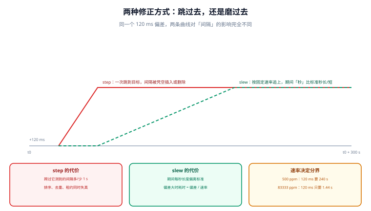

# 修正方式：slew 与 step

发现偏差之后，有两种把时钟拉回去的办法：**跳过去**（step）和**磨过去**（slew）。选哪种不是口味问题，而是「允许不允许某一段时间里的『一秒』不是一秒」。这一页把两种修正的代价算清楚，并给出可判定的分界线。



## 一、两种修正的语义差别

| 方式 | 英文 | 做法 | 墙钟读数 | 单调时钟 | 影响面 |
| --- | --- | --- | --- | --- | --- |
| 跳变 | step / settime | 直接把本地时钟设为参考值 | 一次不连续跳变 | 不受影响 | 所有读墙钟的程序 |
| 缓变 | slew / adjtime | 让本地时钟**走快或走慢一点**，逐步追上 | 连续、单调 | 不受影响 | 期间「一秒」的长度 |

::: info 术语首次出现
slew（缓变）在实现上是给内核一个频率修正量（`adjtimex` 的 `freq`），让时钟在若干秒内以偏离标准频率的方式运行。它**不改变单调性**，代价是这段期间的「秒」比标准秒长一点或短一点。
:::

关键结论先说：**step 破坏的是「不连续」，slew 破坏的是「秒长」。** 两者都不影响 `CLOCK_MONOTONIC`——单调时钟本来就是为「不受修正影响」而设计的。

## 二、谁决定跳还是磨

配置项只有三个，但它们共同决定了一个很实际的问题：一次 120 ms 的偏差，是磨 4 分钟还是跳一下。

| 配置 | 作用 | chrony 默认 | ntpd 默认 |
| --- | --- | --- | --- |
| `makestep <阈值> <前 N 次>` | 启动后前 N 次更新里，偏差超过阈值就 step | `makestep 1.0 3`（发行版通常自带） | 无（需 `-g` 才允许启动大跳） |
| `maxslewrate` | 允许的最大 slew 速率（ppm） | `83333.333` | 固定约 `500` |
| `corrtimeratio` | 偏差与频率修正的时间分配比例 | `3` | 无对应项 |

`makestep 1.0 3` 读作：**前 3 次时钟更新里，若偏差超过 1.0 s 就跳；之后一律只磨。** 这条设计的意图是——开机时可能偏差很大（RTC 不准），此时跳一下代价最低；运行稳定后再跳，就可能踩到别人的超时与去重。

::: danger 把 `makestep` 配成「全时段允许跳」是最常见的自伤
`makestep 1.0 -1`（或某些发行版模板里的等价写法）意味着**任何时候偏差超过 1 s 都可以跳**。此时一次上游抖动就能让线上时钟瞬间回拨 1 秒，而所有用墙钟计时的超时、租约、去重窗口会同时错位。本机实测：一次 −1.00 s 的 step 发生在第 10 秒，**30 s 超时的剩余时间从 20.00 s 变成 21.00 s**——超时被悄悄延长，没有任何日志。
:::

## 三、slew 的代价：这段时间的「秒」不标准

slew 期间的频率偏移是 `maxslewrate`。它决定了两个量：

1. **磨完需要多久** = 偏差 ÷ 速率。
2. **这段期间累计的「秒长」误差** = 速率 × 持续时间。

同一个 120 ms 偏差，在两代守护进程下差别巨大：

| 偏差 | `500 ppm`（旧版 ntpd） | `83333 ppm`（chrony 默认） |
| --- | --- | --- |
| 0.5 ms | 1.0 s | 0.01 s |
| 5 ms | 10.0 s | 0.06 s |
| 120 ms | **240.0 s（4 分钟）** | **1.44 s** |
| 150 ms | 300.0 s（5 分钟） | 1.80 s |

这个差别直接改变工程结论：**在旧版默认下，120 ms 的偏差要磨 4 分钟，期间每秒长 500 µs**。如果恰好有一小时的业务窗口落在这 4 分钟里，累计误差 = 500 ppm × 240 s = **120 ms**——正好等于要被磨掉的那个偏差。

## 四、step 的代价：四件事同时失真

| 受影响的东西 | 回拨 1 s 的后果 | 本机读数 |
| --- | --- | --- |
| 超时 | 剩余时间被延长，重试迟迟不触发 | 20.00 s → 21.00 s |
| 去重窗口 | 窗口前移，已处理的事件重新变「新」 | 回拨 5 s 重放 2 条、回拨 30 s 重放 15 条 |
| 租约 | 持有者认为自己还有更久，双主窗口变大 | 偏差 5 s / 租约 30 s → 重叠 16.7% |
| 日志排序 | 同一台机器内出现「后面的时间戳更早」 | 见第 6 章判错概率 |

前跳（本地变快）的后果是镜像的：超时提前触发、去重窗口缩短、租约提前失效。**两类都会「看起来像偶发 bug」**，因为它们在测试环境里几乎不出现——测试机的时钟通常很准。

## 五、可判定的分界线

选 step 还是 slew，可以写成一条不等式，而不是经验：

```text
可以接受 step  ⟺  这个偏差 × 受影响的事件率 × 单次错误代价  <  磨掉它的成本
```

工程上更实用的是反过来问三个问题：

1. **这段时间有没有「不可重入」的动作？** 结算、发号、扣库存、签合同——有就绝不能 step。
2. **系统能容忍多久的偏差？** 若业务 SLO 允许偏差存在 5 分钟，那就磨；若 5 分钟后会触发对账差异，就必须跳。
3. **跳完之后有没有补偿？** 没有补偿机制的 step，只是把错误从「时间」搬到「业务」里。

::: tip 一条可落地的默认策略
**启动期允许跳，运行期只磨，且用单调时钟兜住间隔。** 具体三句：
- `makestep 1.0 3`：只在开机前 3 次更新内允许跳 1 s 以上。
- 运行期偏差大于阈值时，先告警再人工决策，不要自动跳。
- 所有超时、租约、退避、去重窗口**一律读单调时钟**，这样即使有人手工跳了时钟，这些逻辑也不受影响。
:::

## 六、最小可运行：算一次 slew 要多久、期间秒长偏多少

```python
#!/usr/bin/env python3
"""slew 的时间与秒长偏差；以及与 step 的对照。"""


def slew_time(offset_s, rate_ppm):
    """磨完 offset 需要多少秒。"""
    return abs(offset_s) / (rate_ppm * 1e-6)


def sec_length(rate_ppm):
    """slew 期间「一秒」实际是多长（相对标准秒）。"""
    return 1 + rate_ppm * 1e-6


def window_error(rate_ppm, window_s):
    """一个 window_s 长的业务窗口完全落在 slew 期间时，累计偏差。"""
    return rate_ppm * 1e-6 * window_s


for rate in (500, 83333):
    print(f"maxslewrate = {rate} ppm")
    for off in (0.0005, 0.005, 0.120, 0.150):
        t = slew_time(off, rate)
        print(f"  偏差 {off*1e3:6.1f} ms -> 磨 {t:8.2f} s；"
              f"期间 1 s = {sec_length(rate):.6f} s；"
              f"整小时同速累计 {window_error(rate, 3600):6.2f} s")
    print()

# step 的代价：一段 30 s 超时里发生回拨
D = 30.0
for step in (-1.0, 1.0):
    print(f"step {step:+.1f} s 发生在 t=10 s：剩余 "
          f"{D - (10 + step):.2f} s（正确值 {D - 10:.2f} s）")
```

输出：

```text
maxslewrate = 500 ppm
  偏差    0.5 ms -> 磨     1.00 s； 期间 1 s = 1.000500 s； 整小时同速累计   1.80 s
  偏差    5.0 ms -> 磨    10.00 s； 期间 1 s = 1.000500 s； 整小时同速累计   1.80 s
  偏差  120.0 ms -> 磨   240.00 s； 期间 1 s = 1.000500 s； 整小时同速累计   1.80 s
  偏差  150.0 ms -> 磨   300.00 s； 期间 1 s = 1.000500 s； 整小时同速累计   1.80 s

maxslewrate = 83333 ppm
  偏差    0.5 ms -> 磨     0.01 s； 期间 1 s = 1.083333 s； 整小时同速累计 300.00 s
  偏差    5.0 ms -> 磨     0.06 s； 期间 1 s = 1.083333 s； 整小时同速累计 300.00 s
  偏差  120.0 ms -> 磨     1.44 s； 期间 1 s = 1.083333 s； 整小时同速累计 300.00 s
  偏差  150.0 ms -> 磨     1.80 s； 期间 1 s = 1.083333 s； 整小时同速累计 300.00 s

step -1.0 s 发生在 t=10 s：剩余 21.00 s（正确值 20.00 s）
step +1.0 s 发生在 t=10 s：剩余 19.00 s（正确值 20.00 s）
```

::: danger 这张表最容易被读反的地方
- 「磨得快」不等于「代价小」。`83333 ppm` 那一组磨得很快（120 ms 只要 1.44 s），但**期间「一秒」是 1.083333 s——8.3% 的偏差**。如果这段时间里有一个按秒计费的窗口、或者一个 1 s 精度的限流器，它会看到「1 秒里来了更多请求」。

- 反过来，`500 ppm` 那一组秒长只偏 0.05%，但磨 120 ms 要 4 分钟，**期间一直带着这个偏差在跑**。所以「哪个更好」取决于业务能容忍的是「短时间的 8% 秒长偏差」还是「4 分钟的小偏差」——这是一个必须由业务回答的问题，不是配置问题。
:::

## 七、易错点

::: danger 五个真实踩过的坑
1. **`makestep` 配成全时段。** 一次上游抖动就回拨 1 s，超时、租约、去重同时错位。判据：`makestep` 的第二个参数是正的且很小。
2. **以为 slew 对间隔没影响。** 500 ppm 下每小时累计 1.80 s，83333 ppm 下 **300.00 s**。判据：slew 期间有长窗口业务时，间隔必须读单调时钟。
3. **虚拟机迁移后立刻手工 `ntpdate`。** 迁移造成的跳跃往往是一次性的，手工跳会让正在跑的定时任务重放。判据：先看 `System time` 是否还在增长，再决定。
4. **`chronyc makestep` 当重启开关用。** 它跳的是时钟，不是进程；跳完 `Frequency` 并没有重估。判据：跳完必须观察 `Skew` 是否收敛。
5. **以为 `adjtimex -f` 改的是 offset。** `-f` 改的是频率，`-o` 才是 offset，两个参数搞反会把机器调成「一直偏一点且越走越快」。判据：改之前先读一次 `adjtimex -p`。
:::

## 本页判据

本页判据族 `CKW-A` ~ `CKW-H`，共 8 条。

| 判据 | 约定 | 定错了会怎样 | 怎么验证 |
| --- | --- | --- | --- |
| `CKW-A` | 区分「step 破坏不连续」「slew 破坏秒长」，不笼统说「校准」 | 以为磨过去就没影响 | 文档里两种方式的代价分别写 |
| `CKW-B` | `makestep` 第二个参数必须为正且 ≤ 5 | 运行期随时可跳，事故源 | 配置文件里 `makestep` 一行人工核对 |
| `CKW-C` | 生成环境禁止全时段 step；偏差超阈值走告警 + 人工决策 | 一次回拨打断所有墙钟计时 | 变更记录里注明跳变审批人 |
| `CKW-D` | > 1 s 的偏差必须给「磨多久」的估算，不直接跳 | 跳变范围不可控 | 估算式 `偏差 ÷ maxslewrate` 出现在记录中 |
| `CKW-E` | `maxslewrate` 取默认值时，要说明「期间秒长偏 8.3%」 | 按秒计费的窗口被算错 | 配置说明里写明速率与其含义 |
| `CKW-F` | 所有超时/租约/退避/去重窗口读单调时钟 | step 时这些逻辑同时错位 | 代码检索 `time.time()` / `Date.now()` 用法 |
| `CKW-G` | 虚拟化迁移或 RTC 异常后，先观察 `System time` 趋势再决定跳 | 手工跳导致定时任务重放 | 处置步骤里含「先观察 2 个采样周期」 |
| `CKW-H` | 跳变后必须复核 `Skew` 与 `Frequency` 是否收敛 | 以为跳完就完事，频率仍是错的 | 跳变后 10 分钟内再取一次 `tracking` |

## 验证方式

```shell
# 1. 复跑本页脚本（存成 /tmp/ck_slew.py）
python3 /tmp/ck_slew.py
# 期望：500 ppm 下 120 ms 磨 240.00 s；83333 ppm 下 1.44 s；step -1.0 剩余 21.00 s

# 2. 查本机当前的 makestep 与 maxslewrate
grep -E '^\s*(makestep|maxslewrate)' /etc/chrony.conf /etc/chrony/chrony.conf 2>/dev/null
# 期望：makestep 的第二个参数为正；没有「-1」全时段配置

# 3. 旧版对照（存量机器）
grep -E '^\s*(tinker|server)' /etc/ntp.conf 2>/dev/null | head
# 期望：能看到 tinker 段；旧版没有 maxslewrate 项，固定 500 ppm

# 4. 确认业务代码没有用墙钟算间隔
grep -rn --include='*.py' -E 'time\.time\(\)\s*-\s*' . | head
# 期望：命中处逐一核对，间隔计算应改用 time.monotonic()

# 5. 检查本页判据族定义完整
grep -c 'CKW-[A-H]' docs/Ops/ClockSync/SlewStep/index.md
# 期望：≥ 8
```

## 参考资料

- [RFC 5905 §7.2 — 时钟调整与 slew 的实现约束](https://www.rfc-editor.org/info/rfc5905)
- [chrony 官方文档 — `makestep` 与 `maxslewrate`](https://chrony-project.org/doc/4.6/chrony.conf.html)
- [Linux man-pages — adjtime(3) 与 adjtimex(2)（slew 的内核接口）](https://man7.org/linux/man-pages/man3/adjtime.3.html)
- [ntpd 文档 — `-g` 与 `tinker` 选项](https://www.ntp.org/documentation/4.2.8-series/ntpd/)
- [本库：幂等状态机 · 并发守卫](../../../Backend/IdempotencyStateMachine/ConcurrencyGuard/index.md)
- [本册目录页](../index.md)
