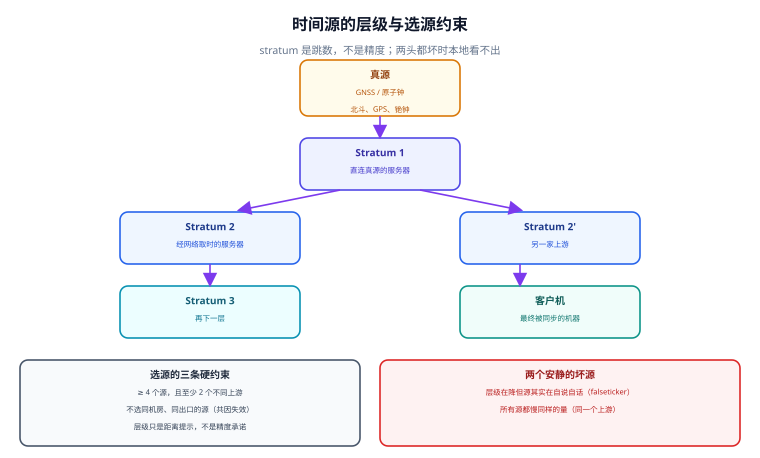

# 时间源与层级

「同步了」这三个字里，最不确定的部分不是算法，而是**你选的源**。源选错的时候，守护进程会把一个错误的偏差当成真值，然后用它去修正本地时钟——过程中不报任何错误，`tracking` 里的每一行都很好看。



## 一、真源、层级，以及「跳数不是精度」

| 概念 | 英文 | 含义 | 常见误解 |
| --- | --- | --- | --- |
| 真源 | Reference clock | 直接产生标准频率的设备：GNSS 接收机、铯/铷钟 | 以为「stratum 0」是一个网络地址 |
| 层级 | Stratum | 距真源的**跳数**，真源为 0，直连为 1 | 以为 stratum 1 一定比 stratum 2 准 |
| 上游 | Upstream / peer | 本机正在取时的那些服务器 | 以为选一个就够了 |
| 权重 | 由算法决定 | 由 `root delay`、`root dispersion`、抖动共同决定 | 以为可以手工指定「以谁为准」 |

::: info 术语首次出现
Stratum（层级）是 NTP 报文头部的一个 8 位字段，含义是「这个应答距离参考时钟经过了几台服务器」。它**只表达拓扑距离**：一台 stratum 1 服务器如果网络抖动 80 ms，本地误差可能比一台网络良好的 stratum 3 更大。把层级当精度承诺，是选源最常见的错。
:::

层级还有一个容易忽略的边界：**stratum 16 表示「不可用」**。当一台机器长时间取不到源，它会把自己的 stratum 抬到 16，此时它的下游会发现「这个源不能用了」——这是协议里少见的、会主动叫的失败。

## 二、选源的三条硬约束

### 约束一：至少 4 个源，且不同上游

这不是「多几个更保险」的经验之谈，而是**多数派判定**的下限。NTP 的交集算法（Marzullo 算法）靠「大多数源声明的区间互相重叠」来定位真值：

- 3 个源：能容忍 1 个坏源（剩下 2 个形成多数），但**无法定位是谁坏了**——只知道「这 3 个里有一个不对」。
- 4 个源：能容忍 1 个坏源并定位它；2 个坏源时多数派落在坏源一侧，基本失效。
- 5 个源：能容忍 2 个坏源。

本机 4,000 次仿真（好源误差 σ = 1 ms，坏源偏 ±500 ms，声明区间 ±2 ms）实测：

| 源数 | 0 个坏源 | 1 个坏源 | 2 个坏源 |
| --- | --- | --- | --- |
| 3 | 100.00% | 99.88% | **0.07%** |
| 4 | 100.00% | 100.00% | 74.92% |
| 5 | 100.00% | 100.00% | 99.65% |
| 6 | 100.00% | 100.00% | 100.00% |

3 个源在 2 个坏源时选对率掉到 **0.07%**——不是「误差变大」，是**结论反过来**：多数派站在错的一边，本地时钟被拉向错误的 500 ms。

### 约束二：不要选同一出口、同一机房的源

这条约束针对的不是「坏源」，而是**共因失效**：当所有源的上游最终都指向同一台服务器，它们就会在同一个时刻一起错。

本机仿真里，让 3 / 4 / 6 个源全部共用一个偏 +500 ms 的上游，交集算法**每次都通过了全部源**（覆盖 3/3、4/4、6/6），估计值 +499.5 ~ +499.9 ms——**检出率 0%**。原因很简单：没有任何一个源站在真值一侧，算法没有可用的多数派参照。

::: danger 最容易被当成「没问题」的共因失效
同一个云厂商、同一个地域、同一个 VPC 里的三台 NTP 服务器，看着是「三个源」，实际是**一个源的三份副本**。它们在厂商内部可能就共用一台上游。判据不是「域名不同」，而是：**至少两个源属于不同的运营主体，或其中一个是自建的 GNSS 授时**。
:::

### 约束三：`iburst` 只影响起步，不影响稳态

`iburst` 让守护进程在启动后的头几个周期**快速连发**若干次采样（chrony 是 4 次，间隔 2 s），把「第一次能用」的时间从几分钟压到几十秒。它不改变稳态精度，也不改变选源结果。把它当成「提高精度」的开关，是最常见的误读。

## 三、源的质量指标：四个数分别说什么

`chronyc sources -v`（或 `ntpq -p`）每个源一行，右侧四列是关键：

| 列 | 含义 | 读法 | 异常形态 |
| --- | --- | --- | --- |
| `Stratum` | 该源自称的层级 | 与 `Reach` 一起读 | 自己在降层（逐步升到 16）= 它也在失去上游 |
| `Poll` | 当前采样间隔（2 的幂，秒） | 稳态通常 64~1024 s | 一直停在 64 = 环路不敢放宽（源在抖） |
| `Reach` | 最近 8 次探测的成功位图（八进制） | `377` = 全成功 | `0` = 全军覆没；`357` = 中间丢过 |
| `LastRx` | 距上次成功应答多久 | 应小于 `Poll` | 大于 `Poll` 说明应答缺失 |

状态符的意义必须逐个记住，它直接决定排障方向：

| 状态符 | 含义 | 第一处置 |
| --- | --- | --- |
| `^*` | 当前被选中的同步源 | 正常，看它的 `offset` 与 `jitter` |
| `^+` | 可接受的备选源 | 正常，参与交集但不驱动修正 |
| `^-` | 被交集算法排除 | 该源与多数派不一致，查它自己的上游 |
| `^x` | falseticker（被判为撒谎） | **不要急着删它**，先确认是它坏还是多数派坏 |
| `^?` | 不可达或未通过测试 | 网络、ACL、`Reach=0` |
| `^~` | 时间过于不稳定（抖动超限） | 查网络丢包与源负载 |

`^x` 与 `^-` 的区别值得单独说：`^-` 是「你不合群」，`^x` 是「你大概率在撒谎」。前者可能是多数派错了，后者是算法给出了更强的判断。**在只有 3 个源的环境里，`^x` 的出现意味着「无法确定谁错」，此时正确的动作是加源，不是删源。**

## 四、最小可运行：判断「我这套源能不能容忍一个坏源」

下面这段脚本实现交集算法的最小版本，用来回答一个具体问题：给定当前的源数与声明区间，一个坏源会把结果带偏多少。

```python
#!/usr/bin/env python3
"""Marzullo 交集的最小实现：给定若干源的 (中心, 半径)，返回最可信区间。"""


def marzullo(intervals):
    """intervals: [(lo, hi), ...]；返回 (中点, 覆盖数, 区间宽)。"""
    edges = []
    for lo, hi in intervals:
        edges.append((lo, +1))
        edges.append((hi, -1))
    edges.sort()
    best = cur = 0
    seg, start, out = 0, None, None
    for pos, d in edges:
        cur += d
        if cur > best:
            best, start = cur, pos
        elif cur < best and start is not None:
            if out is None or best >= out[1]:
                out = (start, best, pos)
            start = None
    if out is None:                      # 全部同层：退化成整体区间
        lo = min(i[0] for i in intervals)
        hi = max(i[1] for i in intervals)
        return (lo + hi) / 2, len(intervals), hi - lo
    s, cover, e = out
    return (s + e) / 2, cover, e - s


# 场景 A：3 个好源（误差 ±1 ms）
good = [(-0.001 - 0.002, -0.001 + 0.002),
        (0.000 - 0.002, 0.000 + 0.002),
        (0.001 - 0.002, 0.001 + 0.002)]
print("3 个好源            ->", marzullo(good))

# 场景 B：3 个源，其中 1 个偏 +500 ms
mixed = good[:2] + [(0.500 - 0.002, 0.500 + 0.002)]
print("2 好 + 1 坏(500ms)  ->", marzullo(mixed))

# 场景 C：3 个源，其中 2 个偏 +500 ms（多数派是错的）
bad2 = good[:1] + [(0.500 - 0.002, 0.500 + 0.002), (0.501 - 0.002, 0.501 + 0.002)]
print("1 好 + 2 坏(500ms)  ->", marzullo(bad2))

# 场景 D：4 个源，其中 2 个偏 +500 ms
bad4 = good[:2] + [(0.500 - 0.002, 0.500 + 0.002), (0.501 - 0.002, 0.501 + 0.002)]
print("2 好 + 2 坏(500ms)  ->", marzullo(bad4))
```

输出（单位：秒）：

```text
3 个好源            -> (0.0, 3, 0.002)
2 好 + 1 坏(500ms)  -> (-0.0005, 2, 0.003)
1 好 + 2 坏(500ms)  -> (0.5005, 2, 0.003)
2 好 + 2 坏(500ms)  -> (-0.0005, 2, 0.003)
```

::: danger 第三行与第四行说的是同一件事：**覆盖数相等时，结论由平票规则决定，不由数据决定**
- 第三行「1 好 + 2 坏」跟着多数派走到了 **0.5005**（错）。第四行「2 好 + 2 坏」回到了 **-0.0005**（对），但它的**覆盖数同样是 2**——与上一行一模一样。也就是说：算法此刻没有任何依据判断哪一对更可信，只是碰巧先扫到了正确那一对的边界。

- 这正好解释了 4,000 次仿真的读数：n = 4、f = 2 时选对率只有 **74.92%**，而不是 100%——剩下的 25% 是「平票时站错边」。多一个源没有救回来，因为多出来的那个源虽然站在正确一侧，却仍然只是平票的一半。

- 结论写起来只有一句：**能容忍的坏源数 f 与源数 n 的关系是 n ≥ 2f + 1；平票（n = 2f）不是「一半概率」，是「结论由实现细节决定」。** 想要容忍 1 个坏源，至少要 3 个源；想要容忍 2 个，至少要 5 个。
:::

## 五、易错点与最佳实践

::: danger 六个真实踩过的坑
- **正确做法**：源数 ≥ 4 且至少两个不同运营主体；平票时用「覆盖数 + 层级 + 显式配置顺序」定规，把规则写在配置里，而不是依赖实现扫描边界的先后。
1. **只配一个源，还开了 `makestep`。** 单源没有任何交叉验证能力，源给了 +500 ms 本地就跳 500 ms，且 `root dispersion` 仍显示「±2 ms」。判据：源数 ≥ 4。
2. **四个源全在同一家云、同一地域。** 共因失效下检出率 0%（实测 0/3、0/4、0/6 全部漏检）。判据：至少两个不同运营主体，或一个自建 GNSS。
3. **`pool.ntp.org` 写四次。** 四次解析可能落到同一个 IP 段，等于一个源。判据：`chronyc sources` 里看 IP，不只看域名。
4. **看到 `^x` 就删源。** `^x` 也可能是多数派错了。删源会把源数降下来，让下一次判断更难。判据：先加源到 2f+1，再决定剔除谁。
5. **把 `iburst` 当成精度开关。** 它只压缩起步时间（从几分钟到几十秒），不改变稳态。判据：描述 `iburst` 时不说「更准」。
6. **把 stratum 当 SLA。** 见过 stratum 1 的机器因为上游 GNSS 天线被遮挡，长期偏 300 ms；也见过 stratum 4 的机器误差 200 µs。判据：只看 `root delay` / `root dispersion` / `jitter`，不看层级。
:::

::: tip 选源的一页纸
1. **数量**：≥ 4（要容忍 2 个坏源则 ≥ 5）。
2. **来源**：≥ 2 个不同运营主体；有条件就自建一个 GNSS 源。
3. **网络**：`root delay` 尽量 < 10 ms；跨地域的源不要作为主源。
4. **起步**：全部加 `iburst`；稳态 `poll` 允许自动放宽到 1024 s。
5. **收口**：把「源数、被选中源、`root dispersion`、falseticker 计数」四项纳入监控。
:::

## 本页判据

本页判据族 `CKS-A` ~ `CKS-H`，共 8 条。

| 判据 | 约定 | 定错了会怎样 | 怎么验证 |
| --- | --- | --- | --- |
| `CKS-A` | 源数 ≥ 4（容忍 2 个坏源则 ≥ 5），按 n ≥ 2f+1 论证 | 2 个坏源时选对率 0.07% | `chronyc sources` 计数并与 f 一起写进文档 |
| `CKS-B` | 至少两个源属不同运营主体，或含一个自建 GNSS 源 | 共因失效检出率 0% | 列出来源清单，标明运营主体 |
| `CKS-C` | 不以 stratum 论证精度，只用 `root delay` / `root dispersion` / `jitter` | 选了台偏 300 ms 的 stratum 1 | 精度结论里不出现「层级」二字 |
| `CKS-D` | `^x` 与 `^-` 分开处置：前者先加源，后者查上游 | 删源后判断能力更弱 | 分诊表里两种符号处置不同 |
| `CKS-E` | `pool.ntp.org` 多处配置时要核对实际 IP | 一个源被当成四个 | `chronyc sources` 输出里 IP 去重后 ≥ 4 |
| `CKS-F` | `iburst` 只描述「起步更快」，不提精度 | 误以为开关能提高稳态精度 | 文档措辞核对 |
| `CKS-G` | `stratum 16` 视为「该源不可用」，纳入告警 | 上游失效无人知 | 监控里有 stratum = 16 的规则 |
| `CKS-H` | 源变更留「改前源清单 + 改后源清单 + 偏差对照」 | 变更后无法归因 | 变更记录三段齐全 |

## 验证方式

```shell
# 1. 复跑本页脚本（存成 /tmp/ck_marzullo.py）
python3 /tmp/ck_marzullo.py
# 期望：四行输出；第 3 行中点为 0.5005（跟随多数派），第 2、4 行覆盖数同为 2

# 2. 数源、看状态符与层级（Linux）
chronyc sources -v
# 期望：被选中源有且只有一个 ^*；总数 ≥ 4；没有 stratum 16

# 3. 看每个源的实际 IP（确认不是同一个源的四个域名）
chronyc sources | awk '/^\^\*/ || /^\^\+/ {print $3}'
# 期望：去重后数量 ≥ 4

# 4. 检查本页判据族定义完整
grep -c 'CKS-[A-H]' docs/Ops/ClockSync/TimeSource/index.md
# 期望：≥ 8
```

## 参考资料

- [RFC 5905 §11.2 — Selection and Clustering Algorithms（交集算法）](https://www.rfc-editor.org/info/rfc5905)
- [RFC 8633 §3 — NTP 部署与源数量建议](https://www.rfc-editor.org/info/rfc8633)
- [chrony 官方文档 — sources 状态符与字段含义](https://chrony-project.org/doc/4.6/chronyc.html)
- [NTP Pool Project — 使用 `pool` 指令而非重复 `server`](https://www.ntppool.org/en/use.html)
- [本库：DNS 解析工程与域名治理](../../DnsResolution/index.md)
- [本册目录页](../index.md)
