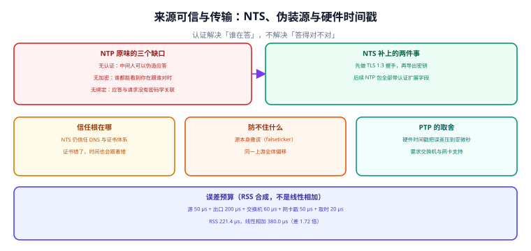

# 来源可信与传输：NTS 与硬件戳

「时间准」和「时间可信」是两件事。前者问误差多大，后者问**这个误差是谁给的、路上有没有人改过**。一条链路上任何一跳被伪造就够了——而伪造 NTP 应答比大多数人想的容易得多：它是一种无状态、无认证、UDP 单包的协议。



## 一、原味 NTP 的三个缺口

| 缺口 | 具体形态 | 后果 |
| --- | --- | --- |
| 无认证 | 应答里没有任何密码学校验 | 中间人可以伪造应答，把时间推到任意值 |
| 无加密 | 全程明文 UDP | 谁都能看到你在与谁对时（可用来定位内网结构） |
| 无绑定 | 应答与请求没有关联标识（除弱随机数） | 攻击者可以先发制人（spoofing）抢在真应答之前 |

::: info 术语首次出现
NTS（Network Time Security，网络时间安全）由 [RFC 8915](https://www.rfc-editor.org/info/rfc8915) 定义，做法是：先用 TLS 1.3 在 **TCP 4460** 上完成一次握手（称为 NTS-KE），双方导出若干密钥与 cookie，之后每个 NTP 包都带上「认证扩展字段」（Authenticator and Encrypted Extension Fields）。它加密的是**认证信息**，不加密整个 NTP 包。
:::

## 二、NTS 补了什么，又补不了什么

| 问题 | NTS 能解决 | NTS 不能解决 |
| --- | --- | --- |
| 中间人伪造应答 | 是（包被改则校验失败） | — |
| 谁在给对时被窃听 | 部分（cookie 与密钥保密，服务器地址仍可见） | 上游服务器身份对旁观者仍可见 |
| 源本身撒谎（falseticker） | **否** | 它与客户端之间的通道是「可信」的，只是内容错 |
| 所有源共用一个上游 | **否** | 认证不产生多样性 |
| 上游证书被攻破 | **否** | 信任根仍是 DNS + 证书体系 |

::: danger NTS 最容易引起的误解
- 「开了 NTS 就安全了」——不成立。NTS 保证的是「**你收到的这个应答，确实来自你选的那台服务器，且没被改过**」。它不保证「这台服务器说得对」。

- 所以第 2 章那套选源规则一条都没被替代：源数 ≥ 4、至少两个不同运营主体。NTS 保护「一对一通道」，交集算法保护「多数派正确」——**两者是正交的**。
:::

配置上，chrony 只需在 `server` 行后加 `nts`，并把 `ntsdumpdir` 指到一个可写目录（cookie 要持久化，否则每次重启都要重新握手）：

```text
# /etc/chrony.conf（片段）
server time1.example.net iburst nts
server time2.example.net iburst nts
ntsdumpdir /var/lib/chrony
```

## 三、PTP 与硬件时间戳：收益取决于「谁是主导项」

PTP（Precision Time Protocol，IEEE 1588）的核心不是协议更复杂，而是**时间戳在网络硬件上打**：网卡 PHY 在电信号进出的一刻打戳，绕过中断、驱动与内核协议栈。理论上它能到亚微秒级。

但「理论上」和「你的链路上」是两件事。本机按公开量级给两套预算各算一次：

| 项 | NTP + 软件时间戳 | PTP + 硬件时间戳 |
| --- | --- | --- |
| 源（GNSS / 原子钟） | 50 µs | 50 µs |
| 授时服务器出口 | 200 µs | 200 µs |
| 交换机转发 | 60 µs | 60 µs（需透明时钟） |
| 网卡打戳 | 150 µs（中断 + 驱动） | 10 µs（PHY 硬件戳） |
| 内核协议栈 | 80 µs | —（已绕过） |
| 应用取时 | 20 µs | 20 µs |
| **RSS 合成** | **274.6 µs** | **215.9 µs** |
| **线性相加** | **560.0 µs** | **340.0 µs** |

::: danger 这张表最重要的结论是「收益没有想象的大」
- 把软件戳换成硬件戳，RSS 只从 **274.6 µs** 降到 **215.9 µs**（**1.27 倍**）。原因是**主导项不是打戳方式，而是授时服务器出口的 200 µs**。

- 所以工程判断应该是：**只有当整条链路都换成 PTP（源、服务器出口、交换机透明时钟、网卡）时，才拿得到亚微秒**。只换网卡，等于在一个 274 µs 的预算里抠掉 150 µs 的一小部分。
:::

再看另一头：公网 NTP 的 `root delay` 常常就是几毫秒，它直接折算成单侧误差：

| `root delay` | 单侧误差贡献（`root delay / 2`） | 与上面的 274 µs 相比 |
| --- | --- | --- |
| 1.0 ms | 0.50 ms | 1.8 倍 |
| 5.0 ms | 2.50 ms | 9.1 倍 |
| 20.0 ms | 10.00 ms | 36.4 倍 |
| 80.0 ms | 40.00 ms | 145.6 倍 |

一条公网路径的 `root delay` 就把「毫秒以下的所有优化」全部盖住了。**先量 `root delay`，再谈 PTP**——顺序反了，钱花在看不见的地方。

## 四、最小可运行：把两种时间戳方式算成一张预算表

```python
#!/usr/bin/env python3
"""误差预算：软件时间戳 vs 硬件时间戳，RSS 与线性各算一次。"""
import math


def rss(vals):
    return math.sqrt(sum(v * v for v in vals))


SW = [("源（GNSS/原子钟）", 50e-6), ("授时服务器出口", 200e-6), ("交换机转发", 60e-6),
      ("网卡软件戳（中断+驱动）", 150e-6), ("内核协议栈", 80e-6), ("应用取时", 20e-6)]
HW = [("源（GNSS/原子钟）", 50e-6), ("授时服务器出口", 200e-6), ("交换机转发（透明时钟）", 60e-6),
      ("网卡硬件戳（PHY）", 10e-6), ("内核到应用", 20e-6)]

for name, b in (("NTP + 软件时间戳", SW), ("PTP + 硬件时间戳", HW)):
    r, lin = rss([v for _, v in b]), sum(v for _, v in b)
    print(f"{name:20s} RSS {r*1e6:6.1f} us / 线性 {lin*1e6:6.1f} us")
    top = max(b, key=lambda x: x[1])
    print(f"  主导项：{top[0]}（{top[1]*1e6:.0f} us，占 RSS 的 "
          f"{top[1]/rss([v for _, v in b])*100:.0f}%）")

a = rss([v for _, v in SW])
c = rss([v for _, v in HW])
print(f"换硬件戳的收益：{a/c:.2f} 倍")

print("\n公网 root delay 折算到单侧误差：")
for rd in (0.001, 0.005, 0.020, 0.080):
    print(f"  root delay {rd*1e3:5.1f} ms -> 单侧 {rd/2*1e3:5.2f} ms（是 274 us 的 {rd/2/274e-6:5.1f} 倍）")
```

输出：

```text
NTP + 软件时间戳       RSS  274.6 us / 线性  560.0 us
  主导项：授时服务器出口（200 us，占 RSS 的 73%）
PTP + 硬件时间戳       RSS  215.9 us / 线性  340.0 us
  主导项：授时服务器出口（200 us，占 RSS 的 93%）
换硬件戳的收益：1.27 倍

公网 root delay 折算到单侧误差：
  root delay   1.0 ms -> 单侧  0.50 ms（是 274 us 的   1.8 倍）
  root delay   5.0 ms -> 单侧  2.50 ms（是 274 us 的   9.1 倍）
  root delay  20.0 ms -> 单侧 10.00 ms（是 274 us 的  36.5 倍）
  root delay  80.0 ms -> 单侧 40.00 ms（是 274 us 的 146.0 倍）
```

「占 RSS 的 93%」这行值得单独看：换成硬件戳之后，预算**几乎只剩服务器出口那一项**。这时候再优化客户端侧的任何东西，收益都趋近于零——**该动的是上游**。

## 五、易错点

::: danger 六个真实踩过的坑
- **正确做法**：NTS 之外仍要满足第 2 章的选源规则（源数 ≥ 4、两个运营主体）；加密传输证明的是「这条通道没被改」，证明不了「这台服务器说得对」，两者必须同时具备。
1. **以为 NTS 能替代选源。** NTS 保的是通道，交集算法保的是多数派。判据：两套措施都在。
2. **`ntsdumpdir` 指到只读目录。** 每次重启都重新握手，起步时间变长且可能失败。判据：目录可写、cookie 文件存在。
3. **只换网卡就宣称亚微秒。** 主导项可能是上游 200 µs。判据：给出整链预算而不是单点指标。
4. **交换机没有透明时钟却上了 PTP。** 排队时延没被补偿，精度退化到与 NTP 同量级。判据：链路设备支持说明。
5. **用 `udp 123` 的 ACL 挡掉 NTS。** NTS-KE 走 **TCP 4460**，只放 123 会握手失败。判据：防火墙两侧都放行。
6. **把「时钟同步成功」当成「时钟可信」。** 前者是状态，后者要证据链（源、认证、交叉验证）。判据：验收清单里有可信性条目。
:::

## 本页判据

本页判据族 `CKA-A` ~ `CKA-H`，共 8 条。

| 判据 | 约定 | 定错了会怎样 | 怎么验证 |
| --- | --- | --- | --- |
| `CKA-A` | 区分「准」（误差多大）与「可信」（谁给的、有没有被改） | 用同步状态替代可信性证据 | 文档里两个概念各有位置 |
| `CKA-B` | NTS 不替代选源，两套措施同时存在 | 源被污染时认证照样通过 | 配置里既有 `nts` 也有 ≥ 4 个源 |
| `CKA-C` | 防火墙同时放行 TCP 4460（NTS-KE）与 UDP 123 | 握手失败，回退到无认证 | 两侧规则都在 |
| `CKA-D` | `ntsdumpdir` 指向可写且持久化的目录 | 每次重启重新握手 | cookie 文件存在且重启后仍在 |
| `CKA-E` | 上 PTP 前先量 `root delay`，主导项在上游时先改上游 | 钱花在看不见的地方 | 有 `root delay` 读数与预算表 |
| `CKA-F` | 宣称亚微秒必须给出整链预算，不用单点指标 | 承诺无法兑现 | 预算表覆盖源到应用 |
| `CKA-G` | PTP 要求链路设备支持透明时钟/边界时钟 | 精度退化到 NTP 量级 | 设备型号与能力说明 |
| `CKA-H` | 可信性验收含「源、认证、交叉验证」三项证据 | 只有一项就当通过 | 验收清单三条可核对 |

## 验证方式

```shell
# 1. 复跑本页脚本（存成 /tmp/ck_budget.py）
python3 /tmp/ck_budget.py
# 期望：274.6 us / 215.9 us；换硬件戳收益 1.27 倍；root delay 5 ms -> 单侧 2.50 ms

# 2. 看本机是否真的用上了 NTS（chrony 4.x）
chronyc -N authdata
# 期望：每行有 Mode / Key / Cookies 等字段；NTS 生效时 Mode 非空

# 3. 确认防火墙放行了 NTS-KE
ss -tnp | grep 4460 ; ss -unp | grep 123
# 期望：4460 有 ESTABLISHED 或曾连接；123 有绑定

# 4. 量一次公网源的 root delay，决定要不要谈 PTP
chronyc tracking | grep -E 'Root delay|Root dispersion'
# 期望：若 root delay > 5 ms，先优化上游路径而不是客户端打戳方式

# 5. 检查本页判据族定义完整
grep -c 'CKA-[A-H]' docs/Ops/ClockSync/TrustBoundary/index.md
# 期望：≥ 8
```

## 参考资料

- [RFC 8915 — Network Time Security for the Network Time Protocol](https://www.rfc-editor.org/info/rfc8915)
- [RFC 8633 — NTP Best Current Practices（部署与安全建议）](https://www.rfc-editor.org/info/rfc8633)
- [IEEE 1588-2019 — Precision Clock Synchronization（PTPv2.1）](https://standards.ieee.org/ieee/1588/6825/)
- [chrony 官方文档 — `nts` / `ntsdumpdir` / `chronyc authdata`](https://chrony-project.org/doc/4.6/chrony.conf.html)
- [本册：怎么证明准（误差界与预算合成）](../Measurement/index.md)
- [本册目录页](../index.md)
