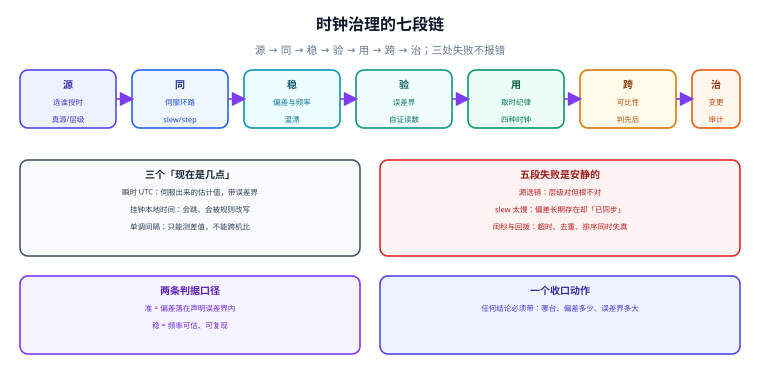
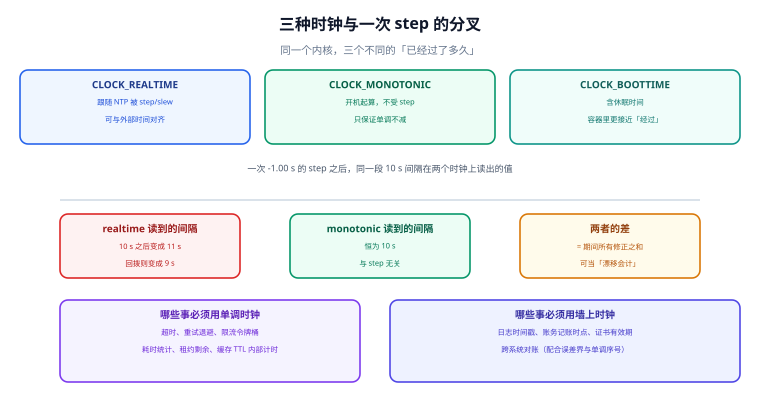

# 网络时间同步与时钟治理

<p style="text-align:center;"></p>

一台机器上的「现在几点」，不是一个事实，而是一个**被同步出来的估计值**：它由一个不确定的时间源、一条有延迟的网络、一个会随温度变化的晶振、一段会跳变的内核代码共同决定。绝大多数时候它足够好，所以没人看它；等到有人看它，通常是因为某件事已经错了——证书突然「尚未生效」、超时提前触发、两条日志的先后顺序反了、分布式锁出现了两个持有者。

本册讲的是**时钟这条链路本身**：时间从哪来、怎么被拖到本地、偏多少、准到多少、凭什么证明、以及应用该怎么用它。至于「同一个时刻在不同时区该显示成什么」，属于[全球化与时区本地化](../../Backend/Globalization/TimeZoneDST/index.md)那一册；至于「怎么监控它」，属于[监控告警](../Monitoring/index.md)。

::: info 本册定位与读数口径
适用对象：需要为线上机器的**时间正确性**负责的运维、平台与后端工程师；读者已经会看 `date`，但需要在事故里回答「这台机器的时间能不能被信任、误差有多大」。

协议与实现事实已按官方文档核对（2026-11-11）：[RFC 5905](https://www.rfc-editor.org/info/rfc5905)（NTPv4）、[RFC 8915](https://www.rfc-editor.org/info/rfc8915)（NTS，Network Time Security）、[IEEE 1588-2019](https://standards.ieee.org/ieee/1588/6825/)（PTPv2.1）、[RFC 8536](https://www.rfc-editor.org/info/rfc8536)（tzdb 与时区文件格式）、[RFC 9562](https://www.rfc-editor.org/info/rfc9562)（UUIDv7 的时间语义）；chrony 配置项与读数含义以 [chrony 官方文档](https://chrony-project.org/documentation.html) 为准（`makestep`、`maxslewrate` 默认 `83333.333` ppm）。

本册全部读数来自本机 **Python 3.13.12 标准库**按上述语义建模的仿真（固定种子 `20261111`，脚本不入库、读者可照文档复现），**不是生产网络的基准测量**；涉及收敛时间、误差界、判错概率的结论，上线前请用自己机房的读数替换。
:::

## 一、为什么单独开一册：时间错了，错法是安静的

时钟出问题的三个特点，决定了它必须有自己的一册：

| 特点 | 表现 | 为什么别的册子接不住 |
| --- | --- | --- |
| **不报错** | `date` 有输出、`systemctl status` 是 active、监控一片绿 | 没有任何接口会因为「时间偏了 3 秒」而返回失败 |
| **跨层** | 内核、虚拟化、网络、证书、数据库、业务代码各用一次 | 时区册讲「怎么显示」，监控册讲「怎么采」，都不讲「这个值可不可信」 |
| **错得晚** | 偏差每天积累 0.86 秒，一周后才越过阈值 | 当时的事件日志、当时的判断依据都已经写完了 |

::: danger 三句最容易说错的话
1. **「NTP 开着就是准的」**——`systemctl is-active chronyd` 只说明进程活着。`chronyc tracking` 里 `Leap status` 非 `Normal`、`System time` 几千秒，进程照样是 active。
2. **「时间是 UTC，所以全球一致」**——UTC 是标尺一致，不是读数一致。每台机器的读数都带自己的误差，**同一个标尺上的两次读数相减，仍然不是真实间隔**。
3. **「时钟同步了就不用管应用」**——同步只把误差压到毫秒级。而超时、租约、去重窗口真正需要的是**不被回拨影响的计时**，这件事同步做不到（见第 6、9 章）。
- **正确做法**：判「准不准」看 `chronyc tracking` 的 `System time` 与 `Last offset`，不看 `is-active`；判「够不够用」看误差界（第 7 章）与业务能容忍的窗口偏差。
:::

## 二、七段链：源 → 同 → 稳 → 验 → 用 → 跨 → 治



| 段 | 做什么 | 安静的失败 | 本册实测读数 |
| --- | --- | --- | --- |
| 源 | 选谁授时、选几个、怎么分层 | 层级在降但源在自说自话 | 选源不足 4 个时，单源被污染即全局偏移 |
| 同 | 伺服环路把本地拖到参考时间 | 环路在跑但没收敛 | 10 ppm 下 `poll` 16 s 收敛 688 s，256 s 起稳态残差 5.278 ms |
| 稳 | 偏差（offset）与频率（freq）分开记 | 只盯 offset，freq 一直偏 | 10 ppm 晶振：每天 0.864 s、30 天 25.92 s |
| 验 | 给出误差界而不只是点估计 | 「偏差 12 ms」但没有 ± | 偏差绝对值 + root delay/2 + root dispersion = 0.912 ms |
| 用 | 应用按「哪种时钟」取时 | 超时/去重/租约全用墙上时钟 | 回拨 1 s 使 30 s 超时的剩余时间变 21 s |
| 跨 | 判断两台机器的先后 | 拿同量级的时间戳定序 | 差 10 ms、σ = 10 ms 时判错 23.98% |
| 治 | 变更、审计与回滚 | 改了源没留证据，出事后无法归因 | 见第 10 章七步定位 |

七段里**五段的失败是安静的**：源选错不报错、slew 太慢不报错、闰秒不报错、跨机不可比不报错、变更没留痕不报错。只有「验」这一段会主动叫——前提是有人写了这个断言。

## 三、三个「现在是几点」



同一台机器上，「现在」至少有三种互不相同的读法，它们的**失效方式完全不同**：

| 名字 | 定义 | 会被什么改变 | 能不能跨机比较 |
| --- | --- | --- | --- |
| 瞬时 UTC | TAI 减闰秒差得到的标尺读数，本机只是它的估计 | 被 step、slew、闰秒、源污染改变 | 可以，但**必须带误差界** |
| 挂钟本地时间 | UTC 加时区规则后的显示值 | 再叠加 DST 与规则版本 | 可以，误差更大（多一层规则） |
| 单调间隔 | 内核从某个原点起算、只增不减的计数 | 不受 step 影响；开机归零 | **不能**，两台机器的原点无关 |

第三列是这一册的主线：**「时间戳」回答「什么时候发生」，「间隔」回答「持续了多久」，两者不能互相替代**。用墙上时钟算间隔，一次 step 就能让 10 秒变成 9 秒或 11 秒；用单调时钟（`CLOCK_MONOTONIC`）打时间戳，跨机就没有任何意义。

## 四、三条贯穿全册的主张

1. **准，是「落在声明误差界内」，不是「和标准时间一样」。** 任何一条时间读数都必须带误差界才有工程意义。本机把误差预算按 RSS 合成：源 50 µs + 出口 200 µs + 交换机 60 µs + 网卡戳 50 µs + 取时 20 µs → **221.4 µs**（线性相加会算成 380.0 µs，夸大 1.72 倍）。
2. **稳，是「频率可估、可复现」。** 偏差可以被 step 一次抹平，频率不行——它只能靠持续调整慢慢磨掉。只记偏差的监控，看不出「这台机器每天快 0.86 秒」。
3. **应用的正确性不能建立在「时钟不会跳」这个假设上。** 同步的目标是把偏差压小，不是取消修正。超时、租约、去重窗口的设计必须**假设时钟会跳**，这才是可实现的工程约束。

::: tip 一句话理解
网络册回答「包怎么到」，时区册回答「几点该显示成什么」，本册回答「**这个『几点』本身有多可信，以及拿它做判断时会在哪里出错**」。
:::

## 五、与其他专题的分工

| 邻页 | 它回答什么 | 本册不重复什么 |
| --- | --- | --- |
| [全球化与时区本地化](../../Backend/Globalization/TimeZoneDST/index.md) | 同一个瞬时在不同时区/规则版本下显示成什么、折叠与间隙怎么处理 | 不讲 tzdb 规则与 DST 折叠算法 |
| [网络基础 · DNS 解析与配置](../Network/Dns/index.md) | 域名怎么解析、`resolv.conf` 怎么配 | 不讲 `pool.ntp.org` 的域名解析细节 |
| [Linux 进阶 · 故障排查](../Linux/Advanced/Troubleshooting/index.md) | `timedatectl` / `chronyc sources` 只是排查表里的一行 | 不重复那张排查表，展开成整册 |
| [分布式锁 · 租约](../../Backend/DistributedLock/Lease/index.md) | 租约怎么续、Fencing token 怎么防双主 | 不讲锁协议，只讲「时钟偏差给它留了多大窗口」 |
| [幂等状态机 · 并发守卫](../../Backend/IdempotencyStateMachine/ConcurrencyGuard/index.md) | 幂等键怎么设计、并发怎么拦 | 不讲幂等模型，只讲「回拨会让去重窗口缩水多少」 |
| [证书与信任链生命周期](../CertificateLifecycle/index.md) | 证书怎么签、怎么轮换、链怎么验 | 不讲 PKI，只讲「本地偏慢 1 秒就会 not yet valid」 |
| [事件集成 · 顺序与分区](../../Backend/EventIntegration/OrderingPartition/index.md) | 消息顺序怎么保、分区键怎么选 | 不讲消息中间件，只讲「跨机时间戳能不能定序」 |
| [监控告警](../Monitoring/index.md) | 指标怎么采、告警规则怎么写 | 不讲采集与告警栈，只讲「时间读数该采哪几个」 |

逐词检索（`git grep`，2026-11-11，限定 `docs/**/*.md` 与 `project/**/*.md`）：`闰秒` **1 篇**、`时钟同步` **1 篇**、`PTP` **2 篇**、`chrony` **6 篇**、`chronyd` **0 篇**、`NTS` 命中 67 篇但**全部是「Not To Scale」「NTS 表」等其他缩写**；`时钟漂移` 20 篇、`时钟回拨` 13 篇，打开逐篇核对，全部是分布式锁、幂等、ID 生成、DST 页里**顺带一句**的提醒（「注意时钟回拨」），**没有一处回答「偏多少、误差界多大、怎么证明」**。`docs/Ops/` 下没有任何时间同步类目录。

::: warning 判「已覆盖」要看它回答到哪一层
`时钟回拨` 命中 13 篇，看着像被写透了。实际那 13 处都停在「所以不要用墙钟做排序」这一句**结论**上，没有一篇给出偏差的量级、误差界怎么构成、不同 `maxslewrate` 下收敛时间的差别。**空白不在主题，在层**：没有一处系统回答「这条时间读数凭什么可信、误差有多大、拿它做判断时会在哪里翻车」。本册就写这一层。
:::

## 六、版本目录：按时间守护进程的代际拆

本主题存在**同一份需求、两套不兼容写法与两套不同的默认行为**，按 `AGENTS.md` 第 3 节「大版本管理」建两个版本目录，旧内容原样保留、标注状态、不覆盖：

| 目录 | 覆盖内容 | 维护状态 | 新项目是否使用 |
| --- | --- | --- | --- |
| [旧版守护进程 ntpd（仅存量项目使用）](ClassicNtpd/index.md) | `/etc/ntp.conf`、`ntpq`/`ntpstat`、默认最大 slew 500 ppm、`makestep` 需显式配置 | **仅存量项目使用 · 已停止新增** | 否，只用于维护存量与做迁移映射 |
| [当前主线 chrony](ModernChrony/index.md) | `/etc/chrony.conf`、`chronyc`、`makestep 1.0 3`、原生 NTS、虚拟化与间歇联网下更快收敛 | **当前主线 · 持续维护** | 是 |

三条理由写在这里，避免后来者误判：

1. **换代的是守护进程与默认行为，不是判据。** 本册 13 族判据（源、收敛、偏差、频率、修正方式、闰秒、单调、误差界、可信、应用纪律……）在两代上都成立，按「问题」切成正文；若按产品把全部章节复制两遍，90% 正文会重复。
2. **真正需要版本目录的是「同一件事两套写法」。** 旧版 `maxslewrate` 固定 500 ppm，chrony 默认 `83333.333` ppm——同一个 120 ms 偏差，前者要 **240 s** 磨过去，后者只要 **1.44 s**；这直接改变「小偏差该 slew 还是 step」的结论，属于必须分开写的差异。
3. **协议版本不需要单独目录。** NTPv4 到 NTS 是**增加能力**不是替换写法（RFC 8915 只加认证扩展字段），小差异在第 8 章用 `::: info` 说明即可；这与库内 `Spring5 / Spring6`、`Vue2 / Vue3` 的「同一份代码两套写法」是同一类判据。

::: warning 旧版目录的处置纪律
`ClassicNtpd/` 的内容不改写、不删除、不与新版合并；目录页与侧边栏同时保留入口，并在该页顶部标注「仅存量项目使用 · 已停止新增」。需要新增能力时一律写进 `ModernChrony/`，需要迁移说明时只在旧页补一张映射表。
:::

## 七、本册结构与判据族

| 页 | 判据族 | 这一族管什么 | 条数 |
| --- | --- | --- | --- |
| [总览：三个「现在是几点」](Overview/index.md) | `CKO-A` ~ `CKO-H` | 边界、术语与判定语言 | 8 |
| [时间源与层级](TimeSource/index.md) | `CKS-A` ~ `CKS-H` | 选源、分层与共因失效 | 8 |
| [偏差与频率：漂移账](OffsetDrift/index.md) | `CKD-A` ~ `CKD-H` | 两个数怎么分开记 | 8 |
| [修正方式：slew 与 step](SlewStep/index.md) | `CKW-A` ~ `CKW-H` | 磨过去还是跳过去 | 8 |
| [闰秒与 smearing](LeapSecond/index.md) | `CKL-A` ~ `CKL-H` | 一天 86401 秒的账 | 8 |
| [三种时钟与可测间隔](Monotonic/index.md) | `CKM-A` ~ `CKM-H` | 间隔与时间戳的分工 | 8 |
| [怎么证明准：测量与误差界](Measurement/index.md) | `CKV-A` ~ `CKV-H` | 点估计与上界 | 8 |
| [来源可信与传输：NTS 与硬件戳](TrustBoundary/index.md) | `CKA-A` ~ `CKA-H` | 谁在答、答得对不对 | 8 |
| [应用侧四条纪律](AppUsage/index.md) | `CKP-A` ~ `CKP-H` | 超时、去重、租约、排序 | 8 |
| [实战：一台漂移机的七步定位](Practice/index.md) | `CKX-A` ~ `CKX-H` | 可复跑的定位与收口 | 8 |
| [常见问题与症状分诊](FAQ/index.md) | `CKQ-A` ~ `CKQ-H` | 六类症状的判定路径 | 8 |
| [旧版 ntpd（存量）](ClassicNtpd/index.md) | `CKN-A` ~ `CKN-H` | 旧写法与迁移映射 | 8 |
| [当前主线 chrony](ModernChrony/index.md) | `CKG-A` ~ `CKG-H` | 当前基线与必设项 | 8 |

全册共 **13 族 / 104 条判据**。判据表列序固定为「页 | 判据族 | 这一族管什么 | 条数」，它是巡检契约的一部分，不是排版自由。

## 八、如何验证本册

所有命令都在仓库根目录执行；实战页的脚本可整段复制后单独运行，不依赖仓库内任何文件。

```shell
# 1. 看 13 族判据是否都能在本册里找到定义
grep -oE 'CK[A-Z]-[A-H]' docs/Ops/ClockSync/*/index.md | sort -u | wc -l
# 期望：104

# 2. 检查 14 张示意图与 1 张 Logo 都在
ls docs/Ops/ClockSync/assets/*.svg | wc -l   # 期望：14
ls docs/Ops/ClockSync/assets/*.png | wc -l   # 期望：1

# 3. 复跑实战页的验收脚本（把 Practice/index.md 里的脚本存成 /tmp/ck_gate.py）
python3 /tmp/ck_gate.py
# 期望：CLOCK 8 / 8 PASS / EXIT=0

# 4. 站点构建
pnpm docs:build
# 期望：build complete，0 条死链
```

## 参考资料

- [RFC 5905 — Network Time Protocol Version 4: Protocol and Algorithms Specification](https://www.rfc-editor.org/info/rfc5905)
- [RFC 8915 — Network Time Security for NTP](https://www.rfc-editor.org/info/rfc8915)
- [RFC 8633 — Network Time Protocol Best Current Practices](https://www.rfc-editor.org/info/rfc8633)
- [RFC 8536 — The Time Zone Information Format (TZif)](https://www.rfc-editor.org/info/rfc8536)
- [RFC 9562 — Universally Unique Identifiers (UUID), including UUIDv7 time semantics](https://www.rfc-editor.org/info/rfc9562)
- [IEEE 1588-2019 — Standard for a Precision Clock Synchronization Protocol (PTP)](https://standards.ieee.org/ieee/1588/6825/)
- [chrony 官方文档 — chrony.conf 与 chronyc](https://chrony-project.org/documentation.html)
- [Linux man-pages — clock_gettime(2)（CLOCK_REALTIME / MONOTONIC / BOOTTIME）](https://man7.org/linux/man-pages/man2/clock_gettime.2.html)
- [本库：全球化与时区本地化](../../Backend/Globalization/TimeZoneDST/index.md)
- [本库：证书与信任链生命周期](../CertificateLifecycle/index.md)
