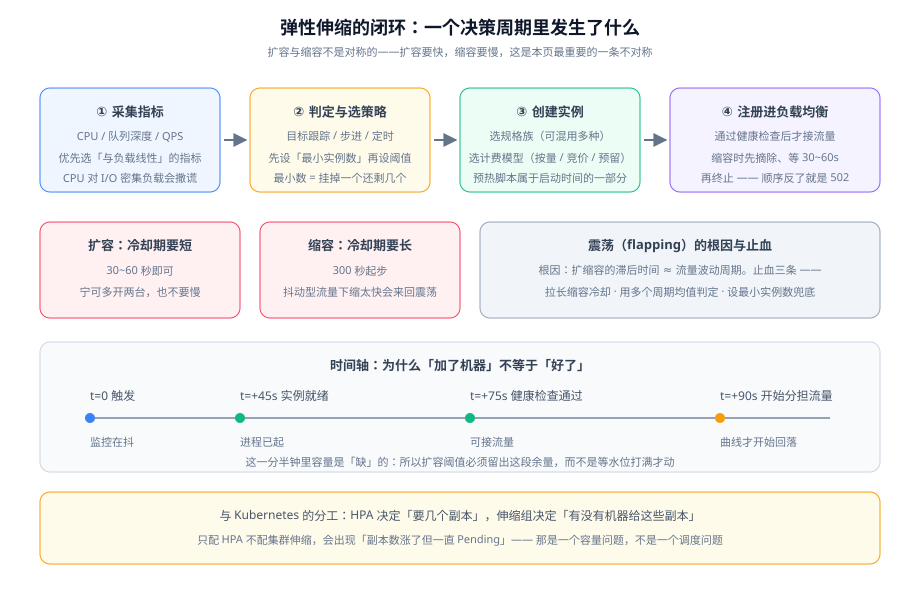

# 弹性伸缩

弹性伸缩是云上唯一一个**在「省钱」和「扛住」之间自动做取舍**的组件。它的价值不在「能加机器」（手动也能加），而在**在你睡觉的时候加对数量**。而它也是云上最容易配成摆设的组件：配了伸缩组但阈值永远不触发，或者触发得太多导致实例反复创建销毁。



::: tip 一句话理解
弹性伸缩的难点不是「怎么扩」，而是**「什么时候不该缩」**。扩错了损失的是钱，缩错了损失的是可用性——所以两者必须用不同的保守程度。
:::

## 先回答两个问题

配伸缩组之前必须回答两个问题，答不上来就先别配：

| 问题 | 答不上来的后果 | 怎么答 |
| --- | --- | --- |
| **扩什么？**（伸缩单位是什么） | 扩了副本但数据库连接数先炸 | 找出「第一个到顶的资源」：是 CPU、连接数、队列深度，还是数据库连接池？ |
| **用什么信号？** | 用 CPU 给 I/O 密集负载做伸缩，永远不触发 | 选**与负载线性相关**的指标；CPU 对「等 I/O」型负载会撒谎 |

::: warning 第一个到顶的资源，通常不是 CPU
一个典型的 Web 服务，在 QPS 上涨时到顶的顺序往往是：**连接池 → 线程池 → 数据库连接数 → 网络带宽 → CPU**。

这意味着：**如果伸缩信号是 CPU，那么在 CPU 打满之前，连接池早就等满了**——用户已经在超时，而伸缩组还没动。
判据：**压测一次，找出第一个到顶的资源，用它（或它的上游指标）作为伸缩信号。**
:::

## 指标选择：四种信号的能力对照

| 信号 | 是否与负载线性 | 到达尖峰的快慢 | 适用 |
| --- | --- | --- | --- |
| CPU 利用率 | **否**（I/O 密集型会低估） | 滞后 | 计算密集型 |
| 网络 / 连接数 | 较线性 | 较快 | 网关、代理类 |
| **队列深度 / 待处理数** | **是**（最诚实） | **最快**（积压先于 CPU） | 几乎所有异步处理型 |
| 业务指标（每秒请求、订单数） | 是 | 快 | 有埋点能力时最优 |
| 定时策略 | — | 提前 | 可预测的峰谷（如每天 9 点） |

**推荐组合：业务指标或队列深度做主信号，CPU 做兜底信号，定时策略做大促这类可预测峰值的预处理。**

## 扩缩容的不对称：这是本页最重要的一条

扩容和缩容**不能对称配置**，因为两者的代价不对称：

| | 扩容 | 缩容 |
| --- | --- | --- |
| 判断错了的代价 | **多花一点钱** | **用户请求失败** |
| 冷却期 | 短（30~60s） | 长（300s 起步） |
| 触发阈值 | 宁早不晚（提前触发） | 宁晚不早（确认趋势后再动） |
| 判定依据 | 单点超阈值即可 | 需要**多个周期均值**连续低于阈值 |
| 最小实例数 | 由「挂掉一个还剩几个」决定 | 同左 |

::: danger 缩容冷却期太短，会造出比不配伸缩更糟的结果
当流量在阈值附近波动时，缩容太快会形成循环：**缩容 → 剩余实例承压 → 指标升高 → 扩容 → 指标下降 → 缩容**。这个循环（flapping）会让：

1. 实例反复创建销毁，**启动开销反而更高**；
2. 用户在某些窗口内体验到容量不足；
3. 监控曲线变成锯齿，**真正的容量问题被噪声掩盖**。

**三条止血措施**：拉长缩容冷却期、用多周期均值而不是瞬时值判定、设一个足够大的最小实例数兜底。
:::

## 最小与最大实例数：两个都是安全阀

| 参数 | 由什么决定 | 常见错误 |
| --- | --- | --- |
| **最小实例数** | **「挂掉一个之后还剩几个能干活」** | 设成 1：任何一次故障都是全站不可用；设成「当前数量」：等于关闭缩容 |
| **最大实例数** | 下游能承受的上限（数据库连接数 / 配额 / 预算） | 设得过大：扩到把数据库连接打满，**扩容反而引发雪崩** |

::: info 最大实例数必须由「下游承载能力」反向推导
一个 10 台应用连一个 `max_connections=200` 的数据库，每实例 20 个连接就已经用完。此时把最大实例数设成 50，伸缩组会在压力下扩到 50 台，**每一台都在抢连接、每一台都拿不到**，后果比不扩容更严重。

正确做法：**先算 `最大实例数 × 每实例连接数 ≤ 数据库上限`，再加一条「连接耗尽」告警作为第二道防线。**
:::

## 启动时间：扩容不是瞬时的

「加了机器就好了」是一个常见误解。从触发到真正分担流量，至少经过四段：

```text
t=0        触发扩容
t=+45s     实例就绪（含镜像拉取、依赖安装、应用启动）
t=+75s     健康检查连续通过（间隔 × 成功阈值）
t=+90s     真正开始分担流量
```

**结论：这一分多钟里容量是「缺」的。** 所以：

1. **扩容阈值必须留出这段余量**——水位打到 80% 才触发，加上 90 秒的滞后，会在扩容完成前就撑爆；
2. **预热要算进启动时间**：如果新实例需要预热（加载缓存、建立连接池、JIT 预热），那么它「就绪」但「不快」——入口应支持慢启动（逐步增加权重）；
3. **缩短启动时间本身就是扩容手段**：把镜像做小、把依赖前置到镜像里，往往比调阈值更有效。

## 与负载均衡的注册顺序

新实例「能干活」不等于「该收流量」，两者之间必须由健康检查把关：

| 阶段 | 正确行为 | 做错的后果 |
| --- | --- | --- |
| 实例创建 | 不注册进后端组，或注册为「未就绪」 | 未启动完成就接流量 → 大量 5xx |
| 健康检查通过 | **自动注册并开始接流量** | 手动注册导致漏掉、或注册了还没好的实例 |
| 缩容触发 | **先摘除，等 `摘除等待` 秒，再终止** | 直接终止 → 在途请求被切断 → 502 |
| 优雅停机 | 先让健康端点失败，等入口摘除 | 见 [负载均衡](../LoadBalancing/index.md) 的四步顺序 |

::: danger 「先摘除再终止」的顺序是硬要求
云上有些平台默认行为是「终止前先摘除」，但**摘除等待时间需要你显式配置**，默认值可能为 0。

判据：**在缩容发生时，入口的 5xx 计数必须没有变化。** 如果每次缩容都伴随一小段错误率抬升，就是这里没配。
:::

## 混合计费：把三类容量分开买

一个伸缩组可以混用多种计费模型，这是省钱与稳兼顾的核心手段：

| 容量类型 | 占比 | 计费模型 | 中断容忍度 |
| --- | --- | --- | --- |
| **稳态基线** | 全天候都要有的部分 | 预留 / 包年包月 | 不可中断 |
| **日常波动** | 白天多、夜里少 | 按量 | 不可中断 |
| **峰值溢出** | 大促、突发 | 竞价 / Spot（可混多种规格族） | 可中断（需回收通知处理） |

::: warning 竞价实例的三条硬约束
1. **必须处理回收通知**（主流云提供数分钟的提前通知，可通过实例元数据或事件总线获取）——不处理就等于随机被杀；
2. **必须消除单点**：不能把「只有一份」的关键组件放在竞价实例上（数据库主库、K8s 控制面、有状态队列都是典型反例）；
3. **必须跨多种规格族分散**，否则同一规格族缺货时会**整批同时被回收**。

判据：**竞价实例被回收时，业务指标（错误率、延迟）应无变化，只有实例数变化。** 做不到这一点，说明还有状态没外置。
:::

## 与 Kubernetes 的分工

这是最容易混淆的一处，边界必须写清：

| 问题 | [容器编排 · 弹性伸缩](../../ContainerOrchestration/Autoscaling/index.md) | 本页 |
| --- | --- | --- |
| 要几个副本 | HPA / VPA / KEDA 决定 | —— |
| 有没有机器给这些副本 | —— | **伸缩组 / 实例池决定** |
| 典型故障 | 副本数涨了但一直 `Pending` | 实例创建失败（配额不足、容量池缺货） |

::: tip 一条诊断判据
**副本数涨了但一直 `Pending` → 那是容量问题，不是调度问题。** 此时去查 HPA 的策略是查错方向；应该去查伸缩组的最大实例数、配额限制与实例创建失败事件。
:::

## 常见错误

| 症状 | 最可能的原因 | 怎么确认 |
| --- | --- | --- |
| 伸缩组从不触发 | 信号选错（I/O 密集用 CPU），或阈值过高 | 回看压测中第一个到顶的资源 |
| 实例反复创建销毁 | 缩容冷却期太短 | 看实例数的锯齿曲线 |
| 扩容后仍超时 | 扩容滞后 > 阈值余量；或下游（数据库）先到顶 | 对比扩容完成时间与错误率回落时间 |
| 每次缩容都有 5xx | 摘除等待为 0，或未先摘除 | 对比缩容时刻与错误率曲线 |
| 竞价实例被回收时服务抖动 | 有状态未外置，或未处理回收通知 | 检查回收事件处理与状态存储位置 |
| 扩容后数据库连接耗尽 | 最大实例数未按下游上限推导 | 算 `最大实例数 × 每实例连接数` |

## 验证方式

| 验证项 | 操作 | 预期 |
| --- | --- | --- |
| 信号选对 | 压测中记录候选指标 | 所选信号在同一窗口内最先越阈值 |
| 扩容及时 | 用压测把负载抬到阈值以上 | 扩容在「阈值余量」内完成并让指标回落 |
| 缩容不抖动 | 让负载在阈值附近持续波动 15 分钟 | 实例数变化次数 ≤ 2 |
| 摘除无错误 | 触发一次缩容，观察入口错误率 | 错误率为 0 |
| 最小数足够 | 手动终止一个实例 | 业务无感知，容量仍满足 |
| 最大数是安全的 | 检查最大实例数与下游承载量的算式 | `最大 × 每实例连接数 ≤ 下游上限` |
| 竞价可中断 | 模拟回收事件（或等待真实回收） | 业务指标无变化，仅实例数变化 |

```shell
# 观察扩缩容是否抖动（连续采样实例数与目标指标）
for i in $(seq 1 30); do
  echo "$(date +%H:%M:%S) instances=$(<查询实例数> ) metric=$(<查询目标指标>)"
  sleep 30
done
# 判读：实例数列在 15 分钟内变化 > 2 次 → 缩容侧需要加长冷却期
```

三条核心判据：

1. **扩容在阈值余量内完成**：压测抬负载后，指标应在实例真正分担流量后回落，而不是继续攀升到超时；
2. **缩容不抖动**：让负载在阈值附近波动 15 分钟，实例数变化次数 ≤ 2；
3. **缩容不产生错误**：每次缩容期间入口错误率保持为 0。

三条全过，容量这一层就算立住。

## 延伸阅读

1. **[可用性拓扑](../Availability/index.md)**：把伸缩与可用区绑定，确认「每个可用区各自能扛全量」。
2. **[成本与规格选型](../Cost/index.md)**：把三类容量拆分折算成账单口径。
3. **[实战：把监控大盘搬上云](../Practice/index.md)**：在具体项目上把伸缩与监控系统自身的告警连起来。


## 与「容量与成本治理」专题的分工（第 156 天补充）

| 问题 | 本页 | [容量与成本治理](../../CapacityCost/index.md) |
| --- | --- | --- |
| 用哪个信号扩、冷却多长、上下限多少 | **本页回答** | 不重复 |
| 扩出来的钱记在谁头上 | 不回答 | **那边回答**：分摊与预算 |
| 缩容之后承诺还扣不扣钱 | 不回答 | **那边回答**：承诺只覆盖底座，缩容不减少已购承诺 |
| 承诺与弹性怎么共存 | 给机制 | **那边回答**：底座/弹性层/峰值层三层划分 |

**一句话结论**：本页决定「扩缩容怎么发生」，那边决定「扩缩容的成本由谁承担、要不要为它提前买折扣」。

**这一页特有的坑**：**缩容不等于降本**。如果底层买的是 1 年期承诺，夜间把副本缩到 1 只是让承诺闲置，账单一分不少——真正的降本要么减少承诺覆盖的基线，要么减少节点池本身的容量。

## 参考资料

- [容器编排 · 弹性伸缩](../../ContainerOrchestration/Autoscaling/index.md)：HPA / VPA / KEDA 与集群伸缩
- [负载均衡](../LoadBalancing/index.md)：健康检查与摘除等待
- [成本与规格选型](../Cost/index.md)：计费模型组合与单位成本
- AWS EC2 Auto Scaling 用户指南（含混合实例策略与容量再平衡）：https://docs.aws.amazon.com/autoscaling/ec2/userguide/what-is-amazon-ec2-auto-scaling.html
- AWS Spot 实例中断通知与最佳实践：https://docs.aws.amazon.com/AWSEC2/latest/UserGuide/spot-instance-termination-notices.html
- 阿里云弹性伸缩（ESS）产品文档：https://help.aliyun.com/zh/auto-scaling/

## 与性能与容量工程的分工

本页讲**用哪个信号扩缩容、怎么配阈值与冷却期**——它回答「机器已经在跑，之后怎么自己加」；[性能与容量工程 · 容量规划](../../PerformanceEngineering/Capacity/index.md) 讲**先算清需要几个副本，再谈扩容**——它回答「峰值来之前，底座该有多大」。**HPA 触发 ≠ 容量规划**：HPA 只是在既有的最小 / 最大副本区间里做反应，区间定错了，扩容与缩容都会错。

| 本页讲什么 | 对方讲什么 | 遇到什么问题时该去哪边 |
| --- | --- | --- |
| 信号选型（队列深度 / CPU / 业务指标）、阈值、冷却期、混合计费 | 峰均比、水位线、需要几个副本、单位成本 | 「伸缩组该怎么配、为什么从不触发」→ 本页 |
| 扩缩容的**不对称**：扩错了损失钱，缩错了损失可用性 | SLO 与错误预算决定「最小副本数至少要留多少」 | 「最小 / 最大副本数该定几台」→ [容量规划](../../PerformanceEngineering/Capacity/index.md) |
| 反应式：指标越过阈值后才动作 | 预测式：按峰值与冗余提前备好底座 | 「大促前要压到多少台」→ [SLO 与冗余](../../PerformanceEngineering/SLO/index.md) |

一条必须写死的边界：**缩容不对称**——容量规划给出的是「常态需要几个」，本页负责「怎么退出多余的那个」，且退出永远要更保守。配置的写法回本页，副本数与水位线的算法去 [性能与容量工程 · 容量规划](../../PerformanceEngineering/Capacity/index.md)。
