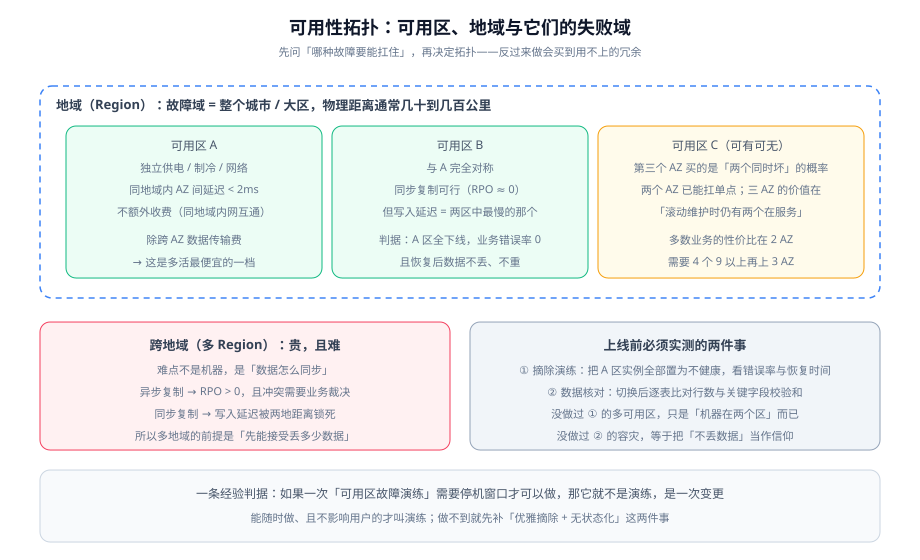

# 可用性拓扑

可用性设计的本质是**把「会一起坏的东西」分开**。云上提供了两级现成的失败域（可用区、地域），但**买了两级失败域不等于获得了可用性**——决定可用性的永远是「数据怎么同步」和「切换谁来决策」这两件事。



::: tip 一句话理解
多可用区买的是**「一个机房的电断了，服务还在」**，它不解决应用自身的死锁、下游的雪崩、配置的错误发布。所以先问「这次要挡哪种故障」，再花钱。
:::

## 失败域的层级：从进程到地域

| 层 | 失败域 | 云上如何应对 | 应用侧需要做什么 |
| --- | --- | --- | --- |
| 进程 | 单进程崩溃 | 进程守护 / 容器重启 | **无状态化**（否则重启丢状态） |
| 实例 | 单机故障 | 多实例 + 健康检查摘除 | 优雅停机、探针正确 |
| **可用区** | 供电 / 制冷 / 网络 | **多可用区部署 + 跨可用区入口** | 会话外置、本地缓存可重建 |
| 地域 | 城市级灾害 | 多地域 + 数据复制 | 冲突裁决、流量调度 |
| 依赖 | 下游服务故障 | 熔断、重试、降级 | 超时预算、幂等 |
| 人为 | 错误发布 | 灰度、金丝雀、可回滚 | 回滚包与演练 |

::: warning 上表中「依赖」与「人为」两行，是云上大多数真实故障的家
多可用区挡不住这两行。所以**先做能挡住的**：无状态化、优雅停机、超时重试降级、可回滚发布。这四件做完，架构上再有多少可用区才有意义。

顺序错了的典型症状：**备案写着「三可用区高可用」，实际在因为一次配置发布错误而全站不可用。**
:::

## 2 AZ 还是 3 AZ：一张取舍表

| | 2 可用区 | 3 可用区 |
| --- | --- | --- |
| 能否扛单区故障 | **能** | 能 |
| 能否在维护时仍保持两个在线 | 不能（剩一个，容量减半） | **能** |
| 跨区流量成本 | 较低 | 较高（三向流量） |
| 数据复制 | 同步复制可行（延迟可控） | 同步复制可行，但写入延迟取三者最慢 |
| 容量冗余 | 各 50%（或主动/被动） | 各 33% |
| 适合 | 绝大多数业务 | 需要 4 个 9 以上，或规则要求「维护不降级」 |

::: info 一条务实的判断
**两个可用区已经能扛住单区故障**，这是绝大多数业务的性价比最优点。第三个可用区的价值主要体现在「滚动维护时仍有两个在服务」以及「两个同时坏」的极小概率场景。

判据：**如果你从没做过一次可用区级演练，那么无论几个可用区都是一样的——都是纸面的。** 先做演练，再评估要不要加第三个。
:::

## 有状态数据：多可用区真正的难点

无状态服务只要「多起几份、分散在不同可用区」就基本完成。真正决定 RPO/RTO 的是**数据层怎么跨可用区**：

| 复制方式 | RPO | 写入延迟 | 适用 |
| --- | --- | --- | --- |
| **同步复制** | ≈ 0 | 取决于两区之间往返延迟（同地域通常可接受） | 交易、账务类；能接受写入变慢 |
| **半同步** | 极小（丢最后一批） | 略低 | 大多数业务数据库的推荐档 |
| **异步复制** | > 0（取决于复制延迟） | 最低 | 对写入延迟敏感、能接受少量数据丢失 |

::: danger 「同步复制」不等于「不丢数据」的三种例外
1. **写入延迟被最慢的那个可用区锁死**——如果 B 区在抖，你的写入会一起变慢（表现是「A 区好好的，但全都在超时」）；
2. **多数派问题**：如果集群需要多数派才能写入，当可用区数量为偶数且网络分区时，可能两边都无法形成多数派；
3. **应用层缓存与消息队列不在复制范围内**：数据库同步了，缓存没有——**切换后缓存是冷的**，会造成「切换成功但数据库被打穿」。

第 3 条最容易被忽略。**切换方案必须包含「缓存预热」这一步**，否则容灾切换会引发一次雪崩。
:::

## 跨地域：两种复制与它们的冲突裁决

跨地域（多 Region）的成本与复杂度都上升一个量级，原因是**数据同步不能再用同步复制**（两地往返延迟会直接加到每次写入上）。

| 方式 | 典型 RPO | 流量调度 | 必须解决的问题 |
| --- | --- | --- | --- |
| **主动 / 被动**（一地服务，另一地热备） | 分钟级（异步复制） | 故障时**手工或自动切 DNS** | 切换决策谁来做、切回来怎么做 |
| **主动 / 主动**（两地同时服务） | 取决于冲突处理 | 就近接入 | **写冲突**：同一账号在两地同时改，谁赢？ |

::: warning 主动/主动的成本不在机器，在「冲突语义」
一旦两地都能写，就必须为每类数据定义冲突裁决：**时间戳后写覆盖会丢数据、版本号会比较复杂、业务级规则（如库存不能为负）需要显式实现**。

如果业务说不出「同一笔数据在两地同时被修改时谁赢」，那就**不要做主动/主动**。用主动/被动，并把切换做得足够快、足够可演练，是更务实的选择。
:::

## 演练设计：唯一能证明可用性的手段

多可用区与容灾的价值**只能通过演练被证明**。演练设计的三条硬要求：

| 要求 | 为什么 | 具体做法 |
| --- | --- | --- |
| **不需要停机窗口** | 需要停机的「演练」其实是变更，会因此永远不做 | 只在多后端、容量有余量的情况下做；先在小流量入口上做 |
| **有明确的通过判据** | 否则「好像还行」就是结论 | 判据：错误率 0、P99 不超过基线 × 1.5、数据核对一致 |
| **监控系统本身不受影响** | 监控一起挂了，就看不到到底发生了什么 | 监控与告警的数据面要能独立于被演练的路径 |

```shell
# 可用区级演练：把 A 区后端全部摘除，持续观测入口
# ① 记录基线
curl -s -o /dev/null -w 'baseline %{http_code} %{time_total}\n' https://<域名>/api/health

# ② 持续压测（另开终端）
for i in $(seq 1 120); do
  curl -s -o /dev/null -w '%{http_code} %{time_total}\n' https://<域名>/api/list
  sleep 1
done

# ③ 期间把 A 区后端置为不健康 / 停掉 A 区实例
# ④ 判读 ② 的输出
#    期望：非 2xx 计数为 0；time_total 最大值 ≤ 基线 × 1.5
grep -vc '^2' <(输出的状态码列)   # 期望 0
```

::: tip 演练之后必须做的一件事
把「**这次故障是怎么被发现的**」写下来。如果是监控发现的，说明告警有效；如果是用户反馈的，**先补那条监控**，再谈其他。

云上很多故障都有「先兆指标」（健康检查失败率、后端连接数、跨区延迟），它们比结果指标更早出现、也更便宜——**把它们补进监控，是每次演练最值钱的产出。**
:::

## 优雅摘除与无状态化：两个前置条件

没有这两个前置条件，多可用区就只是「机器在两个地方」：

| 前置条件 | 含义 | 判据 |
| --- | --- | --- |
| **无状态化** | 单实例随时可以被销毁而不丢用户状态 | 随机杀掉任意实例，用户无感 |
| **优雅摘除** | 实例退出现役时有序完成在途请求 | 缩容与演练期间入口 5xx 为 0 |
| 会话外置 | 会话不放本地内存 | 切换后可继续会话 |
| 本地缓存可重建 | 不在本地缓存「不可再生」的数据 | 冷启动后功能正常，只是慢一点 |

## 常见错误

| 症状 | 最可能的原因 | 怎么确认 |
| --- | --- | --- |
| 单区故障时全站不可用 | 入口未开跨可用区，或后端只在一个区 | 做一次单区摘除演练 |
| 切换成功但数据库被打穿 | 切换后缓存为空，流量全打到数据库 | 对比切换前后数据库 QPS |
| 写入整体变慢 | 同步复制被最慢的可用区拖住 | 对比两区之间的复制延迟 |
| 演练做不了 | 需要停机窗口 | 说明容量没有余量、或后端只有一份 |
| 切回后数据不一致 | 回切没有核对，或双向复制产生了冲突 | 逐表比对行数与校验和 |
| 监控在演练中一起失联 | 监控的数据面与被演练路径耦合 | 检查监控是否跨可用区独立部署 |

## 验证方式

| 验证项 | 操作 | 预期 |
| --- | --- | --- |
| 无状态化 | 随机终止任意应用实例 | 用户无感 |
| 优雅摘除 | 触发一次缩容 | 入口 5xx 为 0 |
| **单区摘除** | 停掉一个可用区的全部后端，持续压测 | 错误率 0、P99 ≤ 基线 × 1.5 |
| 数据一致性 | 演练后逐表比对行数与校验和 | 一致 |
| 缓存预热 | 切换后观察数据库 QPS | 无显著尖峰（有预热） |
| 回切可行 | 按文档执行一次回切 | 可执行且有判据 |
| 监控独立 | 演练期间查看监控与告警 | 正常工作并发出告警 |

::: warning 判据不是实测记录
本表是**判据**。在你自己环境里执行后，把真实输出记入实测列；没有条件验证的写清原因，不要抄期望值。
:::

核心只有一条判据：**你能不能在不通知用户的情况下，随时做一次可用区级演练，并且做完成功率为 0？**

做到这一点，多可用区才算成立。做不到就先去补 [负载均衡](../LoadBalancing/index.md) 的摘除等待与本文的无状态化，再回来做数据层。

## 延伸阅读

1. **[云上安全边界](../Security/index.md)**：可用区与账号边界的交叉——哪些资源不该跨边界共享。
2. **[成本与规格选型](../Cost/index.md)**：跨区流量与双份容量在账单上的样子。
3. **[实战：把监控大盘搬上云](../Practice/index.md)**：把可用区演练用到具体项目上，并验证「演练时告警仍能发出」。

## 与「多活与单元化」的分工（第 163 天补充）

本页讨论的是**失败域**：进程、机器、AZ、地域，四级失败域各自能兜住什么，以及 2 AZ 与 3 AZ 的取舍。它回答「故障的边界在哪」；**它不回答「故障发生时业务怎么继续」**——那需要在失败域之上再叠一层「数据与流量的落点」：

| 本页的结论 | 它推不出的下一步 | 去哪 |
| --- | --- | --- |
| 失败域四级与「跨地域两种复制」 | 一个用户的写能不能只落一处（单元化模型） | [单元化模型](../../MultiActive/CellModel/index.md) |
| 「有状态数据是多可用区真正的难点」 | 双向复制的回环抑制与序列撞号 | [数据同步](../../MultiActive/DataSync/index.md) |
| 「跨地域两种复制与冲突裁决」（第 63 行起） | 裁决之后「收敛 ≠ 正确」的实测与对账三层 | [冲突裁决](../../MultiActive/Conflict/index.md) |
| 「演练设计是唯一能证明可用性的手段」 | 五级演练与「假通过」的五种形态 | [演练](../../MultiActive/Drill/index.md) |

::: tip 两个概念的咬合点
**AZ 是基础设施给的失败域，单元是人划的业务边界。** 理想状态下二者对齐（一个单元落在一个 AZ 内），但不对齐也能工作——代价是「AZ 故障」会同时打掉多个单元的一部分。判断方法：把单元与 AZ 的映射画成矩阵，看任一 AZ 挂掉会波及几个单元，这个数就是你的影响面放大系数。
:::

## 参考资料

- [备份与容灾 · 容灾架构](../../BackupDR/DisasterRecovery/index.md)：冷/温/热备与多活的档位定义与 RTO/RPO 口径
- [备份与容灾 · 恢复演练](../../BackupDR/Recovery/index.md)：恢复流程与演练方法
- [混沌工程](../../ChaosEngineering/index.md)：稳态假设与故障注入的实验设计
- AWS Well-Architected · Reliability Pillar：https://docs.aws.amazon.com/wellarchitected/latest/reliability-pillar/welcome.html
- AWS 多可用区与多区域架构最佳实践：https://docs.aws.amazon.com/whitepapers/latest/aws-fault-isolation-boundaries/regions-and-availability-zones.html
- Google Cloud 灾难恢复规划指南：https://cloud.google.com/architecture/dr-scenarios-planning-guide
